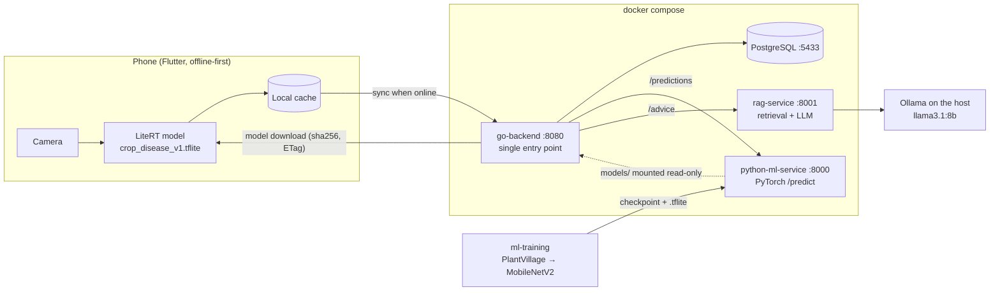

# AI Crop Disease Platform

An **offline-first** crop disease assistant. A phone photographs a leaf and diagnoses it
**on the device** with a LiteRT (TensorFlow Lite) model, so diagnosis works with no network. When a
connection is available, a backend adds:

- syncing diagnoses
- model updates
- a server-side second opinion
- cited treatment advice from a local LLM

This repo backs the talk **"Beyond the API Call: On-Device AI in Flutter with LiteRT and
Offline-First Architecture"** ([`docs/PRESENTATION_PLAN.md`](docs/PRESENTATION_PLAN.md)). The demo
crop is **potato**, with three classes: early blight, late blight and healthy.

## Contents

- [AI Crop Disease Platform](#ai-crop-disease-platform)
  - [Contents](#contents)
  - [Architecture](#architecture)
  - [Repository map](#repository-map)
  - [Prerequisites](#prerequisites)
  - [Quick start (Docker, everything)](#quick-start-docker-everything)
  - [Step by step from a fresh clone](#step-by-step-from-a-fresh-clone)
    - [1. Train the model (`ml-training/`)](#1-train-the-model-ml-training)
    - [2. Hand the model to the ML service and export for mobile](#2-hand-the-model-to-the-ml-service-and-export-for-mobile)
    - [3. Start Ollama](#3-start-ollama)
    - [4. Run the stack](#4-run-the-stack)
  - [Try the API](#try-the-api)
  - [Run the app end to end on an emulator](#run-the-app-end-to-end-on-an-emulator)
  - [Use from a phone](#use-from-a-phone)
  - [Running services without Docker](#running-services-without-docker)
  - [Tests](#tests)
  - [Benchmarks and results](#benchmarks-and-results)
  - [Ports and configuration](#ports-and-configuration)
  - [Troubleshooting](#troubleshooting)
  - [Documentation index](#documentation-index)
  - [Status](#status)

## Architecture



Key rules:
- **Diagnosis never needs the network.** The backend is an add-on.
- The app talks **only to go-backend**, which proxies to the Python services.
- One model version, one label list and one confidence threshold are shared by the phone, the
  ML service and the backend (all from `crop_disease_v1.json`).
- Below the threshold the answer is `"uncertain"`, so the app asks for a better photo instead of guessing.

## Repository map

| Folder | Phase | What it is | Stack | Details |
|---|---|---|---|---|
| [`ml-training/`](ml-training/README.md) | 1 | Data pipeline, MobileNetV2 transfer learning, evaluation, threshold, preprocessing-mismatch and field-photo experiments | Python, PyTorch, uv | [README](ml-training/README.md) |
| [`python-ml-service/`](python-ml-service/README.md) | 2 | FastAPI inference service + TFLite export for mobile | FastAPI, PyTorch, LiteRT | [README](python-ml-service/README.md) |
| [`rag-service/`](rag-service/README.md) | 3 | Cited treatment advice from curated notes | FastAPI, ChromaDB, Ollama | [README](rag-service/README.md) |
| [`go-backend/`](go-backend/README.md) | 4 | Gateway: diagnosis sync, history, model releases, prediction/advice proxies | Go, chi, PostgreSQL (DDD layers) | [README](go-backend/README.md) |
| [`mobile-app/`](mobile-app/README.md) | 6 | LeafCheck Flutter app: UI for every screen on mock data behind real ports; LiteRT (`flutter_litert`) + Hive next | Flutter 3.41, Riverpod, go_router | [README](mobile-app/README.md) |
| [`benchmarks/`](benchmarks/results.md) | – | On-device vs backend latency, model size, RAG latency | Python script | [results](benchmarks/results.md) |
| [`docs/`](docs/) | – | Phase guides, API contract, presentation plan | Markdown + Mermaid | [index](#documentation-index) |
| `docker-compose.yml` | – | Runs postgres, ml-service, rag-service, go-backend together | Docker Compose | below |

## Prerequisites

Install these on macOS (Linux works the same; use your package manager).

| Tool | Why | Install | Check |
|---|---|---|---|
| Docker Desktop | runs every service | [docker.com](https://www.docker.com/products/docker-desktop/) | `docker compose version` |
| uv | Python ≥ 3.11 projects (training, services, benchmarks) | `brew install uv` | `uv --version` |
| Ollama | local LLM for advice; runs on the host so it can use the Mac GPU | [ollama.com](https://ollama.com) or `brew install ollama` | `ollama list` |
| Go 1.26+ | only to run or test go-backend outside Docker | `brew install go` | `go version` |
| Kaggle account | downloads the PlantVillage dataset (~690 MB) | [kaggle.com](https://www.kaggle.com) | `uv run kaggle auth login` |

Disk: about 10 GB in total (dataset 0.7 GB, `llama3.1:8b` 4.9 GB, Docker images, PyTorch).

## Quick start (Docker, everything)

Use this if you **already have** the model files in `python-ml-service/models/`. They are
gitignored, so a fresh clone does not: follow [Step by step](#step-by-step-from-a-fresh-clone) first.

```bash
ollama pull llama3.1:8b                 # once; keep the Ollama app running
docker compose up -d --build --wait     # postgres, ml-service, rag-service, go-backend
curl localhost:8080/ready
# {"database":true,"ml_service":true,"rag_service":true,"status":"ready"}
```

Stop with `docker compose down`. Add `-v` to also delete the database and vector index volumes.

## Step by step from a fresh clone

### 1. Train the model (`ml-training/`)

```bash
cd ml-training
uv sync
uv run pytest                                   # 20 tests, no dataset needed

uv run kaggle auth login                        # opens a browser
uv run kaggle datasets download -d emmarex/plantdisease -p data/ --unzip

# Potato-only subset (3 classes) used in the talk
mkdir -p data/potato
for c in Potato___Early_blight Potato___Late_blight Potato___healthy; do
  ln -sfn "$PWD/data/PlantVillage/$c" "data/potato/$c"
done
uv run python -m crop_ml.train --data-dir data/potato     # ~40 s on Apple silicon
uv run python -m crop_ml.evaluate                          # confusion matrix, eval_summary.json
uv run python -m crop_ml.mismatch                          # accuracy under preprocessing bugs (optional)
```

Output: `outputs/checkpoints/mobilenetv2_v1_best.pt` and `class_names.json`.
Optional: `uv run python -m crop_ml.field_eval` measures field-photo accuracy on PlantDoc potato
images (put them in `data/plantdoc/{train,test}/<class>/`; see the docstring in `src/crop_ml/field_eval.py`).

### 2. Hand the model to the ML service and export for mobile

```bash
cp outputs/checkpoints/{mobilenetv2_v1_best.pt,class_names.json} ../python-ml-service/models/
cd ../python-ml-service
uv sync
uv run scripts/export_tflite.py     # -> models/crop_disease_v1.tflite + crop_disease_v1.json
```

`crop_disease_v1.json` holds `model_version`, `input_shape`, `class_names` and
`confidence_threshold`. On startup go-backend publishes every `crop_disease_<v>.tflite` + `.json`
pair it finds in this folder, so the phone can download the model.

### 3. Start Ollama

```bash
ollama pull llama3.1:8b       # ~4.9 GB, once
ollama list                   # the tag must match LLM_MODEL (default llama3.1:8b)
```

Keep the Ollama app (or `ollama serve`) running. The RAG container reaches it at
`host.docker.internal:11434`.

### 4. Run the stack

```bash
cd ..                                   # repo root
docker compose up -d --build --wait
docker compose ps                       # all four (healthy)
docker compose logs go-backend | grep "model release published"
```

The RAG index is built automatically on first start and kept in the `rag-index` volume.

## Try the API

All `/api/v1/*` calls go through **go-backend** and need `X-API-Key: dev-key` (compose default,
local only). The full contract with real responses is in
[`docs/API_CONTRACT.md`](docs/API_CONTRACT.md).

```bash
B=http://localhost:8080; K='X-API-Key: dev-key'

# Which services are up?
curl -s $B/ready

# Current model for the phone (ETag = sha256; resend it as If-None-Match to get 304)
curl -s -H "$K" $B/api/v1/model-releases/latest

# Download it and verify the checksum
curl -s -H "$K" -o /tmp/model.tflite $B/api/v1/model-releases/v1/artifact
shasum -a 256 /tmp/model.tflite         # must equal "sha256" above

# Server-side diagnosis (online fallback)
IMG=$(find ml-training/data/PlantVillage/Potato___Late_blight -iname '*.jpg' | head -1)
curl -s -H "$K" -F "file=@$IMG;type=image/jpeg" $B/api/v1/predictions
# {"status":"ok","prediction":{"class_name":"Potato___Late_blight",...,"confidence":0.765},...}

# Advice with citations (a few seconds; slower on the first call)
curl -s -H "$K" -H 'Content-Type: application/json' \
  -d '{"question":"How do I manage late blight?","class_name":"Potato___Late_blight"}' \
  $B/api/v1/advice

# Record a diagnosis made on the phone. Send it twice: 201, then 200 (idempotent)
curl -s -H "$K" -H 'Content-Type: application/json' $B/api/v1/diagnoses -d '{
  "id":"0b8a1c2d-3e4f-4a5b-8c6d-7e8f9a0b1c2d","device_id":"demo-phone",
  "class_label":"Potato___Late_blight","confidence":0.93,"confidence_threshold":0.5,
  "model_version":"v1","captured_at":"2026-10-29T20:00:00Z"}'

# Bulk sync after reconnecting (≤ 500 items) and history
curl -s -H "$K" -H 'Content-Type: application/json' "$B/api/v1/diagnoses:sync" -d '{"items":[ ... ]}'
curl -s -H "$K" "$B/api/v1/devices/demo-phone/diagnoses?limit=20"
```

Errors always have the same shape on every service:
`{"error": "advice_unavailable", "detail": "...", "request_id": "..."}`. Send `X-Request-ID` to trace one
call across services.

## Run the app end to end on an emulator

1. Start Ollama (`ollama serve`; `ollama list` shows `llama3.1:8b`) and the stack:
   `docker compose up -d --build --wait`, then check `curl localhost:8080/ready` →
   `"ml_service": true, "rag_service": true`.
2. Start an Android emulator (`flutter emulators --launch <id>`).
3. Run the app with the real adapters:
   ```bash
   cd mobile-app && flutter pub get && flutter run -d emulator-5554
   ```
   The emulator reaches the laptop at `http://10.0.2.2:8080` (the default `SERVER_URL`).
4. Try it: Scan a leaf → **Use a sample photo** → result in milliseconds on the phone → **Ask the
   server for a second opinion** → **Get advice** (cited answer; the first call warms the LLM) →
   History shows **Synced** within ~10 s. Turn on airplane mode in the emulator, scan again: the
   result still appears and waits as **Pending** until the network is back.

Without `SCENARIO` the app uses the real adapters; `--dart-define=SCENARIO=offline` (etc.) runs it on
mock data with no backend. Details: [`mobile-app/README.md`](mobile-app/README.md).

## Use from a phone

| Where the app runs | Base URL |
|---|---|
| Android emulator | `http://10.0.2.2:8080` |
| iOS simulator | `http://localhost:8080` |
| Real phone on the same Wi-Fi | `http://<laptop IP>:8080`; find it with `ipconfig getifaddr en0` |

- On a real phone, allow incoming connections in the macOS firewall (System Settings →
  Network → Firewall).
- Phones block plain HTTP by default:
  - **Android:** `android:usesCleartextTraffic="true"`, or a network security config for the laptop IP.
  - **iOS:** an ATS exception (`NSAllowsLocalNetworking`).

  This is for the local demo only; use HTTPS anywhere else.
- Before using the network, probe `GET /ready` with a 2 s timeout: `connectivity_plus` only says
  that an interface is up.

## Running services without Docker

Useful while developing one service. Each README has the details.

| Service | Commands (from its folder) |
|---|---|
| python-ml-service | `uv run uvicorn app.main:app --reload --port 8000` |
| rag-service | `uv run python -m scripts.ingest` once, then `uv run uvicorn app.main:app --reload --port 8001` |
| go-backend | `make db-up` (PostgreSQL in Docker on 5433), then `MODELS_DIR=../python-ml-service/models ADMIN_API_KEYS=dev-admin-key make run` (ML/RAG URLs default to localhost:8000/8001) |

## Tests

| Where | Command | Needs |
|---|---|---|
| `ml-training/` | `uv run pytest` | nothing (synthetic data) |
| `python-ml-service/` | `uv run pytest` | nothing |
| `rag-service/` | `uv run pytest` | nothing (Ollama is faked) |
| `go-backend/` | `make lint && make test` | nothing |
| `go-backend/` | `make db-up && make test-integration` | Docker; uses a separate `crop_test` database because the tests TRUNCATE tables |
| `rag-service/` | RAGAS evaluation, see its README | Ollama |

## Benchmarks and results

```bash
uv run benchmarks/bench.py --image path/to/leaf.JPG    # services running for the D3/D4 parts
```

Writes [`benchmarks/results.md`](benchmarks/results.md). Measured on the development MacBook (2026-10-29):

| Measure | Result |
|---|---|
| Model size | `.pt` 9.2 MB, `.tflite` 9.0 MB |
| On-device inference (LiteRT, laptop CPU) | p50 **1.9 ms** |
| Backend `/predict`, server time | p50 18 ms; a 3 MB photo over 3G is about **34 s** in total (modelled upload) |
| RAG answer (local Ollama) | warm p50 **3.5 s** |
| Accuracy, PlantVillage lab photos | **95.8%** (macro F1 0.945, threshold 0.50) |
| Accuracy, PlantDoc field photos | **54.8%** on 221 potato field photos |

The gap between lab and field accuracy is the main limitation. Lab-trained models need real field
data before anyone relies on them.

## Ports and configuration

| Service | Host port | Notes |
|---|---|---|
| go-backend | 8080 | `API_KEYS=dev-key`, `ADMIN_API_KEYS=dev-admin-key` (local only) |
| python-ml-service | 8000 | mounts `python-ml-service/models` read-only |
| rag-service | 8001 | `OLLAMA_BASE_URL=http://host.docker.internal:11434`, `LLM_MODEL=llama3.1:8b` |
| PostgreSQL | 5433 | user/password/db `crop`; 5433 avoids clashing with a local PostgreSQL on 5432 |
| Ollama | 11434 | runs on the host, not in Docker |

Every service reads environment variables. See each `.env.example` and README for the full list.
**Change all keys and passwords before exposing anything beyond your laptop.**

## Troubleshooting

| Symptom | Fix |
|---|---|
| `/ready` shows `ml_service:false` | `python-ml-service/models/` is missing the checkpoint: do steps 1–2 |
| `/ready` shows `rag_service:false`, `/advice` → 503 `advice_unavailable` | Start Ollama; the tag in `ollama list` must match `llama3.1:8b` |
| `/model-releases/latest` → 404 `no_release` | No `crop_disease_v1.tflite` + `.json` in `python-ml-service/models/`; run `export_tflite.py`, then `docker compose restart go-backend` |
| Artifact → 409 `artifact_checksum_mismatch` | The `.tflite` was replaced after publishing: export under a new version (e.g. `v2`) instead of overwriting |
| `POST /diagnoses` → 422 for `captured_at` | Timestamps more than 24 h in the future are rejected; send UTC (`...Z`) |
| A field photo comes back `"uncertain"` | Expected: the model was trained on lab photos. Use PlantVillage-style leaves for the demo |
| Port 5432/8080 already in use | Stop the other process, or change the left side of `ports:` in `docker-compose.yml` |
| First advice call takes much longer | Ollama is loading the model into memory; later calls are faster |

## Documentation index

| Document | Content |
|---|---|
| [`docs/ai_ml_roadmap_2026.md`](docs/ai_ml_roadmap_2026.md) | The overall learning roadmap |
| [`docs/PHASE_0_PYTHON_FLUENCY.md`](docs/PHASE_0_PYTHON_FLUENCY.md) | Python refresher |
| [`docs/HOW_IT_WORKS.md`](docs/HOW_IT_WORKS.md) | **Start here:** beginner's guide with diagrams (MobileNetV2, the 50% threshold, Ollama/RAG, sync) |
| [`docs/PHASE_1_ML_THEORY_AND_DATA.md`](docs/PHASE_1_ML_THEORY_AND_DATA.md) | ML theory, data, training (`ml-training/`) |
| [`docs/PHASE_2_PYTHON_ML_SERVICE.md`](docs/PHASE_2_PYTHON_ML_SERVICE.md) | Inference service (`python-ml-service/`) |
| [`docs/PHASE_3_RAG_PIPELINE.md`](docs/PHASE_3_RAG_PIPELINE.md) | RAG pipeline (`rag-service/`) |
| [`docs/PHASE_4_GO_BACKEND_GATEWAY.md`](docs/PHASE_4_GO_BACKEND_GATEWAY.md) | Go gateway guide (the code in `go-backend/` is the source of truth) |
| [`docs/PHASE_5_PRODUCTION_CICD.md`](docs/PHASE_5_PRODUCTION_CICD.md) | Production and CI/CD (planned) |
| [`docs/PHASE_6_FLUTTER_MOBILE.md`](docs/PHASE_6_FLUTTER_MOBILE.md) | Flutter app (planned) |
| [`docs/PHASE_7_ANDROID_KMP.md`](docs/PHASE_7_ANDROID_KMP.md) | Android / KMP (planned) |
| [`docs/API_CONTRACT.md`](docs/API_CONTRACT.md) | What the mobile app can rely on, with real responses |
| [`docs/PRESENTATION_PLAN.md`](docs/PRESENTATION_PLAN.md) | Talk plan, demo script, results |
| [`docs/PRESENTATION_SLIDES.md`](docs/PRESENTATION_SLIDES.md) | Slide-by-slide outline; deck in [`docs/presentation/`](docs/presentation/) |
| [`docs/PRESENTATION_SPEAKER_GUIDE.md`](docs/PRESENTATION_SPEAKER_GUIDE.md) | How to present each slide, demo runbook, Q&A bank, resources |
| [`mobile-app/`](mobile-app/README.md) | Flutter app: architecture, PRD, roadmap, UI implementation |
| [`go-backend/docs/`](go-backend/docs/) | PRD, roadmap, progress for the Go backend; [`AGENTS.md`](go-backend/AGENTS.md) for contributors |

`docs/sync_code_blocks.py` keeps code snippets in the phase docs in sync with the real source files.

## Status

| Part | State |
|---|---|
| Phase 1 training, potato v1 | ✅ done |
| Phase 2 ML service + TFLite export | ✅ done |
| Phase 3 RAG service | ✅ done |
| Phase 4 go-backend M0–M3 (sync, history, model releases, gateway) | ✅ done |
| Benchmarks | ✅ done |
| go-backend M4 hardening (rate limits, metrics, OpenAPI), CI | ⏳ after the talk |
| Flutter app (Phase 6): all screens, goldens, mock scenarios | ✅ done |
| Flutter app end to end: on-device LiteRT, Hive, sync, advice, second opinion, model updates | ✅ done |
| Talk deck + speaker guide | ✅ done |
