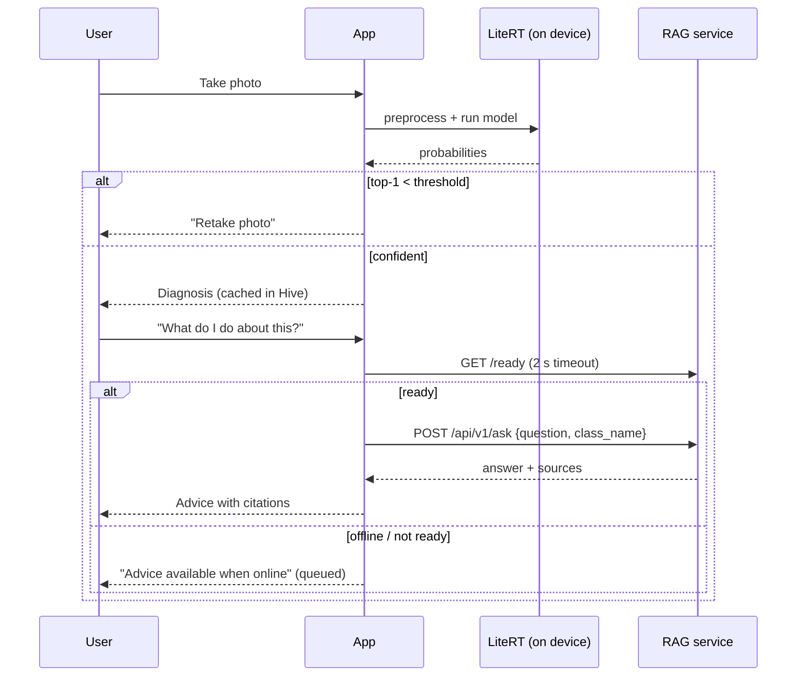

# API Contract: Flutter client ↔ backend

The contract the mobile app relies on. Every example below is a **real response** captured
from the running services (potato model `v1`, 2026-10-29); long lists are shortened.

| Service | Base URL (local) | Used for |
|---|---|---|
| ML service (`python-ml-service/`) | `http://localhost:8000` | Optional server-side diagnosis, model info |
| RAG service (`rag-service/`) | `http://localhost:8001` | "What do I do about this?" answers with sources |

## Client rules

1. **Diagnosis runs on the phone first.** The LiteRT model and these endpoints share one model
   version, one label list and one confidence threshold (from `crop_disease_v1.json`).
2. **Check `status` before showing a diagnosis.** `"uncertain"` means: ask for a clearer photo.
3. **Probe before switching to the network.** `connectivity_plus` only reports that an interface is
   up, so call `GET /ready` with a short timeout (e.g. 2 s) before relying on a backend.
4. **The RAG call is optional and slow** (seconds). Show the on-device result immediately and
   load advice afterwards; never block the diagnosis on it.
5. **Send `X-Request-ID`** (any unique string). It is echoed back and logged, so one ID traces a
   request across services.
6. **All errors share one shape**, so one parser handles every failure.



## ML service

### `GET /ready`
`200` when the model is loaded, else `503` (same body shape).
```json
{"status": "ready", "model_loaded": true, "model_version": "v1"}
```

### `POST /api/v1/predict?top_k=3`
Multipart field `file`: JPEG, PNG or WebP, at most 5 MB.
```json
{
  "status": "ok",
  "prediction": {"class_name": "Potato___Late_blight", "plant": "Potato", "condition": "Late blight", "confidence": 0.9967},
  "top_k": [
    {"class_name": "Potato___Late_blight", "plant": "Potato", "condition": "Late blight", "confidence": 0.9967},
    {"class_name": "Potato___Early_blight", "plant": "Potato", "condition": "Early blight", "confidence": 0.002},
    {"class_name": "Potato___healthy", "plant": "Potato", "condition": "healthy", "confidence": 0.0014}
  ],
  "is_healthy": false,
  "confidence_threshold": 0.5,
  "model_version": "v1",
  "inference_ms": 31.85
}
```

| Field | Meaning |
|---|---|
| `status` | `ok`, or `uncertain` when top-1 confidence < `confidence_threshold` |
| `prediction.class_name` | Exact label; pass it to `/ask` as `class_name` |
| `is_healthy` | Convenience flag; only meaningful when `status` is `ok` |

### `GET /api/v1/models`
Version, class list, input size and threshold of the served model.

## RAG service

### `GET /ready`
`200` only when the index has chunks **and** the Ollama model is available.
```json
{"status": "ready", "chunks": 17, "llm_ready": true, "llm_model": "llama3.1:8b"}
```

### `POST /api/v1/ask`
```json
{"question": "What should I do about this?", "class_name": "Potato___Late_blight"}
```
| Field | Rules |
|---|---|
| `question` | 3–500 characters |
| `class_name` | Optional. The classifier's label; restricts retrieval to that disease's note |
| `top_k` | Optional, 1–10 |

Response (2 of 7 sources shown):
```json
{
  "answer": "Based on [6] and [7], since the leaf is identified as having late blight, you should:\n\n* Destroy cull piles and volunteer potatoes to prevent further infection (as mentioned in [7])\n* Improve air drainage so foliage dries quickly\n* Apply protectant fungicides preventively at 7-10 day intervals in risky weather, rotating fungicide modes of action and following the label and local regulations.",
  "sources": [
    {"index": 1, "title": "Potato late blight", "section": "Symptoms", "source_file": "potato_late_blight.md",
     "class_name": "Potato___Late_blight", "references": ["https://ipm.ucanr.edu/agriculture/potato/late-blight/"], "distance": 0.2305},
    {"index": 2, "title": "Potato late blight", "section": "Overview", "source_file": "potato_late_blight.md",
     "class_name": "Potato___Late_blight", "references": ["https://ipm.ucanr.edu/agriculture/potato/late-blight/"], "distance": 0.2353}
  ],
  "grounded": true,
  "model": "llama3.1:8b",
  "retrieval_ms": 23.6,
  "generation_ms": 3611.1
}
```
| Field | Meaning |
|---|---|
| `answer` | Text with `[n]` citations that point to `sources[n-1]` |
| `sources[].references` | Public URLs to show as "Learn more" links |
| `grounded` | `false` = no relevant passage found; the answer is a fixed "not enough information" text and no LLM was called |

## Errors (both services)

| Status | `error` | When |
|---|---|---|
| 400 | `invalid_image`, `bad_request` | Unreadable or empty image |
| 413 | `payload_too_large` | Image over 5 MB |
| 415 | `unsupported_media_type` | Not JPEG / PNG / WebP |
| 422 | `validation_error` | Missing or invalid field |
| 503 | `model_not_loaded`, `llm_unavailable` | Backend not ready: fall back or retry later |
| 500 | `internal_error` | Unexpected; details only in server logs |

```json
{"error": "unsupported_media_type", "detail": "Got 'text/plain'. Allowed: image/jpeg, image/png, image/webp", "request_id": "0255dd1d887049639af42e080c9cacd1"}
```
```json
{"error": "validation_error", "detail": [{"loc": ["body", "question"], "msg": "String should have at least 3 characters"}], "request_id": "c1af1f2f78ad4da4b7d5b5f2811a9d63"}
```

## LiteRT model file (on device)

`crop_disease_v1.tflite` + `crop_disease_v1.json`:

| Item | Value |
|---|---|
| Input | `float32 [1, 224, 224, 3]`, NHWC, RGB, values 0–1 |
| Preprocessing in Dart | Resize the shorter side to 256 → centre crop 224 → divide by 255 (normalisation is inside the model) |
| Output | `float32 [1, 3]` probabilities, in `class_names` order |
| Threshold | `confidence_threshold` (0.5 for `v1`) |
