# Architecture flow: from training to the phone

How data moves through the platform, part by part, with the files involved.
Plain-language background: [`HOW_IT_WORKS.md`](HOW_IT_WORKS.md).

## 1. The whole system

Three places, three jobs. The **laptop** teaches the model once. The **phone** diagnoses every leaf on its own, with no internet. The **backend** helps only when there is a connection: it stores results, hands out new models, and answers questions.

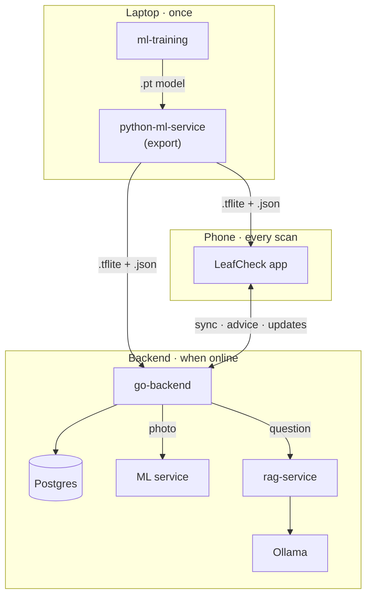

## 2. ml-training: how the model learns

The model learns from about 2,000 labelled leaf photos. Each step below is one file. The result is a single **checkpoint** file that holds everything the other parts need: the learned weights, the class names, how to prepare a photo, and the 50% threshold.

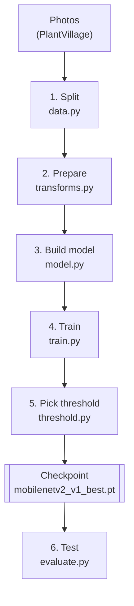

| Step | File (`ml-training/src/crop_ml/`) | What it does |
|---|---|---|
| Settings | `config.py` | Image size 224, epochs, batch size, learning rate, seed 42, `freeze_backbone=True` |
| Look at the data | `eda.py`, `notebooks/02_plantvillage_eda.ipynb` | Photos per class, imbalance plot |
| Load | `data.py` | Stratified train/val/test split (`outputs/splits.json`); weighted sampler for the rare "healthy" class |
| Prepare photos | `transforms.py` | Train: random crop + flips. Val/test: resize 256 → crop 224 → normalise (**the phone copies this**) |
| Model | `model.py` | `build_model`: MobileNetV2 (ImageNet), frozen features, new 3-class last layer |
| Train | `train.py` | AdamW + cross-entropy; keeps the best validation loss; early stopping |
| Threshold | `threshold.py` | Chooses the 0.5 "not sure" cut-off on validation data |
| Test | `evaluate.py`, `mismatch.py`, `field_eval.py` | 95.8% test, the 9.3% preprocessing bug, 54.8% on field photos |

Each epoch works like a quiz and a check:

```
epoch 1 ─ train on ~1,700 photos ─ check on val ─ val loss 0.40 ✔ save
epoch 2 ─ train ──────────────────── check ───── val loss 0.25 ✔ save
epoch 3 ─ train ──────────────────── check ───── val loss 0.27 ✗ (1 without improvement)
...  stop after 3 epochs without improvement → keep the best
```

**Hand-off:** copy `mobilenetv2_v1_best.pt` and `class_names.json` into `python-ml-service/models/`.

## 3. python-ml-service: serve the model and convert it

This service has two jobs. It **serves** the PyTorch model over HTTP, which the app uses for a "second opinion". It also **converts** the model into the small LiteRT format the phone runs, plus a `.json` label card the phone reads instead of hardcoding anything.

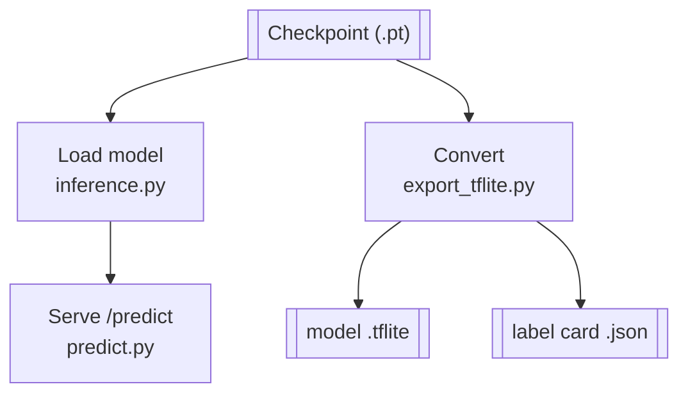

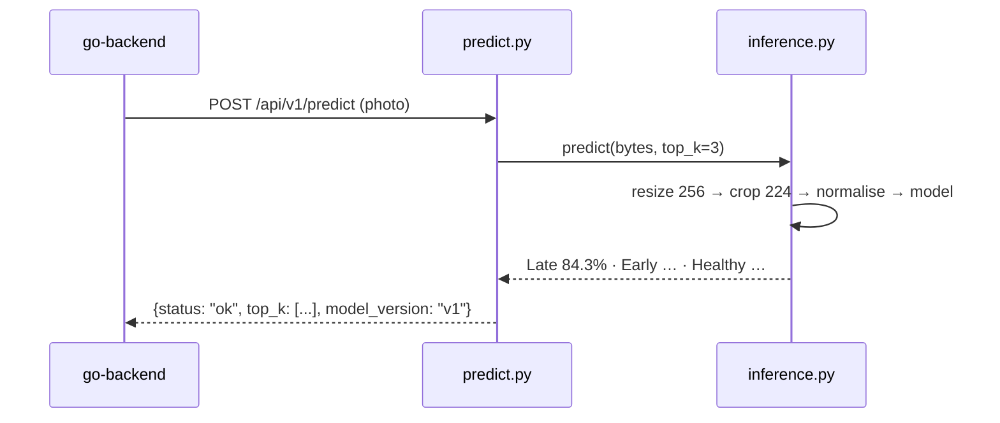

| File (`python-ml-service/`) | What it does |
|---|---|
| `app/main.py` | FastAPI app; loads the model once at start-up |
| `app/services/inference.py` | Loads the checkpoint, rebuilds the same preprocessing, `predict()` |
| `app/routers/predict.py` | `POST /api/v1/predict`; `status` = `ok` or `uncertain` (same threshold rule as the phone) |
| `app/routers/health.py`, `models.py` | `/ready`, model info |
| `app/core/errors.py` | One error format: `{"error", "detail", "request_id"}` |
| `scripts/export_tflite.py` | `.pt` → `.tflite` (LiteRT) + `.json` label card, verified against PyTorch |

## 4. rag-service: librarian + writer

RAG answers "What should I do?" in two steps. The **librarian** (ChromaDB) finds the most relevant paragraphs in our own disease notes. The **writer** (Ollama, a text AI running on the laptop) explains them in plain words and cites them as [1], [2]. The notes are indexed once; each question then runs the steps in the second diagram.

**Once, at start-up (building the index):**

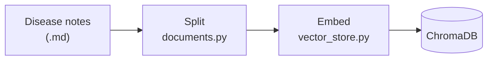

**Every question:**

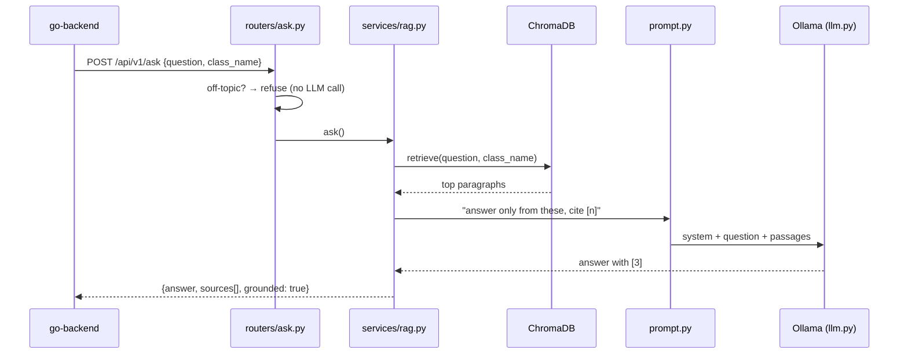

| File (`rag-service/`) | What it does |
|---|---|
| `knowledge/potato_*.md` | Curated disease notes (from UC IPM) |
| `scripts/ingest.py`, `app/services/documents.py` | Split notes into chunks and index them |
| `app/services/vector_store.py` | ChromaDB + all-MiniLM-L6-v2 embeddings |
| `app/services/rag.py` | `retrieve()` the top paragraphs, then `ask()` the LLM |
| `app/services/prompt.py` | "Answer only from these passages, cite [n]" |
| `app/services/llm.py` | Calls Ollama (`llama3.1:8b`) |
| `app/routers/ask.py` | `POST /api/v1/ask`; refuses off-topic questions |
| `scripts/evaluate.py`, `eval/questions.json` | RAGAS scoring (faithfulness 0.51 → 0.88) |

## 5. go-backend: clean layers

The app talks to **one** service only: go-backend, the front desk. A request passes through a key check, then a handler for that endpoint, then a use case that applies the rules, and finally storage (Postgres, model files) or a Python service.

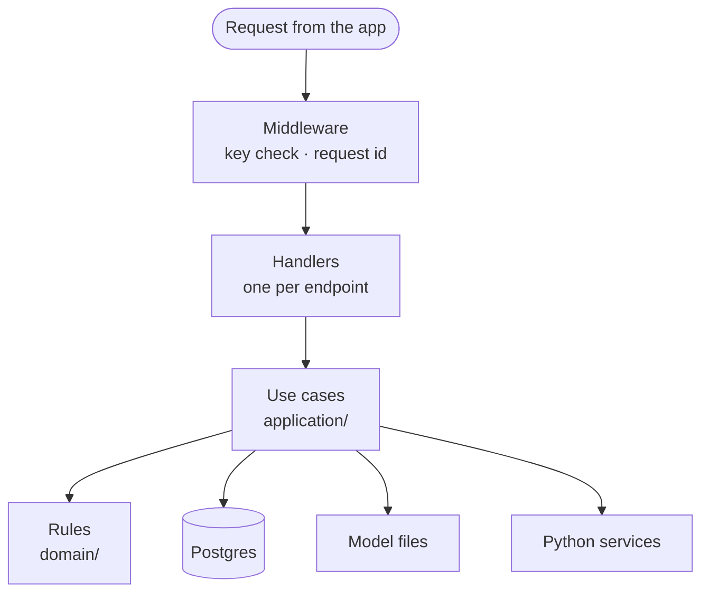

| Endpoint | Goes to |
|---|---|
| `GET /ready` | Checks the database, ML and RAG |
| `POST /api/v1/diagnoses:sync` | Postgres (`created` / `duplicate` / `invalid`) |
| `GET /api/v1/model-releases/latest` + `/artifact` | Filestore (ETag = sha256) |
| `POST /api/v1/predictions` | python-ml-service `/predict` |
| `POST /api/v1/advice` | rag-service `/ask` |

Start-up: `cmd/api/main.go` reads `infrastructure/config/config.go`, connects to Postgres, and publishes
the model pairs found in `MODELS_DIR`.

## 6. Flutter app: layers and one scan

Screens never talk to LiteRT, Hive or HTTP directly. They call **use cases**, which talk to **ports** (interfaces). `real_overrides.dart` plugs the real implementations into those ports (mocks are used for tests). The sequence below follows one scan; the state diagram shows how a saved result reaches the server.

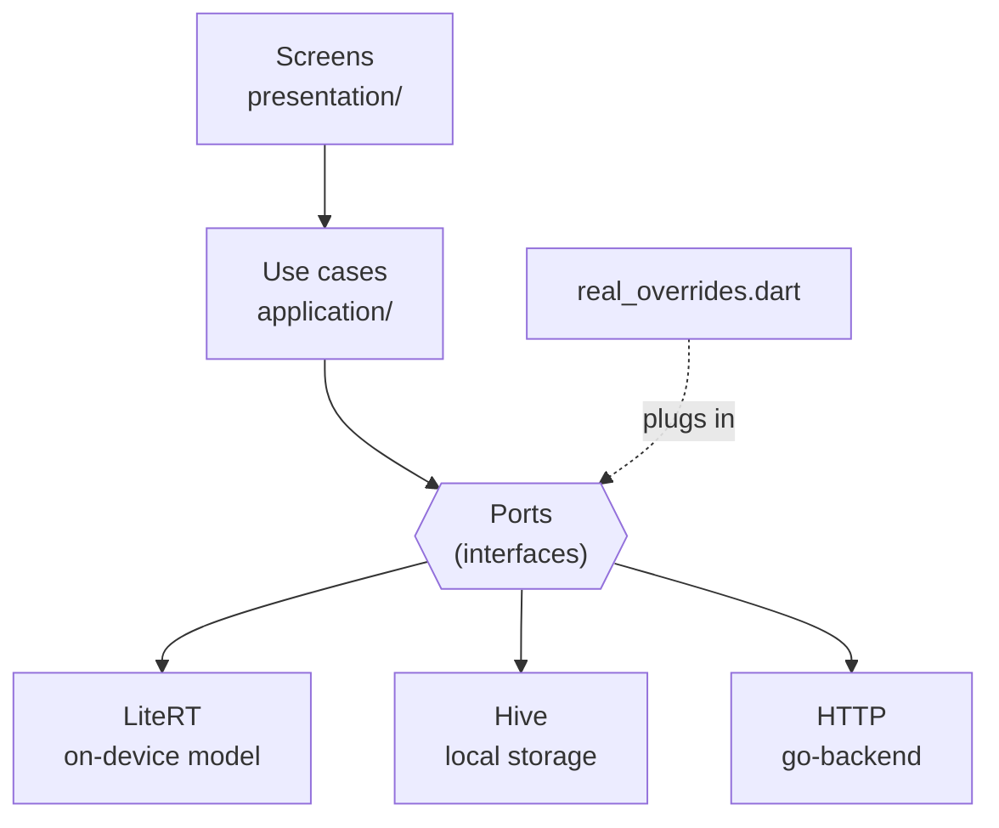

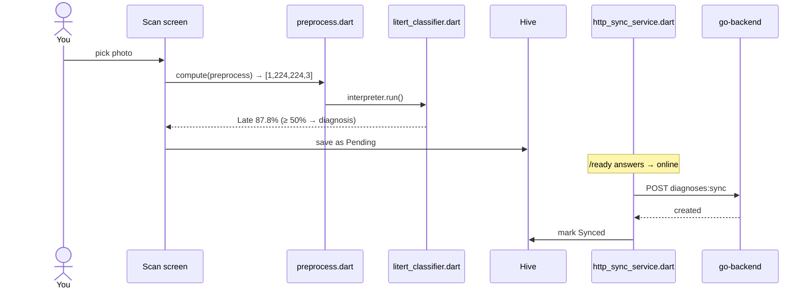

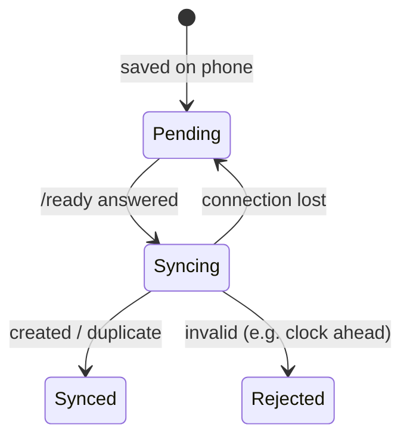

| Job | Files (`mobile-app/lib/`) |
|---|---|
| Real or mock wiring | `main.dart`, `app/di/real_overrides.dart`, `app/di/mock_overrides.dart`, `app/di/providers.dart` |
| On-device diagnosis | `features/diagnosis/infrastructure/litert/preprocess.dart`, `litert_classifier.dart` |
| Bundled model | `assets/models/crop_disease_v1.{tflite,json}`, `features/model_update/infrastructure/model_store.dart` |
| Saving results | `features/diagnosis/infrastructure/local/hive_diagnosis_repository.dart` |
| HTTP client | `shared/http/api_client.dart` (base URL, `X-API-Key`, error mapping) |
| Sync | `features/diagnosis/infrastructure/http/http_sync_service.dart`; auto-sync in `app/app.dart` |
| Second opinion | `features/diagnosis/infrastructure/http/http_server_classifier.dart` |
| Advice | `features/advice/infrastructure/http/http_advice_repository.dart` |
| Model updates | `features/model_update/infrastructure/http/http_model_update_repository.dart` |
| Online check | `features/settings/infrastructure/http_backend_status_source.dart` |
| Rules and screens | `features/*/domain`, `features/*/application`, `features/*/presentation` |

## 7. The thread that ties it together: one checkpoint, many readers

Everything starts from one file written by `train.py`.

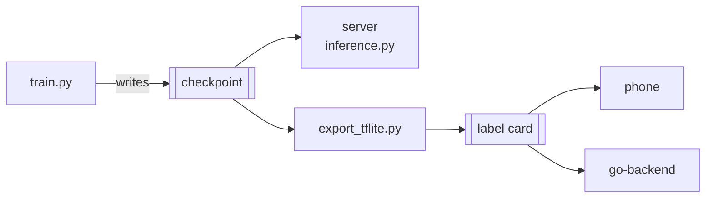

The same labels, the same 50% threshold and the same photo preparation run everywhere. That's why
the phone (87.8%) and the server (84.3%) agree on the same leaf.
