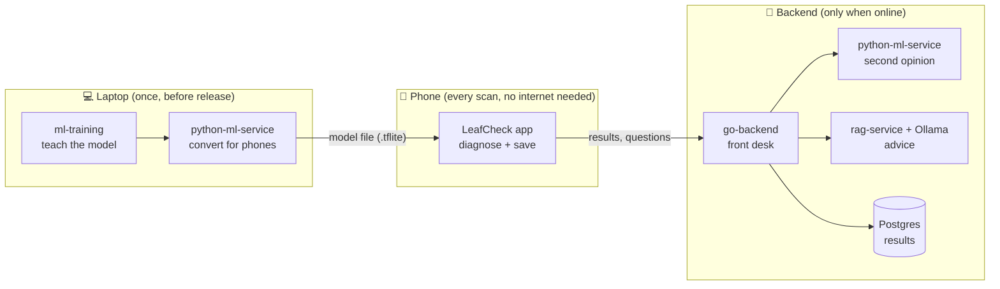
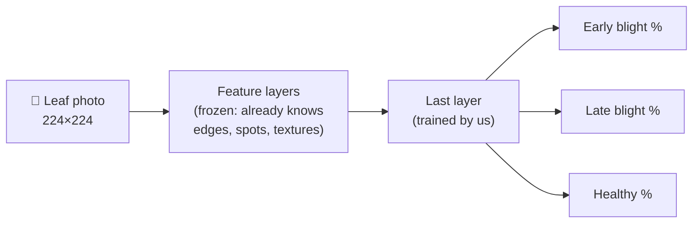
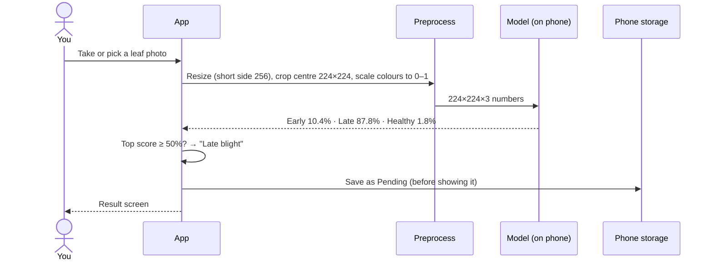
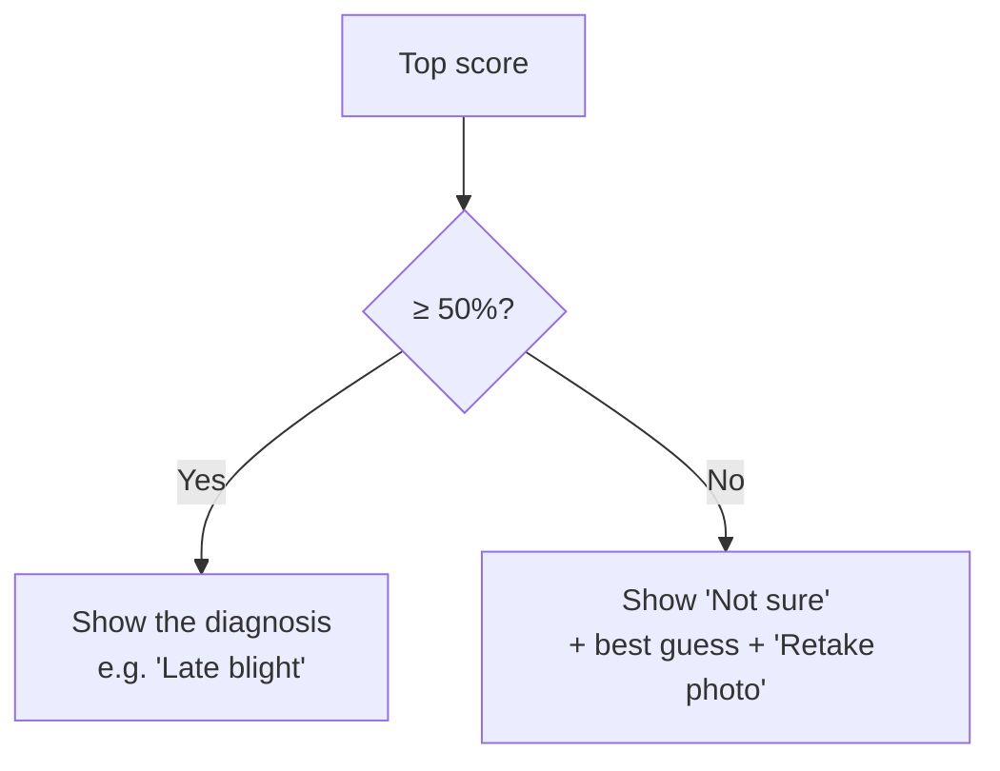
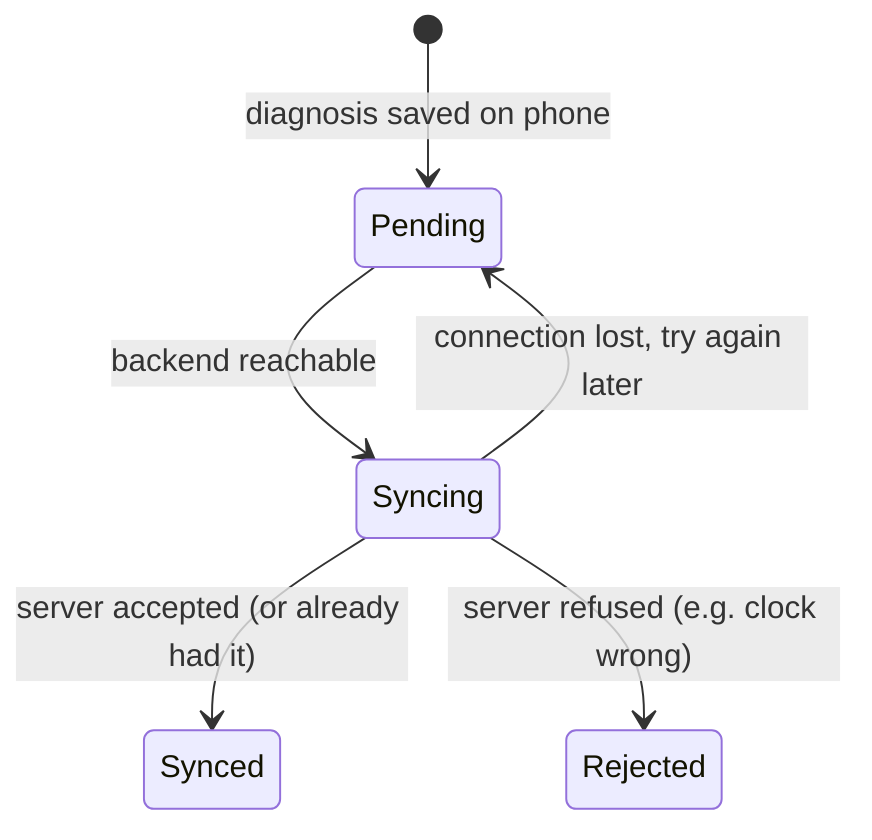
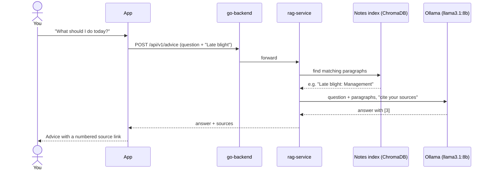
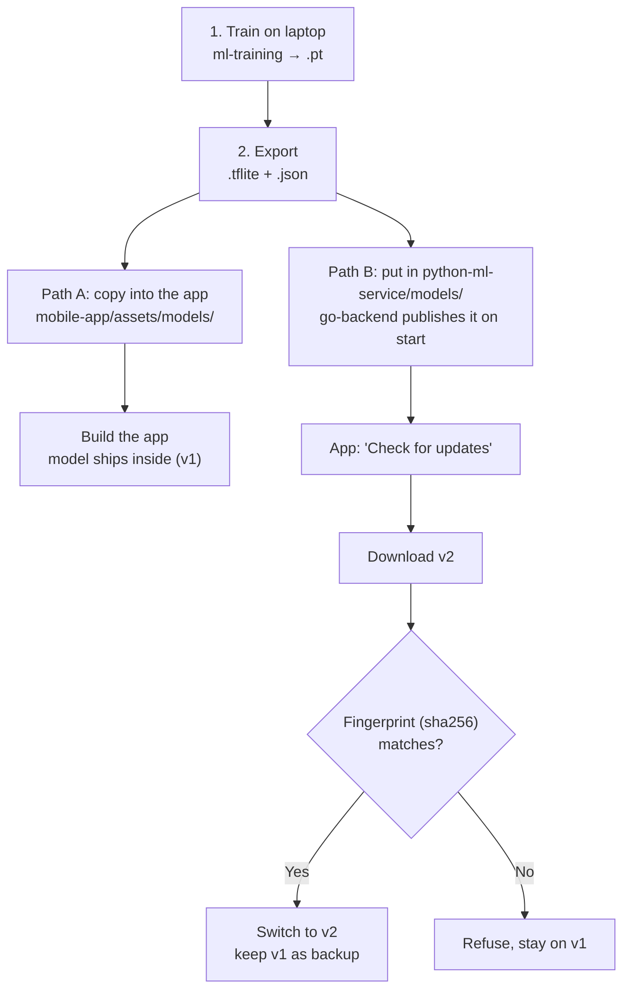

# How LeafCheck works: a beginner's guide

A plant doctor in your pocket. This page explains every part in plain words, with pictures.

**Contents**
1. [The big picture](#1-the-big-picture)
2. [The parts](#2-the-parts)
3. [MobileNetV2: the model](#3-mobilenetv2-the-model)
4. [From photo to answer](#4-from-photo-to-answer)
5. [The 50% threshold: what each result means](#5-the-50-threshold-what-each-result-means)
6. [Offline first, sync later](#6-offline-first-sync-later)
7. [Ollama and RAG: the advice](#7-ollama-and-rag-the-advice)
8. [How a model reaches the phone](#8-how-a-model-reaches-the-phone)
9. [The 30-second explanation](#9-the-30-second-explanation)
10. [Glossary](#10-glossary)

---

## 1. The big picture

We **teach** a model on the laptop, **pack** it into the phone app, and the phone **diagnoses leaves by itself**, even with no internet. When there is internet, the phone **reports back** and can **ask for advice**.



> **In one line:** the phone is the doctor; the internet is only for extras.

---

## 2. The parts

| Part | Its one job | Think of it as | Folder |
|---|---|---|---|
| ml-training | Teaches the model from labelled photos | 🎓 School | `ml-training/` |
| python-ml-service | Converts the model for phones; also diagnoses on the server | 🔄 Translator | `python-ml-service/` |
| LeafCheck app | Diagnoses on the phone, saves results, syncs later | 📱 Pocket doctor | `mobile-app/` |
| go-backend | The only door the app talks to: sync, model updates, forwarding | 🏢 Front desk | `go-backend/` |
| rag-service | Finds the right paragraph in trusted disease notes | 📚 Librarian | `rag-service/` |
| Ollama | Runs a text AI on the laptop that writes the advice | ✍️ Writer | (installed app) |
| benchmarks | Measures how fast each path is | ⏱️ Stopwatch | `benchmarks/` |

---

## 3. MobileNetV2: the model

**What it is:** a small image-recognition model made by Google for phones. It has about 3.4 million learned numbers ("parameters"). Big image models have hundreds of millions.

**The trick, transfer learning:** MobileNetV2 has already learned to *see* (edges, spots, textures, shapes) from 1.3 million everyday photos (ImageNet). We kept that part as it is (**frozen**) and trained only the **last layer**, which decides between our 3 classes.



**Example:** it's like hiring someone who already knows how to read, then teaching them only the words for three potato diseases. Learning is quick: about 40 seconds of training here.

| Fact | Value |
|---|---|
| Training photos | 2,152 potato leaves (PlantVillage), only 152 healthy |
| Accuracy on test photos | **95.8%** (216 photos) |
| Model file on the phone | **9.0 MB** (`crop_disease_v1.tflite`) |
| Time per diagnosis | ~2 ms (laptop CPU), ~11 ms (Android emulator) |

> **In one line:** a small model that already knows how to see; we only taught it potato diseases.

---

## 4. From photo to answer



**Why the preparation step matters:** the model only works if photos are prepared **exactly** as in training. In our tests, forgetting one step (scaling colours to 0–1) made accuracy fall from 95.8% to **9.3%**, and no error appeared anywhere. Same model, wrong input.

> **In one line:** prepare the photo the same way as in school, ask the model, save, then show.

---

## 5. The 50% threshold: what each result means

The model always gives **three percentages that add up to 100%**. The threshold is a simple rule:



**Examples**

```
Late-blight sample (real, on the phone)        → ✅ "Late blight"
  Late blight   █████████████████░░░  87.8%
  Early blight  ██░░░░░░░░░░░░░░░░░░  10.4%
  Healthy       ░░░░░░░░░░░░░░░░░░░░   1.8%

Early-blight sample (real, on the phone)       → ✅ "Early blight", less certain
  Early blight  █████████████░░░░░░░  67.2%

Blurry photo (design example)                  → ⚠️ "Not sure"
  Best guess    ████████░░░░░░░░░░░░  38.9%   (below 50%)
```

| Result | What it means | What to do |
|---|---|---|
| **Late blight**, high % (e.g. 87.8%) | The model is fairly sure it's late blight | Act today: remove infected leaves, get advice |
| **Early blight**, medium % (e.g. 67.2%) | Likely early blight, less certain | Act, and check other leaves; a second opinion helps |
| **Healthy** | No disease pattern found | Keep checking the field regularly |
| **Not sure** (top < 50%) | The photo isn't clear enough to decide | Retake: one leaf, daylight, fill the frame |

**Why 50%?** On test photos, the model gave an answer for **96.3%** of photos, and when it answered it was right **97.1%** of the time. The rest it called "Not sure". Saying "I don't know" is safer than guessing.

**Honest limit:** on real **field** photos (PlantDoc), accuracy drops to **54.8%**. The model is good at "diseased vs healthy" but mixes up the two blights, often with a score above 50%, so the threshold doesn't catch it.

> **In one line:** above 50%, show the answer; below it, ask for a better photo.

---

## 6. Offline first, sync later

Every result is **saved on the phone first**. Uploading happens later, by itself.



**What "online" means here:** not "has Wi-Fi", but "**go-backend answered `/ready` within 2 seconds**".

**Example:** the app said *offline* on a real phone while Wi-Fi worked. It was looking for the backend at `10.0.2.2`, the emulator-only address for "this laptop". The fix was to point it at the laptop's real IP (`SERVER_URL=http://192.168.1.3:8080`).

**Why sending twice is safe:** each result gets a unique ID made on the phone. If the same result is sent again, the server answers "duplicate" and never stores a second copy.

> **In one line:** save first, upload when possible, never lose or double anything.

---

## 7. Ollama and RAG: the advice

**The question:** *"What should I do about this?"*

**RAG** (Retrieval-Augmented Generation) answers it in two steps:

1. **Retrieve (the librarian):** search our own trusted disease notes (written from UC IPM extension guides) and pick the most relevant paragraphs.
2. **Generate (the writer):** give those paragraphs to a text AI and say *"answer only from these, and cite them as [1], [2]"*.

**Ollama** is the writer's engine: a free program that runs a text AI (**llama3.1:8b**) **on the laptop**, with no cloud service.



**Real example from the app:**
> *"…apply protectant fungicides preventively at 7–10 day intervals if you are experiencing risky weather… destroying cull piles and volunteer potatoes (as mentioned in [3])…"*
> Source [3]: Potato late blight: Management · ipm.ucanr.edu

| Question | Answer |
|---|---|
| Does Ollama diagnose the leaf? | **No.** Diagnosis is MobileNetV2 on the phone. Ollama only writes text. |
| Why run it locally? | Free (no per-call fees) and private (questions stay on the laptop) |
| Where else is it used? | As the "grader" when we scored answer quality: faithfulness went from **0.51 → 0.88** after two fixes |
| What if the question is off-topic? | Refused before Ollama is even called (e.g. "How do I fix my car engine?") |
| Downside? | Slow-ish: ~3.5 s when warm, ~20 s on the first call. So advice is an extra and never blocks the diagnosis |
| If Ollama is off? | The app stays online, but **Get advice** shows "unavailable" |

> **In one line:** a librarian finds the right page in our notes; a local AI writer explains it in plain words and points to the page.

---

## 8. How a model reaches the phone

The model **learns on the laptop, never on the phone**. There are two ways it gets to the phone:



**Today:** only v1 exists, and the bundled file is identical to the server's, so the app says **"Up to date"**.

**What does NOT happen:**
- ❌ The phone does not learn from your scans.
- ❌ Sync does not upload photos. It sends only the label, confidence, model version and time.
- ❌ There is no automatic retraining. Improving the model means collecting new photos (with consent), retraining on the laptop, and shipping v2. That's future work.

> **In one line:** the model learns in school (the laptop), not on the job (the phone).

---

## 9. The 30-second explanation

> We trained a small AI on thousands of potato-leaf photos and shrank it to fit in a phone. The phone diagnoses a leaf in milliseconds, with no internet, and saves the result. If it's less than 50% sure, it says "Not sure" instead of guessing. When there's a connection, it quietly uploads the results, can ask a server model for a second opinion, and can ask for advice. The advice comes from our own trusted notes, explained in plain words by an AI running on our own laptop (Ollama), with sources. The model only gets better when we retrain it and ship a new version.

---

## 10. Glossary

| Word | Meaning |
|---|---|
| **Model** | A file of learned numbers that turns a photo into scores |
| **Training** | Showing the model labelled examples until it gets them right |
| **Transfer learning** | Reusing a model that already learned general skills, and teaching it only the last step |
| **Inference** | Using the trained model to answer (one diagnosis) |
| **Confidence** | The model's score for its top answer, 0–100% |
| **Threshold** | The minimum confidence (50%) needed to show a diagnosis |
| **LiteRT / .tflite** | Google's runtime and file format for running models on phones |
| **Preprocessing** | Preparing a photo (resize, crop, scale) exactly as in training |
| **Sync** | Uploading saved results to the server when online |
| **Idempotent** | Safe to repeat: sending twice gives the same result as once |
| **RAG** | Find trusted text first, then let an AI answer from it with citations |
| **Ollama** | A free app that runs text AI models on your own computer |
| **sha256** | A file's fingerprint; if one byte changes, the fingerprint changes |
| **`/ready`** | The backend's "are you there and working?" check |
