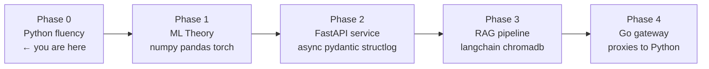
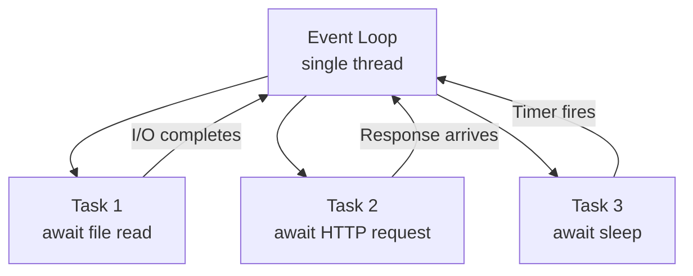
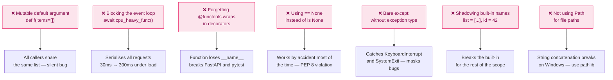

# Phase 0 — Python Fluency

> **Duration:** 2 weeks · **10–15 hrs/week**
> **Goal:** Get Python-fluent fast by leveraging your existing Kotlin and Go
> knowledge as a bridge. You are not learning to program — you are learning
> how Python thinks differently. By the end you will write idiomatic Python
> without reaching for documentation, and produce a CLI tool that proves it.

> **Prerequisite:** None. This is the first phase. Everything in Phases 1–7
> builds on the Python muscle memory built here.

---

## Table of Contents

1. [What You Will Build](#1-what-you-will-build)
2. [How Python Fits the Larger System](#2-how-python-fits-the-larger-system)
3. [Folder Structure](#3-folder-structure)
4. [Environment Setup](#4-environment-setup)
5. [Day 1–3 — Syntax Blitz](#5-day-13--syntax-blitz)
   - [5.1 Variables, Types, and Type Hints](#51-variables-types-and-type-hints)
   - [5.2 Collections and Comprehensions](#52-collections-and-comprehensions)
   - [5.3 Functions — args, kwargs, and Unpacking](#53-functions--args-kwargs-and-unpacking)
   - [5.4 f-strings and String Formatting](#54-f-strings-and-string-formatting)
6. [Day 4–6 — Python OOP vs Kotlin](#6-day-46--python-oop-vs-kotlin)
   - [6.1 Classes and Dataclasses](#61-classes-and-dataclasses)
   - [6.2 Dunder Methods](#62-dunder-methods)
   - [6.3 Protocols — Duck Typing vs Interfaces](#63-protocols--duck-typing-vs-interfaces)
   - [6.4 Inheritance and Mixins](#64-inheritance-and-mixins)
7. [Day 7–9 — Async Python](#7-day-79--async-python)
   - [7.1 How asyncio Works](#71-how-asyncio-works)
   - [7.2 async/await in Practice](#72-asyncawait-in-practice)
   - [7.3 Async vs Kotlin Coroutines — Key Differences](#73-async-vs-kotlin-coroutines--key-differences)
   - [7.4 ThreadPoolExecutor for CPU-Bound Work](#74-threadpoolexecutor-for-cpu-bound-work)
8. [Day 10–14 — Production Python Patterns](#8-day-1014--production-python-patterns)
   - [8.1 Type Hints and mypy](#81-type-hints-and-mypy)
   - [8.2 Decorators](#82-decorators)
   - [8.3 Context Managers](#83-context-managers)
   - [8.4 Error Handling](#84-error-handling)
   - [8.5 Modules, Packages, and Imports](#85-modules-packages-and-imports)
9. [Portfolio Output — CLI Image Analysis Tool](#9-portfolio-output--cli-image-analysis-tool)
10. [Tooling — ruff, mypy, uv](#10-tooling--ruff-mypy-uv)
11. [Interview Questions & Model Answers](#11-interview-questions--model-answers)
12. [Common Mistakes to Avoid](#12-common-mistakes-to-avoid)
13. [Reference Links](#13-reference-links)
14. [Phase 0 Completion Checklist](#14-phase-0-completion-checklist)

---

## 1. What You Will Build

By the end of Phase 0 you will have **one committed CLI tool** on GitHub that
demonstrates Python fluency across every concept covered:

| Artefact | File | What it proves |
|---|---|---|
| Syntax exercises | `exercises/` | Worked through each concept with runnable code |
| CLI tool | `image_analyser/` | End-to-end Python project — OOP, async, type hints, Click |
| Type-checked codebase | `pyproject.toml` + mypy passing | You write typed Python, not just annotated Python |
| Linted codebase | ruff passing with zero warnings | You follow Python conventions, not just style preferences |

The CLI tool is not a toy. It does something real: scans a folder of images,
reads their metadata in parallel using `asyncio`, detects format and
dimensions, and outputs a structured JSON or table report. This is the kind of
utility you would write on day one at any ML engineering job.

---

## 2. How Python Fits the Larger System



Every Python file you write from Phase 1 onwards assumes you are fluent in the
patterns covered here. Async functions, dataclasses, type hints, and decorators
are used constantly in FastAPI, LangChain, PyTorch, and structlog. Skipping
this phase means debugging framework magic you do not understand.

---

## 3. Folder Structure

```
python-fluency/                  ← project root (standalone practice repo)
│
├── exercises/                   ← one file per concept — work through in order
│   ├── 01_syntax_blitz.py
│   ├── 02_comprehensions.py
│   ├── 03_functions.py
│   ├── 04_oop_basics.py
│   ├── 05_dataclasses.py
│   ├── 06_dunder_methods.py
│   ├── 07_protocols.py
│   ├── 08_async_basics.py
│   ├── 09_async_http.py
│   ├── 10_type_hints.py
│   ├── 11_decorators.py
│   └── 12_context_managers.py
│
├── image_analyser/              ← portfolio CLI tool (the main output)
│   ├── __init__.py
│   ├── cli.py                   ← Click entry point
│   ├── scanner.py               ← async directory scanner
│   ├── analyser.py              ← image metadata extraction
│   ├── reporter.py              ← JSON and table output formatters
│   └── models.py                ← dataclasses for typed results
│
├── tests/                       ← pytest unit tests for the CLI tool
│   ├── __init__.py
│   ├── conftest.py
│   ├── test_analyser.py
│   └── test_reporter.py
│
├── pyproject.toml               ← project config, ruff and mypy settings
├── requirements.txt
├── .gitignore
└── README.md
```

Create the scaffold:

```bash
# Create the project root
mkdir python-fluency && cd python-fluency

# Create all directories
mkdir -p exercises image_analyser tests

# Create exercise files — one per concept
touch exercises/01_syntax_blitz.py \
      exercises/02_comprehensions.py \
      exercises/03_functions.py \
      exercises/04_oop_basics.py \
      exercises/05_dataclasses.py \
      exercises/06_dunder_methods.py \
      exercises/07_protocols.py \
      exercises/08_async_basics.py \
      exercises/09_async_http.py \
      exercises/10_type_hints.py \
      exercises/11_decorators.py \
      exercises/12_context_managers.py

# Create CLI tool files
touch image_analyser/__init__.py \
      image_analyser/cli.py \
      image_analyser/scanner.py \
      image_analyser/analyser.py \
      image_analyser/reporter.py \
      image_analyser/models.py

# Create test files
touch tests/__init__.py \
      tests/conftest.py \
      tests/test_analyser.py \
      tests/test_reporter.py

echo "Scaffold created"
```

---

## 4. Environment Setup

### 4.1 Install pyenv and Python

```bash
# Install pyenv — manages Python versions per project
# Never use the system Python (/usr/bin/python3) for project work
brew install pyenv

# Add pyenv initialisation to your shell config
# These three lines make pyenv intercept the `python` command
echo 'export PYENV_ROOT="$HOME/.pyenv"'   >> ~/.zshrc
echo 'export PATH="$PYENV_ROOT/bin:$PATH"' >> ~/.zshrc
echo 'eval "$(pyenv init -)"'              >> ~/.zshrc

# Reload the shell so the above takes effect immediately
source ~/.zshrc

# Install Python 3.11 — current stable, used across all phases
# This takes 2–3 minutes — it compiles from source
pyenv install 3.11.9

# Pin version to this project folder only
# Creates a .python-version file — pyenv reads it automatically
pyenv local 3.11.9

# Verify — must show 3.11.9, not the macOS system Python
python --version
which python   # should show ~/.pyenv/shims/python, not /usr/bin/python3
```

### 4.2 Install uv

```bash
# uv is a fast Python package manager written in Rust
# It replaces pip and venv — 10–100x faster for installs
brew install uv

# Verify
uv --version   # should show uv 0.4.x or later
```

### 4.3 Create virtual environment

```bash
# Still inside python-fluency/

# Create a virtual environment in .venv/
# This isolates project dependencies from the system Python
uv venv

# Activate the virtual environment
# You must run this every time you open a new terminal in this project
source .venv/bin/activate

# Your shell prompt should now be prefixed with (.venv)
# (.venv) paul@macbook python-fluency %

# Deactivate when done (optional — closing the terminal also works)
# deactivate
```

### 4.4 Install dependencies

```bash
# Core dependencies for the CLI tool
uv add \
  pillow \        # image reading — PIL.Image
  click \         # CLI framework — argparse but better
  rich \          # terminal formatting — tables, colours, progress bars
  httpx \         # async HTTP client — used in async exercises
  aiofiles        # async file I/O

# Dev and tooling dependencies
uv add --dev \
  pytest \           # test runner
  pytest-asyncio \   # async test support
  mypy \             # static type checker
  ruff \             # linter + formatter (replaces flake8 + black + isort)
  types-Pillow       # type stubs for Pillow (mypy needs these)

# Pin exact versions for reproducibility
uv pip freeze > requirements.txt

# Verify the key packages
python -c "import click; print(f'Click {click.__version__}')"
python -c "from PIL import Image; print('Pillow OK')"
```

### 4.5 Create pyproject.toml

```bash
cat > pyproject.toml << 'EOF'
[project]
name = "python-fluency"
version = "0.1.0"
description = "Phase 0 — Python fluency exercises and CLI tool"
requires-python = ">=3.11"

[project.scripts]
# This lets you run `image-analyser scan ./photos` after `pip install -e .`
image-analyser = "image_analyser.cli:main"

[tool.pytest.ini_options]
asyncio_mode = "auto"    # every async test function is auto-detected
testpaths = ["tests"]

[tool.ruff]
line-length = 100
target-version = "py311"

[tool.ruff.lint]
# E/F = pycodestyle + pyflakes (errors and style)
# I   = isort (import ordering)
# UP  = pyupgrade (use modern Python syntax)
# B   = bugbear (common bugs and design issues)
select = ["E", "F", "I", "UP", "B"]
ignore = ["E501"]   # line length handled by formatter, not linter

[tool.mypy]
python_version = "3.11"
strict = true                  # enables all strict checks
ignore_missing_imports = true  # don't error on third-party stubs
show_error_codes = true        # show the error code (e.g. [no-untyped-def])
EOF
```

### 4.6 Create .gitignore

```bash
cat > .gitignore << 'EOF'
# Virtual environment — never commit
.venv/

# Python bytecode cache
__pycache__/
*.pyc
*.pyo

# Tool caches
.mypy_cache/
.ruff_cache/
.pytest_cache/

# Test output
.coverage
htmlcov/

# macOS artefacts
.DS_Store

# pyenv version pin — commit this so everyone uses the same Python version
# (uncomment the line below if you DON'T want to commit it)
# .python-version
EOF
```

### 4.7 Install the project in editable mode

```bash
# Editable install — lets Python find image_analyser as a package
# without needing to set PYTHONPATH manually
pip install -e .

# Verify the CLI entry point works
image-analyser --help
# Usage: image-analyser [OPTIONS] COMMAND [ARGS]...
```

---

## 5. Day 1–3 — Syntax Blitz

> Read each section, copy the code into the corresponding exercise file, run
> it, then modify it. Do not just read — the muscle memory comes from typing.

### 5.1 Variables, Types, and Type Hints

**File:** `exercises/01_syntax_blitz.py`

```python
# exercises/01_syntax_blitz.py
#
# Python vs Kotlin vs Go — the same concepts, different syntax.
# Run with: python exercises/01_syntax_blitz.py

# ── Variables ────────────────────────────────────────────────────────────────
# Python: no type declaration required at the variable level
# Kotlin: val name: String = "Paul"
# Go:     name := "Paul"   or   var name string = "Paul"

name = "Paul"          # str inferred
age = 31               # int inferred
score = 0.92           # float inferred
is_active = True       # bool — capital T, unlike Go's true

# Type hints (PEP 484) — optional but strongly recommended for production code
# They do not affect runtime behaviour — they are documentation + mypy input
name_typed: str = "Paul"
age_typed: int = 31
scores: list[float] = [0.91, 0.87, 0.94]   # list[T] — lowercase in Python 3.9+
lookup: dict[str, int] = {"a": 1, "b": 2}  # dict[K, V]

# Optional — a value that may be None
# Kotlin: String?    Go: *string or sql.NullString
from typing import Optional
maybe_label: Optional[str] = None          # old style — still common
maybe_label_new: str | None = None         # new style — Python 3.10+ union syntax

# Constants — Python has no const keyword
# Convention: UPPER_SNAKE_CASE signals "don't change this"
MAX_IMAGE_SIZE_MB: int = 5
DEFAULT_MODEL: str = "mobilenetv2_v1"

print(f"name={name!r}  age={age}  score={score:.2f}  active={is_active}")
print(f"maybe_label is None: {maybe_label is None}")  # use `is None`, not == None
```

Run it:

```bash
python exercises/01_syntax_blitz.py
# name='Paul'  age=31  score=0.92  active=True
# maybe_label is None: True
```

---

### 5.2 Collections and Comprehensions

**File:** `exercises/02_comprehensions.py`

```python
# exercises/02_comprehensions.py
#
# Python's most distinctive syntax — comprehensions replace most for-loops.
# Kotlin equivalent: .map{}, .filter{}, .associate{}
# Go equivalent: manual for loops (Go has no comprehensions)

# ── List comprehension ────────────────────────────────────────────────────────
# [expression for item in iterable if condition]
#
# Kotlin: (0 until 10).map { it * it }
# Go:     for i := 0; i < 10; i++ { result = append(result, i*i) }

numbers = [1, 2, 3, 4, 5, 6, 7, 8, 9, 10]
squares = [n ** 2 for n in numbers]                    # all squares
even_squares = [n ** 2 for n in numbers if n % 2 == 0] # only even numbers

print(f"squares:      {squares}")
print(f"even_squares: {even_squares}")

# ── Dict comprehension ────────────────────────────────────────────────────────
# Kotlin: list.associate { it to it * it }
class_names = ["Tomato___healthy", "Tomato___Early_blight", "Apple___Black_rot"]
label_to_index: dict[str, int] = {label: idx for idx, label in enumerate(class_names)}
index_to_label: dict[int, str] = {idx: label for label, idx in label_to_index.items()}

print(f"\nlabel_to_index: {label_to_index}")
print(f"index_to_label: {index_to_label}")

# ── Set comprehension ─────────────────────────────────────────────────────────
# Useful for deduplication
words = ["apple", "banana", "apple", "cherry", "banana"]
unique_words: set[str] = {w for w in words}   # sets have no duplicates
print(f"\nunique_words: {unique_words}")       # order is not guaranteed

# ── Generator expression ──────────────────────────────────────────────────────
# Like a list comprehension but lazy — computes one item at a time
# Use for large sequences where you don't need all values at once
# Kotlin: sequence { yield(...) }
import os
from pathlib import Path

# This doesn't load all filenames into memory at once
# Path.glob() returns a generator — we wrap it in another generator
def image_paths(folder: str):
    """Yield image file paths one at a time — memory efficient for large folders."""
    return (str(p) for p in Path(folder).glob("**/*.jpg") if p.is_file())

# ── zip, enumerate, and unpacking ─────────────────────────────────────────────
labels = ["healthy", "blight", "rust"]
confidences = [0.91, 0.06, 0.03]

# zip pairs elements from two iterables
for label, conf in zip(labels, confidences):
    print(f"  {label}: {conf:.0%}")

# enumerate gives (index, value) pairs — replaces manual counter variables
for i, label in enumerate(labels):
    print(f"  [{i}] {label}")

# Unpacking — assign multiple values at once
# Kotlin: val (first, second) = pair
first, second, third = labels           # must match exactly
head, *tail = confidences               # *tail captures the rest as a list
print(f"\nfirst={first!r}  tail={tail}")

# Swap without a temp variable — idiomatic Python
a, b = 1, 2
a, b = b, a   # Go needs: a, b = b, a (same!)  Kotlin: same
print(f"after swap: a={a} b={b}")
```

---

### 5.3 Functions — args, kwargs, and Unpacking

**File:** `exercises/03_functions.py`

```python
# exercises/03_functions.py
#
# Python functions are more flexible than Go or Kotlin functions.
# Key concepts: *args, **kwargs, default parameters, keyword-only arguments.

from typing import Any

# ── Default parameters ────────────────────────────────────────────────────────
# Kotlin: fun greet(name: String, greeting: String = "Hello")
# Go:     no default parameters — use functional options or structs instead

def greet(name: str, greeting: str = "Hello") -> str:
    """Simple function with a default parameter."""
    return f"{greeting}, {name}!"

print(greet("Paul"))              # uses default: "Hello, Paul!"
print(greet("Paul", "Hey"))       # override: "Hey, Paul!"
print(greet(name="Paul", greeting="Habari"))  # keyword arguments — order independent

# ── *args — variable positional arguments ─────────────────────────────────────
# *args collects any number of positional arguments into a tuple
# Kotlin: vararg items: String    Go: items ...string

def total(*values: float) -> float:
    """Sum any number of float arguments."""
    return sum(values)   # sum() works on any iterable

print(total(0.91, 0.06, 0.03))   # → 1.0
nums = [0.5, 0.3, 0.2]
print(total(*nums))               # *nums unpacks the list into positional args

# ── **kwargs — variable keyword arguments ──────────────────────────────────────
# **kwargs collects any number of keyword arguments into a dict
# No direct Kotlin/Go equivalent — closest is Map<String, Any>

def log_event(event: str, **metadata: Any) -> None:
    """
    Log a structured event with arbitrary key-value metadata.
    This pattern is used in structlog and FastAPI internally.
    """
    pairs = "  ".join(f"{k}={v!r}" for k, v in metadata.items())
    print(f"[{event}]  {pairs}")

log_event("inference.complete", label="Tomato blight", confidence=0.92, ms=34)
# [inference.complete]  label='Tomato blight'  confidence=0.92  ms=34

config = {"model_version": "v1", "device": "mps"}
log_event("model.loaded", **config)   # **config unpacks dict into keyword args

# ── Keyword-only arguments ────────────────────────────────────────────────────
# Parameters after * can ONLY be passed as keyword arguments, never positional
# This prevents caller errors where argument order is ambiguous

def resize_image(path: str, *, width: int, height: int) -> str:
    """
    The * forces callers to write resize_image("x.jpg", width=224, height=224).
    Without *, a caller could write resize_image("x.jpg", 224, 224) and
    accidentally swap width and height — a silent bug.
    """
    return f"resized {path} to {width}×{height}"

result = resize_image("leaf.jpg", width=224, height=224)   # correct
# resize_image("leaf.jpg", 224, 224)  ← TypeError: takes 1 positional argument

# ── Returning multiple values ─────────────────────────────────────────────────
# Python functions can return a tuple — looks like multiple return values
# Kotlin: Pair<A, B> or data class   Go: (value, error)

def split_label(class_name: str) -> tuple[str, str]:
    """
    Split 'Tomato___Early_blight' into ('Tomato', 'Early blight').
    Returns a tuple — caller unpacks it.
    """
    parts = class_name.split("___", maxsplit=1)
    plant = parts[0].replace("_", " ")
    condition = parts[1].replace("_", " ") if len(parts) > 1 else "unknown"
    return plant, condition   # implicitly creates a tuple

plant, condition = split_label("Tomato___Early_blight")
print(f"\nplant={plant!r}  condition={condition!r}")
```

---

### 5.4 f-strings and String Formatting

**File:** Extend `exercises/01_syntax_blitz.py`

```python
# Add to exercises/01_syntax_blitz.py — f-string section

# ── f-strings (formatted string literals) ────────────────────────────────────
# Kotlin: "Hello $name, score is ${score * 100}%"
# Go:     fmt.Sprintf("Hello %s, score is %.0f%%", name, score*100)

name = "Paul"
score = 0.9231
elapsed_ms = 34.178

# Basic interpolation
msg = f"Hello {name}"

# Expressions inside braces — evaluated at runtime
pct = f"Score: {score * 100:.1f}%"     # :.1f = one decimal place

# Format specifiers
f"{score:.4f}"       # 4 decimal places:         "0.9231"
f"{score:.0%}"       # percentage, no decimals:  "92%"
f"{elapsed_ms:.1f}ms"# one decimal:              "34.2ms"
f"{1_000_000:,}"     # thousands separator:      "1,000,000"
f"{42:05d}"          # zero-padded int:          "00042"
f"{name!r}"          # repr() — adds quotes:     "'Paul'"
f"{name!s}"          # str() — same as default
f"{name!a}"          # ascii() — escapes non-ASCII

# Multiline f-string — use parentheses, not backslash continuation
summary = (
    f"Model: mobilenetv2_v1\n"
    f"Label: Tomato___Early_blight\n"
    f"Confidence: {score:.2%}\n"
    f"Inference: {elapsed_ms:.1f}ms"
)
print(summary)

# Self-documenting expressions (Python 3.8+) — great for debugging
# Prints both the expression and its value
x = 42
print(f"{x=}")          # x=42
print(f"{score=:.3f}")  # score=0.923
```

---

## 6. Day 4–6 — Python OOP vs Kotlin

### 6.1 Classes and Dataclasses

**File:** `exercises/04_oop_basics.py` and `exercises/05_dataclasses.py`

```python
# exercises/04_oop_basics.py
#
# Python classes — the fundamentals before dataclasses.

class ImageMetadata:
    """
    A plain Python class — defines __init__ manually.
    Kotlin equivalent: class ImageMetadata(val path: String, val width: Int, ...)
    """

    def __init__(self, path: str, width: int, height: int, size_bytes: int) -> None:
        # Instance attributes set in __init__
        self.path = path
        self.width = width
        self.height = height
        self.size_bytes = size_bytes

    # Properties — computed attributes, accessed without ()
    # Kotlin: val aspect_ratio: Float get() = width.toFloat() / height
    @property
    def aspect_ratio(self) -> float:
        return self.width / self.height

    @property
    def size_mb(self) -> float:
        return self.size_bytes / (1024 * 1024)

    @property
    def is_square(self) -> bool:
        return self.width == self.height

    # Class method — alternative constructors
    # Kotlin: companion object fun fromPath(path: String): ImageMetadata
    @classmethod
    def from_path(cls, path: str) -> "ImageMetadata":
        """Load metadata directly from a file path — alternative constructor."""
        from PIL import Image
        with Image.open(path) as img:
            w, h = img.size
        import os
        size = os.path.getsize(path)
        return cls(path=path, width=w, height=h, size_bytes=size)

    # Static method — no access to self or cls
    # Kotlin: companion object fun isSupported(ext: String): Boolean
    @staticmethod
    def is_supported_format(extension: str) -> bool:
        """Check if a file extension is a supported image format."""
        return extension.lower() in {".jpg", ".jpeg", ".png", ".webp"}

    def __repr__(self) -> str:
        """Machine-readable representation — used in debugging."""
        return f"ImageMetadata(path={self.path!r}, size={self.width}×{self.height})"

    def __str__(self) -> str:
        """Human-readable representation — used by print()."""
        return f"{self.path} ({self.width}×{self.height}, {self.size_mb:.1f} MB)"


meta = ImageMetadata("/data/leaf.jpg", 3024, 4032, 2_500_000)
print(meta)                        # calls __str__
print(repr(meta))                  # calls __repr__
print(f"Ratio: {meta.aspect_ratio:.2f}")
print(f"Square: {meta.is_square}")
print(f"Supported: {ImageMetadata.is_supported_format('.png')}")
```

```python
# exercises/05_dataclasses.py
#
# Dataclasses — Python's equivalent of Kotlin data classes.
# They auto-generate __init__, __repr__, __eq__ from field definitions.
# Use them whenever a class is primarily a data container.

from dataclasses import dataclass, field
from pathlib import Path


@dataclass
class ImageResult:
    """
    Kotlin equivalent:
        data class ImageResult(
            val path: String,
            val width: Int,
            val height: Int,
            val sizeMb: Float,
            val format: String,
            val isHealthy: Boolean = false,
            val tags: List<String> = emptyList()
        )
    """
    path: str                              # required field
    width: int                             # required field
    height: int                            # required field
    size_mb: float                         # required field
    format: str                            # required field
    is_healthy: bool = False               # optional with default
    tags: list[str] = field(             
        default_factory=list               # IMPORTANT: use field(default_factory=list)
    )                                      # never tags: list[str] = []
    #                                      # mutable defaults are a classic Python bug

    # Computed fields using __post_init__ — runs after __init__
    def __post_init__(self) -> None:
        # Validate on creation — fail early
        if self.width <= 0 or self.height <= 0:
            raise ValueError(f"Invalid dimensions: {self.width}×{self.height}")
        # Normalise the format string
        self.format = self.format.upper()

    @property
    def aspect_ratio(self) -> float:
        return self.width / self.height

    @property
    def megapixels(self) -> float:
        return (self.width * self.height) / 1_000_000


# Dataclass auto-generates __init__ and __repr__
result = ImageResult(
    path="/data/plantvillage/Tomato___Early_blight/image001.jpg",
    width=256,
    height=256,
    size_mb=0.12,
    format="jpeg",
)
print(result)
# ImageResult(path='...', width=256, height=256, size_mb=0.12, format='JPEG', ...)

# Equality is value-based, not reference-based (like Kotlin data class)
r1 = ImageResult("/a.jpg", 224, 224, 0.1, "jpg")
r2 = ImageResult("/a.jpg", 224, 224, 0.1, "jpg")
print(f"r1 == r2: {r1 == r2}")   # True — dataclass compares fields, not identity


# ── frozen=True — immutable dataclass ─────────────────────────────────────────
# Like Kotlin's val — all fields are read-only after creation
# Kotlin: data class Config(val version: String)  ← vals are immutable

@dataclass(frozen=True)
class ModelConfig:
    version: str
    num_classes: int
    input_size: int = 224

config = ModelConfig(version="v1", num_classes=38)
# config.version = "v2"   ← FrozenInstanceError — cannot modify frozen dataclass
print(f"Config: {config}")
```

---

### 6.2 Dunder Methods

**File:** `exercises/06_dunder_methods.py`

```python
# exercises/06_dunder_methods.py
#
# Dunder (double underscore) methods — Python's operator overloading.
# They make your classes work with built-in Python operations.
# Kotlin equivalent: operator fun plus(...), fun toString(), fun equals()

from __future__ import annotations
from dataclasses import dataclass


@dataclass
class ConfidenceScore:
    """
    Wraps a float confidence value and supports natural comparisons.
    Demonstrates the most commonly used dunder methods.
    """
    value: float

    def __post_init__(self) -> None:
        if not 0.0 <= self.value <= 1.0:
            raise ValueError(f"Confidence must be 0–1, got {self.value}")

    # ── String representations ────────────────────────────────────────────
    def __str__(self) -> str:
        """Called by print() and str(). Human-readable."""
        return f"{self.value:.1%}"           # e.g. "92.3%"

    def __repr__(self) -> str:
        """Called by repr(). Should allow recreation of the object."""
        return f"ConfidenceScore({self.value!r})"

    # ── Comparison operators ──────────────────────────────────────────────
    # Kotlin: operator fun compareTo(other: ConfidenceScore): Int
    def __eq__(self, other: object) -> bool:
        if not isinstance(other, ConfidenceScore):
            return NotImplemented
        return self.value == other.value

    def __lt__(self, other: ConfidenceScore) -> bool:
        return self.value < other.value

    def __le__(self, other: ConfidenceScore) -> bool:
        return self.value <= other.value

    def __gt__(self, other: ConfidenceScore) -> bool:
        return self.value > other.value

    # ── Arithmetic operators ──────────────────────────────────────────────
    # Kotlin: operator fun plus(other: ConfidenceScore): ConfidenceScore
    def __add__(self, other: ConfidenceScore) -> ConfidenceScore:
        return ConfidenceScore(min(1.0, self.value + other.value))

    def __mul__(self, factor: float) -> ConfidenceScore:
        return ConfidenceScore(min(1.0, self.value * factor))

    # ── Boolean conversion ────────────────────────────────────────────────
    # Called by if score:  or  bool(score)
    def __bool__(self) -> bool:
        return self.value >= 0.5   # confident = True


class PredictionBatch:
    """
    A collection of predictions — demonstrates container dunder methods.
    Kotlin: class PredictionBatch(private val items: List<Prediction>)
    """

    def __init__(self, predictions: list[tuple[str, float]]) -> None:
        self._items = [(label, ConfidenceScore(conf)) for label, conf in predictions]

    def __len__(self) -> int:
        """Called by len(batch)."""
        return len(self._items)

    def __getitem__(self, idx: int) -> tuple[str, ConfidenceScore]:
        """Called by batch[0]."""
        return self._items[idx]

    def __iter__(self):
        """Called by for item in batch:"""
        return iter(self._items)

    def __contains__(self, label: str) -> bool:
        """Called by 'Tomato' in batch."""
        return any(l == label for l, _ in self._items)

    def __repr__(self) -> str:
        return f"PredictionBatch({len(self)} predictions)"


# Usage — all of these work because of dunder methods
c1 = ConfidenceScore(0.92)
c2 = ConfidenceScore(0.06)

print(c1)                       # "92.0%"  — __str__
print(repr(c1))                 # "ConfidenceScore(0.92)"  — __repr__
print(c1 > c2)                  # True  — __gt__
print(sorted([c2, c1]))         # [0.06, 0.92]  — uses __lt__
print(bool(c2))                 # False (< 0.5)  — __bool__

batch = PredictionBatch([("Tomato___Early_blight", 0.92), ("Tomato___healthy", 0.08)])
print(len(batch))               # 2  — __len__
print(batch[0])                 # first item  — __getitem__
for label, score in batch:      # __iter__
    print(f"  {label}: {score}")
```

---

### 6.3 Protocols — Duck Typing vs Interfaces

**File:** `exercises/07_protocols.py`

```python
# exercises/07_protocols.py
#
# Protocols are Python's answer to interfaces — but with structural typing.
# In Kotlin you declare `class Foo : MyInterface` explicitly.
# In Python, if an object has the right methods, it satisfies the Protocol
# automatically — no declaration needed. This is "duck typing" made type-safe.

from typing import Protocol, runtime_checkable


# Define the Protocol — like a Kotlin interface
class Classifier(Protocol):
    """Any object with these methods satisfies this Protocol."""

    def predict(self, image_bytes: bytes) -> dict[str, float]:
        """Return a dict of {class_name: confidence}."""
        ...   # ... is valid Python — it means "no implementation"

    @property
    def version(self) -> str:
        """Return the model version string."""
        ...


class Preprocessor(Protocol):
    def transform(self, image_bytes: bytes) -> bytes:
        """Apply preprocessing to raw image bytes."""
        ...


# ── Implementations — no explicit "implements Classifier" needed ──────────────

class TorchClassifier:
    """Satisfies Classifier because it has predict() and version."""

    def predict(self, image_bytes: bytes) -> dict[str, float]:
        return {"Tomato___Early_blight": 0.92, "Tomato___healthy": 0.08}

    @property
    def version(self) -> str:
        return "v1"


class TFLiteClassifier:
    """Also satisfies Classifier — completely different implementation."""

    def predict(self, image_bytes: bytes) -> dict[str, float]:
        return {"Apple___Black_rot": 0.87, "Apple___healthy": 0.13}

    @property
    def version(self) -> str:
        return "tflite_v1"


# ── Function that accepts any Classifier ─────────────────────────────────────
# mypy checks that the caller passes something satisfying the Protocol
def run_inference(classifier: Classifier, image: bytes) -> str:
    """Works with any Classifier — torch, tflite, or a mock in tests."""
    results = classifier.predict(image)
    top_label = max(results, key=results.get)   # type: ignore[arg-type]
    return f"{top_label} ({results[top_label]:.1%})"


# Both work — neither declares "implements Classifier" anywhere
torch_clf = TorchClassifier()
tflite_clf = TFLiteClassifier()

print(run_inference(torch_clf, b"fake_image_bytes"))
print(run_inference(tflite_clf, b"fake_image_bytes"))

# In tests, you can pass a simple mock:
class MockClassifier:
    def predict(self, image_bytes: bytes) -> dict[str, float]:
        return {"mock_class": 1.0}

    @property
    def version(self) -> str:
        return "mock"

print(run_inference(MockClassifier(), b""))   # works — satisfies the Protocol
```

---

### 6.4 Inheritance and Mixins

**File:** Extend `exercises/04_oop_basics.py`

```python
# Add to exercises/04_oop_basics.py — inheritance section

# ── Inheritance ───────────────────────────────────────────────────────────────
# Kotlin: class TomatoAnalyser : BaseAnalyser()
# Go:     embedding (struct composition, not inheritance)

class BaseAnalyser:
    """Abstract base class — defines the interface."""

    def analyse(self, image_bytes: bytes) -> dict:
        raise NotImplementedError("Subclasses must implement analyse()")

    def _validate(self, image_bytes: bytes) -> None:
        """Protected helper — convention to prefix with _ for internal use."""
        if not image_bytes:
            raise ValueError("Image bytes cannot be empty")


class TomatoAnalyser(BaseAnalyser):
    """Concrete subclass for tomato disease detection."""

    def analyse(self, image_bytes: bytes) -> dict:
        self._validate(image_bytes)   # call parent method with super()-free access
        return {"plant": "tomato", "model": "mobilenetv2_v1"}


class AppleAnalyser(BaseAnalyser):
    def analyse(self, image_bytes: bytes) -> dict:
        self._validate(image_bytes)
        return {"plant": "apple", "model": "mobilenetv2_v1"}


# ── Mixins — composing behaviour without deep hierarchies ─────────────────────
# Python supports multiple inheritance. Mixins are small classes that add
# one specific capability. They don't inherit from a base class themselves.

class LoggingMixin:
    """Mixin that adds structured logging to any class."""

    def log(self, event: str, **kwargs) -> None:
        pairs = "  ".join(f"{k}={v!r}" for k, v in kwargs.items())
        print(f"[{self.__class__.__name__}] {event}  {pairs}")


class TimingMixin:
    """Mixin that adds timing capability."""

    def timed(self, label: str):
        """Context manager for timing a block of code."""
        import time
        from contextlib import contextmanager

        @contextmanager
        def _timer():
            start = time.perf_counter()
            yield
            elapsed = (time.perf_counter() - start) * 1000
            print(f"[{label}] {elapsed:.1f}ms")

        return _timer()


class LoggedTomatoAnalyser(LoggingMixin, TimingMixin, TomatoAnalyser):
    """Inherits logging, timing, and tomato analysis."""

    def analyse(self, image_bytes: bytes) -> dict:
        self.log("analyse.start", bytes=len(image_bytes))
        with self.timed("tomato_analyse"):
            result = super().analyse(image_bytes)
        self.log("analyse.complete", label=result.get("plant"))
        return result


analyser = LoggedTomatoAnalyser()
analyser.analyse(b"fake_image_data")
```

---

## 7. Day 7–9 — Async Python

### 7.1 How asyncio Works



The event loop runs on **one thread**. When a task hits `await`, it pauses and
the loop moves to the next task. Tasks do not run in parallel — they take turns.
This is cooperative multitasking, not parallelism.

**CPU-bound work (like model inference) blocks this loop** — see Section 7.4.

### 7.2 async/await in Practice

**File:** `exercises/08_async_basics.py`

```python
# exercises/08_async_basics.py
#
# async/await fundamentals.
# Run with: python exercises/08_async_basics.py

import asyncio
import time


# ── async def — coroutine function ────────────────────────────────────────────
# Calling an async function returns a coroutine object, not the result.
# You must await it to get the result.
# Kotlin: suspend fun fetchData(): String
# Go:     goroutine + channel (very different model)

async def fetch_label(image_id: int) -> str:
    """Simulate fetching a label from a remote API — I/O-bound."""
    await asyncio.sleep(0.1)   # simulate 100ms network delay
    return f"label_for_{image_id}"


async def fetch_all_sequential(ids: list[int]) -> list[str]:
    """Sequential — each request waits for the previous one. SLOW."""
    results = []
    for image_id in ids:
        label = await fetch_label(image_id)   # wait here before the next iteration
        results.append(label)
    return results


async def fetch_all_concurrent(ids: list[int]) -> list[str]:
    """
    Concurrent — all requests fire at the same time, wait together. FAST.
    Kotlin: ids.map { async { fetchLabel(it) } }.awaitAll()
    """
    # asyncio.gather runs all coroutines concurrently
    # Each coroutine starts, hits its await, and yields to the event loop
    # The loop then starts the next coroutine — all I/O waits overlap
    results = await asyncio.gather(*[fetch_label(i) for i in ids])
    return list(results)


async def main() -> None:
    ids = list(range(10))   # 10 "images" to fetch labels for

    # Sequential — takes ~10 * 100ms = 1000ms
    start = time.perf_counter()
    seq_results = await fetch_all_sequential(ids)
    seq_time = (time.perf_counter() - start) * 1000
    print(f"Sequential:  {len(seq_results)} results in {seq_time:.0f}ms")

    # Concurrent — takes ~100ms (all waits overlap)
    start = time.perf_counter()
    con_results = await fetch_all_concurrent(ids)
    con_time = (time.perf_counter() - start) * 1000
    print(f"Concurrent:  {len(con_results)} results in {con_time:.0f}ms")
    print(f"Speedup:     {seq_time / con_time:.1f}x faster")


# Entry point — asyncio.run() creates the event loop and runs main()
# Never call asyncio.run() inside an already-running event loop (e.g. Jupyter)
# In Jupyter use: await main()
if __name__ == "__main__":
    asyncio.run(main())
```

---

### 7.3 Async vs Kotlin Coroutines — Key Differences

**File:** `exercises/09_async_http.py`

```python
# exercises/09_async_http.py
#
# Real async HTTP requests using httpx.
# This pattern is used in the RAG service (Phase 3) and Go gateway health checks.

import asyncio
import httpx


async def check_service(url: str, name: str) -> dict:
    """
    Check if a service is healthy.
    Returns a dict with name, status, and response time.
    """
    async with httpx.AsyncClient(timeout=5.0) as client:
        try:
            start = asyncio.get_event_loop().time()
            response = await client.get(url)
            elapsed_ms = (asyncio.get_event_loop().time() - start) * 1000
            return {
                "name": name,
                "status": "ok" if response.status_code == 200 else "degraded",
                "status_code": response.status_code,
                "elapsed_ms": round(elapsed_ms, 1),
            }
        except httpx.ConnectError:
            return {"name": name, "status": "unreachable", "elapsed_ms": None}
        except httpx.TimeoutException:
            return {"name": name, "status": "timeout", "elapsed_ms": None}


async def check_all_services() -> list[dict]:
    """Check multiple services concurrently."""
    services = [
        ("http://localhost:8000/health", "ml-service"),
        ("http://localhost:8001/health", "rag-service"),
        ("http://localhost:8080/health", "go-gateway"),
    ]
    # All three checks fire concurrently — total time ≈ slowest individual check
    results = await asyncio.gather(
        *[check_service(url, name) for url, name in services],
        return_exceptions=True,   # don't let one failure cancel the others
    )
    return [r for r in results if isinstance(r, dict)]


if __name__ == "__main__":
    results = asyncio.run(check_all_services())
    for r in results:
        status_icon = "✓" if r["status"] == "ok" else "✗"
        ms = f"{r['elapsed_ms']}ms" if r["elapsed_ms"] else "N/A"
        print(f"  {status_icon} {r['name']}: {r['status']} ({ms})")
```

**Key differences from Kotlin coroutines — memorise these for interviews:**

| Concept | Python asyncio | Kotlin coroutines |
|---|---|---|
| Thread model | Single-threaded event loop | Can use multiple threads via Dispatchers |
| CPU-bound work | Must offload to ThreadPoolExecutor | Use `Dispatchers.Default` (thread pool) |
| Launch concurrent tasks | `asyncio.gather(*tasks)` | `coroutineScope { async { } }.awaitAll()` |
| Timeout | `asyncio.wait_for(coro, timeout=5)` | `withTimeout(5000)` |
| Cancellation | `task.cancel()` — raises `CancelledError` | `job.cancel()` — raises `CancellationException` |
| Structured concurrency | `asyncio.TaskGroup` (3.11+) | `coroutineScope {}` |
| Entry point | `asyncio.run(main())` | `runBlocking {}` or `GlobalScope.launch {}` |

---

### 7.4 ThreadPoolExecutor for CPU-Bound Work

```python
# Add to exercises/08_async_basics.py — CPU-bound section

import asyncio
from concurrent.futures import ThreadPoolExecutor
import time


def cpu_heavy_task(n: int) -> int:
    """
    Simulates CPU-bound work — e.g. model inference, image decoding.
    This CANNOT be made async with just `await` — it uses the CPU,
    not I/O. Running it inside `async def` without offloading blocks
    the event loop and serialises all requests.
    """
    total = 0
    for i in range(n):
        total += i * i   # busy computation
    time.sleep(0.05)     # simulate 50ms of CPU time
    return total


# Thread pool for CPU work — created once, reused across all requests
_executor = ThreadPoolExecutor(max_workers=4)


async def offloaded_task(n: int) -> int:
    """
    Wraps a CPU-bound function so it runs in a thread pool.
    The event loop yields while the thread runs — other requests can proceed.

    Kotlin equivalent: withContext(Dispatchers.Default) { cpuHeavyTask(n) }
    """
    loop = asyncio.get_running_loop()
    result = await loop.run_in_executor(_executor, cpu_heavy_task, n)
    return result


async def demo_offloading() -> None:
    # Run 4 CPU-heavy tasks concurrently — takes ~50ms total (not 200ms)
    # because they run in separate threads
    start = time.perf_counter()
    results = await asyncio.gather(
        offloaded_task(100_000),
        offloaded_task(100_000),
        offloaded_task(100_000),
        offloaded_task(100_000),
    )
    elapsed = (time.perf_counter() - start) * 1000
    print(f"4 CPU tasks via thread pool: {elapsed:.0f}ms (not {4 * 50}ms)")
```

---

## 8. Day 10–14 — Production Python Patterns

### 8.1 Type Hints and mypy

**File:** `exercises/10_type_hints.py`

```python
# exercises/10_type_hints.py
#
# Type hints in Python are voluntary annotations checked by mypy — not the runtime.
# Kotlin: all types are mandatory. Go: types mandatory for function signatures.
# Python: types optional, but strongly recommended for production ML code.

from __future__ import annotations   # allows forward references in annotations

from pathlib import Path
from typing import TypeAlias, TypeVar, Generic, Literal

# ── Basic annotations ─────────────────────────────────────────────────────────
def predict(image_bytes: bytes, top_k: int = 3) -> list[tuple[str, float]]:
    """Returns top-k (label, confidence) pairs."""
    return [("Tomato___Early_blight", 0.92)]


# ── TypeAlias — name a complex type ──────────────────────────────────────────
# Kotlin: typealias LabelScores = Map<String, Float>
LabelScores: TypeAlias = dict[str, float]
ImageBatch: TypeAlias = list[bytes]


def batch_predict(images: ImageBatch) -> list[LabelScores]:
    return [{"class_a": 0.9} for _ in images]


# ── Union types ───────────────────────────────────────────────────────────────
# Kotlin: String?    Go: pointer or custom nullable wrapper
def load_model(path: str | Path) -> None:
    """Accept both str and Path — coerce to Path internally."""
    path = Path(path)   # normalise
    ...


# ── Literal — restrict to specific values ─────────────────────────────────────
# Kotlin: sealed class or enum
Device = Literal["cpu", "mps", "cuda"]

def get_device(preference: Device = "mps") -> Device:
    import torch
    if preference == "mps" and torch.backends.mps.is_available():
        return "mps"
    return "cpu"


# ── TypeVar and Generics ──────────────────────────────────────────────────────
# Kotlin: class Result<T>(val value: T)
T = TypeVar("T")

class Result(Generic[T]):
    """A generic result container — holds a value or an error."""

    def __init__(self, value: T | None, error: str | None = None) -> None:
        self._value = value
        self._error = error

    @property
    def is_ok(self) -> bool:
        return self._error is None

    def unwrap(self) -> T:
        if self._error is not None:
            raise RuntimeError(self._error)
        assert self._value is not None
        return self._value


pred_result: Result[dict[str, float]] = Result({"class_a": 0.9})
print(pred_result.unwrap())
```

Run mypy:

```bash
# Type-check the entire project
mypy image_analyser/ exercises/ --ignore-missing-imports

# Check a specific file
mypy exercises/10_type_hints.py

# Common mypy flags
mypy --strict exercises/10_type_hints.py      # enable all checks
mypy --show-error-codes exercises/10_type_hints.py  # show error codes like [no-untyped-def]
```

---

### 8.2 Decorators

**File:** `exercises/11_decorators.py`

```python
# exercises/11_decorators.py
#
# Decorators wrap a function with additional behaviour.
# Kotlin: @annotation + annotation processor (compile-time)
# Go:     no native decorators — use higher-order functions manually
#
# Python decorators run at import time and replace the function with
# the wrapper. They are used everywhere: FastAPI routes (@app.post),
# pytest tests (@pytest.mark.asyncio), dataclasses (@dataclass).

import functools
import time
from typing import Callable, TypeVar, ParamSpec

# TypeVar and ParamSpec let the decorator preserve the wrapped function's type signature
P = ParamSpec("P")
R = TypeVar("R")


# ── Simple decorator ──────────────────────────────────────────────────────────
def timer(func: Callable[P, R]) -> Callable[P, R]:
    """
    Decorator that prints how long a function takes.
    @functools.wraps preserves the original function's __name__, __doc__, etc.
    Without it, debugging and introspection show 'wrapper' everywhere instead
    of the real function name.
    """
    @functools.wraps(func)
    def wrapper(*args: P.args, **kwargs: P.kwargs) -> R:
        start = time.perf_counter()
        result = func(*args, **kwargs)
        elapsed_ms = (time.perf_counter() - start) * 1000
        print(f"[timer] {func.__name__} took {elapsed_ms:.1f}ms")
        return result
    return wrapper


@timer
def load_model(version: str) -> str:
    """Simulate loading a model checkpoint."""
    time.sleep(0.05)   # simulate 50ms load time
    return f"model_{version}"

model = load_model("v1")   # prints: [timer] load_model took 50.3ms


# ── Decorator with arguments ───────────────────────────────────────────────────
# Add an extra level of wrapping to accept decorator arguments
def retry(max_attempts: int = 3, delay_seconds: float = 0.5) -> Callable:
    """
    Decorator factory — returns a decorator.
    @retry(max_attempts=3) means: call retry(3) which returns the actual decorator.
    """
    def decorator(func: Callable[P, R]) -> Callable[P, R]:
        @functools.wraps(func)
        def wrapper(*args: P.args, **kwargs: P.kwargs) -> R:
            last_error: Exception | None = None
            for attempt in range(1, max_attempts + 1):
                try:
                    return func(*args, **kwargs)
                except Exception as e:
                    last_error = e
                    print(f"[retry] {func.__name__} failed (attempt {attempt}/{max_attempts}): {e}")
                    if attempt < max_attempts:
                        time.sleep(delay_seconds)
            raise RuntimeError(f"All {max_attempts} attempts failed") from last_error
        return wrapper
    return decorator


@retry(max_attempts=3, delay_seconds=0.1)
def flaky_network_call() -> str:
    """Simulates a function that might fail transiently."""
    import random
    if random.random() < 0.7:   # fails 70% of the time
        raise ConnectionError("Simulated network error")
    return "success"


# ── Stacking decorators ────────────────────────────────────────────────────────
# Decorators apply bottom-up: @timer wraps @retry's wrapper
@timer
@retry(max_attempts=2)
def fetch_prediction(image_id: int) -> str:
    return f"prediction_{image_id}"
```

---

### 8.3 Context Managers

**File:** `exercises/12_context_managers.py`

```python
# exercises/12_context_managers.py
#
# Context managers implement the with statement.
# They guarantee setup and teardown — even if an exception occurs.
# Kotlin: use{} block    Go: defer statement

from contextlib import contextmanager, asynccontextmanager
from pathlib import Path
import time


# ── Class-based context manager ───────────────────────────────────────────────
class ModelSession:
    """
    Manages a model's loaded state — loads on enter, unloads on exit.
    Ensures the model is always unloaded even if inference raises an exception.
    """

    def __init__(self, model_path: str) -> None:
        self.model_path = model_path
        self._model = None

    def __enter__(self) -> "ModelSession":
        """Called at the start of the with block."""
        print(f"Loading model from {self.model_path}")
        self._model = f"loaded_model_{self.model_path}"   # simulate load
        return self   # the value bound to the `as` variable

    def __exit__(self, exc_type, exc_val, exc_tb) -> bool:
        """
        Called at the end of the with block — always, even on exception.
        exc_type/val/tb are None if no exception occurred.
        Return True to suppress the exception, False to propagate it.
        """
        print(f"Unloading model")
        self._model = None
        return False   # always propagate exceptions — don't hide errors

    def predict(self, image: str) -> str:
        if self._model is None:
            raise RuntimeError("Model not loaded — use inside a with block")
        return f"prediction_for_{image}"


with ModelSession("models/mobilenetv2_v1.pt") as session:
    result = session.predict("leaf.jpg")
    print(f"Result: {result}")
# Model is unloaded here, even if predict() raised an exception


# ── Generator-based context manager (@contextmanager) ─────────────────────────
# Cleaner syntax for simple cases — no need for a full class
@contextmanager
def timed_block(label: str):
    """
    Context manager for timing a block of code.
    yield separates __enter__ (before) from __exit__ (after).
    """
    start = time.perf_counter()
    try:
        yield   # execution of the with block happens here
    finally:
        # finally ensures this runs even if an exception occurs
        elapsed_ms = (time.perf_counter() - start) * 1000
        print(f"[{label}] {elapsed_ms:.1f}ms")


with timed_block("model_inference"):
    time.sleep(0.05)   # simulate inference
# [model_inference] 50.2ms


# ── Async context manager ─────────────────────────────────────────────────────
# Used in FastAPI lifespan, httpx.AsyncClient, and database connections
@asynccontextmanager
async def async_http_session(base_url: str):
    """
    Async context manager for an HTTP client session.
    The `async with` keyword is required here (not plain `with`).
    """
    import httpx
    async with httpx.AsyncClient(base_url=base_url, timeout=10.0) as client:
        yield client   # client is available inside the async with block
    # client is closed here automatically


# Usage in an async function:
async def fetch_health(base_url: str) -> dict:
    async with async_http_session(base_url) as client:
        response = await client.get("/health")
        return response.json()
```

---

### 8.4 Error Handling

**File:** Extend `exercises/03_functions.py`

```python
# Add to exercises/03_functions.py — error handling section

# ── Exception hierarchy ────────────────────────────────────────────────────────
# Python exceptions are classes. Catching a parent class catches all children.
# Go: error interface + sentinel errors + custom error types
# Kotlin: Throwable → Exception → RuntimeException → your custom exception

class MLServiceError(Exception):
    """Base class for all ML service errors. Catch this to catch everything."""


class ModelNotLoadedError(MLServiceError):
    """Raised when inference is attempted before model.load() is called."""


class InvalidImageError(MLServiceError):
    """Raised when image bytes cannot be decoded."""
    def __init__(self, message: str, size_bytes: int) -> None:
        super().__init__(message)
        self.size_bytes = size_bytes


# ── try / except / else / finally ────────────────────────────────────────────
def safe_predict(image_bytes: bytes) -> dict | None:
    """
    Demonstrates the full try/except/else/finally structure.
    else runs only if no exception occurred.
    finally always runs — exception or not.
    """
    try:
        if not image_bytes:
            raise InvalidImageError("Empty image bytes", size_bytes=0)
        result = {"label": "Tomato___healthy", "confidence": 0.91}

    except InvalidImageError as e:
        # Catch specific error — has access to e.size_bytes
        print(f"Invalid image ({e.size_bytes} bytes): {e}")
        return None

    except ModelNotLoadedError:
        # Catch another specific error — re-raise with more context
        raise RuntimeError("Cannot predict — model must be loaded first")

    except Exception as e:
        # Catch-all — log and re-raise (never silently swallow unknown errors)
        print(f"Unexpected error during prediction: {type(e).__name__}: {e}")
        raise

    else:
        # Only runs if try block completed without exception
        print("Prediction succeeded")
        return result

    finally:
        # Always runs — use for cleanup (close files, release locks)
        print("safe_predict cleanup done")


# ── Exception chaining — from clause ─────────────────────────────────────────
# Go:    fmt.Errorf("load failed: %w", err)
# Kotlin: throw RuntimeException("load failed", cause)

try:
    open("nonexistent_model.pt")
except FileNotFoundError as e:
    # `from e` chains the original exception as __cause__
    # In the traceback, Python shows both errors with "The above exception was the direct cause of"
    raise ModelNotLoadedError("Model checkpoint not found") from e
```

---

### 8.5 Modules, Packages, and Imports

```python
# Understanding Python's import system — essential for structuring projects

# ── Absolute imports (always prefer these) ────────────────────────────────────
# Works from any working directory — unambiguous
from image_analyser.models import ImageResult
from image_analyser.analyser import analyse_image

# ── Relative imports (only inside a package) ─────────────────────────────────
# image_analyser/reporter.py importing from image_analyser/models.py:
from .models import ImageResult       # same package
from ..utils import helper_function   # parent package (if it exists)

# ── __all__ — controls what `from module import *` exports ────────────────────
# Good practice: define __all__ in every __init__.py
# image_analyser/__init__.py:
__all__ = ["ImageResult", "analyse_image"]   # only these are public

# ── Lazy imports — import inside a function to speed up startup ───────────────
def get_model():
    import torch                 # only imported when this function is called
    from torchvision import models
    return models.mobilenet_v2()
```

---

## 9. Portfolio Output — CLI Image Analysis Tool

This is the deliverable for Phase 0. It uses every concept covered above.

### 9.1 Data Models

**File:** `image_analyser/models.py`

```python
# image_analyser/models.py
#
# Dataclasses for structured results — typed from the start.

from __future__ import annotations
from dataclasses import dataclass, field
from pathlib import Path


@dataclass
class ImageInfo:
    """Metadata extracted from one image file."""
    path: Path
    width: int
    height: int
    size_bytes: int
    format: str                        # JPEG, PNG, WEBP
    mode: str                          # RGB, RGBA, L (grayscale)
    error: str | None = None           # set if analysis failed

    @property
    def size_mb(self) -> float:
        return self.size_bytes / (1024 * 1024)

    @property
    def megapixels(self) -> float:
        return (self.width * self.height) / 1_000_000

    @property
    def aspect_ratio(self) -> float:
        return self.width / self.height if self.height > 0 else 0.0

    @property
    def is_square(self) -> bool:
        return self.width == self.height

    @property
    def ok(self) -> bool:
        return self.error is None


@dataclass
class ScanReport:
    """Aggregated report for a directory scan."""
    folder: str
    total_files: int
    analysed: int
    failed: int
    images: list[ImageInfo] = field(default_factory=list)

    @property
    def success_rate(self) -> float:
        if self.total_files == 0:
            return 0.0
        return self.analysed / self.total_files
```

### 9.2 Analyser

**File:** `image_analyser/analyser.py`

```python
# image_analyser/analyser.py
#
# Image metadata extraction using Pillow.
# sync function — called from a thread pool by the async scanner.

from pathlib import Path
from PIL import Image, UnidentifiedImageError
from image_analyser.models import ImageInfo


def analyse_image(path: Path) -> ImageInfo:
    """
    Extract metadata from one image file.
    Returns an ImageInfo — if analysis fails, sets the error field.
    Never raises — callers rely on the error field to detect failures.
    """
    try:
        with Image.open(path) as img:
            # img.verify() would close the file — open again after verify
            width, height = img.size
            fmt = img.format or "UNKNOWN"
            mode = img.mode

        size_bytes = path.stat().st_size

        return ImageInfo(
            path=path,
            width=width,
            height=height,
            size_bytes=size_bytes,
            format=fmt,
            mode=mode,
        )
    except UnidentifiedImageError:
        return ImageInfo(
            path=path, width=0, height=0, size_bytes=0,
            format="UNKNOWN", mode="UNKNOWN",
            error="Cannot identify image format",
        )
    except OSError as e:
        return ImageInfo(
            path=path, width=0, height=0, size_bytes=0,
            format="UNKNOWN", mode="UNKNOWN",
            error=str(e),
        )
```

### 9.3 Async Scanner

**File:** `image_analyser/scanner.py`

```python
# image_analyser/scanner.py
#
# Async directory scanner — uses asyncio + ThreadPoolExecutor to scan
# image files concurrently without blocking the event loop.

from __future__ import annotations
import asyncio
from concurrent.futures import ThreadPoolExecutor
from pathlib import Path

from image_analyser.analyser import analyse_image
from image_analyser.models import ImageInfo, ScanReport

# Supported extensions — case-insensitive check in scan()
SUPPORTED_EXTENSIONS = {".jpg", ".jpeg", ".png", ".webp", ".bmp", ".tiff"}

# Thread pool for CPU-bound Pillow operations
_executor = ThreadPoolExecutor(max_workers=8, thread_name_prefix="scanner")


async def scan_directory(
    folder: str | Path,
    recursive: bool = True,
    max_concurrent: int = 50,
) -> ScanReport:
    """
    Scan a directory and return metadata for all images found.

    Uses a semaphore to cap concurrent operations — prevents opening
    thousands of files simultaneously on large datasets.
    """
    folder = Path(folder)
    if not folder.exists():
        raise FileNotFoundError(f"Folder not found: {folder}")

    # Collect all image paths first (fast — just reads directory entries)
    pattern = "**/*" if recursive else "*"
    all_paths = [
        p for p in folder.glob(pattern)
        if p.is_file() and p.suffix.lower() in SUPPORTED_EXTENSIONS
    ]

    # Semaphore limits concurrent file operations
    # Without this, scanning 54,000 PlantVillage images could open thousands
    # of file handles simultaneously — hitting OS limits
    semaphore = asyncio.Semaphore(max_concurrent)
    loop = asyncio.get_running_loop()

    async def analyse_one(path: Path) -> ImageInfo:
        async with semaphore:
            # Offload the CPU/I/O-bound Pillow call to the thread pool
            return await loop.run_in_executor(_executor, analyse_image, path)

    # Analyse all images concurrently (up to max_concurrent at once)
    results: list[ImageInfo] = await asyncio.gather(
        *[analyse_one(p) for p in all_paths]
    )

    analysed = sum(1 for r in results if r.ok)
    failed = sum(1 for r in results if not r.ok)

    return ScanReport(
        folder=str(folder),
        total_files=len(all_paths),
        analysed=analysed,
        failed=failed,
        images=results,
    )
```

### 9.4 Reporter

**File:** `image_analyser/reporter.py`

```python
# image_analyser/reporter.py
#
# Output formatters — JSON and Rich table.
# Keeping output formatting separate from analysis logic is the
# single-responsibility principle in practice.

from __future__ import annotations
import json
from pathlib import Path

from rich.console import Console
from rich.table import Table
from rich import box

from image_analyser.models import ScanReport

console = Console()


def print_table(report: ScanReport, limit: int = 50) -> None:
    """Print a formatted table to the terminal using Rich."""
    table = Table(
        title=f"Image Analysis: {report.folder}",
        box=box.ROUNDED,
        show_lines=False,
    )
    table.add_column("File",         style="cyan",  no_wrap=True, max_width=40)
    table.add_column("Dims",         style="white", justify="right")
    table.add_column("Size",         style="green", justify="right")
    table.add_column("MP",           style="blue",  justify="right")
    table.add_column("Format",       style="yellow")
    table.add_column("Mode",         style="magenta")
    table.add_column("Status",       style="bold")

    for img in report.images[:limit]:
        status = "✓" if img.ok else f"✗ {img.error}"
        table.add_row(
            img.path.name,
            f"{img.width}×{img.height}" if img.ok else "—",
            f"{img.size_mb:.2f} MB"     if img.ok else "—",
            f"{img.megapixels:.1f}"     if img.ok else "—",
            img.format,
            img.mode,
            f"[green]{status}[/green]" if img.ok else f"[red]{status}[/red]",
        )

    console.print(table)
    console.print(
        f"\n[bold]Total:[/bold] {report.total_files} files  "
        f"[green]✓ {report.analysed}[/green]  "
        f"[red]✗ {report.failed}[/red]  "
        f"Success rate: {report.success_rate:.1%}"
    )


def save_json(report: ScanReport, output_path: str) -> None:
    """Save the full report as JSON — machine-readable output."""
    data = {
        "folder": report.folder,
        "summary": {
            "total_files":   report.total_files,
            "analysed":      report.analysed,
            "failed":        report.failed,
            "success_rate":  round(report.success_rate, 4),
        },
        "images": [
            {
                "path":         str(img.path),
                "width":        img.width,
                "height":       img.height,
                "size_mb":      round(img.size_mb, 3),
                "megapixels":   round(img.megapixels, 2),
                "format":       img.format,
                "mode":         img.mode,
                "aspect_ratio": round(img.aspect_ratio, 3),
                "error":        img.error,
            }
            for img in report.images
        ],
    }
    Path(output_path).write_text(json.dumps(data, indent=2))
    console.print(f"[green]Saved JSON report → {output_path}[/green]")
```

### 9.5 CLI Entry Point

**File:** `image_analyser/cli.py`

```python
# image_analyser/cli.py
#
# Click CLI — the user-facing entry point.
# Click uses decorators to define commands and options.
# Kotlin equivalent: kotlinx-cli or clikt library
# Go equivalent: cobra or flag package

import asyncio
import click
from rich.console import Console

from image_analyser.scanner import scan_directory
from image_analyser.reporter import print_table, save_json

console = Console()


@click.group()
def main() -> None:
    """Image Analyser — scan and report on image files."""
    pass


@main.command()
@click.argument("folder", type=click.Path(exists=True, file_okay=False))
@click.option("--recursive/--no-recursive", default=True,
              help="Scan subdirectories recursively")
@click.option("--output", "-o", default=None,
              help="Save JSON report to this path")
@click.option("--limit", "-n", default=50, show_default=True,
              help="Max rows to show in table output")
def scan(folder: str, recursive: bool, output: str | None, limit: int) -> None:
    """
    Scan FOLDER for images and report their metadata.

    Examples:
        image-analyser scan ./photos
        image-analyser scan ./data/plantvillage --output report.json
        image-analyser scan ./photos --no-recursive --limit 20
    """
    console.print(f"[bold]Scanning:[/bold] {folder}  recursive={recursive}")

    # asyncio.run() bridges the sync Click handler into the async scanner
    report = asyncio.run(scan_directory(folder, recursive=recursive))

    print_table(report, limit=limit)

    if output:
        save_json(report, output)


@main.command()
@click.argument("image_path", type=click.Path(exists=True))
def info(image_path: str) -> None:
    """Show metadata for a single IMAGE_PATH."""
    from pathlib import Path
    from image_analyser.analyser import analyse_image

    result = analyse_image(Path(image_path))
    if result.ok:
        console.print(f"[bold]Path:[/bold]        {result.path}")
        console.print(f"[bold]Dimensions:[/bold] {result.width}×{result.height}")
        console.print(f"[bold]Size:[/bold]        {result.size_mb:.2f} MB")
        console.print(f"[bold]Megapixels:[/bold] {result.megapixels:.1f} MP")
        console.print(f"[bold]Format:[/bold]      {result.format}")
        console.print(f"[bold]Mode:[/bold]        {result.mode}")
    else:
        console.print(f"[red]Error:[/red] {result.error}")
```

Run the CLI tool:

```bash
# Scan a directory
image-analyser scan ./data/plantvillage/PlantVillage

# Single image info
image-analyser info ./data/plantvillage/PlantVillage/Tomato___healthy/image001.jpg

# Save JSON report
image-analyser scan ./data/plantvillage --output report.json

# Help
image-analyser --help
image-analyser scan --help
```

---

## 10. Tooling — ruff, mypy, uv

```bash
# ── ruff — lint and format ─────────────────────────────────────────────────────

# Check for linting errors
ruff check image_analyser/ exercises/

# Auto-fix fixable errors (import ordering, unused imports, etc.)
ruff check --fix image_analyser/ exercises/

# Format code (like black)
ruff format image_analyser/ exercises/

# Check without modifying — for CI
ruff check --no-fix image_analyser/


# ── mypy — type checking ───────────────────────────────────────────────────────

# Type-check the main package
mypy image_analyser/

# Strict mode — all functions must have type annotations
mypy --strict image_analyser/

# Check exercises (some will have intentional type errors for learning)
mypy exercises/ --ignore-missing-imports


# ── Running tests ──────────────────────────────────────────────────────────────

# Run all tests
pytest tests/ -v

# With coverage
pytest tests/ -v --cov=image_analyser --cov-report=term-missing

# Run a specific file
pytest tests/test_analyser.py -v


# ── Putting it all together — run before every commit ─────────────────────────
ruff check --no-fix image_analyser/ && \
ruff format --check image_analyser/ && \
mypy image_analyser/ && \
pytest tests/ -q

# If all pass: zero output, exit code 0
# If any fail: error output, non-zero exit code (Git hooks can use this)
```

---

## 11. Interview Questions & Model Answers

---

### Q1. "What is the GIL and how does it affect Python concurrency?"

**Model answer:**

> "The GIL — Global Interpreter Lock — is a mutex inside CPython that prevents
> more than one thread from executing Python bytecode at the same time. This
> means that for CPU-bound work like model inference, multiple threads do not
> run in true parallel even on a multi-core machine — they take turns. For I/O-
> bound work like HTTP requests and file reads, the GIL is released while
> waiting, so threads can effectively overlap."
>
> "In my ML service I handle this by using `asyncio` for I/O-bound operations
> and a `ThreadPoolExecutor` for CPU-bound inference. The executor threads
> release the GIL during the actual PyTorch computation (C extension code),
> so inference can run concurrently across threads. For true CPU parallelism
> without the GIL, the alternative is `multiprocessing` — separate processes
> each with their own GIL and their own copy of the model."

*Reference: `exercises/08_async_basics.py` — ThreadPoolExecutor section*

---

### Q2. "Explain the difference between `__str__` and `__repr__`."

**Model answer:**

> "`__repr__` is aimed at developers — it should ideally produce a string that
> could recreate the object: `ConfidenceScore(0.92)`. `__str__` is aimed at
> end users — it should be readable: `92.0%`. When you call `print(obj)` Python
> calls `__str__`. When you inspect an object in the REPL or in a list, Python
> calls `__repr__`. If you only implement one, implement `__repr__` — it acts
> as the fallback for `__str__` too. I use `{obj!r}` in f-strings when I want
> `repr()` — it adds quotes around strings, which makes debugging log output
> unambiguous."

*Reference: `exercises/06_dunder_methods.py`*

---

### Q3. "What is the difference between a list comprehension and a generator expression?"

**Model answer:**

> "A list comprehension — `[x**2 for x in range(1000)]` — evaluates eagerly:
> it creates the entire list in memory immediately. A generator expression —
> `(x**2 for x in range(1000))` — evaluates lazily: it computes one value at
> a time when iterated. For large sequences like a 54,000-image dataset,
> a generator avoids loading everything into memory at once. The trade-off is
> that you can only iterate a generator once and you cannot index into it.
> I use generator expressions in my scanner when collecting image paths —
> `(p for p in folder.glob('**/*.jpg'))` — before passing them to
> `asyncio.gather` which materialises them."

*Reference: `exercises/02_comprehensions.py`*

---

### Q4. "How does `async/await` differ from Kotlin coroutines?"

**Model answer:**

> "The biggest difference is the thread model. Python's asyncio event loop runs
> on a single thread — all coroutines share that thread and take turns at
> `await` points. Kotlin coroutines can use multiple threads via Dispatchers —
> `Dispatchers.Default` runs coroutines on a thread pool sized to the CPU count.
> This means CPU-bound work is naturally parallelised in Kotlin but not in
> Python asyncio."
>
> "In Python, if I call `model.forward(tensor)` directly inside an `async def`,
> I block the event loop and serialise all requests. The fix is
> `loop.run_in_executor(pool, model.forward, tensor)` — this offloads the CPU
> work to a thread. In Kotlin I would use `withContext(Dispatchers.Default) { }`.
> The pattern is the same conceptually but Python requires the explicit executor."

*Reference: `exercises/08_async_basics.py` and the comparison table in Section 7.3*

---

### Q5. "What is a decorator and how does it work?"

**Model answer:**

> "A decorator is a function that takes another function and returns a
> replacement function. When Python sees `@timer` above a function definition,
> it is syntactic sugar for `load_model = timer(load_model)`. The `timer`
> function wraps `load_model` in a `wrapper` function that adds timing, then
> returns `wrapper` as the new `load_model`."
>
> "The critical detail is `@functools.wraps(func)` inside the wrapper — without
> it, the wrapped function loses its `__name__`, `__doc__`, and other metadata.
> This breaks tools like FastAPI's OpenAPI generator and pytest's test discovery
> which rely on function names. I use `functools.wraps` on every decorator I
> write."

*Reference: `exercises/11_decorators.py`*

---

### Q6. "What is a Protocol and how does it differ from an abstract base class?"

**Model answer:**

> "An abstract base class (ABC) requires explicit inheritance — you write
> `class TorchClassifier(BaseClassifier)` and Python enforces the contract at
> class definition time. A Protocol uses structural typing — any class with
> the right methods satisfies the Protocol without declaring it. This is
> Python's version of Go's interface system — if it has the right methods,
> it qualifies."
>
> "The practical benefit: I can write `def run_inference(clf: Classifier)` where
> `Classifier` is a Protocol with `predict()` and `version`. In tests I pass a
> `MockClassifier` that also has those methods — no inheritance, no registration.
> In production I pass `TorchClassifier`. `mypy` checks both satisfy the Protocol
> statically. This makes the code more testable and reduces coupling."

*Reference: `exercises/07_protocols.py`*

---

### Q7. "What is the difference between `*args` and `**kwargs`?"

**Model answer:**

> "`*args` collects any number of positional arguments into a tuple. `**kwargs`
> collects any number of keyword arguments into a dictionary. Both appear in the
> function signature with the `*` and `**` prefix. At the call site, `*sequence`
> unpacks a list or tuple into positional arguments, and `**mapping` unpacks a
> dict into keyword arguments."
>
> "I use `**kwargs` in my logging functions — `log_event('inference', label='Tomato',
> ms=34)` — which mirrors structlog's API. FastAPI uses `**kwargs` internally for
> dependency injection and route parameter binding."

*Reference: `exercises/03_functions.py`*

---

### Q8. "What is a dataclass and when would you use one over a regular class?"

**Model answer:**

> "A dataclass is a class where Python auto-generates `__init__`, `__repr__`,
> and `__eq__` from the field annotations you declare. It is the equivalent of
> Kotlin's data class. I use dataclasses for classes that are primarily data
> containers — they hold values, have properties derived from those values, but
> do not have complex state or behaviour. My `ImageInfo` and `ScanReport` are
> dataclasses."
>
> "The common gotcha is mutable default values. `tags: list[str] = []` is a bug
> — all instances share the same list object. The correct form is
> `tags: list[str] = field(default_factory=list)`, which creates a new list for
> each instance. I use `frozen=True` for configuration objects that should be
> immutable after creation."

*Reference: `exercises/05_dataclasses.py`*

---

### Q9. "How does Python's import system work and what is `__all__`?"

**Model answer:**

> "When you write `import image_analyser.scanner`, Python looks for
> `image_analyser/scanner.py` on `sys.path`. If it finds a directory named
> `image_analyser` with an `__init__.py`, that directory is a package and
> Python runs `__init__.py` first. Absolute imports — `from image_analyser.models
> import ImageInfo` — work from any working directory and are unambiguous.
> Relative imports — `from .models import ImageInfo` — only work inside a
> package and use `.` to mean the current package."
>
> "`__all__` in a module defines which names are exported when a caller writes
> `from module import *`. More importantly, it documents the public API — tools
> and IDEs use it to know what is intentionally public versus internal."

*Reference: Section 8.5*

---

### Q10. "Why is `from __future__ import annotations` used?"

**Model answer:**

> "In Python 3.10 and earlier, type annotations are evaluated at import time.
> This causes a `NameError` for forward references — when a class method
> returns the class itself: `def from_path(cls) -> ImageMetadata`. The class
> `ImageMetadata` is not yet fully defined when the annotation is read."
>
> "`from __future__ import annotations` defers all annotation evaluation — they
> become strings that are only resolved when needed, typically by mypy or at
> runtime via `typing.get_type_hints()`. This makes forward references work and
> avoids import-time overhead from evaluating complex annotations. In Python
> 3.11+ this behaviour became the default, but adding the import explicitly
> ensures compatibility and signals intent."

*Reference: `exercises/10_type_hints.py` and `image_analyser/models.py`*

---

## 12. Common Mistakes to Avoid



---

## 13. Reference Links

| Resource | Type | Why it matters for this phase |
|---|---|---|
| [Python Crash Course, 3rd Ed — Ch. 1–10](https://nostarch.com/pythoncrashcourse3) | Book | Fast ramp for existing programmers — skip Part II (projects) |
| [Real Python — Python Type Checking Guide](https://realpython.com/python-type-checking/) | Article | Comprehensive mypy and type hints guide — read fully |
| [mypy cheat sheet](https://mypy.readthedocs.io/en/stable/cheat_sheet_py3.html) | Reference | Quick lookup for type annotation syntax |
| [FastAPI Tutorial](https://fastapi.tiangolo.com/tutorial/) | Docs | Teaches async Python naturally through real API code — read ahead |
| [Python asyncio docs](https://docs.python.org/3/library/asyncio.html) | Docs | Official reference — Tasks, gather, run_in_executor |
| [David Beazley — Python Concurrency](https://www.youtube.com/watch?v=MCs5OvhV9S4) | Video | The best explanation of threads, async, and the GIL in one talk |
| [Click documentation](https://click.palletsprojects.com/) | Docs | CLI framework used in the portfolio tool |
| [Rich documentation](https://rich.readthedocs.io/) | Docs | Terminal formatting — tables, colours, progress bars |
| [Python Protocols — PEP 544](https://peps.python.org/pep-0544/) | PEP | The original structural typing proposal — short and readable |
| [Ruff documentation](https://docs.astral.sh/ruff/) | Docs | Linter and formatter — replaces flake8, black, isort |
| [Python dataclasses — PEP 557](https://peps.python.org/pep-0557/) | PEP | Data class specification — field(), frozen, __post_init__ |
| [uv documentation](https://docs.astral.sh/uv/) | Docs | Package manager used throughout all phases |
| [Python Patterns — Fluent Python](https://www.oreilly.com/library/view/fluent-python-2nd/9781492056348/) | Book | The definitive advanced Python book — Ch. 1–6 cover this phase |

---

## 14. Phase 0 Completion Checklist

Complete every item before moving to Phase 1.

### Exercises

- [ ] `exercises/01_syntax_blitz.py` runs — variables, type hints, f-strings
- [ ] `exercises/02_comprehensions.py` runs — list, dict, set comprehensions, zip, enumerate
- [ ] `exercises/03_functions.py` runs — *args, **kwargs, keyword-only, multiple return
- [ ] `exercises/04_oop_basics.py` runs — class, property, classmethod, staticmethod
- [ ] `exercises/05_dataclasses.py` runs — @dataclass, field(), frozen, __post_init__
- [ ] `exercises/06_dunder_methods.py` runs — __str__, __repr__, __eq__, __len__, __iter__
- [ ] `exercises/07_protocols.py` runs — Protocol, structural typing, mock implementation
- [ ] `exercises/08_async_basics.py` runs — sequential vs concurrent, asyncio.gather, ThreadPoolExecutor
- [ ] `exercises/09_async_http.py` runs — httpx.AsyncClient, error handling, gather with exceptions
- [ ] `exercises/10_type_hints.py` runs — TypeAlias, Literal, Generic, TypeVar
- [ ] `exercises/11_decorators.py` runs — @timer, @retry, functools.wraps, stacking
- [ ] `exercises/12_context_managers.py` runs — __enter__/__exit__, @contextmanager, @asynccontextmanager

### CLI Tool

- [ ] `image_analyser/models.py` — ImageInfo and ScanReport dataclasses with properties
- [ ] `image_analyser/analyser.py` — analyse_image never raises, sets error field on failure
- [ ] `image_analyser/scanner.py` — async scan with semaphore limiting concurrency
- [ ] `image_analyser/reporter.py` — print_table (Rich) and save_json both work
- [ ] `image_analyser/cli.py` — `scan` and `info` commands work end-to-end
- [ ] `image-analyser scan ./some_folder` completes without error
- [ ] `image-analyser scan ./some_folder --output report.json` produces valid JSON
- [ ] `image-analyser info ./some_image.jpg` prints metadata correctly

### Tooling

- [ ] `ruff check image_analyser/` returns zero warnings
- [ ] `ruff format --check image_analyser/` returns zero formatting issues
- [ ] `mypy image_analyser/` returns zero type errors
- [ ] `pytest tests/ -v` passes all tests

### GitHub

- [ ] Repository created — `python-fluency/` as a standalone repo or sub-directory
- [ ] `.gitignore` excludes `.venv/`, `__pycache__/`, `.mypy_cache/`
- [ ] `requirements.txt` generated with `uv pip freeze > requirements.txt`
- [ ] `README.md` includes: install steps, usage examples with output, what each exercise covers
- [ ] All 12 exercise files committed with descriptive commit messages
- [ ] CLI tool committed with a screenshot of the table output in the README

### Interview readiness

- [ ] Can explain the GIL and why `ThreadPoolExecutor` is needed for CPU-bound async work
- [ ] Can write a list comprehension, dict comprehension, and generator expression from memory
- [ ] Can explain `*args` vs `**kwargs` with an example of each
- [ ] Can explain the difference between `__str__` and `__repr__`
- [ ] Can write a simple decorator using `functools.wraps` from memory
- [ ] Can explain what a Protocol is and how it differs from an abstract base class
- [ ] Can name three differences between Python `asyncio` and Kotlin coroutines
- [ ] Can explain the mutable default argument bug and how to fix it with `field(default_factory=list)`

---

> **Next:** Phase 1 — ML Theory + Data Foundations
> The Python patterns from Phase 0 — async/await, dataclasses, type hints,
> context managers, and decorators — appear in every file from Phase 1 onwards.
> `numpy`, `pandas`, and `torch` all use these patterns heavily.
> The `image_analyser` tool also uses `Pillow` in the same way Phase 1's
> preprocessing pipeline does — familiarity with PIL now pays off immediately.
