# Phase 1 — ML Theory + Data Foundations

> **Duration:** 2 weeks · **10–15 hrs/week**
> **Goal:** Understand *why* models work, not just how to run them. Build mathematical
> intuition, master data work, and train a baseline model whose checkpoint Phase 2 serves.
>
> **Code:** everything in this doc is the real code in [`ml-training/`](../ml-training/).
> Each code block is headed with its file path. The code has been run, linted and tested
> (`uv run pytest`: 15 tests).

---

## Table of Contents

1. [What You Will Build](#1-what-you-will-build)
2. [Architecture and Folder Structure](#2-architecture-and-folder-structure)
3. [Environment Setup](#3-environment-setup)
4. [Week 1 — Math Intuition](#4-week-1--math-intuition)
5. [Week 2 — Data Work](#5-week-2--data-work)
6. [Training, Evaluation and Notebooks](#6-training-evaluation-and-notebooks)
7. [Interview Questions & Model Answers](#7-interview-questions--model-answers)
8. [Common Mistakes to Avoid](#8-common-mistakes-to-avoid)
9. [Reference Links](#9-reference-links)
10. [Phase 1 Completion Checklist](#10-phase-1-completion-checklist)

---

## 1. What You Will Build

| Artefact | Where | What it proves |
|---|---|---|
| Theory scripts + notebook | `src/crop_ml/theory/`, `notebooks/01_gradient_descent.ipynb` | You understand *why* training works |
| EDA | `src/crop_ml/eda.py`, `notebooks/02_plantvillage_eda.ipynb` | You understand the data before modelling |
| Baseline model | `src/crop_ml/train.py`, `notebooks/03_baseline_model.ipynb` | You can train, evaluate and interpret a CNN |
| **Checkpoint for Phase 2** | `outputs/checkpoints/mobilenetv2_v1_best.pt` | The hand-off to the ML service |

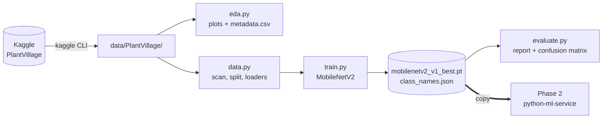

---

## 2. Architecture and Folder Structure

The code is a small **installable package** (`crop_ml`) with one module per concern.
Notebooks only *call* the package, so nothing important lives only inside a notebook,
and every step can also run from the terminal.

```
ml-training/
├── pyproject.toml          ← dependencies + ruff/pytest/mypy config (uv project)
├── uv.lock                 ← exact versions of every package (commit this)
├── src/crop_ml/
│   ├── config.py           ← TrainConfig: every setting in one dataclass
│   ├── data.py             ← scan images, parse class names, stratified split, loaders, sampler
│   ├── transforms.py       ← train (augmenting) and eval (deterministic) pipelines
│   ├── model.py            ← MobileNetV2 with a new classification head
│   ├── train.py            ← CLI: training loop, early stopping, checkpoint
│   ├── evaluate.py         ← CLI: classification report, confusion matrix, summary JSON
│   ├── eda.py              ← CLI: class distribution, image sizes, sample grid
│   └── theory/             ← week 1: gradient_descent, lr_experiment, loss_functions
├── notebooks/              ← 01_gradient_descent, 02_plantvillage_eda, 03_baseline_model
├── tests/                  ← pytest on a tiny synthetic dataset (no download needed)
├── data/                   ← dataset (gitignored)
└── outputs/                ← plots, checkpoints, splits.json (gitignored)
```

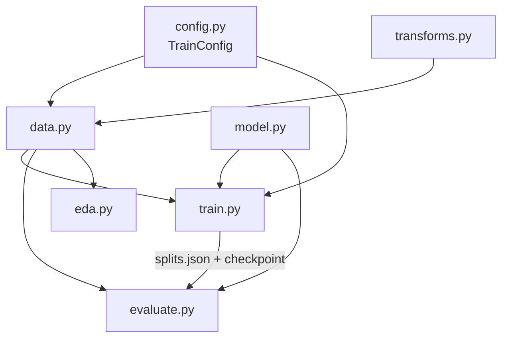

---

## 3. Environment Setup

### 3.1 Tools (once per machine)

```bash
# Homebrew package manager (skip if `brew --version` already works)
/bin/bash -c "$(curl -fsSL https://raw.githubusercontent.com/Homebrew/install/HEAD/install.sh)"

# uv: installs Python itself and manages every project's packages
brew install uv
uv python install 3.11
```

> You do **not** need pyenv: `uv python install` manages Python versions, and the
> `.python-version` file in the project pins 3.11.

### 3.2 Create the project and install dependencies

The repo already contains `ml-training/`, so you only run `uv sync`. To recreate it from
scratch, these are the commands that built it:

```bash
uv init --package --python 3.11 --name crop-ml ml-training
cd ml-training

# Runtime dependencies (comments go on their own lines; a comment after "\" breaks the command)
uv add numpy pandas matplotlib seaborn scikit-learn torch torchvision pillow tqdm

# Dev-only tools: tests, lint, notebooks, dataset download
uv add --dev pytest ruff mypy ipykernel jupyter kaggle
```

Day to day:

```bash
cd ml-training
uv sync                 # create/update .venv exactly as uv.lock says
uv run pytest           # 15 tests, ~30 s, no dataset needed
uv run ruff check .     # lint
```

> `uv run <cmd>` runs inside the project's `.venv`, so you never have to `source activate`.
> `uv.lock` pins every version; commit it. No `requirements.txt` is needed.

**File:** `ml-training/pyproject.toml`

```toml
[project]
name = "crop-ml"
version = "0.1.0"
description = "Phase 1: PlantVillage data pipeline and MobileNetV2 baseline for crop disease classification"
readme = "README.md"
authors = [
    { name = "Paul Mburu", email = "paulmburu53@gmail.com" }
]
requires-python = ">=3.11"
dependencies = [
    "matplotlib>=3.11.2",
    "numpy>=2.4.6",
    "pandas>=3.1.0",
    "pillow>=13.0.0",
    "scikit-learn>=1.9.1",
    "seaborn>=0.13.2",
    "torch>=2.15.0",
    "torchvision>=0.29.2",
    "tqdm>=4.70.1",
]

[build-system]
requires = ["uv_build>=0.12.5,<0.13.0"]
build-backend = "uv_build"

[dependency-groups]
dev = [
    "ipykernel>=7.4.0",
    "jupyter>=1.1.1",
    "kaggle>=2.2.5",
    "mypy>=2.4.1",
    "pytest>=9.2.0",
    "ruff>=0.17.3",
]

[tool.ruff]
line-length = 120
target-version = "py311"

[tool.ruff.lint]
select = ["E", "F", "I", "B", "UP"]
per-file-ignores = { "notebooks/*" = ["E402", "E701", "E702"] }  # notebooks favour short exploratory lines

[tool.pytest.ini_options]
testpaths = ["tests"]
addopts = "-q"

[tool.mypy]
python_version = "3.11"
ignore_missing_imports = true
```

### 3.3 Register the Jupyter kernel

```bash
uv run python -m ipykernel install --user --name crop-ml --display-name "crop-ml (ml-training)"
uv run jupyter lab        # pick the "crop-ml" kernel in each notebook
```

### 3.4 Kaggle login (needed in Week 2)

1. Create a free account at kaggle.com and verify your email.
2. Log the CLI in through your browser (no file to copy, nothing to paste):

```bash
cd ml-training
uv run kaggle auth login                                 # opens a browser; approve access
uv run kaggle datasets list -s plantdisease | head -3   # a list = login works
```

If the browser flow is not possible, Kaggle's settings page (kaggle.com/settings/api) offers
**Generate New Token** (save it to `~/.kaggle/access_token`) or the older **Create Legacy API Key**
(`~/.kaggle/kaggle.json`); then `chmod 600` the file. Treat either one as a password.

---

## 4. Week 1 — Math Intuition

> **Week 1 goal:** implement gradient descent by hand so you understand it mechanically.
> Interviewers will ask you to explain it on a whiteboard.

### 4.1 How a Neural Network Learns (Concept Map)

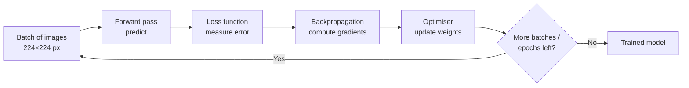

One trip round this loop is one **step**; one pass over every training image is one **epoch**.

| Term | One-sentence definition |
|---|---|
| Weight | A number inside the model that gets adjusted during training |
| Bias | An offset weight that lets the model shift its output |
| Forward pass | Running input through the model to produce a prediction |
| Loss | A number measuring how wrong the prediction was |
| Gradient | The direction and size to move each weight to reduce the loss |
| Backpropagation | Computing gradients by working backwards through the layers (chain rule) |
| Learning rate | How large a step the optimiser takes when updating weights |
| Epoch | One full pass through the training dataset |
| Batch | A subset of training data processed before one weight update |
| Overfitting | The model memorises training data but fails on new data |

### 4.2 Linear Regression from Scratch

Fit `y = w·x + b` with nothing but numpy, so every moving part is visible.

**File:** `ml-training/src/crop_ml/theory/gradient_descent.py`

```python
"""Linear regression trained with hand-written gradient descent.

Week 1 theory exercise: every moving part of training (forward pass, loss,
gradients, update) is visible before PyTorch hides it.

Run:  uv run python -m crop_ml.theory.gradient_descent
Out:  outputs/plots/gradient_descent.png
"""

from pathlib import Path

import matplotlib

matplotlib.use("Agg")  # write PNGs without needing a GUI window
import matplotlib.pyplot as plt  # noqa: E402
import numpy as np  # noqa: E402

PLOTS_DIR = Path("outputs/plots")


def generate_data(n: int = 100, seed: int = 42) -> tuple[np.ndarray, np.ndarray]:
    """Return X, y with a known relationship y = 3x + 2 plus noise.

    Knowing the true answer (w=3, b=2) lets us check that training works.
    """
    rng = np.random.default_rng(seed)
    X = rng.standard_normal(n)
    y = 3 * X + 2 + rng.standard_normal(n) * 0.5
    return X, y


def forward(X: np.ndarray, w: float, b: float) -> np.ndarray:
    """Forward pass: the model is just a line."""
    return w * X + b


def mse_loss(y_pred: np.ndarray, y_true: np.ndarray) -> float:
    """Mean squared error. Squaring removes signs and punishes big misses."""
    return float(np.mean((y_pred - y_true) ** 2))


def compute_gradients(
    X: np.ndarray, y_pred: np.ndarray, y_true: np.ndarray
) -> tuple[float, float]:
    """Partial derivatives of MSE with respect to w and b (chain rule).

    dL/dw = 2 * mean(X * error)      dL/db = 2 * mean(error)
    """
    error = y_pred - y_true
    return float(2 * np.mean(X * error)), float(2 * np.mean(error))


def train(
    X: np.ndarray, y: np.ndarray, lr: float = 0.05, epochs: int = 200, verbose: bool = True
) -> tuple[float, float, list[float]]:
    """Run full-batch gradient descent. Returns (w, b, loss history)."""
    w, b = 0.0, 0.0
    losses: list[float] = []
    for epoch in range(epochs):
        y_pred = forward(X, w, b)  # 1. predict
        loss = mse_loss(y_pred, y)  # 2. measure error
        losses.append(loss)
        dw, db = compute_gradients(X, y_pred, y)  # 3. which way is downhill?
        w -= lr * dw  # 4. step downhill
        b -= lr * db
        if verbose and epoch % 20 == 0:
            print(f"Epoch {epoch:3d} | Loss: {loss:.4f} | w={w:.3f} b={b:.3f}")
    return w, b, losses


def plot_results(
    X: np.ndarray, y: np.ndarray, w: float, b: float, losses: list[float], save_dir: Path = PLOTS_DIR
) -> Path:
    """Save the fitted line and the loss curve side by side. Returns the file path."""
    save_dir.mkdir(parents=True, exist_ok=True)
    fig, axes = plt.subplots(1, 2, figsize=(12, 4))

    axes[0].scatter(X, y, alpha=0.5, label="Data", color="steelblue")
    x_line = np.linspace(X.min(), X.max(), 100)
    axes[0].plot(x_line, w * x_line + b, color="tomato", lw=2, label=f"Fit: y={w:.2f}x+{b:.2f}")
    axes[0].set(title="Fitted line", xlabel="X", ylabel="y")
    axes[0].legend()

    axes[1].plot(losses, color="steelblue")
    axes[1].set(title="Loss convergence", xlabel="Epoch", ylabel="MSE (log scale)", yscale="log")

    path = save_dir / "gradient_descent.png"
    fig.tight_layout()
    fig.savefig(path, dpi=150, bbox_inches="tight")
    plt.close(fig)
    return path


if __name__ == "__main__":
    X, y = generate_data()
    w, b, losses = train(X, y)
    print(f"\nLearned: w={w:.3f}, b={b:.3f}  (true: w=3.0, b=2.0)")
    print(f"Saved plot -> {plot_results(X, y, w, b, losses)}")
```

**Run it:**

```bash
uv run python -m crop_ml.theory.gradient_descent
```

**Expected output** (exact, the data is seeded):

```
Epoch   0 | Loss: 9.2256 | w=0.173 b=0.184
Epoch  20 | Loss: 0.8257 | w=2.180 b=1.714
...
Epoch 180 | Loss: 0.2353 | w=3.060 b=1.998

Learned: w=3.060, b=1.998  (true: w=3.0, b=2.0)
Saved plot -> outputs/plots/gradient_descent.png
```

The learned values are close to, not exactly, 3 and 2: the noise in the data makes the
best-fitting line differ slightly from the true one. That is expected.

### 4.3 Learning Rate: Too Small, Good, Too Large

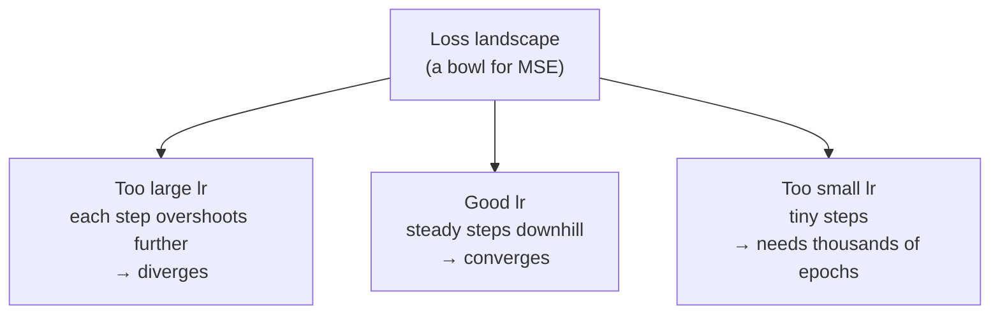

**Why does 0.5 still work here?** For MSE on this data the loss bowl has curvature ≈ 2,
and plain gradient descent stays stable while `lr < 2 / curvature ≈ 1.0`. So 0.5 converges
(very fast), and you need `lr > 1` to see divergence. The experiment includes both.

**File:** `ml-training/src/crop_ml/theory/lr_experiment.py`

```python
"""How the learning rate changes convergence: too small, good, near the edge, too large.

For this data (X ~ N(0, 1)) the MSE curvature is about 2, so plain gradient
descent is stable only while lr < ~1.0. lr=0.5 converges in very few steps;
lr=1.05 overshoots further on every step and diverges.

Run:  uv run python -m crop_ml.theory.lr_experiment
Out:  outputs/plots/learning_rate_comparison.png
"""

from pathlib import Path

import matplotlib

matplotlib.use("Agg")
import matplotlib.pyplot as plt  # noqa: E402

from crop_ml.theory.gradient_descent import PLOTS_DIR, generate_data, train  # noqa: E402

EXPERIMENTS = {
    "lr=0.001 (too small)": 0.001,
    "lr=0.05 (good)": 0.05,
    "lr=0.5 (fast, still stable)": 0.5,
    "lr=1.05 (too large: diverges)": 1.05,
}


def run_all(epochs: int = 60) -> dict[str, list[float]]:
    """Train once per learning rate and return each loss history."""
    X, y = generate_data()
    return {label: train(X, y, lr=lr, epochs=epochs, verbose=False)[2] for label, lr in EXPERIMENTS.items()}


def plot(histories: dict[str, list[float]], save_dir: Path = PLOTS_DIR) -> Path:
    """Plot every history on one log-scale chart (clipped so divergence stays readable)."""
    save_dir.mkdir(parents=True, exist_ok=True)
    fig, ax = plt.subplots(figsize=(10, 4))
    for label, losses in histories.items():
        ax.plot([min(v, 1e3) for v in losses], label=label)
    ax.set(xlabel="Epoch", ylabel="MSE (clipped at 1000, log)", yscale="log",
           title="Effect of learning rate on convergence")
    ax.legend()
    path = save_dir / "learning_rate_comparison.png"
    fig.savefig(path, dpi=150, bbox_inches="tight")
    plt.close(fig)
    return path


if __name__ == "__main__":
    histories = run_all()
    for label, losses in histories.items():
        print(f"{label:32s} final loss = {losses[-1]:.4g}")
    print(f"Saved -> {plot(histories)}")
```

**Run it:**

```bash
uv run python -m crop_ml.theory.lr_experiment
```

**Expected output:**

```
lr=0.001 (too small)             final loss = 7.84
lr=0.05 (good)                   final loss = 0.24
lr=0.5 (fast, still stable)      final loss = 0.2353
lr=1.05 (too large: diverges)    final loss = 8.012e+05
Saved -> outputs/plots/learning_rate_comparison.png
```

### 4.4 Loss Functions — When to Use Which

**File:** `ml-training/src/crop_ml/theory/loss_functions.py`

```python
"""The four losses you meet most often, written by hand and checked against PyTorch.

- MSE: regression, punishes large errors hard.
- MAE: regression, robust to outliers.
- Cross-entropy: pick 1 of N classes (our crop disease task).
- Binary cross-entropy: yes/no, or several independent yes/no labels.

Run:  uv run python -m crop_ml.theory.loss_functions
"""

import numpy as np
import torch
from torch import nn


def mse(y_pred: np.ndarray, y_true: np.ndarray) -> float:
    return float(np.mean((y_pred - y_true) ** 2))


def mae(y_pred: np.ndarray, y_true: np.ndarray) -> float:
    return float(np.mean(np.abs(y_pred - y_true)))


def cross_entropy(logits: np.ndarray, true_class: int) -> float:
    """Softmax the raw scores, then take -log(probability of the correct class)."""
    exp = np.exp(logits - logits.max())  # subtracting the max avoids overflow
    probs = exp / exp.sum()
    return float(-np.log(probs[true_class]))


def binary_cross_entropy(logit: float, label: int) -> float:
    """Sigmoid the raw score, then -[y*log(p) + (1-y)*log(1-p)]."""
    p = 1.0 / (1.0 + np.exp(-logit))
    return float(-(label * np.log(p) + (1 - label) * np.log(1 - p)))


def _t(a: np.ndarray) -> torch.Tensor:
    return torch.from_numpy(np.asarray(a, dtype=np.float32))


def main() -> None:
    y_pred = np.array([2.5, 0.0, 2.0, 8.0])
    y_true = np.array([3.0, -0.5, 2.0, 7.0])
    print(f"MSE  manual={mse(y_pred, y_true):.4f}  torch={nn.MSELoss()(_t(y_pred), _t(y_true)):.4f}")
    print(f"MAE  manual={mae(y_pred, y_true):.4f}  torch={nn.L1Loss()(_t(y_pred), _t(y_true)):.4f}")

    # 3 classes (Healthy, Early blight, Late blight); the model favours class 0.
    logits = np.array([2.0, 1.0, 0.1])
    torch_ce = nn.CrossEntropyLoss()(_t(logits).unsqueeze(0), torch.tensor([0]))
    print(f"CE   manual={cross_entropy(logits, 0):.4f}  torch={torch_ce:.4f}")

    torch_bce = nn.BCEWithLogitsLoss()(torch.tensor([1.5]), torch.tensor([1.0]))
    print(f"BCE  manual={binary_cross_entropy(1.5, 1):.4f}  torch={torch_bce:.4f}")

    print(
        "\nWhich loss?\n"
        "  predict a number           -> MSE (default) or MAE (outliers)\n"
        "  yes/no                     -> BCEWithLogitsLoss\n"
        "  1 of N classes             -> CrossEntropyLoss (feed raw logits, no softmax)\n"
        "  several labels at once     -> BCEWithLogitsLoss per label"
    )


if __name__ == "__main__":
    main()
```

**Run it:** `uv run python -m crop_ml.theory.loss_functions`. Each "manual" value matches
its "torch" value, which proves the formula is right.

| Task | Loss | PyTorch |
|---|---|---|
| Predict a number | MSE (default) / MAE (outliers) | `nn.MSELoss`, `nn.L1Loss` |
| Yes / no | Binary cross-entropy | `nn.BCEWithLogitsLoss` |
| One of N classes (**our task**) | Cross-entropy | `nn.CrossEntropyLoss` (takes raw logits) |
| Several labels at once | BCE per label | `nn.BCEWithLogitsLoss` |

### 4.5 What a CNN Actually Does

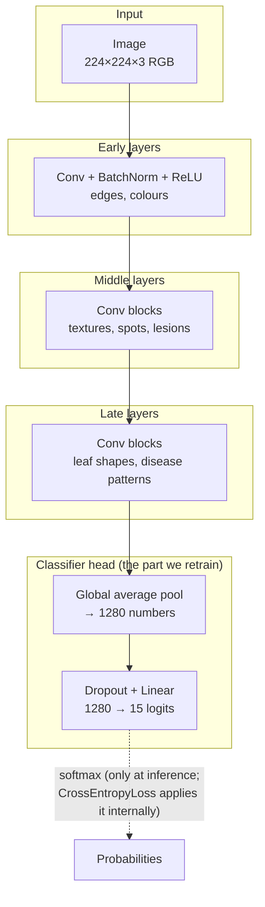

| Component | What it does | Intuition |
|---|---|---|
| Convolutional layer | Slides a small filter over the image, computing dot products | Finds a pattern anywhere in the image |
| ReLU | Sets negative values to 0 | Non-linearity; without it the network collapses to one linear map |
| Pooling / stride | Shrinks the spatial size | Keeps the strongest signal, cuts compute |
| Batch normalisation | Normalises activations per channel | Stabilises and speeds up training |
| Dropout | Randomly zeros activations during training | Regularisation: no single path can be relied on |
| Global average pooling | Averages each feature map to one number | Turns a feature map into a flat vector |
| Linear layer | Matrix multiply to class scores (logits) | The actual classifier |
| Softmax | Turns logits into probabilities that sum to 1 | Readable confidence |

MobileNetV2 replaces ordinary convolutions with *depthwise-separable* ones, which need
~8–9× fewer operations. That is why it runs well on phones (Phases 6–7).

---

## 5. Week 2 — Data Work

> Real ML engineers spend most of their time here. Most tutorials skip it. Yours won't.

### 5.1 Download the PlantVillage Dataset

**Dataset facts** (Kaggle `emmarex/plantdisease`, counted after download): **20,638 images**,
**15 classes** across pepper, potato and tomato. The zip is **≈690 MB**, because it also contains a
duplicate copy of everything in a nested `PlantVillage/PlantVillage/` folder. (The full PlantVillage
set has 38 classes and 54k images; this Kaggle version is the 15-class subset.)

```bash
cd ml-training
uv run kaggle datasets download -d emmarex/plantdisease -p data/ --unzip   # slow: ~690 MB
ls data/PlantVillage
```

**Expected output:** 15 class folders plus the nested `PlantVillage` duplicate (which `data.py`
ignores, because it holds no images directly):

```
Pepper__bell___Bacterial_spot   Tomato_Bacterial_spot                          Tomato__Target_Spot
Pepper__bell___healthy          Tomato_Early_blight                            Tomato__Tomato_YellowLeaf__Curl_Virus
Potato___Early_blight           Tomato_Late_blight                             Tomato__Tomato_mosaic_virus
Potato___Late_blight            Tomato_Leaf_Mold                               Tomato_healthy
Potato___healthy                Tomato_Septoria_leaf_spot                      Tomato_Spider_mites_Two_spotted_spider_mite
```

**Two traps in this dataset**, both handled in `data.py`:

1. **Inconsistent folder names.** Three styles exist: `Potato___Early_blight` (three underscores),
   `Tomato__Target_Spot` (two) and `Tomato_Bacterial_spot` (one). A naive `split("___")` mislabels
   every tomato class. `parse_class_name()` uses the longest separator present.
2. **Mixed-case extensions.** Many files are `.JPG`. `glob("*.jpg")` and `find -name "*.jpg"`
   are case-sensitive and silently miss them, so the code compares `suffix.lower()`.

If your copy has a different layout, point the code at the folder that *contains* the class
folders with `--data-dir`.

### 5.2 The Data Module

This one module turns a folder of images into DataLoaders. Read its docstring first: it lists the
four bugs it avoids.

**File:** `ml-training/src/crop_ml/data.py`

```python
"""Find images, label them, split them, and build DataLoaders.

Dataset layout (Kaggle `emmarex/plantdisease`, 15 classes, ~20.6k images):

    data/plantvillage/PlantVillage/
        Pepper__bell___Bacterial_spot/xxx.JPG
        Potato___Early_blight/...
        Tomato__Target_Spot/...          <- some folders use "__"
        Tomato_Bacterial_spot/...        <- and some a single "_"

Things this module gets right that are easy to get wrong:
- File extensions are mixed case (.JPG / .jpg), so matching is case-insensitive.
- The split is stratified, so rare classes appear in val and test too.
- Each split has its own Dataset object, so train gets augmentation and
  val/test do not.
- The balancing sampler is built from *train* labels only, so it can never
  draw a val/test image into training.
"""

import json
from collections import Counter
from dataclasses import dataclass
from pathlib import Path

import pandas as pd
import torch
from PIL import Image
from sklearn.model_selection import train_test_split
from torch.utils.data import DataLoader, Dataset, WeightedRandomSampler

from crop_ml.config import TrainConfig
from crop_ml.transforms import build_eval_transforms, build_train_transforms

IMAGE_EXTENSIONS = {".jpg", ".jpeg", ".png"}


def parse_class_name(folder: str) -> tuple[str, str]:
    """Split a PlantVillage folder name into (plant, condition).

    >>> parse_class_name("Pepper__bell___Bacterial_spot")
    ('Pepper bell', 'Bacterial spot')
    >>> parse_class_name("Tomato__Target_Spot")
    ('Tomato', 'Target Spot')
    >>> parse_class_name("Tomato_Bacterial_spot")
    ('Tomato', 'Bacterial spot')
    """
    # Three naming styles exist in this dataset: "Potato___Early_blight",
    # "Tomato__Target_Spot" and "Tomato_Bacterial_spot". Use the longest separator present.
    sep = next((s for s in ("___", "__", "_") if s in folder), "_")
    plant, _, condition = folder.partition(sep)

    def clean(s: str) -> str:
        return " ".join(s.replace("_", " ").split())

    return clean(plant), clean(condition) or "unknown"


def scan_images(data_dir: Path) -> pd.DataFrame:
    """One row per image: path, class_name, label (int), plant, condition.

    Labels are assigned in sorted folder order; that order is saved as
    class_names.json and must never change between training and serving.
    """
    if not data_dir.is_dir():
        raise FileNotFoundError(f"Dataset folder not found: {data_dir}")
    # Only folders that directly contain images are classes. The Kaggle zip also holds a
    # nested duplicate "PlantVillage/" folder with no images of its own; counting it as a
    # class would shift every label index after it.
    class_dirs = sorted(d for d in data_dir.iterdir()
                        if d.is_dir() and any(f.suffix.lower() in IMAGE_EXTENSIONS for f in d.iterdir()))
    rows = []
    for label, d in enumerate(class_dirs):
        plant, condition = parse_class_name(d.name)
        for f in sorted(d.iterdir()):
            if f.suffix.lower() in IMAGE_EXTENSIONS:
                rows.append({"path": str(f), "class_name": d.name, "label": label,
                             "plant": plant, "condition": condition})
    if not rows:
        raise ValueError(f"No images found under {data_dir}")
    return pd.DataFrame(rows)


@dataclass
class Splits:
    train: pd.DataFrame
    val: pd.DataFrame
    test: pd.DataFrame
    class_names: list[str]

    def save(self, path: Path) -> None:
        """Write the exact file lists so evaluation re-uses the same test set."""
        path.parent.mkdir(parents=True, exist_ok=True)
        path.write_text(json.dumps({
            "class_names": self.class_names,
            **{k: getattr(self, k)[["path", "label"]].to_dict("records") for k in ("train", "val", "test")},
        }))

    @classmethod
    def load(cls, path: Path) -> "Splits":
        raw = json.loads(path.read_text())
        return cls(*(pd.DataFrame(raw[k]) for k in ("train", "val", "test")), class_names=raw["class_names"])


def split_dataset(df: pd.DataFrame, val_fraction: float, test_fraction: float, seed: int) -> Splits:
    """Stratified train/val/test split (class proportions kept in every split).

    Note: PlantVillage holds several photos of the same leaf, so a random split
    still lets near-duplicates land in both train and test. Treat test accuracy
    as optimistic; real field photos will score lower.
    """
    class_names = sorted(df["class_name"].unique())
    train_val, test = train_test_split(df, test_size=test_fraction, stratify=df["label"], random_state=seed)
    rel_val = val_fraction / (1 - test_fraction)
    train, val = train_test_split(train_val, test_size=rel_val, stratify=train_val["label"], random_state=seed)
    return Splits(*(s.reset_index(drop=True) for s in (train, val, test)), class_names=class_names)


class LeafDataset(Dataset):
    """Loads images from a split DataFrame and applies one transform."""

    def __init__(self, frame: pd.DataFrame, transform) -> None:
        self.paths = frame["path"].tolist()
        self.labels = frame["label"].tolist()
        self.transform = transform

    def __len__(self) -> int:
        return len(self.paths)

    def __getitem__(self, i: int) -> tuple[torch.Tensor, int]:
        with Image.open(self.paths[i]) as img:
            return self.transform(img.convert("RGB")), self.labels[i]


def make_balanced_sampler(labels: list[int]) -> WeightedRandomSampler:
    """Sample each training image with probability 1/(its class count).

    Rare classes get drawn as often as common ones, which counters the ~20x
    imbalance in this dataset. Built from train labels only.
    """
    counts = Counter(labels)
    weights = torch.tensor([1.0 / counts[y] for y in labels], dtype=torch.double)
    return WeightedRandomSampler(weights, num_samples=len(labels), replacement=True)


def build_dataloaders(cfg: TrainConfig, splits: Splits) -> dict[str, DataLoader]:
    """Return {"train", "val", "test"} DataLoaders for the given splits."""
    train_tf = build_train_transforms(cfg.image_size, cfg.mean, cfg.std)
    eval_tf = build_eval_transforms(cfg.image_size, cfg.mean, cfg.std)
    common = {
        "batch_size": cfg.batch_size,
        "num_workers": cfg.num_workers,
        "persistent_workers": cfg.num_workers > 0,
        "pin_memory": torch.cuda.is_available(),  # only useful (and supported) on CUDA
    }
    return {
        "train": DataLoader(LeafDataset(splits.train, train_tf),
                            sampler=make_balanced_sampler(splits.train["label"].tolist()), **common),
        "val": DataLoader(LeafDataset(splits.val, eval_tf), shuffle=False, **common),
        "test": DataLoader(LeafDataset(splits.test, eval_tf), shuffle=False, **common),
    }
```

How the pieces fit:

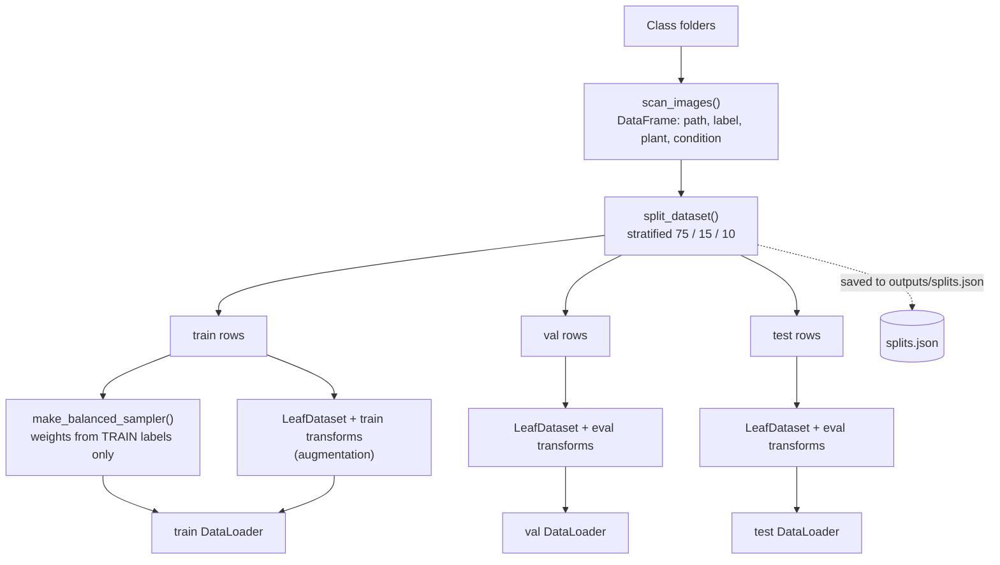

### 5.3 Exploratory Data Analysis (EDA)

**File:** `ml-training/src/crop_ml/eda.py`

```python
"""Exploratory data analysis: what is in the dataset before we train on it.

Run (from ml-training/, after downloading the data):
    uv run python -m crop_ml.eda

Writes:
    data/metadata.csv                    one row per image (path, class, plant, condition, size)
    outputs/plots/class_distribution.png images per class (shows the imbalance)
    outputs/plots/image_sizes.png        width/height spread
    outputs/plots/sample_grid.png        one example image per class
"""

import argparse
from pathlib import Path

import matplotlib

matplotlib.use("Agg")
import matplotlib.pyplot as plt  # noqa: E402
import pandas as pd  # noqa: E402
from PIL import Image  # noqa: E402

from crop_ml.config import TrainConfig  # noqa: E402
from crop_ml.data import scan_images  # noqa: E402


def add_image_sizes(df: pd.DataFrame) -> pd.DataFrame:
    """Add width/height columns (reads only the image header, so it is fast)."""
    sizes = [Image.open(p).size for p in df["path"]]
    return df.assign(width=[w for w, _ in sizes], height=[h for _, h in sizes])


def class_summary(df: pd.DataFrame) -> pd.DataFrame:
    """Images per class, largest first, with share of the dataset."""
    counts = df.groupby("class_name").size().sort_values(ascending=False).rename("images").to_frame()
    counts["share_%"] = (100 * counts["images"] / counts["images"].sum()).round(1)
    return counts


def plot_class_distribution(summary: pd.DataFrame, path: Path) -> None:
    fig, ax = plt.subplots(figsize=(10, 6))
    summary["images"].sort_values().plot.barh(ax=ax, color="seagreen")
    ax.set(xlabel="Images", ylabel="", title="Images per class")
    fig.savefig(path, dpi=150, bbox_inches="tight")
    plt.close(fig)


def plot_image_sizes(df: pd.DataFrame, path: Path) -> None:
    fig, ax = plt.subplots(figsize=(6, 5))
    ax.scatter(df["width"], df["height"], s=4, alpha=0.3)
    ax.set(xlabel="Width (px)", ylabel="Height (px)", title="Image dimensions")
    fig.savefig(path, dpi=150, bbox_inches="tight")
    plt.close(fig)


def plot_sample_grid(df: pd.DataFrame, path: Path, cols: int = 5) -> None:
    """One random image from every class, titled with its class name."""
    samples = df.groupby("class_name").sample(n=1, random_state=0)
    rows = -(-len(samples) // cols)  # ceiling division
    fig, axes = plt.subplots(rows, cols, figsize=(cols * 3, rows * 3.2))
    for ax in axes.flat:
        ax.axis("off")
    for ax, (_, r) in zip(axes.flat, samples.iterrows(), strict=False):
        ax.imshow(Image.open(r["path"]).convert("RGB"))
        ax.set_title(f"{r['plant']}\n{r['condition']}", fontsize=8)  # title still shows with axis off
    fig.savefig(path, dpi=120, bbox_inches="tight")
    plt.close(fig)


def run(data_dir: Path, output_dir: Path, metadata_csv: Path) -> pd.DataFrame:
    df = add_image_sizes(scan_images(data_dir))
    summary = class_summary(df)
    print(summary.to_string())
    print(f"\n{len(df)} images, {len(summary)} classes, "
          f"imbalance (largest/smallest) = {summary['images'].max() / summary['images'].min():.1f}x")

    plots = output_dir / "plots"
    plots.mkdir(parents=True, exist_ok=True)
    plot_class_distribution(summary, plots / "class_distribution.png")
    plot_image_sizes(df, plots / "image_sizes.png")
    plot_sample_grid(df, plots / "sample_grid.png")
    metadata_csv.parent.mkdir(parents=True, exist_ok=True)
    df.to_csv(metadata_csv, index=False)
    print(f"Saved plots -> {plots}/ and metadata -> {metadata_csv}")
    return df


if __name__ == "__main__":
    d = TrainConfig()
    p = argparse.ArgumentParser(description="Explore the PlantVillage dataset.")
    p.add_argument("--data-dir", type=Path, default=d.data_dir)
    p.add_argument("--output-dir", type=Path, default=d.output_dir)
    p.add_argument("--metadata-csv", type=Path, default=Path("data/metadata.csv"))
    a = p.parse_args()
    run(a.data_dir, a.output_dir, a.metadata_csv)
```

**Run it:**

```bash
uv run python -m crop_ml.eda
```

It prints a table of images per class, then a summary line of the form `<N> images, 15 classes,
imbalance (largest/smallest) = <ratio>x` (expect roughly 20,600 images and a ratio around 20x), and saves three plots plus `data/metadata.csv`. The notebook
`02_plantvillage_eda.ipynb` runs the same code and adds `df.info()`, `describe()` and a
plant × condition pivot table.

### 5.4 Class Imbalance

The biggest class (a tomato disease, ~3,200 images) has roughly **20× more images** than the smallest
(potato healthy, ~150). Check the exact ratio in your own EDA output. Trained naively, the model learns to favour big classes.

| Fix | How | Used here |
|---|---|---|
| Oversample rare classes | `WeightedRandomSampler`, weight = 1 / class count | ✅ `make_balanced_sampler()` |
| Weight the loss | `CrossEntropyLoss(weight=...)` | ❌ do *one* of the two, not both |
| Judge with macro F1 | Average F1 over classes equally | ✅ `evaluate.py` |
| Collect more data | — | Not possible here |

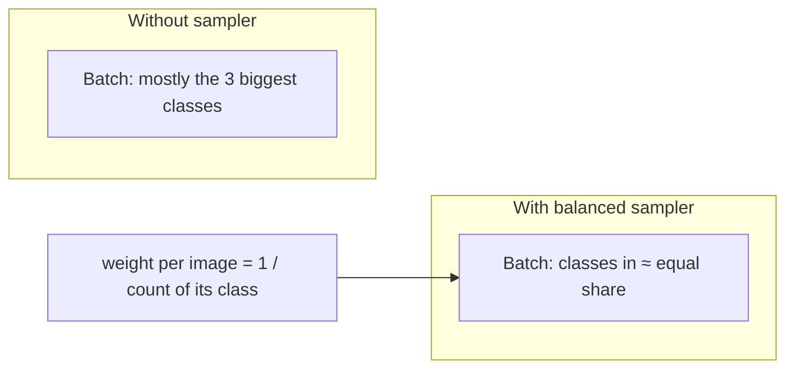

### 5.5 Image Preprocessing Pipeline

**File:** `ml-training/src/crop_ml/transforms.py`

```python
"""Image preprocessing pipelines (torchvision.transforms.v2).

Train: random crop/flip/rotation/colour jitter, so the model sees varied leaves.
Eval:  deterministic resize + centre crop. The Phase 2 service must apply
       exactly this eval pipeline; the checkpoint stores image_size/mean/std
       so it can.
"""

import torch
from torchvision.transforms import v2 as T

from crop_ml.config import IMAGENET_MEAN, IMAGENET_STD


def _to_normalized_tensor(mean: tuple[float, ...], std: tuple[float, ...]) -> list:
    # ToImage + ToDtype(scale=True) replaces the deprecated ToTensor(): uint8 [0,255] -> float [0,1]
    return [T.ToImage(), T.ToDtype(torch.float32, scale=True), T.Normalize(mean, std)]


def build_train_transforms(
    image_size: int = 224, mean: tuple[float, ...] = IMAGENET_MEAN, std: tuple[float, ...] = IMAGENET_STD
) -> T.Compose:
    """Augmenting pipeline for training images (PIL in, normalised CxHxW tensor out)."""
    return T.Compose([
        T.RandomResizedCrop(image_size, scale=(0.7, 1.0)),
        T.RandomHorizontalFlip(),
        T.RandomVerticalFlip(),  # leaf photos have no fixed "up"
        T.RandomRotation(20),
        T.ColorJitter(brightness=0.2, contrast=0.2, saturation=0.2),
        *_to_normalized_tensor(mean, std),
    ])


def build_eval_transforms(
    image_size: int = 224, mean: tuple[float, ...] = IMAGENET_MEAN, std: tuple[float, ...] = IMAGENET_STD
) -> T.Compose:
    """Deterministic pipeline for validation, test and serving."""
    return T.Compose([
        T.Resize(int(image_size * 256 / 224)),  # 256 for 224: standard ImageNet ratio
        T.CenterCrop(image_size),
        *_to_normalized_tensor(mean, std),
    ])
```

| Step | Train | Eval / serving | Why |
|---|---|---|---|
| Size | `RandomResizedCrop(224)` | `Resize(256)` + `CenterCrop(224)` | Train sees varied framing; eval is repeatable |
| Flips / rotation | ✅ | ❌ | Leaves have no fixed orientation |
| Colour jitter | ✅ | ❌ | Robust to lighting |
| To float tensor | `ToImage` + `ToDtype(scale=True)` | same | Replaces the deprecated `ToTensor()` |
| Normalise | ImageNet mean / std | same | The pretrained weights expect it |

> **Contract with Phase 2:** the service must apply exactly the eval pipeline. The checkpoint
> stores `image_size`, `mean` and `std`, and a Phase 2 test checks the result.

### 5.6 Train / Validation / Test Splits

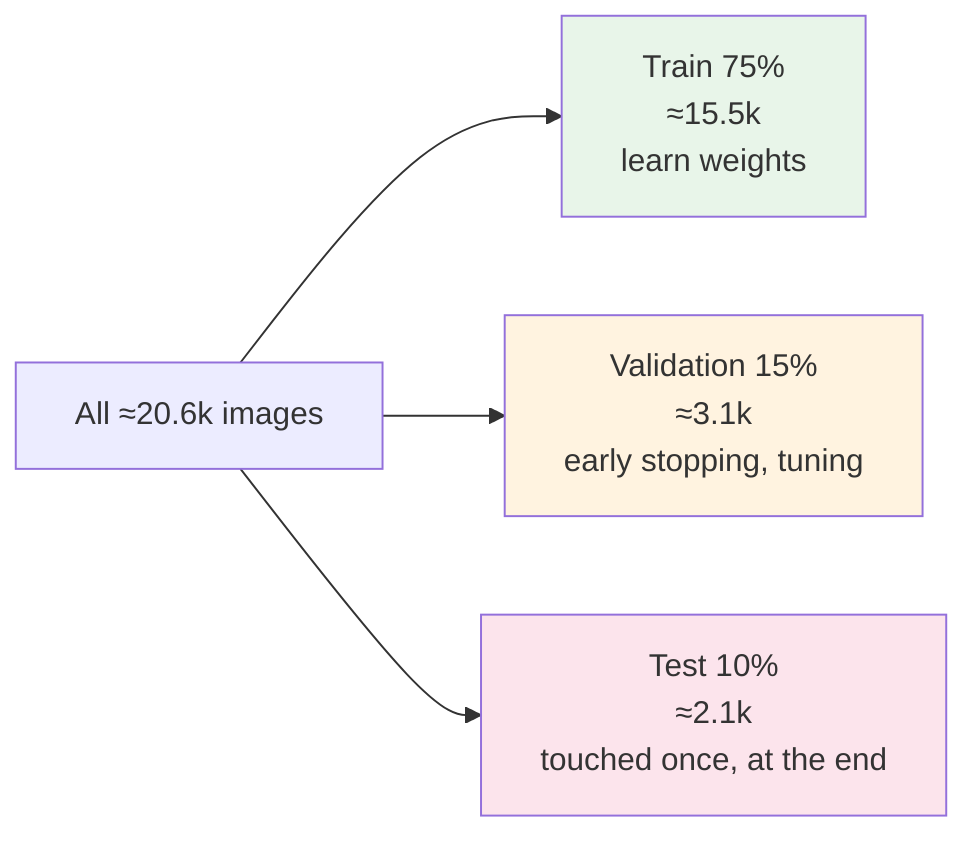

- **Stratified**: every split keeps the class proportions, so rare classes appear in val and test too.
- **Saved** to `outputs/splits.json`: evaluation re-uses the *exact* test files.
- **Caveat:** PlantVillage has several photos of the same physical leaf, so near-duplicates can land in
  both train and test. Test accuracy is therefore optimistic; expect lower accuracy on real field photos.

---

## 6. Training, Evaluation and Notebooks

### 6.1 Configuration

**File:** `ml-training/src/crop_ml/config.py`

```python
"""All training settings in one place.

Every CLI flag in `crop_ml.train` maps onto a field here, so a run is fully
described by one `TrainConfig` (it is saved next to the checkpoint).
"""

from dataclasses import dataclass, field
from pathlib import Path

# ImageNet statistics: the pretrained MobileNetV2 expects inputs normalised this way.
IMAGENET_MEAN = (0.485, 0.456, 0.406)
IMAGENET_STD = (0.229, 0.224, 0.225)


@dataclass
class TrainConfig:
    data_dir: Path = Path("data/PlantVillage")  # folder of class sub-folders
    output_dir: Path = Path("outputs")  # checkpoints/, plots/, splits.json
    model_version: str = "v1"

    image_size: int = 224
    batch_size: int = 32
    epochs: int = 10
    lr: float = 1e-3
    weight_decay: float = 1e-4
    label_smoothing: float = 0.1
    patience: int = 3  # early stopping: epochs without val-loss improvement
    val_fraction: float = 0.15
    test_fraction: float = 0.10
    seed: int = 42
    num_workers: int = 2
    pretrained: bool = True  # False = random weights (offline tests)
    freeze_backbone: bool = True  # train only the classifier head

    mean: tuple[float, float, float] = field(default=IMAGENET_MEAN)
    std: tuple[float, float, float] = field(default=IMAGENET_STD)

    @property
    def checkpoint_dir(self) -> Path:
        return self.output_dir / "checkpoints"

    @property
    def plots_dir(self) -> Path:
        return self.output_dir / "plots"

    @property
    def checkpoint_path(self) -> Path:
        return self.checkpoint_dir / f"mobilenetv2_{self.model_version}_best.pt"
```

### 6.2 Model: Transfer Learning with MobileNetV2

**File:** `ml-training/src/crop_ml/model.py`

```python
"""MobileNetV2 with a new classification head (transfer learning).

MobileNetV2 is small (~3.5M params) and fast on phones, which matters for the
Flutter/KMP phases. We reuse its ImageNet features and replace only the last layer.
"""

from torch import nn
from torchvision.models import MobileNet_V2_Weights, mobilenet_v2


def build_model(num_classes: int, pretrained: bool = True, freeze_backbone: bool = True) -> nn.Module:
    """Return MobileNetV2 whose final Linear layer outputs `num_classes` logits.

    pretrained=True downloads ImageNet weights once (~14 MB, cached by torch).
    freeze_backbone=True trains only the head: fast and enough for a baseline.
    """
    weights = MobileNet_V2_Weights.IMAGENET1K_V2 if pretrained else None
    model = mobilenet_v2(weights=weights)
    if freeze_backbone:
        for p in model.features.parameters():
            p.requires_grad = False
    model.classifier[1] = nn.Linear(model.last_channel, num_classes)
    return model
```

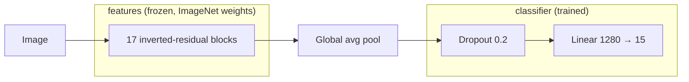

With the backbone frozen only **19,215 parameters** (1280×15 weights + 15 biases) are trained,
out of ~2.2 M. That is fast and is enough for a strong baseline. `--unfreeze` fine-tunes everything.

### 6.3 Training Loop with Early Stopping

**File:** `ml-training/src/crop_ml/train.py`

```python
"""Train the MobileNetV2 baseline and save the best checkpoint.

Run (from ml-training/):
    uv run python -m crop_ml.train                       # defaults from TrainConfig
    uv run python -m crop_ml.train --epochs 3 --batch-size 64

Writes:
    outputs/splits.json                                 exact train/val/test file lists
    outputs/checkpoints/mobilenetv2_v1_best.pt          best model (lowest val loss)
    outputs/checkpoints/class_names.json                label index -> folder name
    outputs/checkpoints/history.json                    per-epoch loss/accuracy

Checkpoint contract (Phase 2 relies on these exact keys):
    model_state_dict, num_classes, class_names, model_version,
    val_acc, image_size, mean, std, confidence_threshold (chosen on validation data)
"""

import argparse
import json
import random
import time
from dataclasses import asdict
from pathlib import Path

import numpy as np
import torch
from torch import nn
from torch.utils.data import DataLoader

from crop_ml.config import TrainConfig
from crop_ml.data import build_dataloaders, scan_images, split_dataset
from crop_ml.model import build_model


def pick_device() -> torch.device:
    """Apple GPU (MPS) on an M-series Mac, CUDA on Nvidia, else CPU."""
    if torch.backends.mps.is_available():
        return torch.device("mps")
    if torch.cuda.is_available():
        return torch.device("cuda")
    return torch.device("cpu")


def set_seed(seed: int) -> None:
    random.seed(seed)
    np.random.seed(seed)
    torch.manual_seed(seed)


def run_epoch(model: nn.Module, loader: DataLoader, criterion: nn.Module, device: torch.device,
              optimizer: torch.optim.Optimizer | None = None, frozen_backbone: bool = False) -> tuple[float, float]:
    """One pass over `loader`. Trains if `optimizer` is given, else evaluates.

    Returns (mean loss, accuracy).
    """
    training = optimizer is not None
    model.train(training)
    if training and frozen_backbone:
        # Frozen layers must also keep their BatchNorm statistics frozen.
        model.features.eval()

    total_loss, correct, seen = 0.0, 0, 0
    with torch.set_grad_enabled(training):
        for images, labels in loader:
            images, labels = images.to(device), labels.to(device)
            logits = model(images)
            loss = criterion(logits, labels)
            if training:
                optimizer.zero_grad()
                loss.backward()
                optimizer.step()
            total_loss += loss.item() * labels.size(0)
            correct += (logits.argmax(1) == labels).sum().item()
            seen += labels.size(0)
    return total_loss / seen, correct / seen


def save_checkpoint(model: nn.Module, cfg: TrainConfig, class_names: list[str], val_acc: float) -> None:
    """Write the checkpoint plus class_names.json (the Phase 1 -> Phase 2 contract)."""
    cfg.checkpoint_dir.mkdir(parents=True, exist_ok=True)
    torch.save({
        "model_state_dict": model.state_dict(),
        "num_classes": len(class_names),
        "class_names": class_names,
        "model_version": cfg.model_version,
        "val_acc": float(val_acc),
        "image_size": cfg.image_size,
        "mean": list(cfg.mean),
        "std": list(cfg.std),
    }, cfg.checkpoint_path)
    (cfg.checkpoint_dir / "class_names.json").write_text(json.dumps(class_names, indent=2))


def fit(cfg: TrainConfig) -> dict[str, list[float]]:
    """Full training run with early stopping. Returns the per-epoch history."""
    set_seed(cfg.seed)
    device = pick_device()

    splits = split_dataset(scan_images(cfg.data_dir), cfg.val_fraction, cfg.test_fraction, cfg.seed)
    splits.save(cfg.output_dir / "splits.json")
    loaders = build_dataloaders(cfg, splits)
    print(f"Device: {device} | classes: {len(splits.class_names)} | "
          f"train/val/test: {len(splits.train)}/{len(splits.val)}/{len(splits.test)}")

    model = build_model(len(splits.class_names), cfg.pretrained, cfg.freeze_backbone).to(device)
    # The sampler already balances classes, so the loss is unweighted (no double correction).
    criterion = nn.CrossEntropyLoss(label_smoothing=cfg.label_smoothing)
    optimizer = torch.optim.AdamW((p for p in model.parameters() if p.requires_grad),
                                  lr=cfg.lr, weight_decay=cfg.weight_decay)
    scheduler = torch.optim.lr_scheduler.ReduceLROnPlateau(optimizer, factor=0.5, patience=1)

    history: dict[str, list[float]] = {"train_loss": [], "train_acc": [], "val_loss": [], "val_acc": []}
    best_val_loss, epochs_without_improvement = float("inf"), 0

    for epoch in range(1, cfg.epochs + 1):
        start = time.perf_counter()
        tr_loss, tr_acc = run_epoch(model, loaders["train"], criterion, device, optimizer, cfg.freeze_backbone)
        va_loss, va_acc = run_epoch(model, loaders["val"], criterion, device)
        scheduler.step(va_loss)
        for k, v in zip(history, (tr_loss, tr_acc, va_loss, va_acc), strict=True):
            history[k].append(v)

        improved = va_loss < best_val_loss
        print(f"Epoch {epoch:2d}/{cfg.epochs} | train {tr_loss:.4f}/{tr_acc:.3f} | "
              f"val {va_loss:.4f}/{va_acc:.3f} | {time.perf_counter() - start:.0f}s"
              f"{'  <- best, saved' if improved else ''}")
        if improved:
            best_val_loss, epochs_without_improvement = va_loss, 0
            save_checkpoint(model, cfg, splits.class_names, va_acc)
        else:
            epochs_without_improvement += 1
            if epochs_without_improvement >= cfg.patience:
                print(f"Early stopping: no val-loss improvement for {cfg.patience} epochs.")
                break

    # Imported here because evaluate.py imports pick_device from this module.
    from crop_ml.evaluate import calibrate

    calibrate(cfg.checkpoint_path, cfg.output_dir / "splits.json", num_workers=cfg.num_workers)
    (cfg.checkpoint_dir / "history.json").write_text(json.dumps(history, indent=2))
    (cfg.checkpoint_dir / "train_config.json").write_text(json.dumps(asdict(cfg), indent=2, default=str))
    print(f"Best checkpoint -> {cfg.checkpoint_path}")
    return history


def parse_args(argv: list[str] | None = None) -> TrainConfig:
    d = TrainConfig()
    p = argparse.ArgumentParser(description="Train the crop disease baseline model.")
    p.add_argument("--data-dir", type=Path, default=d.data_dir)
    p.add_argument("--output-dir", type=Path, default=d.output_dir)
    p.add_argument("--model-version", default=d.model_version)
    p.add_argument("--epochs", type=int, default=d.epochs)
    p.add_argument("--batch-size", type=int, default=d.batch_size)
    p.add_argument("--lr", type=float, default=d.lr)
    p.add_argument("--patience", type=int, default=d.patience)
    p.add_argument("--num-workers", type=int, default=d.num_workers)
    p.add_argument("--no-pretrained", dest="pretrained", action="store_false",
                   help="random init (offline tests only)")
    p.add_argument("--unfreeze", dest="freeze_backbone", action="store_false",
                   help="fine-tune the whole network")
    return TrainConfig(**vars(p.parse_args(argv)))


if __name__ == "__main__":
    fit(parse_args())
```

What happens in each epoch:

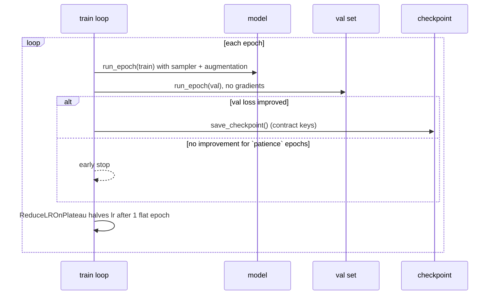

**Run it:**

```bash
uv run python -m crop_ml.train                    # 10 epochs max, early stopping
uv run python -m crop_ml.train --help             # all flags
```

**Expected output** (times are for an M-series Mac using the GPU via MPS):

```
Device: mps | classes: 15 | train/val/test: <≈15.5k>/<≈3.1k>/<≈2.1k>
Epoch  1/10 | train 0.9.../0.8.. | val 0.6.../0.9.. | 60s  <- best, saved
...
Best checkpoint -> outputs/checkpoints/mobilenetv2_v1_best.pt
```

Exact numbers depend on your hardware and versions; a frozen-backbone baseline typically
reaches roughly 90%+ validation accuracy on this dataset.

**The checkpoint contract** (Phase 2 depends on these exact keys):

| Key | Example | Used by Phase 2 for |
|---|---|---|
| `model_state_dict` | weights | rebuilding the network |
| `num_classes` | 15 | sizing the final layer |
| `class_names` | `["Pepper__bell___Bacterial_spot", ...]` | index → label |
| `model_version` | `"v1"` | responses, `/api/v1/models` |
| `val_acc` | 0.93 | `/api/v1/models` |
| `image_size`, `mean`, `std` | 224, ImageNet stats | identical preprocessing |

### 6.4 Evaluation Reporter

**File:** `ml-training/src/crop_ml/evaluate.py`

```python
"""Evaluate a trained checkpoint on the held-out test split.

Run (from ml-training/, after training):
    uv run python -m crop_ml.evaluate
    uv run python -m crop_ml.evaluate --checkpoint outputs/checkpoints/mobilenetv2_v1_best.pt

Uses outputs/splits.json written by training, so the test images are exactly
the ones the model never saw.

Writes:
    outputs/plots/confusion_matrix.png
    outputs/eval_summary.json     accuracy, macro/weighted F1, per-class P/R/F1
"""

import argparse
import json
from pathlib import Path

import matplotlib

matplotlib.use("Agg")
import matplotlib.pyplot as plt  # noqa: E402
import numpy as np  # noqa: E402
import seaborn as sns  # noqa: E402
import torch  # noqa: E402
from sklearn.metrics import accuracy_score, classification_report, confusion_matrix  # noqa: E402
from torch import nn  # noqa: E402
from torch.utils.data import DataLoader  # noqa: E402

from crop_ml.config import TrainConfig  # noqa: E402
from crop_ml.data import LeafDataset, Splits  # noqa: E402
from crop_ml.model import build_model  # noqa: E402
from crop_ml.threshold import ThresholdChoice, choose_threshold  # noqa: E402
from crop_ml.train import pick_device  # noqa: E402
from crop_ml.transforms import build_eval_transforms  # noqa: E402


def load_checkpoint(path: Path, device: torch.device) -> tuple[nn.Module, dict]:
    """Rebuild the model from a checkpoint. Returns (model in eval mode, checkpoint dict)."""
    ckpt = torch.load(path, map_location=device, weights_only=True)
    model = build_model(ckpt["num_classes"], pretrained=False, freeze_backbone=False)
    model.load_state_dict(ckpt["model_state_dict"])
    return model.to(device).eval(), ckpt


@torch.inference_mode()
def predict(model: nn.Module, loader: DataLoader, device: torch.device) -> tuple[np.ndarray, np.ndarray, np.ndarray]:
    """Return (true labels, predicted labels, top-1 confidence) for every image in `loader`."""
    y_true, y_pred, conf = [], [], []
    for images, labels in loader:
        probs = torch.softmax(model(images.to(device)), dim=1)
        top, idx = probs.max(1)
        y_pred.append(idx.cpu().numpy())
        conf.append(top.cpu().numpy())
        y_true.append(labels.numpy())
    return np.concatenate(y_true), np.concatenate(y_pred), np.concatenate(conf)


def calibrate(checkpoint: Path, splits_path: Path, target_precision: float = 0.95, batch_size: int = 64,
              num_workers: int = 2) -> ThresholdChoice:
    """Choose the confidence threshold on the VALIDATION split and store it in the checkpoint."""
    device = pick_device()
    model, ckpt = load_checkpoint(checkpoint, device)
    tf = build_eval_transforms(ckpt["image_size"], tuple(ckpt["mean"]), tuple(ckpt["std"]))
    loader = DataLoader(LeafDataset(Splits.load(splits_path).val, tf), batch_size=batch_size,
                        num_workers=num_workers)
    y_true, y_pred, conf = predict(model, loader, device)
    choice = choose_threshold(conf, y_true == y_pred, target_precision)
    ckpt["confidence_threshold"] = choice.threshold
    torch.save(ckpt, checkpoint)
    print(f"Confidence threshold {choice.threshold:.3f}: answers {choice.coverage:.1%} of validation images "
          f"with {choice.precision:.1%} precision")
    return choice


def save_confusion_matrix(y_true: np.ndarray, y_pred: np.ndarray, class_names: list[str], path: Path) -> None:
    """Row-normalised confusion matrix: each row shows where one true class went."""
    labels = list(range(len(class_names)))
    cm = confusion_matrix(y_true, y_pred, labels=labels, normalize="true")
    fig, ax = plt.subplots(figsize=(max(8, len(labels) * 0.7), max(6, len(labels) * 0.6)))
    sns.heatmap(cm, annot=True, fmt=".2f", cmap="Blues", xticklabels=class_names,
                yticklabels=class_names, ax=ax, cbar=False)
    ax.set(xlabel="Predicted", ylabel="True", title="Confusion matrix (row-normalised)")
    path.parent.mkdir(parents=True, exist_ok=True)
    fig.savefig(path, dpi=150, bbox_inches="tight")
    plt.close(fig)


def _threshold_stats(threshold: float | None, y_true: np.ndarray, y_pred: np.ndarray, conf: np.ndarray) -> dict:
    """How the stored threshold behaves on the test set (answered share and their accuracy)."""
    if threshold is None:
        return {}
    kept = conf >= threshold
    return {"confidence_threshold": threshold, "test_coverage": float(kept.mean()),
            "test_accuracy_when_answered": float((y_true[kept] == y_pred[kept]).mean()) if kept.any() else None}


def evaluate(checkpoint: Path, splits_path: Path, output_dir: Path, batch_size: int = 64,
             num_workers: int = 2) -> dict:
    """Score the checkpoint on the test split, save plots + summary, return the summary."""
    device = pick_device()
    model, ckpt = load_checkpoint(checkpoint, device)
    splits = Splits.load(splits_path)
    class_names: list[str] = ckpt["class_names"]

    tf = build_eval_transforms(ckpt["image_size"], tuple(ckpt["mean"]), tuple(ckpt["std"]))
    loader = DataLoader(LeafDataset(splits.test, tf), batch_size=batch_size, num_workers=num_workers)
    y_true, y_pred, conf = predict(model, loader, device)

    labels = list(range(len(class_names)))
    # labels= keeps every class in the report even if one is missing from the test split;
    # zero_division=0 avoids warnings/NaN for classes with no predictions.
    report = classification_report(y_true, y_pred, labels=labels, target_names=class_names,
                                   zero_division=0, output_dict=True)
    print(classification_report(y_true, y_pred, labels=labels, target_names=class_names, zero_division=0))

    save_confusion_matrix(y_true, y_pred, class_names, output_dir / "plots" / "confusion_matrix.png")
    summary = {
        "model_version": ckpt["model_version"],
        "test_images": int(len(y_true)),
        "accuracy": float(accuracy_score(y_true, y_pred)),
        "macro_f1": report["macro avg"]["f1-score"],
        "weighted_f1": report["weighted avg"]["f1-score"],
        **_threshold_stats(ckpt.get("confidence_threshold"), y_true, y_pred, conf),
        "per_class": {n: {k: report[n][k] for k in ("precision", "recall", "f1-score", "support")}
                      for n in class_names},
    }
    (output_dir / "eval_summary.json").write_text(json.dumps(summary, indent=2))
    print(f"Accuracy {summary['accuracy']:.3f} | macro F1 {summary['macro_f1']:.3f} "
          f"-> {output_dir / 'eval_summary.json'}")
    return summary


if __name__ == "__main__":
    d = TrainConfig()
    p = argparse.ArgumentParser(description="Evaluate a checkpoint on the test split.")
    p.add_argument("--checkpoint", type=Path, default=d.checkpoint_path)
    p.add_argument("--splits", type=Path, default=d.output_dir / "splits.json")
    p.add_argument("--output-dir", type=Path, default=d.output_dir)
    p.add_argument("--num-workers", type=int, default=d.num_workers)
    a = p.parse_args()
    evaluate(a.checkpoint, a.splits, a.output_dir, num_workers=a.num_workers)
```

**Run it:**

```bash
uv run python -m crop_ml.evaluate
```

It prints scikit-learn's per-class precision / recall / F1 table, then
`Accuracy 0.9.. | macro F1 0.9.. -> outputs/eval_summary.json`, and saves
`outputs/plots/confusion_matrix.png`. Read the confusion matrix row by row: each row is a
true class, and off-diagonal cells show what it gets mistaken for (often tomato diseases
for each other).

### 6.5 Tests

The tests build a tiny fake dataset (3 classes, mixed `.jpg`/`.JPG`, one `__` folder) so they
run in seconds without the real data.

**File:** `ml-training/tests/conftest.py`

```python
"""Shared fixtures: a tiny synthetic PlantVillage-style dataset (no download needed)."""

from pathlib import Path

import numpy as np
import pytest
from PIL import Image

# Folder names mimic the real dataset, including the "__" variant and mixed-case extensions.
CLASSES = {
    "Pepper__bell___Bacterial_spot": 24,
    "Potato___healthy": 12,
    "Tomato__Target_Spot": 30,
}


@pytest.fixture(scope="session")
def tiny_dataset(tmp_path_factory: pytest.TempPathFactory) -> Path:
    root = tmp_path_factory.mktemp("plantvillage")
    rng = np.random.default_rng(0)
    for i, (name, n) in enumerate(CLASSES.items()):
        d = root / name
        d.mkdir()
        for j in range(n):
            # Each class has a distinct base colour so a model can actually learn it.
            arr = np.full((64, 80, 3), 60 * (i + 1), dtype=np.uint8)
            arr = (arr + rng.integers(0, 40, arr.shape)).astype(np.uint8)
            ext = ".JPG" if j % 2 else ".jpg"
            Image.fromarray(arr).save(d / f"img_{j}{ext}", format="JPEG")
        (d / "notes.txt").write_text("not an image")
    return root
```

**File:** `ml-training/tests/test_data.py`

```python
import pytest
import torch

from crop_ml.config import TrainConfig
from crop_ml.data import (
    build_dataloaders,
    make_balanced_sampler,
    parse_class_name,
    scan_images,
    split_dataset,
)

from .conftest import CLASSES


@pytest.mark.parametrize(("folder", "expected"), [
    ("Pepper__bell___Bacterial_spot", ("Pepper bell", "Bacterial spot")),
    ("Potato___Early_blight", ("Potato", "Early blight")),
    ("Tomato__Target_Spot", ("Tomato", "Target Spot")),
    ("Tomato__Tomato_YellowLeaf__Curl_Virus", ("Tomato", "Tomato YellowLeaf Curl Virus")),
    ("Tomato_Bacterial_spot", ("Tomato", "Bacterial spot")),
    ("Tomato_healthy", ("Tomato", "healthy")),
])
def test_parse_class_name(folder, expected):
    assert parse_class_name(folder) == expected


def test_scan_counts_mixed_case_extensions_and_skips_non_images(tiny_dataset):
    df = scan_images(tiny_dataset)
    assert len(df) == sum(CLASSES.values())
    assert sorted(df["class_name"].unique()) == sorted(CLASSES)


def test_folders_without_images_are_not_classes(tiny_dataset, tmp_path):
    import shutil

    root = tmp_path / "pv"
    shutil.copytree(tiny_dataset, root)
    (root / "PlantVillage" / "nested").mkdir(parents=True)  # like the duplicate folder in the Kaggle zip
    df = scan_images(root)
    assert sorted(df["class_name"].unique()) == sorted(CLASSES)
    assert sorted(df["label"].unique()) == list(range(len(CLASSES)))  # no gaps in label indices


def test_split_is_disjoint_and_stratified(tiny_dataset):
    s = split_dataset(scan_images(tiny_dataset), 0.15, 0.10, seed=42)
    paths = [set(x["path"]) for x in (s.train, s.val, s.test)]
    assert not (paths[0] & paths[1] or paths[0] & paths[2] or paths[1] & paths[2])
    assert sum(len(p) for p in paths) == sum(CLASSES.values())
    for part in (s.val, s.test):  # every class present in the small splits too
        assert part["label"].nunique() == len(CLASSES)


def test_split_round_trips_through_json(tiny_dataset, tmp_path):
    s = split_dataset(scan_images(tiny_dataset), 0.15, 0.10, seed=42)
    s.save(tmp_path / "splits.json")
    loaded = type(s).load(tmp_path / "splits.json")
    assert loaded.test["path"].tolist() == s.test["path"].tolist()
    assert loaded.class_names == s.class_names


def test_sampler_only_indexes_train_set():
    labels = [0] * 90 + [1] * 10
    idx = list(make_balanced_sampler(labels))
    assert max(idx) < len(labels)
    share_rare = sum(labels[i] == 1 for i in idx) / len(idx)
    assert 0.3 < share_rare < 0.7  # rare class drawn about as often as the common one


def test_train_loader_augments_and_eval_loader_does_not(tiny_dataset):
    cfg = TrainConfig(data_dir=tiny_dataset, image_size=32, batch_size=4, num_workers=0)
    loaders = build_dataloaders(cfg, split_dataset(scan_images(tiny_dataset), 0.15, 0.10, 42))
    ds_train, ds_val = loaders["train"].dataset, loaders["val"].dataset
    assert ds_train.transform is not ds_val.transform
    images, _ = next(iter(loaders["val"]))
    assert images.shape[1:] == (3, 32, 32) and images.dtype == torch.float32
    # Same val image twice -> identical; same train image twice -> differs (random augmentation).
    assert torch.equal(ds_val[0][0], ds_val[0][0])
    assert not torch.equal(ds_train[0][0], ds_train[0][0])
```

**File:** `ml-training/tests/test_training.py`

```python
"""End-to-end smoke test: train 2 epochs on the tiny dataset, then evaluate."""

import json

import torch

from crop_ml.config import TrainConfig
from crop_ml.evaluate import evaluate
from crop_ml.mismatch import run as mismatch_run
from crop_ml.model import build_model
from crop_ml.theory.gradient_descent import generate_data, train
from crop_ml.train import fit

from .conftest import CLASSES

CONTRACT_KEYS = {"model_state_dict", "num_classes", "class_names", "model_version",
                 "val_acc", "image_size", "mean", "std", "confidence_threshold"}


def test_model_outputs_one_logit_per_class():
    model = build_model(5, pretrained=False).eval()
    assert model(torch.zeros(2, 3, 64, 64)).shape == (2, 5)


def test_frozen_backbone_trains_only_head():
    model = build_model(3, pretrained=False, freeze_backbone=True)
    trainable = {n for n, p in model.named_parameters() if p.requires_grad}
    assert trainable == {"classifier.1.weight", "classifier.1.bias"}


def test_gradient_descent_recovers_true_line():
    w, b, losses = train(*generate_data(), lr=0.05, epochs=200, verbose=False)
    assert abs(w - 3) < 0.15 and abs(b - 2) < 0.15 and losses[-1] < losses[0]


def test_fit_then_evaluate_writes_contract_artifacts(tiny_dataset, tmp_path):
    cfg = TrainConfig(data_dir=tiny_dataset, output_dir=tmp_path, image_size=32, batch_size=8,
                      epochs=2, num_workers=0, pretrained=False)
    history = fit(cfg)
    assert len(history["val_loss"]) >= 1

    ckpt = torch.load(cfg.checkpoint_path, weights_only=True)
    assert CONTRACT_KEYS <= ckpt.keys()
    assert ckpt["class_names"] == sorted(CLASSES)
    assert json.loads((cfg.checkpoint_dir / "class_names.json").read_text()) == sorted(CLASSES)

    summary = evaluate(cfg.checkpoint_path, tmp_path / "splits.json", tmp_path, num_workers=0)
    assert set(summary["per_class"]) == set(CLASSES)
    assert (tmp_path / "plots" / "confusion_matrix.png").exists()
    assert 0.5 <= ckpt["confidence_threshold"] <= 1.0
    assert "test_coverage" in summary

    results = mismatch_run(cfg.checkpoint_path, tmp_path / "splits.json", tmp_path / "mismatch.json", num_workers=2)
    assert set(results) == {"correct", "stretch", "no_scale", "bgr"}
```

### 6.6 Notebooks (portfolio output)

| Notebook | What it shows | Needs dataset |
|---|---|---|
| `01_gradient_descent.ipynb` | fitted line, loss curve, learning-rate comparison, loss table | no |
| `02_plantvillage_eda.ipynb` | class table, `info()`/`describe()`, pivot, plots | yes |
| `03_baseline_model.ipynb` | training, history curves, test evaluation, confusion matrix | yes |

Each notebook starts with `os.chdir('..')` so paths resolve from `ml-training/`, and uses
`num_workers=0` (the safest choice inside Jupyter on macOS). Commit them **with outputs**
so GitHub shows the plots.

### 6.7 Confidence Threshold: Knowing When Not to Answer

The classifier always picks one of its classes, even for a blurry or unrelated photo. After
training, `calibrate()` (in `evaluate.py`) picks the lowest confidence that keeps
**≥ 95% precision on the validation set** (never below 0.5) and stores it in the checkpoint as
`confidence_threshold`. The API and the phone both read it from there, so they agree.

**File:** `ml-training/src/crop_ml/threshold.py`

```python
"""Pick the confidence threshold below which the app says "retake photo" instead of guessing.

Rule: the lowest threshold t (never below `floor`) such that predictions with
confidence >= t are correct at least `target_precision` of the time on the
VALIDATION set. Lower t keeps more predictions (coverage); higher t keeps fewer,
more reliable ones.

The threshold is stored in the checkpoint as `confidence_threshold`, so the
Phase 2 service and the phone apply exactly the same rule.

Limitation: this guards against low-confidence mistakes on potato leaves. A photo
of something that is not a potato leaf can still get high confidence; the
threshold reduces that risk but does not remove it.
"""

from dataclasses import dataclass

import numpy as np


@dataclass(frozen=True)
class ThresholdChoice:
    threshold: float
    coverage: float  # share of validation images that would get an answer
    precision: float  # accuracy on those answered images


def choose_threshold(confidences: np.ndarray, correct: np.ndarray,
                     target_precision: float = 0.95, floor: float = 0.5) -> ThresholdChoice:
    """Lowest threshold >= floor whose accepted predictions reach target_precision.

    confidences: top-1 softmax probability per image; correct: bool per image.
    Falls back to the most selective candidate if the target can't be reached.
    """
    if len(confidences) == 0:
        raise ValueError("Need at least one validation prediction")
    candidates = np.unique(np.concatenate([[floor], confidences[confidences >= floor]]))
    best = None
    for t in candidates:  # ascending: first hit is the lowest qualifying threshold
        kept = confidences >= t
        if not kept.any():
            continue
        precision = float(correct[kept].mean())
        best = ThresholdChoice(float(t), float(kept.mean()), precision)
        if precision >= target_precision:
            return best
    return best or ThresholdChoice(float(floor), 0.0, 0.0)
```python
```

**Run it:** `uv run python -m crop_ml.mismatch`

**Result (potato model v1, 216 test images):**

| Variant | Accuracy | Still answered (≥ threshold) | Predictions [early, late, healthy] |
|---|---|---|---|
| correct | 95.8% | 96.3% | [97, 101, 18] |
| stretch to 224×224 | 97.7% | 97.2% | [101, 97, 18] |
| forgot ÷255 | **9.3%** | **91.2%** | [1, 5, 210] |
| red/blue swapped | **55.6%** | **88.9%** | [9, 180, 27] |

- **Forgetting ÷255 makes almost every leaf "healthy"**, confidently. That is the worst possible
  failure for a farmer, and nothing crashes.
- Swapped channels push most leaves to "late blight".
- Stretching did no harm here only because PlantVillage photos are already square (256×256);
  phone photos are not, so measure it again with real camera images.
- The confidence threshold does not catch any of these: broken inputs still produce confident outputs.

### 6.8 The Silent Failure: Preprocessing Mismatch

The phone must prepare images exactly like training did. `mismatch.py` scores the test set with the
correct pipeline and three realistic bugs a Dart port could contain.

**File:** `ml-training/src/crop_ml/mismatch.py`

```python
"""What a preprocessing mismatch does to accuracy: the "silent failure" experiment.

The phone must prepare images exactly like training did. Each variant below is a
realistic bug in a Dart port; the model still returns confident-looking answers,
only the accuracy drops. Nothing crashes, which is why this failure is silent.

Run (from ml-training/, after training):
    uv run python -m crop_ml.mismatch

Variants:
    correct          Resize short side to 256 -> centre crop 224 -> /255 -> normalise
    stretch          Resize straight to 224x224 (aspect ratio distorted, no crop)
    no_scale         Forget /255: pixel values 0..255 reach the network
    bgr              Red and blue channels swapped (common with camera/OpenCV buffers)
"""

import argparse
import json
from pathlib import Path

import numpy as np
import torch
from torch.utils.data import DataLoader
from torchvision.transforms import v2 as T

from crop_ml.config import TrainConfig
from crop_ml.data import LeafDataset, Splits
from crop_ml.evaluate import load_checkpoint, predict
from crop_ml.train import pick_device


def swap_red_blue(x: torch.Tensor) -> torch.Tensor:
    """RGB -> BGR. A named function (not a lambda) so DataLoader worker processes can pickle it."""
    return x[[2, 1, 0]]


def variants(size: int, mean: list[float], std: list[float]) -> dict[str, T.Compose]:
    norm = T.Normalize(mean, std)
    to_float = [T.ToImage(), T.ToDtype(torch.float32, scale=True)]
    crop = [T.Resize(int(size * 256 / 224)), T.CenterCrop(size)]
    return {
        "correct": T.Compose([*crop, *to_float, norm]),
        "stretch": T.Compose([T.Resize((size, size)), *to_float, norm]),
        # scale=False keeps 0..255 values, exactly what a missing "/ 255.0" in Dart produces
        "no_scale": T.Compose([*crop, T.ToImage(), T.ToDtype(torch.float32, scale=False), norm]),
        "bgr": T.Compose([*crop, *to_float, T.Lambda(swap_red_blue), norm]),
    }


def run(checkpoint: Path, splits_path: Path, out: Path, num_workers: int = 2) -> dict[str, dict]:
    device = pick_device()
    model, ckpt = load_checkpoint(checkpoint, device)
    test = Splits.load(splits_path).test
    threshold = ckpt.get("confidence_threshold")
    results = {}
    for name, tf in variants(ckpt["image_size"], ckpt["mean"], ckpt["std"]).items():
        loader = DataLoader(LeafDataset(test, tf), batch_size=64, num_workers=num_workers)
        y_true, y_pred, conf = predict(model, loader, device)
        results[name] = {
            "accuracy": float((y_true == y_pred).mean()),
            "mean_confidence": float(conf.mean()),
            # Share of images the app would still answer (confident) even though the input is broken
            "answered": float((conf >= threshold).mean()) if threshold is not None else None,
            "predicted_class_counts": np.bincount(y_pred, minlength=ckpt["num_classes"]).tolist(),
        }
    out.write_text(json.dumps({"class_names": ckpt["class_names"], "threshold": threshold,
                               "results": results}, indent=2))
    print(f"{'variant':10s} {'accuracy':>9s} {'mean conf':>10s} {'answered':>9s}  predictions per class")
    for name, r in results.items():
        answered = f"{r['answered']:.1%}" if r["answered"] is not None else "-"
        print(f"{name:10s} {r['accuracy']:9.1%} {r['mean_confidence']:10.2f} {answered:>9s}  "
              f"{r['predicted_class_counts']}")
    print(f"\nclasses: {ckpt['class_names']}\nSaved -> {out}")
    return results


if __name__ == "__main__":
    d = TrainConfig()
    p = argparse.ArgumentParser(description="Measure accuracy under preprocessing mismatches.")
    p.add_argument("--checkpoint", type=Path, default=d.checkpoint_path)
    p.add_argument("--splits", type=Path, default=d.output_dir / "splits.json")
    p.add_argument("--out", type=Path, default=d.output_dir / "mismatch.json")
    p.add_argument("--num-workers", type=int, default=d.num_workers)
    a = p.parse_args()
    run(a.checkpoint, a.splits, a.out, a.num_workers)
```

**Run it:** `uv run python -m crop_ml.mismatch`

**Result (potato model v1, 216 test images):**

| Variant | Accuracy | Still answered (≥ threshold) | Predictions [early, late, healthy] |
|---|---|---|---|
| correct | 95.8% | 96.3% | [97, 101, 18] |
| stretch to 224×224 | 97.7% | 97.2% | [101, 97, 18] |
| forgot ÷255 | **9.3%** | **91.2%** | [1, 5, 210] |
| red/blue swapped | **55.6%** | **88.9%** | [9, 180, 27] |

- **Forgetting ÷255 makes almost every leaf "healthy"**, confidently. That is the worst possible
  failure for a farmer, and nothing crashes.
- Swapped channels push most leaves to "late blight".
- Stretching did no harm here only because PlantVillage photos are already square (256×256);
  phone photos are not, so measure it again with real camera images.
- The confidence threshold does not catch any of these: broken inputs still produce confident outputs.

### 6.9 Potato Demo (used in the presentation)

The presentation uses only the 3 potato classes (2,152 images: early blight 1,000, late blight 1,000,
healthy 152, a 6.6× imbalance). No code changes, just a different data folder:

```bash
mkdir -p data/potato
for c in Potato___Early_blight Potato___Late_blight Potato___healthy; do
  ln -sfn "$PWD/data/PlantVillage/$c" "data/potato/$c"   # links, no copying
done
uv run python -m crop_ml.eda --data-dir data/potato --metadata-csv data/potato_metadata.csv
uv run python -m crop_ml.train --data-dir data/potato     # ~40 s on an M-series Mac
uv run python -m crop_ml.evaluate
uv run python -m crop_ml.mismatch
```

Results: test accuracy **95.8%**, macro F1 **0.945**. Per class (precision / recall):
early blight 0.99 / 0.95, late blight 0.95 / 0.96, healthy 0.83 / 1.00. A few blighted leaves are
called healthy, which is the costly direction for a farmer.

### 6.10 Hand-off to Phase 2

```bash
cp outputs/checkpoints/mobilenetv2_v1_best.pt outputs/checkpoints/class_names.json \
   ../python-ml-service/models/
```

---

## 7. Interview Questions & Model Answers

These are real questions pulled from 2026 AI/ML hiring loops. Each maps to
specific code you wrote this phase.

---

### Q1. "Explain gradient descent in plain English."

**Model answer:**

> "Imagine you're blindfolded on a hilly landscape and you want to reach the
> lowest point. You feel the slope under your feet and take a step downhill.
> Repeat until you can't go lower. That's gradient descent — the 'landscape'
> is the loss function over all possible weight values, the 'slope' is the
> gradient, and the step size is the learning rate."

> "In my implementation, I computed the gradient of MSE loss with respect to
> each parameter manually using calculus — `dL/dw = 2 * mean(X * error)`. Then
> updated `w -= lr * dw`. I experimented with learning rates of 0.001, 0.05,
> 0.5 and 1.05. 0.001 barely moved, 0.05 converged smoothly, 0.5 converged
> fastest, and 1.05 diverged: each step overshot the minimum by more than the
> last. For MSE the stable limit is lr < 2 / curvature, which is about 1.0 for
> this data, so that is exactly where it broke."

*Reference: `crop_ml/theory/gradient_descent.py`, `crop_ml/theory/lr_experiment.py`*

---

### Q2. "What loss function did you use and why?"

**Model answer:**

> "Cross-entropy for the classification task. The reason is that cross-entropy
> penalises confident wrong predictions very harshly — if the model says 99%
> probability for the wrong class, the loss is very large. MSE wouldn't work
> well here because it doesn't have that property; a 99% confidence wrong
> prediction and a 60% confidence wrong prediction would produce similar MSE
> but very different cross-entropy values."

> "I also added label smoothing of 0.1. Instead of training toward hard 0/1
> targets, the model trains toward 0.05/0.95, which reduces overconfidence and
> often improves generalisation — especially useful with 15 classes where some
> diseases look very similar."

*Reference: `crop_ml/train.py` — `CrossEntropyLoss(label_smoothing=0.1)`*

---

### Q3. "How did you handle class imbalance in the dataset?"

**Model answer:**

> "This PlantVillage subset is heavily imbalanced: the largest class has about
> 20x more images than the smallest. Without correction, the model learns to
> bias toward common classes. I used a `WeightedRandomSampler` where each
> training image's weight is `1 / count(its class)`, so every class is drawn
> about equally often. I built the weights from the training split only; built
> from the whole dataset they would index validation and test images and leak
> them into training. I didn't also weight the loss, because that would
> correct the imbalance twice."

> "A unit test checks that a class with 10% of the images is drawn about 50%
> of the time in a two-class case. I judge the model with macro F1, which
> weights every class equally."

*Reference: `crop_ml/data.py` — `make_balanced_sampler()`*

---

### Q4. "What is the difference between training, validation, and test sets?"

**Model answer:**

> "Training is what the model learns from. Validation is used to monitor
> progress and tune hyperparameters — because I'm making decisions based on
> validation metrics, the model indirectly 'sees' this data through my choices.
> Test is evaluated exactly once, after all tuning, to give an honest estimate
> of real-world performance."

> "A common mistake is using test set performance to make any model decision —
> that inflates the reported accuracy and the model isn't as good as reported.
> In my pipeline the split is stratified, saved to `splits.json`, and the test
> files are only read by `evaluate.py` after training is finished."

*Reference: `crop_ml/data.py` — `split_dataset()`, `build_dataloaders()`*

---

### Q5. "Why use transfer learning instead of training from scratch?"

**Model answer:**

> "MobileNetV2 was pretrained on ImageNet — 1.2 million images across 1000
> classes. The early layers learned to detect edges, textures, and shapes that
> are universally useful for image recognition. Training those from scratch on
> about 20,000 images would likely overfit and take much longer. Transfer
> learning lets me start from that knowledge and only adapt the final
> classifier layer to my 15 crop disease classes."

> "In practice: I froze the backbone initially and only trained the new
> classifier head: 19,215 trainable parameters instead of about 2.2 million.
> I also kept the frozen layers' BatchNorm statistics fixed. Training all the
> weights from scratch on this dataset size would likely give much worse
> results."

*Reference: `crop_ml/model.py` — `build_model(freeze_backbone=True)`*

---

### Q6. "What is overfitting and how do you detect and prevent it?"

**Model answer:**

> "Overfitting is when the model memorises the training data rather than
> learning general patterns. It manifests as a growing gap between training
> accuracy and validation accuracy — training keeps improving while validation
> plateaus or degrades."

> "I detect it by plotting training and validation loss curves together. I
> prevent it with: (1) dropout in the MobileNetV2 classifier, (2) L2
> regularisation via `weight_decay=1e-4` in AdamW, (3) data augmentation,
> which artificially increases the diversity of training examples, (4) label
> smoothing, which prevents overconfident predictions, and (5) early stopping:
> I keep the checkpoint with the lowest validation loss and stop after 3
> epochs without improvement."

*Reference: `crop_ml/train.py`, `crop_ml/transforms.py`*

---

### Q7. "Explain precision, recall, and F1. When would you prioritise recall over precision?"

**Model answer:**

> "Precision: of all predictions for a class, what fraction were correct?
> Recall: of all actual instances of a class, what fraction did the model find?
> F1: the harmonic mean of precision and recall — balanced metric."

> "For crop disease: a false negative (missing a diseased plant) means the
> disease spreads. A false positive (flagging a healthy plant) means an
> unnecessary treatment. In most agricultural contexts I'd prioritise recall —
> it's better to over-alert than to miss a disease outbreak. If chemical
> treatments were expensive or harmful, I'd need to balance this more carefully."

> "In my evaluation, I tracked both metrics per class and identified the worst
> performing classes using macro F1 — averaging F1 across all classes equally,
> regardless of class frequency."

*Reference: `crop_ml/evaluate.py` — `evaluate()`*

---

### Q8. "What is a convolutional layer and why is it better than a dense layer for images?"

**Model answer:**

> "A convolutional layer slides a small filter — say 3×3 — across the image and
> computes a dot product at each position. This produces a feature map showing
> where that filter's pattern appears in the image. The key advantages over a
> dense layer are: (1) parameter sharing — the same filter is used everywhere,
> so a 3×3 filter has 9 parameters versus potentially millions for a dense
> layer on a 224×224 image; (2) translation invariance — a filter that detects
> an edge will detect it regardless of where in the image it appears; and (3)
> local connectivity — pixels near each other are more related than distant ones,
> and conv layers exploit this structure."

---

### Q9. "What does batch normalisation do and why does it help?"

**Model answer:**

> "Batch normalisation normalises the activations within each layer across the
> batch — it subtracts the batch mean and divides by the batch standard
> deviation, then applies learned scale and shift parameters. This stabilises
> training in two ways: it prevents activations from growing very large or very
> small (which causes vanishing/exploding gradients), and it allows higher
> learning rates without divergence. As a side effect it acts as mild
> regularisation because the normalisation adds noise based on the batch
> composition."

---

### Q10. "Your model gets 95% accuracy. Is it good?"

**Model answer:**

> "Not necessarily — it depends on the class distribution. If 95% of images
> are 'Healthy', a model that always predicts Healthy gets 95% accuracy while
> being completely useless. That's why I use macro F1 as the primary metric for
> PlantVillage — it averages F1 across all 15 classes equally, regardless of
> how many images each class has. A model that ignores minority classes will
> have low F1 even with high accuracy."

> "I also produce a per-class breakdown and identify the worst performing
> classes. Those are the classes that need more data, better augmentation, or
> class-specific strategies. And because PlantVillage contains near-duplicate
> photos of the same leaf, even a good test score is optimistic for real
> field photos."

*Reference: `crop_ml/evaluate.py`*

---

## 8. Common Mistakes to Avoid

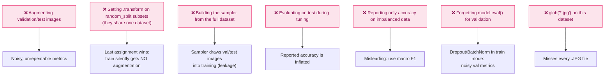

Every one of these is avoided in `crop_ml/data.py` / `train.py`, and M2, M3 and M7 have tests.

---

## 9. Reference Links

| Resource | Type | Why it matters for this phase |
|---|---|---|
| [fast.ai Practical Deep Learning — Lesson 1](https://course.fast.ai/) | Course (free) | Best practitioner-first ML intuition course — watch before coding |
| [3Blue1Brown: Neural Networks playlist](https://www.youtube.com/playlist?list=PLZHQObOWTQDNU6R1_67000Dx_ZCJB-3pi) | Video | Visualises gradient descent and backprop — watch once, understand forever |
| [CS229 Lecture Notes — Linear Regression](https://cs229.stanford.edu/lectures-spring2022/main_notes.pdf) | PDF | Stanford — gradient descent derivation done properly |
| [PyTorch Transfer Learning Tutorial](https://pytorch.org/tutorials/beginner/transfer_learning_tutorial.html) | Tutorial | Official guide — covers exactly what you built in `src/train.py` |
| [torchvision transforms v2](https://pytorch.org/vision/stable/transforms.html) | Docs | Complete reference for all augmentation options |
| [Kaggle Learn: Pandas](https://www.kaggle.com/learn/pandas) | Interactive | Real pandas exercises on messy data — do one while building EDA notebook |
| [uv documentation](https://docs.astral.sh/uv/) | Docs | Projects, `uv add`, `uv sync`, `uv run`, lockfiles |
| [Scikit-learn metrics user guide](https://scikit-learn.org/stable/modules/model_evaluation.html) | Docs | Precision, recall, F1, confusion matrix — authoritative reference |
| [PlantVillage dataset on Kaggle](https://www.kaggle.com/datasets/emmarex/plantdisease) | Dataset | The dataset you use throughout this project |
| [PyTorch MPS (Apple Silicon) guide](https://pytorch.org/docs/stable/notes/mps.html) | Docs | Using your M5 GPU for training — significant speedup |
| [Understanding Batch Normalisation](https://arxiv.org/abs/1502.03167) | Paper | Original BN paper — read the introduction and Section 2 |
| [A Recipe for Training Neural Networks — Karpathy](http://karpathy.github.io/2019/04/25/recipe/) | Blog | Required reading — practical debugging guide by the best in the field |

---

## 10. Phase 1 Completion Checklist

Complete every item before moving to Phase 2.

### Code (all in `ml-training/`)

- [ ] `uv sync` then `uv run pytest`: all tests pass
- [ ] `uv run ruff check .` is clean
- [ ] `python -m crop_ml.theory.gradient_descent` / `lr_experiment` / `loss_functions` run
- [ ] `python -m crop_ml.eda` runs on the real dataset (15 classes found)
- [ ] `python -m crop_ml.train` completes (early stopping may end it before 10 epochs)
- [ ] `python -m crop_ml.evaluate` writes the confusion matrix and `eval_summary.json`

### Notebooks

- [ ] `01_gradient_descent.ipynb`: committed with output cells visible
- [ ] `02_plantvillage_eda.ipynb`: class distribution visible
- [ ] `03_baseline_model.ipynb`: training curves and confusion matrix visible

### Outputs (gitignored, present locally)

- [ ] `outputs/plots/{gradient_descent,learning_rate_comparison,class_distribution,confusion_matrix}.png`
- [ ] `outputs/checkpoints/mobilenetv2_v1_best.pt` and `class_names.json`
- [ ] `outputs/splits.json`, `outputs/eval_summary.json`, `data/metadata.csv`

### GitHub

- [ ] `.gitignore` excludes `data/`, `outputs/`, `.venv/`
- [ ] `pyproject.toml` and `uv.lock` committed (they replace `requirements.txt`)
- [ ] `ml-training/README.md` states your test accuracy and macro F1

### Interview readiness

- [ ] Explain gradient descent on a whiteboard without notes
- [ ] Explain why lr=0.5 converged but lr=1.05 diverged
- [ ] Name three differences between MSE and cross-entropy
- [ ] Explain why validation and test must be separate
- [ ] Explain class imbalance and two ways to handle it
- [ ] Draw the CNN flow from memory
- [ ] State your test accuracy and macro F1 from memory

---

> **Next:** Phase 2 — Python ML Service (FastAPI).
> It consumes `outputs/checkpoints/mobilenetv2_v1_best.pt` and `class_names.json`
> (copy them into `python-ml-service/models/`).
