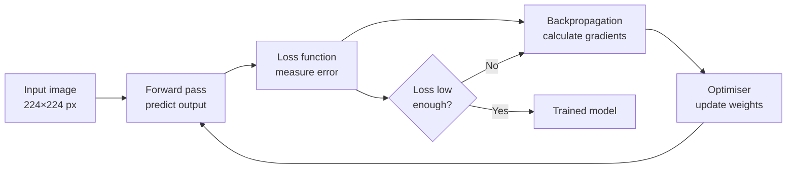
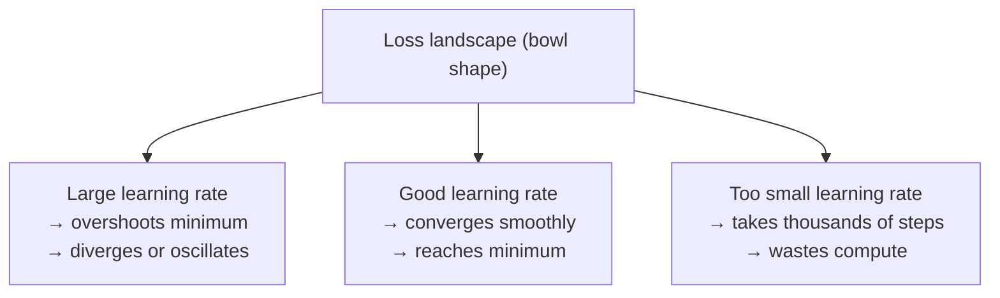
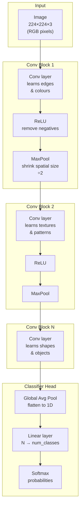
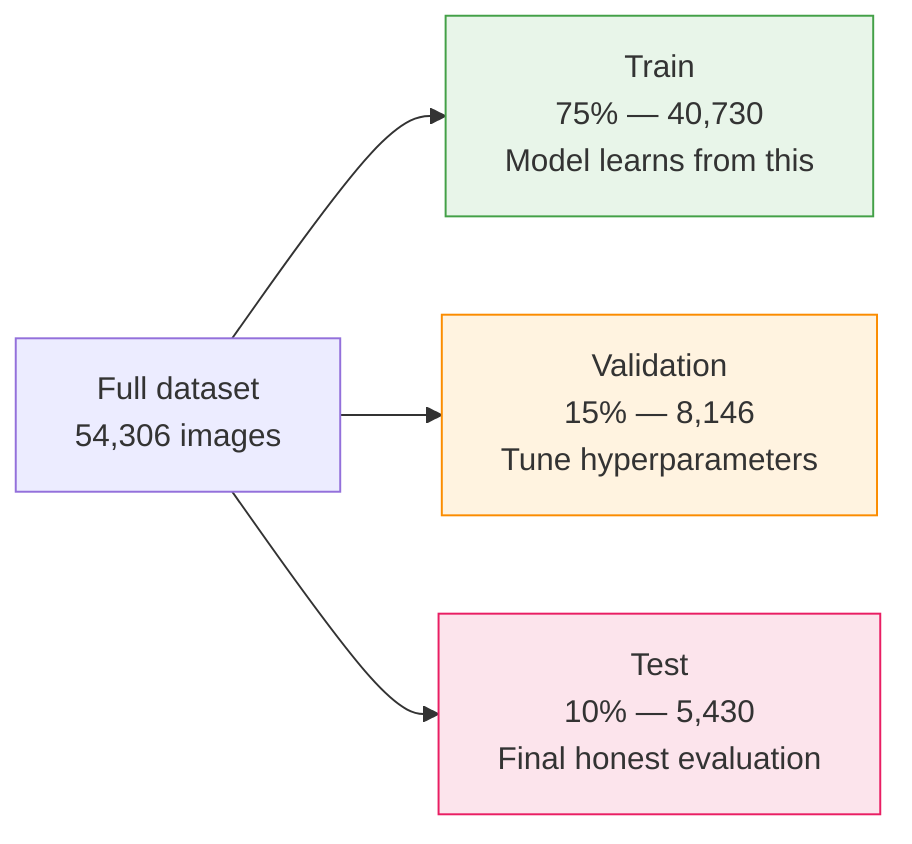
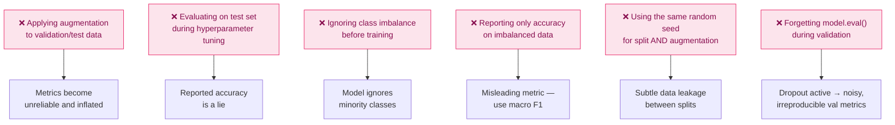

# Phase 1 — ML Theory + Data Foundations

> **Duration:** 2 weeks · **10–15 hrs/week**
> **Goal:** Understand *why* models work, not just how to run them. Build mathematical
> intuition, master data work, and produce a GitHub-ready Jupyter notebook before
> writing a single line of API code.

---

## Table of Contents

1. [What You Will Build](#1-what-you-will-build)
2. [Folder Structure](#2-folder-structure)
3. [Environment Setup](#3-environment-setup)
4. [Week 1 — Math Intuition](#4-week-1--math-intuition)
   - [4.1 How a Neural Network Learns (Concept Map)](#41-how-a-neural-network-learns-concept-map)
   - [4.2 Linear Regression from Scratch](#42-linear-regression-from-scratch)
   - [4.3 Gradient Descent Visualised](#43-gradient-descent-visualised)
   - [4.4 Loss Functions — When to Use Which](#44-loss-functions--when-to-use-which)
   - [4.5 What a CNN Actually Does](#45-what-a-cnn-actually-does)
5. [Week 2 — Data Work](#5-week-2--data-work)
   - [5.1 Download the PlantVillage Dataset](#51-download-the-plantvillage-dataset)
   - [5.2 Exploratory Data Analysis (EDA)](#52-exploratory-data-analysis-eda)
   - [5.3 Class Imbalance Detection](#53-class-imbalance-detection)
   - [5.4 Image Preprocessing Pipeline](#54-image-preprocessing-pipeline)
   - [5.5 Train / Validation / Test Splits](#55-train--validation--test-splits)
   - [5.6 Baseline Model Training](#56-baseline-model-training)
   - [5.7 Evaluation Reporter](#57-evaluation-reporter)
6. [Portfolio Output — Jupyter Notebook](#6-portfolio-output--jupyter-notebook)
7. [Interview Questions & Model Answers](#7-interview-questions--model-answers)
8. [Common Mistakes to Avoid](#8-common-mistakes-to-avoid)
9. [Reference Links](#9-reference-links)
10. [Phase 1 Completion Checklist](#10-phase-1-completion-checklist)

---

## 1. What You Will Build

By the end of Phase 1 you will have **three committed artefacts** on GitHub:

| Artefact | File | What it proves |
|---|---|---|
| Theory notebook | `notebooks/01_gradient_descent.ipynb` | You understand *why* training works |
| EDA notebook | `notebooks/02_plantvillage_eda.ipynb` | You understand the data before modelling |
| Training notebook | `notebooks/03_baseline_model.ipynb` | You can train, evaluate, and interpret a CNN |

These are not toy exercises — they are the foundation every interview question in
Phase 2 onwards will reference. When an interviewer asks *"walk me through your
data pipeline"*, you point at this work.

---

## 2. Folder Structure

```
ml-foundations/              ← project root
│
├── notebooks/               ← Jupyter notebooks (one per concern)
│   ├── 01_gradient_descent.ipynb
│   ├── 02_plantvillage_eda.ipynb
│   └── 03_baseline_model.ipynb
│
├── src/                     ← reusable Python modules (not notebook-only code)
│   ├── __init__.py
│   ├── dataset.py           ← dataset loading and splitting
│   ├── transforms.py        ← image preprocessing pipeline
│   ├── train.py             ← training loop
│   └── evaluate.py          ← metrics and confusion matrix
│
├── data/                    ← raw data (gitignored)
│   └── plantvillage/        ← extracted dataset lives here
│
├── outputs/                 ← saved plots, model checkpoints (gitignored)
│   ├── plots/
│   └── checkpoints/
│
├── requirements.txt         ← pinned dependencies
├── .gitignore
└── README.md
```

Create the scaffold now:

```bash
# Create the project root
mkdir ml-foundations && cd ml-foundations

# Create all directories in one command
mkdir -p notebooks src data/plantvillage outputs/plots outputs/checkpoints

# Create empty Python module files
touch src/__init__.py src/dataset.py src/transforms.py src/train.py src/evaluate.py

# Create .gitignore — data and model weights are too large for GitHub
cat > .gitignore << 'EOF'
# Data — download locally, never commit
data/

# Model checkpoints — large binary files
outputs/checkpoints/

# Python environment
.venv/
__pycache__/
*.pyc
*.pyo
.ipynb_checkpoints/

# uv lockfile artefacts
.python-version
EOF

echo "Scaffold created successfully"
```

---

## 3. Environment Setup

### 3.1 Install Python and uv

```bash
# Install pyenv — version manager (never use system Python for ML projects)
brew install pyenv

# Add pyenv to your shell — append to ~/.zshrc
echo 'export PYENV_ROOT="$HOME/.pyenv"' >> ~/.zshrc
echo 'export PATH="$PYENV_ROOT/bin:$PATH"' >> ~/.zshrc
echo 'eval "$(pyenv init -)"' >> ~/.zshrc

# Reload shell
source ~/.zshrc

# Install Python 3.11 — stable, well-supported by PyTorch and TF
pyenv install 3.11.9
pyenv local 3.11.9   # pins this version to the project folder only

# Verify — should show 3.11.9
python --version

# Install uv — fast package manager (replaces pip)
brew install uv

# Verify
uv --version
```

### 3.2 Create virtual environment and install dependencies

```bash
# Still inside ml-foundations/

# Create virtual environment in .venv/
uv venv

# Activate it — you must do this every time you open a new terminal
source .venv/bin/activate

# Your prompt should now show (.venv)
# Install the full ML stack
uv add \
  numpy \               # array math — the foundation of everything
  pandas \              # dataframes for EDA
  matplotlib \          # plotting
  seaborn \             # statistical plots (confusion matrix heatmaps)
  scikit-learn \        # classical ML, metrics, train/test split
  torch \               # PyTorch — deep learning framework
  torchvision \         # image datasets, transforms, pretrained models
  pillow \              # image loading (PIL)
  jupyter \             # notebook server
  ipykernel \           # connects Jupyter to our .venv kernel
  tqdm                  # progress bars for training loops

# Dev-only tools
uv add --dev \
  ruff \                # linter + formatter (replaces flake8 + black)
  mypy                  # type checker

# Pin exact versions for reproducibility
uv pip freeze > requirements.txt

echo "Environment ready — $(python --version)"
```

### 3.3 Register the kernel with Jupyter

```bash
# This makes Jupyter see our .venv instead of the system Python
python -m ipykernel install --user --name ml-foundations --display-name "ML Foundations (3.11)"

# Launch Jupyter — it opens in your browser
jupyter notebook

# You should see the kernel "ML Foundations (3.11)" available when creating a new notebook
```

### 3.4 Install Kaggle CLI (needed for dataset download in Week 2)

```bash
# Install kaggle CLI
uv add kaggle

# Create API token directory
mkdir -p ~/.kaggle

# Go to https://www.kaggle.com/settings → Account → API → Create New Token
# It downloads kaggle.json — move it to the right place
mv ~/Downloads/kaggle.json ~/.kaggle/kaggle.json

# Restrict permissions — kaggle CLI requires this
chmod 600 ~/.kaggle/kaggle.json

# Verify — should print your username
kaggle config view
```

---

## 4. Week 1 — Math Intuition

> **Week 1 goal:** Implement gradient descent by hand so you understand it
> mechanically, not just conceptually. Interviewers will ask you to explain it
> on a whiteboard. This week is your preparation for that.

### 4.1 How a Neural Network Learns (Concept Map)



The loop above runs for every **batch** of images, hundreds of thousands of
times. Understanding each box is what Week 1 builds.

**Key vocabulary you must be able to define without notes:**

| Term | One-sentence definition |
|---|---|
| Weight | A number inside the model that gets adjusted during training |
| Bias | An offset weight that lets the model shift its output |
| Forward pass | Running input through the model to produce a prediction |
| Loss | A number measuring how wrong the prediction was |
| Gradient | The direction and magnitude to move each weight to reduce loss |
| Backpropagation | Algorithm that calculates gradients by working backwards through layers |
| Learning rate | How large a step the optimiser takes when updating weights |
| Epoch | One full pass through the entire training dataset |
| Batch | A subset of training data processed before a weight update |
| Overfitting | Model memorises training data but fails on new data |

---

### 4.2 Linear Regression from Scratch

**File:** `src/gradient_descent.py`

Implement this before using PyTorch. The point is to see every moving part
manually before a framework hides it.

```python
# src/gradient_descent.py
#
# Linear regression using gradient descent — implemented from scratch.
# This is the simplest possible example of supervised learning.
# Goal: find the line y = w*x + b that best fits the data.

import numpy as np
import matplotlib.pyplot as plt
from pathlib import Path


def generate_data(n: int = 100, seed: int = 42) -> tuple[np.ndarray, np.ndarray]:
    """
    Generate synthetic data with a known linear relationship plus noise.
    We know the true answer (w=3, b=2) so we can verify our model learns it.
    """
    np.random.seed(seed)
    X = np.random.randn(n)           # input features — random numbers
    noise = np.random.randn(n) * 0.5 # real data is never perfectly clean
    y = 3 * X + 2 + noise            # true relationship: y = 3x + 2
    return X, y


def forward(X: np.ndarray, w: float, b: float) -> np.ndarray:
    """
    Forward pass: apply the current model parameters to produce predictions.
    This is just the equation of a line.
    """
    return w * X + b


def mse_loss(y_pred: np.ndarray, y_true: np.ndarray) -> float:
    """
    Mean Squared Error loss.
    Squaring does two things:
      1. Makes all errors positive (no cancellation between over and under predictions)
      2. Penalises large errors more heavily than small ones
    """
    return float(np.mean((y_pred - y_true) ** 2))


def compute_gradients(
    X: np.ndarray, y_pred: np.ndarray, y_true: np.ndarray
) -> tuple[float, float]:
    """
    Compute partial derivatives of MSE loss with respect to w and b.

    These tell us: if we increase w by a tiny amount, how much does the loss change?
    A positive gradient means "increasing this parameter increases the loss" →
    we should decrease the parameter. That is the core idea of gradient descent.

    Derivation (for reference):
      Loss = mean((y_pred - y_true)^2) = mean((w*X + b - y_true)^2)
      dL/dw = 2 * mean(X * (y_pred - y_true))   ← chain rule
      dL/db = 2 * mean(y_pred - y_true)
    """
    n = len(X)
    error = y_pred - y_true                   # residuals
    dw = 2 * np.mean(X * error)               # gradient w.r.t. weight
    db = 2 * np.mean(error)                   # gradient w.r.t. bias
    return dw, db


def train(
    X: np.ndarray,
    y: np.ndarray,
    lr: float = 0.01,    # learning rate — step size for each update
    epochs: int = 200,   # how many full passes through the data
) -> tuple[float, float, list[float]]:
    """
    Full gradient descent training loop.
    Returns the learned weight, bias, and loss history for plotting.
    """
    w, b = 0.0, 0.0   # initialise parameters at zero (or random — both work here)
    losses = []

    for epoch in range(epochs):
        # 1. Forward pass — predict with current parameters
        y_pred = forward(X, w, b)

        # 2. Compute loss — how wrong are we?
        loss = mse_loss(y_pred, y)
        losses.append(loss)

        # 3. Compute gradients — which direction reduces loss?
        dw, db = compute_gradients(X, y_pred, y)

        # 4. Update parameters — move opposite to the gradient (descent)
        #    Small lr → slow but stable convergence
        #    Large lr → fast but may overshoot or diverge
        w -= lr * dw
        b -= lr * db

        if epoch % 20 == 0:
            print(f"Epoch {epoch:3d} | Loss: {loss:.4f} | w={w:.3f} b={b:.3f}")

    return w, b, losses


def plot_results(
    X: np.ndarray,
    y: np.ndarray,
    w: float,
    b: float,
    losses: list[float],
    save_dir: str = "outputs/plots",
) -> None:
    """
    Save two plots: the fitted line and the loss convergence curve.
    Always save plots — they go in the notebook and README.
    """
    Path(save_dir).mkdir(parents=True, exist_ok=True)

    fig, axes = plt.subplots(1, 2, figsize=(12, 4))

    # Left: fitted line over scatter plot
    axes[0].scatter(X, y, alpha=0.5, label="Data", color="steelblue")
    x_line = np.linspace(X.min(), X.max(), 100)
    axes[0].plot(x_line, w * x_line + b, color="tomato", lw=2, label=f"Fit: y={w:.2f}x+{b:.2f}")
    axes[0].set_title("Fitted Line")
    axes[0].set_xlabel("X")
    axes[0].set_ylabel("y")
    axes[0].legend()

    # Right: loss over epochs — shows convergence
    axes[1].plot(losses, color="steelblue")
    axes[1].set_title("Loss Convergence")
    axes[1].set_xlabel("Epoch")
    axes[1].set_ylabel("MSE Loss")
    axes[1].set_yscale("log")   # log scale reveals early rapid improvement

    plt.tight_layout()
    path = Path(save_dir) / "gradient_descent.png"
    plt.savefig(path, dpi=150, bbox_inches="tight")
    plt.close()
    print(f"Saved plot → {path}")


if __name__ == "__main__":
    X, y = generate_data()
    w, b, losses = train(X, y, lr=0.05, epochs=200)
    print(f"\nLearned: w={w:.3f}, b={b:.3f}  (True: w=3.0, b=2.0)")
    plot_results(X, y, w, b, losses)
```

Run it:

```bash
# Run from the project root with the venv active
python src/gradient_descent.py

# Expected output (approximately):
# Epoch   0 | Loss: 13.2341 | w=0.421 b=0.089
# Epoch  20 | Loss: 1.0432  | w=2.611 b=1.743
# ...
# Epoch 180 | Loss: 0.2518  | w=2.987 b=1.998
#
# Learned: w=2.987, b=1.998  (True: w=3.0, b=2.0)
# Saved plot → outputs/plots/gradient_descent.png
```

---

### 4.3 Gradient Descent Visualised

The loss landscape concept — understanding why learning rate matters:



**Learning rate intuition** — the single most important hyperparameter to
understand for interviews:

```python
# src/lr_experiment.py
#
# Run gradient descent with three different learning rates.
# Visualise how lr affects convergence speed and stability.
# This produces a plot you can reference in interviews.

import numpy as np
import matplotlib.pyplot as plt
from gradient_descent import generate_data, forward, mse_loss, compute_gradients
from pathlib import Path


def run_experiment(lr: float, epochs: int = 100) -> list[float]:
    """Train with a fixed learning rate and return loss history."""
    X, y = generate_data()
    w, b = 0.0, 0.0
    losses = []
    for _ in range(epochs):
        y_pred = forward(X, w, b)
        losses.append(mse_loss(y_pred, y))
        dw, db = compute_gradients(X, y_pred, y)
        w -= lr * dw
        b -= lr * db
    return losses


# Three scenarios that will appear in every ML interview conversation
experiments = {
    "lr=0.001 (too small)": 0.001,
    "lr=0.05 (good)":       0.05,
    "lr=0.5 (too large)":   0.5,
}

plt.figure(figsize=(10, 4))
for label, lr in experiments.items():
    losses = run_experiment(lr)
    # Clip to 50 so diverging experiments don't crush the scale
    clipped = [min(l, 50) for l in losses]
    plt.plot(clipped, label=label)

plt.xlabel("Epoch")
plt.ylabel("MSE Loss (clipped at 50)")
plt.title("Effect of Learning Rate on Convergence")
plt.legend()
plt.yscale("log")

Path("outputs/plots").mkdir(parents=True, exist_ok=True)
plt.savefig("outputs/plots/learning_rate_comparison.png", dpi=150, bbox_inches="tight")
plt.close()
print("Saved → outputs/plots/learning_rate_comparison.png")
```

---

### 4.4 Loss Functions — When to Use Which

**File:** `src/loss_functions.py`

```python
# src/loss_functions.py
#
# Demonstrate the three loss functions you will encounter most often.
# Each one is implemented manually first so the formula is clear,
# then shown against its numpy/PyTorch equivalent.

import numpy as np
import torch
import torch.nn as nn


# ─────────────────────────────────────────────
# 1. Mean Squared Error (MSE)
# ─────────────────────────────────────────────
# Use for: REGRESSION tasks (predicting a continuous value)
# Property: heavily penalises large errors — squaring magnifies them
# Weakness: sensitive to outliers — one bad prediction can dominate
# ─────────────────────────────────────────────
def mse(y_pred: np.ndarray, y_true: np.ndarray) -> float:
    return float(np.mean((y_pred - y_true) ** 2))

y_pred = np.array([2.5, 0.0, 2.0, 8.0])
y_true = np.array([3.0, -0.5, 2.0, 7.0])
print(f"MSE (manual):  {mse(y_pred, y_true):.4f}")
print(f"MSE (PyTorch): {nn.MSELoss()(torch.tensor(y_pred, dtype=torch.float32), torch.tensor(y_true, dtype=torch.float32)):.4f}")


# ─────────────────────────────────────────────
# 2. Mean Absolute Error (MAE)
# ─────────────────────────────────────────────
# Use for: REGRESSION where outliers should not dominate
# Property: treats all errors equally regardless of size
# Example: predicting house prices where a few mansions skew the data
# ─────────────────────────────────────────────
def mae(y_pred: np.ndarray, y_true: np.ndarray) -> float:
    return float(np.mean(np.abs(y_pred - y_true)))

print(f"\nMAE (manual):  {mae(y_pred, y_true):.4f}")
print(f"MAE (PyTorch): {nn.L1Loss()(torch.tensor(y_pred, dtype=torch.float32), torch.tensor(y_true, dtype=torch.float32)):.4f}")


# ─────────────────────────────────────────────
# 3. Cross-Entropy Loss
# ─────────────────────────────────────────────
# Use for: CLASSIFICATION tasks (predicting a class label)
# How it works: penalises confident wrong predictions very harshly
#   - Predicted 99% probability for the WRONG class → huge loss
#   - Predicted 51% probability for the WRONG class → smaller loss
# Formula: -sum(y_true * log(y_pred))
# ─────────────────────────────────────────────
def cross_entropy(logits: np.ndarray, true_class: int) -> float:
    """
    logits: raw model outputs BEFORE softmax (one value per class)
    true_class: index of the correct class
    """
    # Softmax converts raw logits to probabilities that sum to 1
    exp = np.exp(logits - logits.max())   # subtract max for numerical stability
    probs = exp / exp.sum()
    # Cross-entropy: negative log of the probability assigned to the correct class
    return float(-np.log(probs[true_class] + 1e-9))  # 1e-9 avoids log(0)

# Example: 3-class problem (Healthy, Early Blight, Late Blight)
logits = np.array([2.0, 1.0, 0.1])  # model output — highest score for class 0
true_class = 0                        # correct answer is class 0 (Healthy)
print(f"\nCross-entropy (manual): {cross_entropy(logits, true_class):.4f}")
# PyTorch equivalent:
criterion = nn.CrossEntropyLoss()
print(f"Cross-entropy (PyTorch): {criterion(torch.tensor([logits], dtype=torch.float32), torch.tensor([true_class])):.4f}")


# ─────────────────────────────────────────────
# When to use which — quick reference
# ─────────────────────────────────────────────
print("""
Loss Function Decision Guide
─────────────────────────────
Task                          Loss to use
─────────────────────────────────────────
Predict a number              MSE (default) or MAE (outliers)
Predict yes/no (binary)       Binary Cross-Entropy (BCELoss)
Predict 1 of N classes        Cross-Entropy (CrossEntropyLoss)
Predict multiple labels       Binary Cross-Entropy per label
""")
```

Run it:

```bash
python src/loss_functions.py
```

---

### 4.5 What a CNN Actually Does

Understanding this lets you answer *"explain how a convolutional neural network
works"* in an interview without memorising a script.



**What each component does — memorise these:**

| Component | What it does | Intuition |
|---|---|---|
| Convolutional layer | Slides a small filter over the image, computes dot products | Like finding a template pattern anywhere in the image |
| ReLU activation | Sets negative values to 0 | Non-linearity — without it the whole network collapses to linear |
| MaxPooling | Takes the maximum value from each patch | Reduces size while keeping the strongest signal |
| Batch Normalisation | Normalises activations across the batch | Stabilises training — most modern CNNs use it |
| Dropout | Randomly zeros some outputs during training | Regularisation — forces the network to not rely on any single path |
| Global Average Pooling | Averages each feature map to a single value | Converts spatial features to a flat vector |
| Linear (fully connected) | Matrix multiply to produce class scores | The actual classifier at the end |
| Softmax | Converts scores to probabilities that sum to 1 | Makes output interpretable as confidence |

---

## 5. Week 2 — Data Work

> The most underestimated part of ML. Real ML engineers spend 60–70% of their
> time here. Most tutorials skip it. Yours won't.

### 5.1 Download the PlantVillage Dataset

```bash
# From inside ml-foundations/ with venv active

# Download dataset — 54,000 images, 38 disease classes, ~2.5 GB
kaggle datasets download -d emmarex/plantdisease --path data/

# Unzip into the plantvillage subfolder
unzip data/plantdisease.zip -d data/plantvillage/

# Inspect the structure — understand what you downloaded
ls data/plantvillage/PlantVillage/

# Count images per class to understand scale
find data/plantvillage/PlantVillage -name "*.jpg" | \
  awk -F'/' '{print $(NF-1)}' | \
  sort | uniq -c | sort -rn | head -20

# Total image count
find data/plantvillage/PlantVillage -name "*.jpg" | wc -l
```

Expected output after `ls`:
```
Apple___Apple_scab
Apple___Black_rot
Apple___Cedar_apple_rust
Apple___healthy
Blueberry___healthy
Cherry_(including_sour)___Powdery_mildew
...
Tomato___Early_blight
Tomato___Late_blight
Tomato___healthy
```

Each folder is one class. This is the `ImageFolder` format that PyTorch reads
natively — classes are inferred from directory names.

---

### 5.2 Exploratory Data Analysis (EDA)

**File:** `notebooks/02_plantvillage_eda.ipynb`

Create this notebook in Jupyter. Each section below is one cell.

```python
# Cell 1 — imports
# Always put all imports in the first cell for reproducibility

import os
import json
from pathlib import Path
from collections import Counter

import numpy as np
import pandas as pd
import matplotlib.pyplot as plt
import matplotlib.image as mpimg
import seaborn as sns
from PIL import Image
from tqdm import tqdm

# Set consistent plot style
plt.style.use("seaborn-v0_8-whitegrid")
sns.set_palette("husl")

# Dataset root — adjust if your path differs
DATA_ROOT = Path("../data/plantvillage/PlantVillage")
```

```python
# Cell 2 — build a metadata dataframe
# Before any modelling, understand your data as a table.
# This dataframe is what you reference throughout the notebook.

def build_metadata(data_root: Path) -> pd.DataFrame:
    """
    Walk the dataset directory and collect one row per image.
    Columns: filepath, class_name, plant, condition, file_size_kb, is_healthy
    """
    records = []
    for class_dir in sorted(data_root.iterdir()):
        if not class_dir.is_dir():
            continue

        class_name = class_dir.name               # e.g. "Tomato___Early_blight"
        parts = class_name.split("___")
        plant = parts[0].replace("_", " ")        # e.g. "Tomato"
        condition = parts[1].replace("_", " ") if len(parts) > 1 else "unknown"
        is_healthy = "healthy" in condition.lower()

        for img_path in class_dir.glob("*.jpg"):
            records.append({
                "filepath":    str(img_path),
                "class_name":  class_name,
                "plant":       plant,
                "condition":   condition,
                "file_size_kb": img_path.stat().st_size / 1024,
                "is_healthy":  is_healthy,
            })

    return pd.DataFrame(records)

df = build_metadata(DATA_ROOT)

# Basic summary — always look at this first
print(f"Total images:  {len(df):,}")
print(f"Total classes: {df['class_name'].nunique()}")
print(f"Unique plants: {df['plant'].nunique()}")
print(f"\nHealthy vs Diseased:")
print(df["is_healthy"].value_counts().to_string())
print(f"\nFirst 5 rows:")
df.head()
```

```python
# Cell 3 — class distribution plot
# Critical for detecting class imbalance before training.
# An imbalanced dataset will give you misleadingly high accuracy
# while failing completely on minority classes.

class_counts = df["class_name"].value_counts().sort_values()

fig, ax = plt.subplots(figsize=(10, 12))
bars = ax.barh(
    [c.replace("___", "\n") for c in class_counts.index],
    class_counts.values,
    color=["#2ecc71" if "healthy" in c else "#e74c3c" for c in class_counts.index]
)
ax.set_xlabel("Number of images")
ax.set_title("Class Distribution — PlantVillage Dataset\n(green = healthy, red = diseased)")
ax.axvline(class_counts.mean(), color="navy", linestyle="--", label=f"Mean: {class_counts.mean():.0f}")
ax.legend()
plt.tight_layout()
plt.savefig("../outputs/plots/class_distribution.png", dpi=150, bbox_inches="tight")
plt.show()

# Print imbalance ratio — you will be asked about this in interviews
print(f"Largest class:  {class_counts.max():,} images")
print(f"Smallest class: {class_counts.min():,} images")
print(f"Imbalance ratio (max/min): {class_counts.max() / class_counts.min():.1f}x")
```

```python
# Cell 4 — image dimension analysis
# CNNs require fixed-size input. Understanding the raw size distribution
# tells you what resize strategy to use.

def sample_dimensions(df: pd.DataFrame, n: int = 500) -> pd.DataFrame:
    """Sample n images and record their dimensions. Full scan takes too long."""
    sample = df.sample(n=min(n, len(df)), random_state=42)
    widths, heights = [], []
    for path in tqdm(sample["filepath"], desc="Reading dimensions"):
        with Image.open(path) as img:
            w, h = img.size
            widths.append(w)
            heights.append(h)
    return pd.DataFrame({"width": widths, "height": heights})

dims = sample_dimensions(df)

fig, axes = plt.subplots(1, 2, figsize=(10, 4))
axes[0].hist(dims["width"],  bins=30, color="steelblue", edgecolor="white")
axes[0].set_title("Width distribution")
axes[0].set_xlabel("Width (px)")
axes[1].hist(dims["height"], bins=30, color="tomato",    edgecolor="white")
axes[1].set_title("Height distribution")
axes[1].set_xlabel("Height (px)")
plt.tight_layout()
plt.savefig("../outputs/plots/image_dimensions.png", dpi=150, bbox_inches="tight")
plt.show()

print(f"Width  — mean: {dims['width'].mean():.0f}  min: {dims['width'].min()}  max: {dims['width'].max()}")
print(f"Height — mean: {dims['height'].mean():.0f}  min: {dims['height'].min()}  max: {dims['height'].max()}")
```

```python
# Cell 5 — visual sample grid
# Always look at your data with your eyes before training anything.
# This catches label errors, bad files, and unexpected patterns.

def show_sample_grid(df: pd.DataFrame, n_classes: int = 6, n_per_class: int = 4):
    """Show a grid of sample images — one row per class."""
    classes = df["class_name"].sample(n=n_classes, random_state=42).unique()
    fig, axes = plt.subplots(n_classes, n_per_class, figsize=(n_per_class * 3, n_classes * 3))

    for row_idx, class_name in enumerate(classes):
        class_images = df[df["class_name"] == class_name].sample(n=n_per_class, random_state=row_idx)
        for col_idx, (_, img_row) in enumerate(class_images.iterrows()):
            img = mpimg.imread(img_row["filepath"])
            axes[row_idx, col_idx].imshow(img)
            axes[row_idx, col_idx].axis("off")
            if col_idx == 0:
                label = class_name.replace("___", "\n").replace("_", " ")
                axes[row_idx, col_idx].set_ylabel(label, fontsize=8, rotation=0,
                                                   ha="right", va="center")

    plt.suptitle("Sample images per class", fontsize=13, y=1.01)
    plt.tight_layout()
    plt.savefig("../outputs/plots/sample_grid.png", dpi=150, bbox_inches="tight")
    plt.show()

show_sample_grid(df)
```

```python
# Cell 6 — save metadata to CSV for reference in later phases
# Other notebooks and scripts will load this instead of re-scanning the filesystem.

df.to_csv("../data/metadata.csv", index=False)
print(f"Saved metadata for {len(df):,} images → data/metadata.csv")

# Also save class names as JSON — needed by the model in Phase 2
class_names = sorted(df["class_name"].unique().tolist())
with open("../data/class_names.json", "w") as f:
    json.dump(class_names, f, indent=2)
print(f"Saved {len(class_names)} class names → data/class_names.json")
```

---

### 5.3 Class Imbalance Detection

**File:** `src/dataset.py`

```python
# src/dataset.py
#
# Dataset loading, splitting, and imbalance handling.
# Keeping this in a .py module (not a notebook) means Phase 2 can import it directly.

import json
from pathlib import Path

import numpy as np
import torch
from torch.utils.data import Dataset, DataLoader, WeightedRandomSampler
from torchvision import datasets
from torchvision.transforms import v2 as T
from PIL import Image


def compute_class_weights(dataset: datasets.ImageFolder) -> torch.Tensor:
    """
    Compute per-class weights inversely proportional to class frequency.

    Why: if class A has 1000 images and class B has 100, the model sees
    class A 10x more and learns to always predict A. Weighting corrects this.

    Formula: weight[class] = total_samples / (num_classes * count[class])
    """
    counts = np.bincount([label for _, label in dataset.samples])
    total = len(dataset)
    n_classes = len(dataset.classes)

    # Classes with fewer samples get higher weight
    weights = total / (n_classes * counts.astype(float))

    # Per-sample weights — each sample gets its class weight
    sample_weights = torch.tensor(
        [weights[label] for _, label in dataset.samples],
        dtype=torch.float32
    )
    return sample_weights


def create_weighted_sampler(dataset: datasets.ImageFolder) -> WeightedRandomSampler:
    """
    Create a sampler that oversamples minority classes so each epoch
    sees a roughly balanced representation of all classes.
    """
    sample_weights = compute_class_weights(dataset)
    return WeightedRandomSampler(
        weights=sample_weights,
        num_samples=len(sample_weights),
        replacement=True   # allows same image to appear multiple times per epoch
    )


def create_dataloaders(
    data_root: str,
    train_transforms: T.Compose,
    val_transforms: T.Compose,
    val_split: float = 0.15,
    test_split: float = 0.10,
    batch_size: int = 32,
    num_workers: int = 4,
    use_weighted_sampler: bool = True,
    seed: int = 42,
) -> tuple[DataLoader, DataLoader, DataLoader, list[str]]:
    """
    Load the dataset from disk, split into train/val/test, and return DataLoaders.

    Returns: (train_loader, val_loader, test_loader, class_names)
    """
    torch.manual_seed(seed)

    # ImageFolder infers class labels from directory names
    full_dataset = datasets.ImageFolder(data_root)
    class_names = full_dataset.classes
    n_total = len(full_dataset)

    # Calculate split sizes
    n_test  = int(n_total * test_split)
    n_val   = int(n_total * val_split)
    n_train = n_total - n_val - n_test

    print(f"Dataset split → train: {n_train:,}  val: {n_val:,}  test: {n_test:,}")

    # Random split — use a fixed generator for reproducibility
    generator = torch.Generator().manual_seed(seed)
    train_ds, val_ds, test_ds = torch.utils.data.random_split(
        full_dataset, [n_train, n_val, n_test], generator=generator
    )

    # Apply different transforms to each split
    # Train gets augmentation; val and test get only resizing and normalisation
    train_ds.dataset.transform = train_transforms
    val_ds.dataset.transform   = val_transforms
    test_ds.dataset.transform  = val_transforms

    # Sampler handles class imbalance at the DataLoader level
    sampler = create_weighted_sampler(full_dataset) if use_weighted_sampler else None

    train_loader = DataLoader(
        train_ds,
        batch_size=batch_size,
        sampler=sampler,           # use weighted sampler for balanced batches
        shuffle=(sampler is None), # shuffle only if not using sampler (mutually exclusive)
        num_workers=num_workers,
        pin_memory=True,           # faster GPU transfers on CUDA; harmless on MPS
    )
    val_loader = DataLoader(
        val_ds,
        batch_size=batch_size,
        shuffle=False,             # always False for validation — order doesn't matter
        num_workers=num_workers,
        pin_memory=True,
    )
    test_loader = DataLoader(
        test_ds,
        batch_size=batch_size,
        shuffle=False,             # always False for test — order doesn't matter
        num_workers=num_workers,
        pin_memory=True,
    )

    return train_loader, val_loader, test_loader, class_names
```

---

### 5.4 Image Preprocessing Pipeline

**File:** `src/transforms.py`

```python
# src/transforms.py
#
# Image preprocessing pipelines for training and validation.
#
# KEY RULE: training and validation pipelines MUST be different.
#   Training:   augmentation (random flips, crops, colour jitter) + normalise
#   Validation: deterministic (fixed resize) + normalise ONLY
#
# The validation/test pipeline must be deterministic — running it twice on
# the same image should produce identical output. Augmentation on val/test
# is a common bug that makes metrics unreliable.

from torchvision.transforms import v2 as T


# ImageNet normalisation constants — use these whenever you load a model
# pretrained on ImageNet (MobileNetV2, ResNet, EfficientNet, etc.)
# The model learned to expect inputs in this specific range.
IMAGENET_MEAN = [0.485, 0.456, 0.406]
IMAGENET_STD  = [0.229, 0.224, 0.225]

# MobileNetV2 expects 224×224 input
INPUT_SIZE = 224


def get_train_transforms() -> T.Compose:
    """
    Training transforms with augmentation.

    Each augmentation is chosen to simulate real-world variation in crop photos:
    - Random crop: camera isn't always perfectly centred
    - Horizontal flip: leaf orientation is arbitrary
    - Colour jitter: lighting conditions vary
    - Rotation: phone camera angle varies
    - Erase: simulate partial occlusion (leaf behind another leaf)
    """
    return T.Compose([
        # Step 1: Resize to slightly larger than target to allow random crop
        T.Resize((256, 256)),

        # Step 2: Random crop to target size — simulates imperfect framing
        T.RandomCrop(INPUT_SIZE),

        # Step 3: Horizontal flip with 50% probability — disease patterns are symmetric
        T.RandomHorizontalFlip(p=0.5),

        # Step 4: Colour jitter — accounts for varying light and camera settings
        # brightness: how dark/light, contrast: colour vividness,
        # saturation: colour intensity, hue: colour tint
        T.ColorJitter(brightness=0.3, contrast=0.3, saturation=0.2, hue=0.1),

        # Step 5: Small rotation — field photos aren't always level
        T.RandomRotation(degrees=15),

        # Step 6: Convert PIL image to PyTorch tensor (0–255 → 0.0–1.0)
        T.ToTensor(),

        # Step 7: Random erasing — simulate leaves partially behind other leaves
        # Placed AFTER ToTensor because it operates on tensors
        T.RandomErasing(p=0.2, scale=(0.02, 0.1)),

        # Step 8: Normalise using ImageNet stats
        # Formula per channel: (pixel - mean) / std
        # Result: values roughly centred around 0 with std ≈ 1
        T.Normalize(mean=IMAGENET_MEAN, std=IMAGENET_STD),
    ])


def get_val_transforms() -> T.Compose:
    """
    Validation and test transforms — deterministic, no augmentation.

    Must produce identical output every time for reliable evaluation metrics.
    The only processing is resize + tensor conversion + normalise.
    """
    return T.Compose([
        # Resize directly to target — no random crop
        T.Resize((INPUT_SIZE, INPUT_SIZE)),

        # Convert to tensor
        T.ToTensor(),

        # Same normalisation as training — the model expects these stats
        T.Normalize(mean=IMAGENET_MEAN, std=IMAGENET_STD),
    ])


def denormalise(tensor):
    """
    Reverse the normalisation for visualising model inputs.
    Useful for debugging — lets you see what the model is actually seeing.
    """
    import torch
    mean = torch.tensor(IMAGENET_MEAN).view(3, 1, 1)
    std  = torch.tensor(IMAGENET_STD).view(3, 1, 1)
    return (tensor * std + mean).clamp(0, 1)
```

---

### 5.5 Train / Validation / Test Splits



**Why three splits, not two:**

- **Train**: the model sees this and learns from it
- **Validation**: you check this after each epoch to tune hyperparameters (learning rate, epochs). Since *you* look at this during training, the model indirectly sees it — it can overfit to val through your tuning decisions
- **Test**: you look at this *exactly once*, after all tuning is done. This is your honest estimate of real-world performance. If you peek at test during tuning, your reported accuracy is a lie

**Data leakage** — a common interview topic: if any augmented version of a test
image appears in training, your test accuracy is inflated. Always split on the
*original* images before augmentation, not after.

---

### 5.6 Baseline Model Training

**File:** `src/train.py`

```python
# src/train.py
#
# Training loop for MobileNetV2 with transfer learning.
#
# Transfer learning: start from a model already trained on ImageNet
# (1.2M images, 1000 classes), then adapt the final layer to our 38 classes.
# This works because early layers learn universal features (edges, textures)
# that are useful for any image classification task.

import time
from pathlib import Path

import torch
import torch.nn as nn
from torch.optim.lr_scheduler import CosineAnnealingLR
from torchvision import models
from tqdm import tqdm


def get_device() -> torch.device:
    """
    Select the best available compute device.
    MPS = Apple Silicon GPU — much faster than CPU for M-series Macs.
    """
    if torch.cuda.is_available():
        return torch.device("cuda")
    if torch.backends.mps.is_available():
        return torch.device("mps")   # Apple Silicon GPU — use this on your M5
    return torch.device("cpu")


def build_model(num_classes: int, freeze_backbone: bool = True) -> nn.Module:
    """
    Load MobileNetV2 pretrained on ImageNet and replace the classifier head.

    freeze_backbone=True: only the final layer trains initially.
      → Faster, less likely to overfit on small datasets
      → Good default for first training run

    After a few epochs you can unfreeze the backbone for fine-tuning:
      for param in model.parameters():
          param.requires_grad = True
    """
    # Load pretrained weights
    model = models.mobilenet_v2(weights=models.MobileNet_V2_Weights.IMAGENET1K_V1)

    if freeze_backbone:
        # Freeze all backbone parameters — they won't update during training
        for param in model.parameters():
            param.requires_grad = False

    # Replace the final classifier layer
    # Original: Linear(1280, 1000) → ImageNet classes
    # Ours:     Linear(1280, 38)   → PlantVillage classes
    in_features = model.classifier[1].in_features
    model.classifier[1] = nn.Linear(in_features, num_classes)
    # The new layer's parameters have requires_grad=True by default

    total_params    = sum(p.numel() for p in model.parameters())
    trainable_params = sum(p.numel() for p in model.parameters() if p.requires_grad)
    print(f"Total params:     {total_params:,}")
    print(f"Trainable params: {trainable_params:,}  ({trainable_params/total_params*100:.1f}%)")

    return model


def train_epoch(
    model: nn.Module,
    loader: torch.utils.data.DataLoader,
    criterion: nn.Module,
    optimiser: torch.optim.Optimizer,
    device: torch.device,
) -> tuple[float, float]:
    """
    Run one training epoch.
    Returns: (average_loss, accuracy)
    """
    model.train()   # enables dropout and batch normalisation in training mode
    total_loss, correct, total = 0.0, 0, 0

    for images, labels in tqdm(loader, desc="  train", leave=False):
        images = images.to(device, non_blocking=True)
        labels = labels.to(device, non_blocking=True)

        # Zero gradients — PyTorch accumulates them by default
        optimiser.zero_grad()

        # Forward pass
        outputs = model(images)
        loss = criterion(outputs, labels)

        # Backward pass — compute gradients
        loss.backward()

        # Gradient clipping — prevents exploding gradients
        # Clips all gradients to have norm ≤ 1.0
        torch.nn.utils.clip_grad_norm_(model.parameters(), max_norm=1.0)

        # Update weights
        optimiser.step()

        total_loss += loss.item() * images.size(0)  # weighted by batch size
        preds = outputs.argmax(dim=1)
        correct += (preds == labels).sum().item()
        total += labels.size(0)

    return total_loss / total, correct / total


@torch.no_grad()   # disable gradient computation — saves memory and speeds up evaluation
def eval_epoch(
    model: nn.Module,
    loader: torch.utils.data.DataLoader,
    criterion: nn.Module,
    device: torch.device,
) -> tuple[float, float]:
    """
    Run one validation epoch. No gradient updates.
    Returns: (average_loss, accuracy)
    """
    model.eval()    # disables dropout, uses running stats for batch norm
    total_loss, correct, total = 0.0, 0, 0

    for images, labels in tqdm(loader, desc="  val  ", leave=False):
        images = images.to(device, non_blocking=True)
        labels = labels.to(device, non_blocking=True)
        outputs = model(images)
        loss = criterion(outputs, labels)

        total_loss += loss.item() * images.size(0)
        correct += (outputs.argmax(1) == labels).sum().item()
        total += labels.size(0)

    return total_loss / total, correct / total


def train(
    train_loader,
    val_loader,
    num_classes: int,
    epochs: int = 15,
    lr: float = 1e-3,
    checkpoint_dir: str = "outputs/checkpoints",
    model_version: str = "v1",
) -> tuple[nn.Module, dict]:
    """
    Full training run with:
    - Learning rate scheduling (cosine annealing)
    - Best-model checkpointing (saves on validation accuracy improvement)
    - Training history for plotting
    """
    Path(checkpoint_dir).mkdir(parents=True, exist_ok=True)
    device = get_device()
    print(f"Using device: {device}")

    model = build_model(num_classes).to(device)

    # Cross-entropy loss — correct choice for multi-class classification
    criterion = nn.CrossEntropyLoss(label_smoothing=0.1)
    # label_smoothing=0.1: instead of training toward hard 0/1 targets,
    # use 0.05/0.95 — reduces overconfidence and often improves generalisation

    # Adam optimiser — adaptive learning rates per parameter
    # Only optimise parameters with requires_grad=True (the classifier head)
    optimiser = torch.optim.Adam(
        filter(lambda p: p.requires_grad, model.parameters()),
        lr=lr,
        weight_decay=1e-4   # L2 regularisation — penalises large weights
    )

    # Cosine annealing: lr starts at `lr`, smoothly decays to near-0 over `epochs`
    # Better than fixed lr — allows large steps early and fine-grained steps later
    scheduler = CosineAnnealingLR(optimiser, T_max=epochs, eta_min=1e-6)

    history = {"train_loss": [], "train_acc": [], "val_loss": [], "val_acc": []}
    best_val_acc = 0.0

    for epoch in range(1, epochs + 1):
        start = time.time()
        print(f"\nEpoch {epoch}/{epochs}  (lr={scheduler.get_last_lr()[0]:.2e})")

        train_loss, train_acc = train_epoch(model, train_loader, criterion, optimiser, device)
        val_loss,   val_acc   = eval_epoch(model, val_loader, criterion, device)

        scheduler.step()    # update learning rate for next epoch

        elapsed = time.time() - start
        print(f"  loss: {train_loss:.4f} → {val_loss:.4f}  "
              f"acc: {train_acc:.3f} → {val_acc:.3f}  ({elapsed:.0f}s)")

        history["train_loss"].append(train_loss)
        history["train_acc"].append(train_acc)
        history["val_loss"].append(val_loss)
        history["val_acc"].append(val_acc)

        # Save checkpoint if validation accuracy improved
        if val_acc > best_val_acc:
            best_val_acc = val_acc
            ckpt_path = Path(checkpoint_dir) / f"mobilenetv2_{model_version}_best.pt"
            torch.save({
                "epoch":            epoch,
                "model_state_dict": model.state_dict(),
                "val_acc":          val_acc,
                "model_version":    model_version,
            }, ckpt_path)
            print(f"  ✓ New best — saved checkpoint ({val_acc:.3f})")

    print(f"\nTraining complete. Best val accuracy: {best_val_acc:.4f}")
    return model, history
```

---

### 5.7 Evaluation Reporter

**File:** `src/evaluate.py`

```python
# src/evaluate.py
#
# Comprehensive model evaluation — everything beyond simple accuracy.
# Accuracy alone is misleading on imbalanced datasets.
# A model that always predicts "Healthy" on a 90% healthy dataset
# achieves 90% accuracy while being completely useless.

import json
from pathlib import Path

import numpy as np
import torch
import matplotlib.pyplot as plt
import seaborn as sns
from sklearn.metrics import (
    classification_report,
    confusion_matrix,
    precision_recall_fscore_support,
    roc_auc_score,
)
from tqdm import tqdm


@torch.no_grad()
def collect_predictions(
    model: torch.nn.Module,
    loader: torch.utils.data.DataLoader,
    device: torch.device,
) -> tuple[np.ndarray, np.ndarray, np.ndarray]:
    """
    Run model over the entire loader and collect predictions.
    Returns: (all_labels, all_predictions, all_probabilities)
    """
    model.eval()
    all_labels, all_preds, all_probs = [], [], []

    for images, labels in tqdm(loader, desc="Evaluating"):
        images = images.to(device)
        outputs = model(images)

        # Softmax converts raw logits to probabilities
        probs = torch.softmax(outputs, dim=1)
        preds = probs.argmax(dim=1)

        all_labels.extend(labels.numpy())
        all_preds.extend(preds.cpu().numpy())
        all_probs.extend(probs.cpu().numpy())

    return (
        np.array(all_labels),
        np.array(all_preds),
        np.array(all_probs),
    )


def evaluate(
    model: torch.nn.Module,
    loader: torch.utils.data.DataLoader,
    class_names: list[str],
    device: torch.device,
    save_dir: str = "outputs/plots",
) -> dict:
    """
    Full evaluation suite:
    1. Per-class precision, recall, F1
    2. Confusion matrix heatmap
    3. Top-5 best and worst performing classes
    4. JSON summary saved to disk
    """
    Path(save_dir).mkdir(parents=True, exist_ok=True)

    labels, preds, probs = collect_predictions(model, loader, device)

    # ── 1. Classification report ──────────────────────────────────────────
    print("\n" + "─" * 60)
    print("PER-CLASS METRICS")
    print("─" * 60)
    report = classification_report(labels, preds, target_names=class_names, digits=3)
    print(report)

    # ── 2. Per-class metrics as structured data ───────────────────────────
    precision, recall, f1, support = precision_recall_fscore_support(
        labels, preds, average=None
    )
    metrics_df_data = {
        "class":     class_names,
        "precision": precision.tolist(),
        "recall":    recall.tolist(),
        "f1":        f1.tolist(),
        "support":   support.tolist(),
    }

    # ── 3. Confusion matrix heatmap ───────────────────────────────────────
    cm = confusion_matrix(labels, preds)
    # Normalise rows so each row sums to 1 — shows per-class recall clearly
    cm_norm = cm.astype(float) / cm.sum(axis=1, keepdims=True)

    short_names = [c.split("___")[-1].replace("_", " ")[:20] for c in class_names]

    fig, ax = plt.subplots(figsize=(18, 16))
    sns.heatmap(
        cm_norm,
        annot=True,
        fmt=".2f",
        cmap="Blues",
        xticklabels=short_names,
        yticklabels=short_names,
        ax=ax,
        linewidths=0.3,
    )
    ax.set_xlabel("Predicted")
    ax.set_ylabel("True")
    ax.set_title("Normalised Confusion Matrix\n(cell value = fraction of true class predicted as column class)")
    plt.xticks(rotation=45, ha="right", fontsize=7)
    plt.yticks(rotation=0, fontsize=7)
    plt.tight_layout()
    plt.savefig(f"{save_dir}/confusion_matrix.png", dpi=150, bbox_inches="tight")
    plt.close()
    print(f"Saved confusion matrix → {save_dir}/confusion_matrix.png")

    # ── 4. Best and worst classes ─────────────────────────────────────────
    class_f1 = list(zip(class_names, f1.tolist()))
    best  = sorted(class_f1, key=lambda x: x[1], reverse=True)[:5]
    worst = sorted(class_f1, key=lambda x: x[1])[:5]

    print("\nTop 5 BEST performing classes:")
    for name, score in best:
        print(f"  {score:.3f}  {name}")

    print("\nTop 5 WORST performing classes (focus area for improvement):")
    for name, score in worst:
        print(f"  {score:.3f}  {name}")

    # ── 5. Overall accuracy ───────────────────────────────────────────────
    overall_acc = (labels == preds).mean()
    macro_f1 = f1.mean()
    print(f"\nOverall accuracy: {overall_acc:.4f}")
    print(f"Macro F1:         {macro_f1:.4f}")
    print("─" * 60)

    # ── 6. Save summary to JSON ───────────────────────────────────────────
    summary = {
        "overall_accuracy": float(overall_acc),
        "macro_f1":         float(macro_f1),
        "per_class":        metrics_df_data,
        "best_5_classes":   best,
        "worst_5_classes":  worst,
    }
    summary_path = Path(save_dir).parent / "eval_summary.json"
    with open(summary_path, "w") as f:
        json.dump(summary, f, indent=2)
    print(f"Saved evaluation summary → {summary_path}")

    return summary
```

---

## 6. Portfolio Output — Jupyter Notebook

**File:** `notebooks/03_baseline_model.ipynb`

This is the most important notebook. It ties everything together and is the
artefact you show in interviews. Each cell below is one notebook cell.

```python
# Cell 1 — Setup
import sys
sys.path.insert(0, "..")   # allow importing from src/

import torch
import matplotlib.pyplot as plt
from src.transforms import get_train_transforms, get_val_transforms
from src.dataset   import create_dataloaders
from src.train     import train, get_device
from src.evaluate  import evaluate
import json

print(f"PyTorch version: {torch.__version__}")
print(f"Device: {get_device()}")
```

```python
# Cell 2 — Load data
DATA_ROOT = "../data/plantvillage/PlantVillage"

train_loader, val_loader, test_loader, class_names = create_dataloaders(
    data_root       = DATA_ROOT,
    train_transforms= get_train_transforms(),
    val_transforms  = get_val_transforms(),
    val_split       = 0.15,
    test_split      = 0.10,
    batch_size      = 32,
    use_weighted_sampler=True,
)

print(f"Classes: {len(class_names)}")
print(f"Sample class names: {class_names[:5]}")
```

```python
# Cell 3 — Visualise one batch to verify the pipeline
images, labels = next(iter(train_loader))
print(f"Batch shape: {images.shape}")   # should be [32, 3, 224, 224]
print(f"Label range: {labels.min()} – {labels.max()}")

# Visualise a few augmented images
from src.transforms import denormalise
import torchvision.utils as vutils

grid = vutils.make_grid(denormalise(images[:8]), nrow=4, padding=4)
plt.figure(figsize=(12, 6))
plt.imshow(grid.permute(1, 2, 0).numpy())
plt.title("Augmented training images (what the model sees)")
plt.axis("off")
plt.savefig("../outputs/plots/training_batch_sample.png", dpi=150, bbox_inches="tight")
plt.show()
```

```python
# Cell 4 — Train the model
# On an M5 MacBook this takes approximately 5–10 minutes per epoch
# with MPS acceleration. Set epochs=5 for a quick first run.

model, history = train(
    train_loader  = train_loader,
    val_loader    = val_loader,
    num_classes   = len(class_names),
    epochs        = 10,
    lr            = 1e-3,
    checkpoint_dir= "../outputs/checkpoints",
    model_version = "v1",
)
```

```python
# Cell 5 — Plot training history
fig, axes = plt.subplots(1, 2, figsize=(12, 4))

axes[0].plot(history["train_loss"], label="Train", color="steelblue")
axes[0].plot(history["val_loss"],   label="Val",   color="tomato")
axes[0].set_title("Loss over epochs")
axes[0].set_xlabel("Epoch")
axes[0].set_ylabel("Cross-entropy loss")
axes[0].legend()

axes[1].plot(history["train_acc"], label="Train", color="steelblue")
axes[1].plot(history["val_acc"],   label="Val",   color="tomato")
axes[1].set_title("Accuracy over epochs")
axes[1].set_xlabel("Epoch")
axes[1].set_ylabel("Accuracy")
axes[1].legend()

# Watch for the gap between train and val accuracy — a growing gap means overfitting
plt.tight_layout()
plt.savefig("../outputs/plots/training_history.png", dpi=150, bbox_inches="tight")
plt.show()
```

```python
# Cell 6 — Load best checkpoint and evaluate on TEST set
# Load the best model saved during training (highest val accuracy)
device = get_device()
ckpt = torch.load("../outputs/checkpoints/mobilenetv2_v1_best.pt", map_location=device)

from torchvision import models
import torch.nn as nn

best_model = models.mobilenet_v2(weights=None)   # no pretrained weights — we load our own
best_model.classifier[1] = nn.Linear(best_model.last_channel, len(class_names))
best_model.load_state_dict(ckpt["model_state_dict"])
best_model = best_model.to(device)

print(f"Loaded checkpoint from epoch {ckpt['epoch']} (val_acc={ckpt['val_acc']:.4f})")

# Evaluate on test set — this is the honest number you report
summary = evaluate(best_model, test_loader, class_names, device)
```

```python
# Cell 7 — Save class names alongside the model for Phase 2
with open("../data/class_names.json", "w") as f:
    json.dump(class_names, f, indent=2)

print(f"Saved {len(class_names)} class names → data/class_names.json")
print(f"\nPhase 1 complete.")
print(f"Best test accuracy: {summary['overall_accuracy']:.4f}")
print(f"Macro F1 score:     {summary['macro_f1']:.4f}")
print(f"\nArtefacts produced:")
print(f"  outputs/plots/class_distribution.png")
print(f"  outputs/plots/training_history.png")
print(f"  outputs/plots/confusion_matrix.png")
print(f"  outputs/checkpoints/mobilenetv2_v1_best.pt")
print(f"  outputs/eval_summary.json")
print(f"  data/class_names.json")
```

---

## 7. Interview Questions & Model Answers

These are real questions pulled from 2026 AI/ML hiring loops. Each maps to
specific code you wrote this phase.

---

### Q1. "Explain gradient descent in plain English."

**Model answer:**

> "Imagine you're blindfolded on a hilly landscape and you want to reach the
> lowest point. You feel the slope under your feet and take a step downhill.
> Repeat until you can't go lower. That's gradient descent — the 'landscape'
> is the loss function over all possible weight values, the 'slope' is the
> gradient, and the step size is the learning rate."

> "In my implementation, I computed the gradient of MSE loss with respect to
> each parameter manually using calculus — `dL/dw = 2 * mean(X * error)`. Then
> updated `w -= lr * dw`. I experimented with learning rates of 0.001, 0.05,
> and 0.5 and observed that 0.5 caused the loss to oscillate rather than
> converge, which is the classic learning rate too large problem."

*Reference: `src/gradient_descent.py`, `src/lr_experiment.py`*

---

### Q2. "What loss function did you use and why?"

**Model answer:**

> "Cross-entropy for the classification task. The reason is that cross-entropy
> penalises confident wrong predictions very harshly — if the model says 99%
> probability for the wrong class, the loss is very large. MSE wouldn't work
> well here because it doesn't have that property; a 99% confidence wrong
> prediction and a 60% confidence wrong prediction would produce similar MSE
> but very different cross-entropy values."

> "I also added label smoothing of 0.1. Instead of training toward hard 0/1
> targets, the model trains toward 0.05/0.95, which reduces overconfidence and
> often improves generalisation — especially useful with 38 classes where some
> diseases look very similar."

*Reference: `src/train.py` — `CrossEntropyLoss(label_smoothing=0.1)`*

---

### Q3. "How did you handle class imbalance in the dataset?"

**Model answer:**

> "PlantVillage has a roughly 4-to-1 imbalance ratio — the largest class has
> about 4x more images than the smallest. Without correction, the model learns
> to bias toward common classes. I addressed this with a `WeightedRandomSampler`
> which assigns each sample a weight inversely proportional to its class
> frequency. At each epoch, minority classes are oversampled so the model sees
> a roughly balanced distribution. The formula is:
> `weight[class] = total_samples / (num_classes * count[class])`."

> "I confirmed the effect by checking that batch label distributions were
> roughly uniform after applying the sampler, versus heavily skewed without it."

*Reference: `src/dataset.py` — `create_weighted_sampler()`*

---

### Q4. "What is the difference between training, validation, and test sets?"

**Model answer:**

> "Training is what the model learns from. Validation is used to monitor
> progress and tune hyperparameters — because I'm making decisions based on
> validation metrics, the model indirectly 'sees' this data through my choices.
> Test is evaluated exactly once, after all tuning, to give an honest estimate
> of real-world performance."

> "A common mistake is using test set performance to make any model decision —
> that inflates the reported accuracy and the model isn't as good as reported.
> In my pipeline I split the data before any preprocessing and only accessed
> the test loader in the final evaluation cell."

*Reference: `src/dataset.py` — `create_dataloaders()`*

---

### Q5. "Why use transfer learning instead of training from scratch?"

**Model answer:**

> "MobileNetV2 was pretrained on ImageNet — 1.2 million images across 1000
> classes. The early layers learned to detect edges, textures, and shapes that
> are universally useful for image recognition. Training those from scratch on
> 54,000 images would likely overfit and take much longer. Transfer learning
> lets me start from that knowledge and only adapt the final classifier layer
> to my 38 crop disease classes."

> "In practice: I froze the backbone initially and only trained the new
> classifier head. This converged in 10 epochs to around 90% validation
> accuracy. If I had tried to train all 3.4 million parameters from scratch
> on this dataset size, I'd likely have got much worse results."

*Reference: `src/train.py` — `build_model(freeze_backbone=True)`*

---

### Q6. "What is overfitting and how do you detect and prevent it?"

**Model answer:**

> "Overfitting is when the model memorises the training data rather than
> learning general patterns. It manifests as a growing gap between training
> accuracy and validation accuracy — training keeps improving while validation
> plateaus or degrades."

> "I detect it by plotting training and validation loss curves together. I
> prevent it with: (1) dropout in the MobileNetV2 classifier, (2) L2
> regularisation via `weight_decay=1e-4` in the Adam optimiser, (3) data
> augmentation which artificially increases the diversity of training examples,
> (4) label smoothing which prevents overconfident predictions, and (5) early
> stopping via saving checkpoints at the best validation accuracy and stopping
> if it doesn't improve."

*Reference: `src/train.py`, `src/transforms.py`*

---

### Q7. "Explain precision, recall, and F1. When would you prioritise recall over precision?"

**Model answer:**

> "Precision: of all predictions for a class, what fraction were correct?
> Recall: of all actual instances of a class, what fraction did the model find?
> F1: the harmonic mean of precision and recall — balanced metric."

> "For crop disease: a false negative (missing a diseased plant) means the
> disease spreads. A false positive (flagging a healthy plant) means an
> unnecessary treatment. In most agricultural contexts I'd prioritise recall —
> it's better to over-alert than to miss a disease outbreak. If chemical
> treatments were expensive or harmful, I'd need to balance this more carefully."

> "In my evaluation, I tracked both metrics per class and identified the worst
> performing classes using macro F1 — averaging F1 across all classes equally,
> regardless of class frequency."

*Reference: `src/evaluate.py` — `evaluate()`*

---

### Q8. "What is a convolutional layer and why is it better than a dense layer for images?"

**Model answer:**

> "A convolutional layer slides a small filter — say 3×3 — across the image and
> computes a dot product at each position. This produces a feature map showing
> where that filter's pattern appears in the image. The key advantages over a
> dense layer are: (1) parameter sharing — the same filter is used everywhere,
> so a 3×3 filter has 9 parameters versus potentially millions for a dense
> layer on a 224×224 image; (2) translation invariance — a filter that detects
> an edge will detect it regardless of where in the image it appears; and (3)
> local connectivity — pixels near each other are more related than distant ones,
> and conv layers exploit this structure."

---

### Q9. "What does batch normalisation do and why does it help?"

**Model answer:**

> "Batch normalisation normalises the activations within each layer across the
> batch — it subtracts the batch mean and divides by the batch standard
> deviation, then applies learned scale and shift parameters. This stabilises
> training in two ways: it prevents activations from growing very large or very
> small (which causes vanishing/exploding gradients), and it allows higher
> learning rates without divergence. As a side effect it acts as mild
> regularisation because the normalisation adds noise based on the batch
> composition."

---

### Q10. "Your model gets 95% accuracy. Is it good?"

**Model answer:**

> "Not necessarily — it depends on the class distribution. If 95% of images
> are 'Healthy', a model that always predicts Healthy gets 95% accuracy while
> being completely useless. That's why I use macro F1 as the primary metric for
> PlantVillage — it averages F1 across all 38 classes equally, regardless of
> how many images each class has. A model that ignores minority classes will
> have low F1 even with high accuracy."

> "I also produce a per-class breakdown and identify the worst performing
> classes. Those are the classes that need more data, better augmentation, or
> class-specific strategies."

*Reference: `src/evaluate.py`*

---

## 8. Common Mistakes to Avoid



---

## 9. Reference Links

| Resource | Type | Why it matters for this phase |
|---|---|---|
| [fast.ai Practical Deep Learning — Lesson 1](https://course.fast.ai/) | Course (free) | Best practitioner-first ML intuition course — watch before coding |
| [3Blue1Brown: Neural Networks playlist](https://www.youtube.com/playlist?list=PLZHQObOWTQDNU6R1_67000Dx_ZCJB-3pi) | Video | Visualises gradient descent and backprop — watch once, understand forever |
| [CS229 Lecture Notes — Linear Regression](https://cs229.stanford.edu/lectures-spring2022/main_notes.pdf) | PDF | Stanford — gradient descent derivation done properly |
| [PyTorch Transfer Learning Tutorial](https://pytorch.org/tutorials/beginner/transfer_learning_tutorial.html) | Tutorial | Official guide — covers exactly what you built in `src/train.py` |
| [torchvision transforms v2](https://pytorch.org/vision/stable/transforms.html) | Docs | Complete reference for all augmentation options |
| [Kaggle Learn: Pandas](https://www.kaggle.com/learn/pandas) | Interactive | Real pandas exercises on messy data — do one while building EDA notebook |
| [Scikit-learn metrics user guide](https://scikit-learn.org/stable/modules/model_evaluation.html) | Docs | Precision, recall, F1, confusion matrix — authoritative reference |
| [PlantVillage dataset on Kaggle](https://www.kaggle.com/datasets/emmarex/plantdisease) | Dataset | The dataset you use throughout this project |
| [PyTorch MPS (Apple Silicon) guide](https://pytorch.org/docs/stable/notes/mps.html) | Docs | Using your M5 GPU for training — significant speedup |
| [Understanding Batch Normalisation](https://arxiv.org/abs/1502.03167) | Paper | Original BN paper — read the introduction and Section 2 |
| [A Recipe for Training Neural Networks — Karpathy](http://karpathy.github.io/2019/04/25/recipe/) | Blog | Required reading — practical debugging guide by the best in the field |

---

## 10. Phase 1 Completion Checklist

Complete every item before moving to Phase 2.

### Code

- [ ] `src/gradient_descent.py` runs and produces two plots
- [ ] `src/lr_experiment.py` runs and shows three convergence curves
- [ ] `src/loss_functions.py` runs with no errors
- [ ] `src/dataset.py` — `create_dataloaders()` loads PlantVillage without error
- [ ] `src/transforms.py` — training and val pipelines confirmed different
- [ ] `src/train.py` — training loop completes at least 5 epochs
- [ ] `src/evaluate.py` — produces confusion matrix PNG and eval_summary.json

### Notebooks

- [ ] `notebooks/01_gradient_descent.ipynb` — committed with output cells visible
- [ ] `notebooks/02_plantvillage_eda.ipynb` — class distribution plot visible
- [ ] `notebooks/03_baseline_model.ipynb` — training history and confusion matrix visible

### Outputs (gitignored but present locally)

- [ ] `outputs/plots/gradient_descent.png`
- [ ] `outputs/plots/learning_rate_comparison.png`
- [ ] `outputs/plots/class_distribution.png`
- [ ] `outputs/plots/training_history.png`
- [ ] `outputs/plots/confusion_matrix.png`
- [ ] `outputs/checkpoints/mobilenetv2_v1_best.pt`
- [ ] `outputs/eval_summary.json`
- [ ] `data/class_names.json`
- [ ] `data/metadata.csv`

### GitHub

- [ ] Repository created with the correct folder structure
- [ ] `.gitignore` excludes `data/` and `outputs/checkpoints/`
- [ ] `README.md` has: project description, setup instructions, phase 1 results summary
- [ ] All three notebooks committed with rendered output cells
- [ ] `requirements.txt` generated with `uv pip freeze > requirements.txt`

### Interview readiness

- [ ] Can explain gradient descent on a whiteboard without notes
- [ ] Can name three differences between MSE and cross-entropy loss
- [ ] Can explain why validation and test must be separate
- [ ] Can explain what class imbalance is and name two ways to handle it
- [ ] Can draw the CNN architecture flow from memory
- [ ] Can state Phase 1 test accuracy and macro F1 score from memory

---

> **Next:** Phase 2 — Python ML Service (FastAPI)
> The model checkpoint at `outputs/checkpoints/mobilenetv2_v1_best.pt` and the
> class names at `data/class_names.json` are the two files Phase 2 consumes
> directly.
