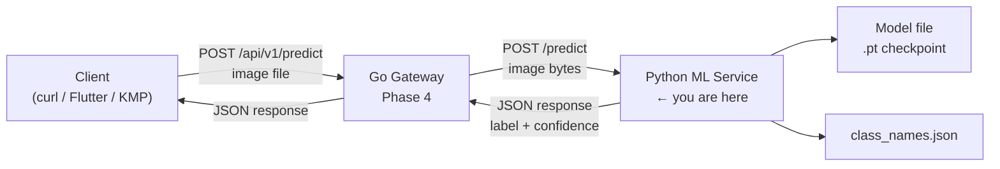
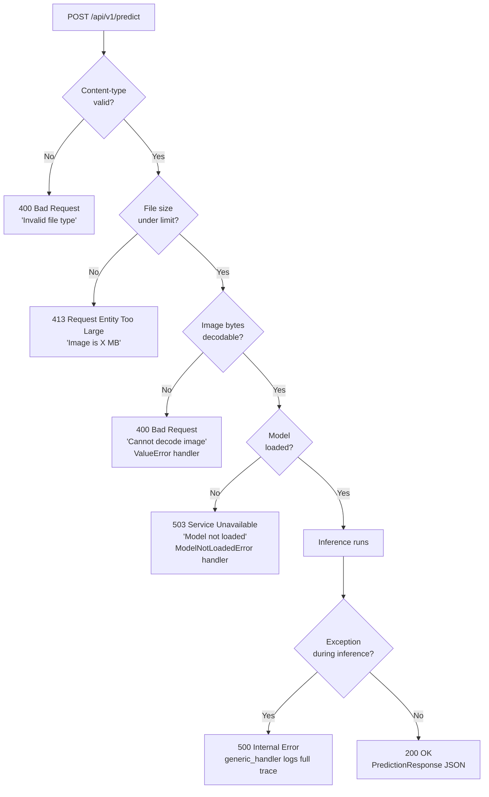
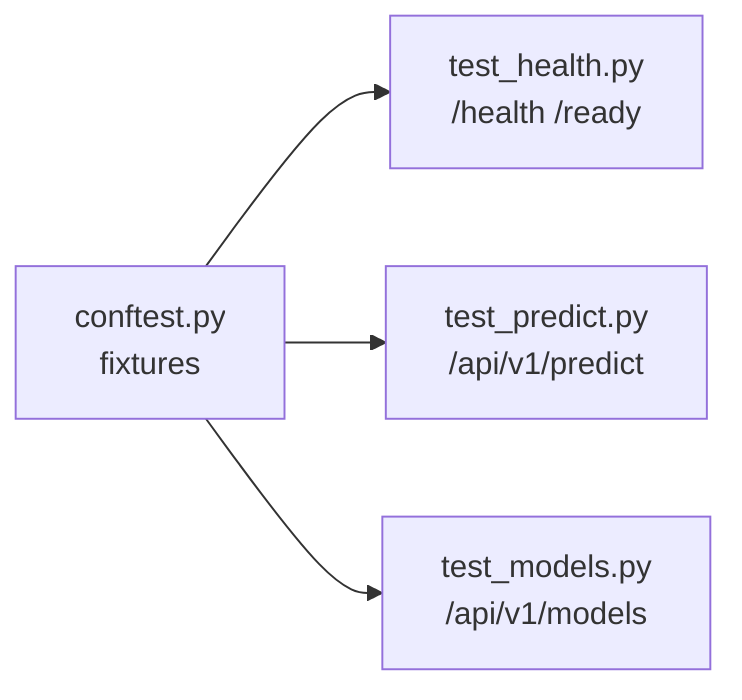
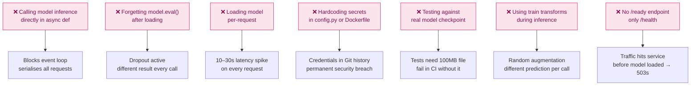

# Phase 2 — Python ML Service (FastAPI)

> **Duration:** 1.5 weeks · **10–15 hrs/week**
> **Goal:** Wrap the trained MobileNetV2 model from Phase 1 into a
> production-ready REST API — with model versioning, Pydantic validation,
> structured logging, error handling, pytest coverage, and a Docker container.
> By the end, a single `docker compose up` starts the service and `curl` proves
> it works end-to-end.

> **Prerequisite:** Phase 1 complete. You must have:
> - `outputs/checkpoints/mobilenetv2_v1_best.pt` — the trained model checkpoint
> - `data/class_names.json` — the 38 class name list
> - `requirements.txt` from Phase 1 for reference

---

## Table of Contents

1. [What You Will Build](#1-what-you-will-build)
2. [How the Service Fits the Larger System](#2-how-the-service-fits-the-larger-system)
3. [Folder Structure](#3-folder-structure)
4. [Environment Setup](#4-environment-setup)
5. [Application Configuration](#5-application-configuration)
6. [Pydantic Schemas](#6-pydantic-schemas)
7. [Inference Service](#7-inference-service)
8. [FastAPI Application](#8-fastapi-application)
9. [Routers](#9-routers)
   - [9.1 Predict Router](#91-predict-router)
   - [9.2 Health Router](#92-health-router)
   - [9.3 Models Router](#93-models-router)
10. [Structured Logging](#10-structured-logging)
11. [Error Handling](#11-error-handling)
12. [TFLite Export](#12-tflite-export)
13. [Testing with pytest](#13-testing-with-pytest)
14. [Dockerfile and Docker Compose](#14-dockerfile-and-docker-compose)
15. [Manual Testing with curl and Postman](#15-manual-testing-with-curl-and-postman)
16. [Interview Questions & Model Answers](#16-interview-questions--model-answers)
17. [Common Mistakes to Avoid](#17-common-mistakes-to-avoid)
18. [Reference Links](#18-reference-links)
19. [Phase 2 Completion Checklist](#19-phase-2-completion-checklist)

---

## 1. What You Will Build

By the end of Phase 2 you will have **one deployable service** committed to
GitHub as a clean sub-directory of the monorepo:

| Artefact | File | What it proves |
|---|---|---|
| FastAPI application | `app/main.py` | You can structure a production Python API |
| Inference service | `app/services/inference.py` | Model loading, versioning, async-safe inference |
| Pydantic schemas | `app/schemas/prediction.py` | You validate I/O at the boundary, not inside logic |
| Health + metrics endpoints | `app/routers/health.py` | You build observable services, not black boxes |
| Model version endpoint | `app/routers/models.py` | You think about model lifecycle from day one |
| Structured logging | `app/core/logging.py` | Every request is traceable in production |
| Full pytest suite | `tests/` | You write tests — the senior signal most candidates skip |
| Dockerfile | `Dockerfile` | The service runs identically on any machine |
| TFLite export script | `scripts/export_tflite.py` | Phase 6 (Flutter) and Phase 7 (KMP) consume this |

---

## 2. How the Service Fits the Larger System



The Python service is a **single-responsibility component** — it accepts an
image and returns a prediction. It knows nothing about authentication, rate
limiting, or routing. Those belong in the Go gateway (Phase 4). Keeping
concerns separated makes each component testable and replaceable in isolation.

---

## 3. Folder Structure

```
python-ml-service/               ← service root (one directory in the monorepo)
│
├── app/                         ← application package
│   ├── __init__.py
│   ├── main.py                  ← FastAPI app factory, lifespan, middleware
│   ├── config.py                ← settings loaded from environment variables
│   │
│   ├── core/                    ← cross-cutting concerns
│   │   ├── __init__.py
│   │   └── logging.py           ← structlog configuration
│   │
│   ├── schemas/                 ← Pydantic input/output models
│   │   ├── __init__.py
│   │   └── prediction.py        ← PredictionResponse, ErrorResponse
│   │
│   ├── services/                ← business logic, no HTTP knowledge
│   │   ├── __init__.py
│   │   └── inference.py         ← model loading, preprocessing, inference
│   │
│   └── routers/                 ← HTTP handlers, thin layer over services
│       ├── __init__.py
│       ├── predict.py           ← POST /api/v1/predict
│       ├── health.py            ← GET /health, GET /ready
│       └── models.py            ← GET /api/v1/models
│
├── models/                      ← model files (gitignored — too large)
│   ├── mobilenetv2_v1.pt        ← copied from Phase 1 outputs
│   └── crop_disease_v1.tflite  ← exported by scripts/export_tflite.py
│
├── scripts/                     ← one-off utility scripts
│   └── export_tflite.py         ← converts .pt → .tflite for mobile phases
│
├── tests/                       ← pytest test suite
│   ├── __init__.py
│   ├── conftest.py              ← shared fixtures (app client, mock model)
│   ├── test_predict.py          ← predict endpoint tests
│   ├── test_health.py           ← health endpoint tests
│   └── fixtures/                ← test images
│       ├── healthy_leaf.jpg
│       └── diseased_leaf.jpg
│
├── Dockerfile                   ← multi-stage build
├── .dockerignore
├── .env.example                 ← template — never commit .env
├── .gitignore
├── pyproject.toml               ← project metadata and tool config
└── requirements.txt             ← pinned dependencies for Docker
```

Create the scaffold:

```bash
# Navigate to the monorepo root created in Phase 1
cd ai-crop-disease-platform   # or wherever your monorepo root is

# Create the service directory
mkdir -p python-ml-service
cd python-ml-service

# Create all directories
mkdir -p app/{core,schemas,services,routers} \
         models \
         scripts \
         tests/fixtures

# Create all __init__.py files (makes each directory a Python package)
touch app/__init__.py \
      app/core/__init__.py \
      app/schemas/__init__.py \
      app/services/__init__.py \
      app/routers/__init__.py \
      tests/__init__.py

# Create placeholder files so the structure is visible before we write code
touch app/main.py \
      app/config.py \
      app/core/logging.py \
      app/schemas/prediction.py \
      app/services/inference.py \
      app/routers/predict.py \
      app/routers/health.py \
      app/routers/models.py \
      scripts/export_tflite.py \
      tests/conftest.py \
      tests/test_predict.py \
      tests/test_health.py

# Copy the Phase 1 model checkpoint and class names into this service
# Adjust the source path to match where Phase 1 outputs live
cp ../ml-foundations/outputs/checkpoints/mobilenetv2_v1_best.pt models/
cp ../ml-foundations/data/class_names.json models/

echo "Scaffold created"
ls -la app/
```

---

## 4. Environment Setup

### 4.1 Create virtual environment

```bash
# Inside python-ml-service/
# Each service gets its own venv — never share one across services
uv venv

# Activate
source .venv/bin/activate

# Your prompt should show (.venv)
```

### 4.2 Install dependencies

```bash
# Core application dependencies
uv add \
  fastapi \               # web framework — async, type-safe, auto-docs
  "uvicorn[standard]" \   # ASGI server — runs the FastAPI app
  torch \                 # PyTorch — model inference
  torchvision \           # image transforms (same pipeline as Phase 1)
  pillow \                # image decoding (PIL)
  pydantic \              # data validation — used by FastAPI natively
  pydantic-settings \     # settings management from env vars
  python-multipart \      # required for file upload endpoints
  structlog \             # structured JSON logging
  prometheus-client       # /metrics endpoint for Phase 5

# Test and dev dependencies
uv add --dev \
  pytest \                # test runner
  pytest-asyncio \        # async test support
  httpx \                 # async HTTP client for testing FastAPI
  pytest-cov \            # coverage reporting
  ruff \                  # linter + formatter
  mypy \                  # type checker

# Pin dependencies for Docker reproducibility
uv pip freeze > requirements.txt

echo "Dependencies installed"
python -c "import fastapi; print(f'FastAPI {fastapi.__version__}')"
```

### 4.3 Create pyproject.toml

```bash
cat > pyproject.toml << 'EOF'
[project]
name = "python-ml-service"
version = "0.1.0"
description = "Crop disease classification ML service"
requires-python = ">=3.11"

[tool.pytest.ini_options]
# asyncio_mode = "auto" means every async test function is treated as a test
# without needing @pytest.mark.asyncio on each one
asyncio_mode = "auto"
testpaths = ["tests"]

[tool.ruff]
line-length = 100
target-version = "py311"

[tool.ruff.lint]
select = ["E", "F", "I", "UP"]  # pycodestyle, pyflakes, isort, pyupgrade

[tool.mypy]
python_version = "3.11"
strict = true
ignore_missing_imports = true
EOF
```

### 4.4 Create .gitignore

```bash
cat > .gitignore << 'EOF'
# Virtual environment
.venv/

# Model weights — too large for Git, use Git LFS or cloud storage
models/*.pt
models/*.tflite
models/*.h5

# Environment secrets — NEVER commit
.env

# Python cache
__pycache__/
*.pyc
*.pyo
.mypy_cache/
.ruff_cache/

# Test artefacts
.coverage
htmlcov/
.pytest_cache/

# Docker build cache
.dockerignore
EOF
```

### 4.5 Create .env.example

```bash
# .env.example — template showing required variables
# Copy to .env and fill in real values — never commit .env
cat > .env.example << 'EOF'
# Application
APP_ENV=development          # development | production
APP_PORT=8000
LOG_LEVEL=INFO               # DEBUG | INFO | WARNING | ERROR

# Model
MODEL_DIR=models             # directory containing .pt files
DEFAULT_MODEL_VERSION=v1     # which version to load on startup
MAX_IMAGE_SIZE_MB=5          # reject uploads larger than this

# Security (used by Go gateway to call this service internally)
INTERNAL_API_KEY=change-me-in-production
EOF

# Copy to .env for local development
cp .env.example .env
```

---

## 5. Application Configuration

**File:** `app/config.py`

```python
# app/config.py
#
# Centralised settings management using pydantic-settings.
#
# pydantic-settings reads values from:
#   1. Environment variables (highest priority)
#   2. A .env file (convenient for local development)
#   3. Default values defined here (fallback)
#
# This means the same code runs locally (reading .env) and in Docker
# (reading environment variables injected by docker-compose or the cloud).
# No code changes needed between environments — only the env vars change.

from functools import lru_cache
from pathlib import Path

from pydantic import Field
from pydantic_settings import BaseSettings, SettingsConfigDict


class Settings(BaseSettings):
    """
    All application configuration in one place.
    Every field maps to an environment variable of the same name (uppercased).
    """

    # ── Application ───────────────────────────────────────────────────────
    app_env: str = Field(default="development", description="development | production")
    app_port: int = Field(default=8000)
    log_level: str = Field(default="INFO")

    # ── Model ─────────────────────────────────────────────────────────────
    model_dir: Path = Field(default=Path("models"))
    default_model_version: str = Field(default="v1")
    max_image_size_mb: int = Field(default=5)

    # ── Security ──────────────────────────────────────────────────────────
    internal_api_key: str = Field(default="dev-key")

    # ── Derived properties ────────────────────────────────────────────────
    @property
    def max_image_size_bytes(self) -> int:
        """Convert MB limit to bytes for direct comparison against upload size."""
        return self.max_image_size_mb * 1024 * 1024

    @property
    def is_production(self) -> bool:
        return self.app_env == "production"

    # Tell pydantic-settings to also read from a .env file
    model_config = SettingsConfigDict(
        env_file=".env",
        env_file_encoding="utf-8",
        case_sensitive=False,   # MODEL_DIR and model_dir both work
    )


@lru_cache(maxsize=1)
def get_settings() -> Settings:
    """
    Return a cached Settings instance.

    @lru_cache ensures we only read and parse the env/file once per process.
    Dependency injection in FastAPI: `settings: Settings = Depends(get_settings)`
    """
    return Settings()
```

---

## 6. Pydantic Schemas

**File:** `app/schemas/prediction.py`

```python
# app/schemas/prediction.py
#
# Pydantic models define the contract between the API and its callers.
#
# Why Pydantic matters:
#   - FastAPI uses these to validate incoming requests automatically
#   - They generate the OpenAPI (Swagger) documentation for free
#   - They enforce types at runtime — a float field will reject a string
#   - They serialise cleanly to JSON for the response body
#
# Rule: schemas live at the HTTP boundary.
#       Business logic never imports schemas — only routers do.

from __future__ import annotations

from pydantic import BaseModel, Field


class TopPrediction(BaseModel):
    """One entry in the top-K predictions list."""

    label: str = Field(
        description="Human-readable class name, e.g. 'Tomato___Early_blight'"
    )
    confidence: float = Field(
        ge=0.0, le=1.0,
        description="Softmax probability — values always between 0 and 1"
    )


class PredictionResponse(BaseModel):
    """
    Successful prediction response.
    Returned by POST /api/v1/predict on a 200 OK.
    """

    label: str = Field(
        description="Top-1 predicted class name"
    )
    confidence: float = Field(
        ge=0.0, le=1.0,
        description="Confidence for the top-1 prediction"
    )
    top_3: list[TopPrediction] = Field(
        description="Top 3 predictions with their confidences"
    )
    model_version: str = Field(
        description="Which model version produced this prediction"
    )
    inference_time_ms: float = Field(
        description="How long inference took in milliseconds"
    )
    is_healthy: bool = Field(
        description="True if top-1 label contains 'healthy'"
    )

    model_config = {"json_schema_extra": {
        "example": {
            "label": "Tomato___Early_blight",
            "confidence": 0.9231,
            "top_3": [
                {"label": "Tomato___Early_blight", "confidence": 0.9231},
                {"label": "Tomato___Late_blight",  "confidence": 0.0512},
                {"label": "Tomato___healthy",       "confidence": 0.0187},
            ],
            "model_version": "v1",
            "inference_time_ms": 34.2,
            "is_healthy": False,
        }
    }}


class ModelInfo(BaseModel):
    """Metadata about one loaded model version."""

    version: str
    num_classes: int
    loaded: bool
    checkpoint_path: str


class ModelsResponse(BaseModel):
    """Response for GET /api/v1/models — lists all available model versions."""

    default_version: str
    models: list[ModelInfo]


class HealthResponse(BaseModel):
    """Response for GET /health."""

    status: str   # "ok" | "degraded" | "unhealthy"
    model_loaded: bool
    version: str


class ErrorResponse(BaseModel):
    """
    Standard error response shape.
    FastAPI will use this for all HTTPException responses.
    Having a consistent shape means callers can always parse errors the same way.
    """

    error: str = Field(description="Machine-readable error code")
    message: str = Field(description="Human-readable explanation")
    detail: str | None = Field(default=None, description="Optional extra context")
```

---

## 7. Inference Service

**File:** `app/services/inference.py`

This is the most important file in the service. It owns all model knowledge —
loading, versioning, preprocessing, and inference. The routers call it but know
nothing about PyTorch.

```python
# app/services/inference.py
#
# InferenceService encapsulates everything model-related.
#
# Design decisions worth explaining in interviews:
#
# 1. ThreadPoolExecutor for CPU-bound inference
#    Python's asyncio event loop is single-threaded. If we call model(tensor)
#    directly inside an async function, it blocks the event loop — no other
#    requests can be served until inference finishes. We offload to a thread
#    pool so the event loop stays free to handle other requests concurrently.
#
# 2. Model versioning from day one
#    The checkpoint filename encodes the version. The service loads the default
#    version at startup but can switch versions at runtime. This matters for
#    A/B testing and rollbacks in production.
#
# 3. Singleton pattern via FastAPI lifespan
#    The model is loaded once at startup (expensive) and reused across all
#    requests (cheap). We never reload per-request.

from __future__ import annotations

import asyncio
import json
import time
from concurrent.futures import ThreadPoolExecutor
from pathlib import Path

import torch
import torch.nn as nn
from PIL import Image
import io
import structlog
from torchvision import models
from torchvision.transforms import v2 as T

from app.config import get_settings
from app.schemas.prediction import PredictionResponse, TopPrediction

log = structlog.get_logger(__name__)

# ── Preprocessing pipeline ────────────────────────────────────────────────────
# Must exactly match the val_transforms from Phase 1 src/transforms.py.
# Using train_transforms here (with augmentation) would give different results
# on the same image each time — that is a bug, not a feature.
IMAGENET_MEAN = [0.485, 0.456, 0.406]
IMAGENET_STD  = [0.229, 0.224, 0.225]

INFERENCE_TRANSFORMS = T.Compose([
    T.Resize((224, 224)),                              # MobileNetV2 expects 224×224
    T.ToTensor(),                                      # PIL (0–255) → tensor (0.0–1.0)
    T.Normalize(mean=IMAGENET_MEAN, std=IMAGENET_STD), # match ImageNet pretraining stats
])


class ModelNotLoadedError(Exception):
    """Raised when inference is attempted before a model is loaded."""


class InferenceService:
    """
    Manages model loading, versioning, and inference.
    One instance lives for the lifetime of the application (singleton).
    """

    def __init__(self) -> None:
        self._model: nn.Module | None = None
        self._class_names: list[str] = []
        self._version: str = ""
        self._device = self._select_device()
        # Thread pool for offloading CPU-bound inference off the event loop.
        # max_workers=2 is conservative — avoids memory pressure on small instances.
        self._executor = ThreadPoolExecutor(max_workers=2, thread_name_prefix="inference")
        log.info("inference.service.created", device=str(self._device))

    @staticmethod
    def _select_device() -> torch.device:
        """
        Pick the fastest available device.
        MPS = Apple Silicon GPU (your M5 MacBook) — use it.
        """
        if torch.cuda.is_available():
            return torch.device("cuda")
        if torch.backends.mps.is_available():
            return torch.device("mps")
        return torch.device("cpu")

    def load(self, version: str | None = None) -> None:
        """
        Load a model checkpoint from disk.
        Called once at application startup via FastAPI lifespan.

        Args:
            version: model version string, e.g. "v1". Defaults to
                     DEFAULT_MODEL_VERSION from settings.
        """
        settings = get_settings()
        version = version or settings.default_model_version

        # Locate the checkpoint file
        ckpt_path = settings.model_dir / f"mobilenetv2_{version}_best.pt"
        if not ckpt_path.exists():
            raise FileNotFoundError(f"Model checkpoint not found: {ckpt_path}")

        # Load class names — must match the classes the model was trained on
        class_names_path = settings.model_dir / "class_names.json"
        if not class_names_path.exists():
            raise FileNotFoundError(f"class_names.json not found: {class_names_path}")

        with open(class_names_path) as f:
            self._class_names = json.load(f)

        # Reconstruct the model architecture — must match Phase 1 exactly
        model = models.mobilenet_v2(weights=None)  # no pretrained weights — we load our own
        model.classifier[1] = nn.Linear(
            model.last_channel, len(self._class_names)
        )

        # Load saved weights — map_location ensures it works regardless of device
        checkpoint = torch.load(ckpt_path, map_location=self._device, weights_only=True)
        model.load_state_dict(checkpoint["model_state_dict"])

        # eval() mode: disables dropout and uses running batch norm stats
        # Critical — forgetting this gives different results on each call
        model.eval()
        model.to(self._device)

        self._model = model
        self._version = version

        log.info(
            "model.loaded",
            version=version,
            num_classes=len(self._class_names),
            device=str(self._device),
            checkpoint=str(ckpt_path),
        )

    @property
    def is_loaded(self) -> bool:
        return self._model is not None

    @property
    def version(self) -> str:
        return self._version

    @property
    def num_classes(self) -> int:
        return len(self._class_names)

    def _preprocess(self, image_bytes: bytes) -> torch.Tensor:
        """
        Decode raw image bytes and apply the inference preprocessing pipeline.

        Returns a tensor of shape [1, 3, 224, 224] — batch size 1.
        """
        try:
            # PIL handles JPEG, PNG, WebP, and more
            image = Image.open(io.BytesIO(image_bytes)).convert("RGB")
            # convert("RGB") is essential: RGBA (PNG with transparency) or
            # grayscale images would cause a shape mismatch in the model
        except Exception as exc:
            raise ValueError(f"Cannot decode image: {exc}") from exc

        tensor = INFERENCE_TRANSFORMS(image)  # shape: [3, 224, 224]
        return tensor.unsqueeze(0).to(self._device)  # add batch dim: [1, 3, 224, 224]

    def _run_inference(self, tensor: torch.Tensor) -> tuple[list[str], list[float]]:
        """
        Synchronous inference — runs in the thread pool, not the event loop.
        Returns (class_names, probabilities) sorted by descending probability.
        """
        if self._model is None:
            raise ModelNotLoadedError("Model not loaded — call load() first")

        with torch.no_grad():
            # Forward pass through MobileNetV2
            logits = self._model(tensor)  # shape: [1, num_classes]
            # Softmax converts raw scores to probabilities summing to 1
            probs = torch.softmax(logits, dim=1).squeeze(0)  # shape: [num_classes]

        # Move to CPU for numpy/Python operations
        probs_cpu = probs.cpu().tolist()

        # Sort by probability, descending
        ranked = sorted(
            zip(self._class_names, probs_cpu),
            key=lambda x: x[1],
            reverse=True,
        )
        labels, confidences = zip(*ranked)
        return list(labels), list(confidences)

    async def predict(self, image_bytes: bytes) -> PredictionResponse:
        """
        Async entry point called by the router.

        Flow:
          1. Preprocess image (fast, done on event loop)
          2. Offload inference to thread pool (slow, CPU-bound)
          3. Build and return the response object
        """
        if not self.is_loaded:
            raise ModelNotLoadedError("Model not loaded")

        start_ms = time.perf_counter() * 1000

        # Preprocessing is fast (a few ms) — safe to do on the event loop
        tensor = self._preprocess(image_bytes)

        # Inference is slow (30–100ms on CPU) — offload to thread pool
        loop = asyncio.get_running_loop()
        labels, confidences = await loop.run_in_executor(
            self._executor,
            self._run_inference,
            tensor,
        )

        elapsed_ms = (time.perf_counter() * 1000) - start_ms

        top_label = labels[0]
        top_confidence = confidences[0]

        log.info(
            "inference.complete",
            label=top_label,
            confidence=round(top_confidence, 4),
            inference_time_ms=round(elapsed_ms, 1),
            model_version=self._version,
        )

        return PredictionResponse(
            label=top_label,
            confidence=top_confidence,
            top_3=[
                TopPrediction(label=labels[i], confidence=confidences[i])
                for i in range(min(3, len(labels)))
            ],
            model_version=self._version,
            inference_time_ms=round(elapsed_ms, 1),
            is_healthy="healthy" in top_label.lower(),
        )

    def shutdown(self) -> None:
        """Called during application shutdown to release resources cleanly."""
        self._executor.shutdown(wait=True)
        log.info("inference.service.shutdown")


# ── Module-level singleton ────────────────────────────────────────────────────
# FastAPI imports this instance in main.py and in routers.
# Using a module-level singleton (rather than a class variable) is idiomatic
# FastAPI — it pairs cleanly with the lifespan context manager.
inference_service = InferenceService()
```

---

## 8. FastAPI Application

**File:** `app/main.py`

```python
# app/main.py
#
# Application factory — creates and configures the FastAPI instance.
#
# Key patterns used here:
#
# 1. Lifespan context manager (replaces deprecated on_event startup/shutdown)
#    Runs setup code before the server accepts requests and teardown code
#    after it stops. The model is loaded here so it is warm before the
#    first request arrives.
#
# 2. CORS middleware
#    Required if a browser (or Flutter web) calls the API directly.
#    Set to restrictive origins in production.
#
# 3. Exception handlers
#    Catch known error types and return structured JSON responses.
#    Unhandled exceptions fall through to the default 500 handler.

from __future__ import annotations

from contextlib import asynccontextmanager
from typing import AsyncGenerator

import structlog
from fastapi import FastAPI, Request
from fastapi.middleware.cors import CORSMiddleware
from fastapi.responses import JSONResponse

from app.config import get_settings
from app.core.logging import configure_logging
from app.routers import health, models, predict
from app.schemas.prediction import ErrorResponse
from app.services.inference import ModelNotLoadedError, inference_service

log = structlog.get_logger(__name__)


@asynccontextmanager
async def lifespan(app: FastAPI) -> AsyncGenerator[None, None]:
    """
    Lifespan context manager — code before yield runs at startup,
    code after yield runs at shutdown.

    This replaces @app.on_event("startup") which is deprecated in FastAPI 0.95+.
    """
    # ── Startup ───────────────────────────────────────────────────────────
    settings = get_settings()
    configure_logging(settings.log_level)

    log.info("application.starting", env=settings.app_env, port=settings.app_port)

    # Load the model — blocks startup until weights are loaded into memory.
    # This is intentional: we never want the server to accept requests while
    # the model is still loading (it would return ModelNotLoadedError on every call).
    inference_service.load(version=settings.default_model_version)
    log.info("application.ready")

    yield  # ← server is running and accepting requests here

    # ── Shutdown ──────────────────────────────────────────────────────────
    inference_service.shutdown()
    log.info("application.stopped")


def create_app() -> FastAPI:
    """
    Application factory — returns a configured FastAPI instance.
    Using a factory function (rather than a module-level app object) makes
    testing easier: each test can create a fresh app instance.
    """
    settings = get_settings()

    app = FastAPI(
        title="Crop Disease ML Service",
        description="Image classification API for plant disease detection",
        version="1.0.0",
        docs_url="/docs",       # Swagger UI — available in development
        redoc_url="/redoc",     # ReDoc alternative docs
        openapi_url="/openapi.json",
        lifespan=lifespan,
    )

    # ── CORS ──────────────────────────────────────────────────────────────
    # In production, replace ["*"] with specific allowed origins.
    # The Go gateway is the primary caller — Flutter/KMP call the gateway,
    # not this service directly. CORS is here for local development convenience.
    app.add_middleware(
        CORSMiddleware,
        allow_origins=["*"] if not settings.is_production else ["http://localhost:8080"],
        allow_methods=["GET", "POST"],
        allow_headers=["*"],
    )

    # ── Routers ───────────────────────────────────────────────────────────
    app.include_router(health.router)              # /health, /ready
    app.include_router(predict.router)             # /api/v1/predict
    app.include_router(models.router)              # /api/v1/models

    # ── Exception handlers ────────────────────────────────────────────────
    @app.exception_handler(ModelNotLoadedError)
    async def model_not_loaded_handler(request: Request, exc: ModelNotLoadedError) -> JSONResponse:
        """Return 503 Service Unavailable when the model is not ready."""
        log.error("model.not_loaded", path=request.url.path)
        return JSONResponse(
            status_code=503,
            content=ErrorResponse(
                error="model_not_loaded",
                message="The ML model is not loaded. The service may be starting up.",
            ).model_dump(),
        )

    @app.exception_handler(ValueError)
    async def value_error_handler(request: Request, exc: ValueError) -> JSONResponse:
        """Return 400 Bad Request for invalid input (e.g. corrupt image bytes)."""
        log.warning("invalid_input", path=request.url.path, detail=str(exc))
        return JSONResponse(
            status_code=400,
            content=ErrorResponse(
                error="invalid_input",
                message=str(exc),
            ).model_dump(),
        )

    @app.exception_handler(Exception)
    async def generic_handler(request: Request, exc: Exception) -> JSONResponse:
        """Catch-all — log the full exception and return a generic 500."""
        log.exception("unhandled_error", path=request.url.path, exc_info=exc)
        return JSONResponse(
            status_code=500,
            content=ErrorResponse(
                error="internal_error",
                message="An unexpected error occurred.",
            ).model_dump(),
        )

    return app


# Module-level app instance — uvicorn references this: `uvicorn app.main:app`
app = create_app()
```

---

## 9. Routers

### 9.1 Predict Router

**File:** `app/routers/predict.py`

```python
# app/routers/predict.py
#
# POST /api/v1/predict — the primary endpoint of the service.
#
# The router's job is only to:
#   1. Validate the incoming request (file type, file size)
#   2. Call the inference service
#   3. Return the response or raise an HTTPException
#
# No business logic lives here. "Thin router, fat service" is the pattern.

from __future__ import annotations

import structlog
from fastapi import APIRouter, File, HTTPException, UploadFile

from app.config import get_settings
from app.schemas.prediction import PredictionResponse
from app.services.inference import inference_service

log = structlog.get_logger(__name__)

# prefix groups all routes under /api/v1 — versioning from day one
router = APIRouter(prefix="/api/v1", tags=["prediction"])

# Allowed MIME types — reject everything else at the boundary
ALLOWED_CONTENT_TYPES = {"image/jpeg", "image/png", "image/webp"}


@router.post(
    "/predict",
    response_model=PredictionResponse,
    summary="Classify a crop image",
    description="Upload a JPEG, PNG, or WebP image. Returns the predicted disease class and confidence.",
    responses={
        200: {"model": PredictionResponse},
        400: {"description": "Invalid image format or size"},
        413: {"description": "Image exceeds size limit"},
        503: {"description": "Model not loaded"},
    },
)
async def predict(
    file: UploadFile = File(..., description="Crop image — JPEG, PNG, or WebP"),
) -> PredictionResponse:
    """
    Accept an image file and return a disease classification prediction.

    Validation order:
      1. Content-type header check (fast, no I/O)
      2. Read the file bytes
      3. File size check (avoids loading huge files into memory before rejecting)
      4. Call inference service
    """
    settings = get_settings()

    # ── 1. Content-type validation ─────────────────────────────────────────
    # content_type is a header sent by the client — it can be spoofed.
    # In Phase 5 we add magic-byte validation for deeper checking.
    if file.content_type not in ALLOWED_CONTENT_TYPES:
        log.warning(
            "predict.invalid_content_type",
            content_type=file.content_type,
            filename=file.filename,
        )
        raise HTTPException(
            status_code=400,
            detail=f"Invalid file type '{file.content_type}'. "
                   f"Accepted: {', '.join(ALLOWED_CONTENT_TYPES)}",
        )

    # ── 2. Read bytes ──────────────────────────────────────────────────────
    # await is required — reading from the upload stream is async I/O
    image_bytes = await file.read()

    # ── 3. Size validation ─────────────────────────────────────────────────
    # Check AFTER reading so we can give an accurate size in the error message
    if len(image_bytes) > settings.max_image_size_bytes:
        size_mb = len(image_bytes) / (1024 * 1024)
        log.warning("predict.file_too_large", size_mb=round(size_mb, 1))
        raise HTTPException(
            status_code=413,
            detail=f"Image is {size_mb:.1f} MB. Maximum allowed: {settings.max_image_size_mb} MB.",
        )

    # ── 4. Inference ───────────────────────────────────────────────────────
    # inference_service.predict raises ValueError on corrupt images,
    # caught by the exception handler in main.py → returns 400
    result = await inference_service.predict(image_bytes)

    log.info(
        "predict.success",
        filename=file.filename,
        label=result.label,
        confidence=result.confidence,
        inference_time_ms=result.inference_time_ms,
    )
    return result
```

### 9.2 Health Router

**File:** `app/routers/health.py`

```python
# app/routers/health.py
#
# /health — liveness probe: is the process running?
# /ready  — readiness probe: is the service ready to serve traffic?
#
# The distinction matters for Kubernetes and Cloud Run:
#   Liveness:  if this fails, restart the container
#   Readiness: if this fails, stop sending traffic (but don't restart)
#
# A service can be alive (process is up) but not ready (model still loading).
# Health and readiness as separate endpoints lets the orchestrator tell
# the difference and react appropriately.

from __future__ import annotations

import structlog
from fastapi import APIRouter
from fastapi.responses import JSONResponse

from app.schemas.prediction import HealthResponse
from app.services.inference import inference_service

log = structlog.get_logger(__name__)
router = APIRouter(tags=["observability"])


@router.get(
    "/health",
    response_model=HealthResponse,
    summary="Liveness probe",
    description="Returns 200 if the process is running. Does not check model state.",
)
async def health() -> HealthResponse:
    """
    Liveness probe — always returns 200 as long as the process is alive.
    Kubernetes uses this to decide whether to restart the container.
    """
    return HealthResponse(
        status="ok",
        model_loaded=inference_service.is_loaded,
        version=inference_service.version or "not_loaded",
    )


@router.get(
    "/ready",
    summary="Readiness probe",
    description="Returns 200 if the model is loaded and ready to serve. Returns 503 if not.",
)
async def ready() -> JSONResponse:
    """
    Readiness probe — returns 503 until the model is fully loaded.
    Cloud Run / Kubernetes will not route traffic here until this returns 200.
    """
    if not inference_service.is_loaded:
        log.warning("readiness.not_ready")
        return JSONResponse(
            status_code=503,
            content={"status": "not_ready", "reason": "model_loading"},
        )
    return JSONResponse(
        status_code=200,
        content={"status": "ready", "model_version": inference_service.version},
    )
```

### 9.3 Models Router

**File:** `app/routers/models.py`

```python
# app/routers/models.py
#
# GET /api/v1/models — lists available model versions.
#
# Why this endpoint matters for interviews:
# "How do you manage model versions in production?"
# This endpoint is part of the answer — you can query what is loaded
# and what is available without SSH-ing into the server.

from __future__ import annotations

from pathlib import Path

import structlog
from fastapi import APIRouter

from app.config import get_settings
from app.schemas.prediction import ModelInfo, ModelsResponse
from app.services.inference import inference_service

log = structlog.get_logger(__name__)
router = APIRouter(prefix="/api/v1", tags=["models"])


@router.get(
    "/models",
    response_model=ModelsResponse,
    summary="List available model versions",
    description="Returns all .pt checkpoint files in the models directory and which is currently loaded.",
)
async def list_models() -> ModelsResponse:
    """
    Scan the models directory for checkpoint files and report their status.
    Allows operators to see what is deployed without accessing the server directly.
    """
    settings = get_settings()
    model_dir = settings.model_dir

    # Find all checkpoint files — filename pattern: mobilenetv2_{version}_best.pt
    checkpoints = list(model_dir.glob("mobilenetv2_*_best.pt"))

    model_infos: list[ModelInfo] = []
    for ckpt_path in sorted(checkpoints):
        # Extract version from filename: mobilenetv2_v1_best.pt → "v1"
        parts = ckpt_path.stem.split("_")   # ["mobilenetv2", "v1", "best"]
        version = parts[1] if len(parts) >= 2 else "unknown"
        is_current = version == inference_service.version

        model_infos.append(ModelInfo(
            version=version,
            num_classes=inference_service.num_classes if is_current else 0,
            loaded=is_current,
            checkpoint_path=str(ckpt_path),
        ))

    return ModelsResponse(
        default_version=settings.default_model_version,
        models=model_infos,
    )
```

---

## 10. Structured Logging

**File:** `app/core/logging.py`

```python
# app/core/logging.py
#
# Structured logging using structlog.
#
# Why structured logging?
# Plain text logs: "2026-07-30 Prediction: Tomato blight, 0.92, 34ms"
# Structured logs: {"event":"inference.complete","label":"Tomato___Early_blight","confidence":0.92,"ms":34}
#
# Structured logs can be queried in Datadog, Loki, or CloudWatch:
#   { label = "Tomato___Early_blight" } | count over 5m
# Plain text logs cannot. In production, structured logs are non-negotiable.
#
# structlog processors run in order — each takes the event dict and returns
# a modified version. Think of them as middleware for log lines.

from __future__ import annotations

import logging
import sys

import structlog


def configure_logging(level: str = "INFO") -> None:
    """
    Set up structlog with JSON output in production, coloured output locally.
    Call this once at application startup.
    """
    log_level = getattr(logging, level.upper(), logging.INFO)

    # Configure the standard library logging to route through structlog
    logging.basicConfig(
        format="%(message)s",
        stream=sys.stdout,
        level=log_level,
    )

    structlog.configure(
        processors=[
            # Add log level (INFO, WARNING, ERROR) to the event dict
            structlog.stdlib.add_log_level,

            # Add a UTC timestamp in ISO 8601 format
            structlog.processors.TimeStamper(fmt="iso", utc=True),

            # If an exception is present, format it as a stack trace string
            structlog.processors.format_exc_info,

            # Render the final dict as a JSON string — one line per log event
            structlog.processors.JSONRenderer(),
        ],
        wrapper_class=structlog.make_filtering_bound_logger(log_level),
        logger_factory=structlog.PrintLoggerFactory(),
        cache_logger_on_first_use=True,
    )
```

Logs from the running service look like:

```json
{"event":"application.starting","env":"development","port":8000,"level":"info","timestamp":"2026-07-30T08:00:00Z"}
{"event":"model.loaded","version":"v1","num_classes":38,"device":"mps","level":"info","timestamp":"2026-07-30T08:00:01Z"}
{"event":"inference.complete","label":"Tomato___Early_blight","confidence":0.9231,"inference_time_ms":34.1,"model_version":"v1","level":"info","timestamp":"2026-07-30T08:00:45Z"}
```

---

## 11. Error Handling

Error handling flow — what happens when something goes wrong:



Every error path returns the same `ErrorResponse` shape — callers never need
to parse different JSON structures depending on what went wrong.

---

## 12. TFLite Export

**File:** `scripts/export_tflite.py`

This script converts the PyTorch checkpoint to TensorFlow Lite format. Phase 6
(Flutter) and Phase 7 (Android KMP) both consume the `.tflite` file for
on-device inference. Run this once after Phase 1 training is complete.

```python
# scripts/export_tflite.py
#
# Export the PyTorch MobileNetV2 checkpoint to TensorFlow Lite (.tflite).
#
# Why TFLite for mobile?
# PyTorch Mobile exists but TFLite has:
#   - Better support in Flutter (tflite_flutter package)
#   - Better support in Android (org.tensorflow:tensorflow-lite)
#   - Smaller runtime binary size
#   - Quantisation support for even smaller models
#
# Export path: PyTorch (.pt) → ONNX (.onnx) → TensorFlow SavedModel → TFLite (.tflite)
# This two-step path (via ONNX) is the most reliable cross-framework conversion.

import json
from pathlib import Path

import numpy as np
import torch
import torch.nn as nn
from torchvision import models


def load_pytorch_model(
    checkpoint_path: str,
    class_names_path: str,
) -> tuple[nn.Module, list[str]]:
    """Load the Phase 1 trained checkpoint and return model + class names."""
    with open(class_names_path) as f:
        class_names = json.load(f)

    model = models.mobilenet_v2(weights=None)
    model.classifier[1] = nn.Linear(model.last_channel, len(class_names))

    checkpoint = torch.load(checkpoint_path, map_location="cpu", weights_only=True)
    model.load_state_dict(checkpoint["model_state_dict"])
    model.eval()

    print(f"Loaded PyTorch model: {len(class_names)} classes")
    return model, class_names


def export_to_onnx(model: nn.Module, output_path: str) -> None:
    """
    Export to ONNX format — the intermediate step.
    ONNX is a framework-neutral model format supported by most ML frameworks.
    """
    # Dummy input matching the model's expected shape: [batch, channels, H, W]
    dummy_input = torch.randn(1, 3, 224, 224)

    torch.onnx.export(
        model,
        dummy_input,
        output_path,
        input_names=["input"],         # name the input tensor
        output_names=["output"],       # name the output tensor
        dynamic_axes={
            "input":  {0: "batch_size"},   # allow variable batch size
            "output": {0: "batch_size"},
        },
        opset_version=17,              # ONNX opset — 17 is widely supported
        do_constant_folding=True,      # fold constants at export time (smaller model)
    )
    size_mb = Path(output_path).stat().st_size / (1024 * 1024)
    print(f"Exported ONNX: {output_path} ({size_mb:.1f} MB)")


def export_to_tflite(onnx_path: str, output_path: str, quantise: bool = True) -> None:
    """
    Convert ONNX to TFLite via the onnx-tf bridge and TF Lite converter.

    quantise=True: apply dynamic range quantisation.
      - Model size: ~14MB → ~4MB
      - Inference speed: faster on mobile CPU
      - Accuracy: minimal loss (< 1% on most models)
    """
    try:
        import onnx
        import onnx_tf
        import tensorflow as tf
    except ImportError:
        print(
            "Missing dependencies. Install with:\n"
            "  pip install onnx onnx-tf tensorflow"
        )
        raise

    # Step 1: Load ONNX model
    onnx_model = onnx.load(onnx_path)
    onnx.checker.check_model(onnx_model)   # validates the ONNX graph
    print("ONNX model validated")

    # Step 2: Convert ONNX → TF SavedModel
    saved_model_dir = Path(output_path).parent / "tf_saved_model"
    tf_rep = onnx_tf.backend.prepare(onnx_model)
    tf_rep.export_graph(str(saved_model_dir))
    print(f"Exported TF SavedModel: {saved_model_dir}")

    # Step 3: Convert TF SavedModel → TFLite
    converter = tf.lite.TFLiteConverter.from_saved_model(str(saved_model_dir))

    if quantise:
        # Dynamic range quantisation: weights stored as int8, activations as float32
        # Best tradeoff between size reduction and accuracy preservation
        converter.optimizations = [tf.lite.Optimize.DEFAULT]

    tflite_model = converter.convert()

    # Save to disk
    Path(output_path).write_bytes(tflite_model)
    size_mb = Path(output_path).stat().st_size / (1024 * 1024)
    print(f"Exported TFLite: {output_path} ({size_mb:.1f} MB)")


def verify_tflite(tflite_path: str, class_names: list[str]) -> None:
    """
    Run a dummy inference through the TFLite model to confirm it works.
    Always verify after export — a corrupted export is silent otherwise.
    """
    import tensorflow as tf

    interpreter = tf.lite.Interpreter(model_path=tflite_path)
    interpreter.allocate_tensors()

    input_details  = interpreter.get_input_details()
    output_details = interpreter.get_output_details()

    print(f"\nTFLite model verified:")
    print(f"  Input shape:  {input_details[0]['shape']}")    # expect [1, 224, 224, 3]
    print(f"  Output shape: {output_details[0]['shape']}")   # expect [1, 38]

    # Run dummy inference — random noise as input
    dummy = np.random.randn(1, 224, 224, 3).astype(np.float32)
    interpreter.set_tensor(input_details[0]["index"], dummy)
    interpreter.invoke()

    output = interpreter.get_tensor(output_details[0]["index"])
    top_class = class_names[np.argmax(output[0])]
    print(f"  Dummy inference top class: {top_class}")
    print("  Verification passed ✓")


if __name__ == "__main__":
    MODEL_VERSION = "v1"
    MODELS_DIR = Path("models")
    MODELS_DIR.mkdir(exist_ok=True)

    checkpoint_path   = str(MODELS_DIR / f"mobilenetv2_{MODEL_VERSION}_best.pt")
    class_names_path  = str(MODELS_DIR / "class_names.json")
    onnx_path         = str(MODELS_DIR / f"mobilenetv2_{MODEL_VERSION}.onnx")
    tflite_path       = str(MODELS_DIR / f"crop_disease_{MODEL_VERSION}.tflite")

    print("=== TFLite Export Pipeline ===\n")

    model, class_names = load_pytorch_model(checkpoint_path, class_names_path)
    export_to_onnx(model, onnx_path)
    export_to_tflite(onnx_path, tflite_path, quantise=True)
    verify_tflite(tflite_path, class_names)

    print(f"\nExport complete. Files in {MODELS_DIR}:")
    for f in sorted(MODELS_DIR.iterdir()):
        print(f"  {f.name}  ({f.stat().st_size / (1024*1024):.1f} MB)")
```

Run the export:

```bash
# Install extra deps needed only for this script — not the main service
uv add --optional-group export onnx onnx-tf tensorflow

# Run the export
python scripts/export_tflite.py

# Expected output:
# Loaded PyTorch model: 38 classes
# Exported ONNX: models/mobilenetv2_v1.onnx (14.2 MB)
# ONNX model validated
# Exported TF SavedModel: models/tf_saved_model
# Exported TFLite: models/crop_disease_v1.tflite (4.1 MB)
# TFLite model verified:
#   Input shape:  [1, 224, 224, 3]
#   Output shape: [1, 38]
#   Verification passed ✓
```

---

## 13. Testing with pytest

The test suite is what separates a portfolio project from a toy script.
Interviewers look for this. Write it before you think the code is "done".



### 13.1 conftest.py — shared fixtures

**File:** `tests/conftest.py`

```python
# tests/conftest.py
#
# Shared pytest fixtures available to all test files in the tests/ directory.
#
# Key fixture: app_client
# Creates an AsyncClient that calls the FastAPI app directly — no network,
# no running server needed. Tests run in milliseconds.
#
# Key fixture: mock_inference_service
# Replaces the real InferenceService with a mock that returns canned responses.
# This means tests run even without the model checkpoint file present.
# Unit tests should not depend on external files — they test logic, not I/O.

from __future__ import annotations

from io import BytesIO
from pathlib import Path
from unittest.mock import AsyncMock, MagicMock, patch

import pytest
import pytest_asyncio
from httpx import ASGITransport, AsyncClient
from PIL import Image

from app.main import create_app
from app.schemas.prediction import PredictionResponse, TopPrediction


# ── Canned prediction — what the mock service always returns ─────────────────
MOCK_PREDICTION = PredictionResponse(
    label="Tomato___Early_blight",
    confidence=0.9231,
    top_3=[
        TopPrediction(label="Tomato___Early_blight", confidence=0.9231),
        TopPrediction(label="Tomato___Late_blight",  confidence=0.0512),
        TopPrediction(label="Tomato___healthy",       confidence=0.0187),
    ],
    model_version="v1",
    inference_time_ms=34.1,
    is_healthy=False,
)


def make_jpeg_bytes(width: int = 224, height: int = 224) -> bytes:
    """
    Create a minimal valid JPEG in memory.
    PIL is used rather than reading a file so tests have no external dependencies.
    """
    img = Image.new("RGB", (width, height), color=(100, 150, 80))  # green-ish
    buf = BytesIO()
    img.save(buf, format="JPEG")
    return buf.getvalue()


def make_png_bytes(width: int = 224, height: int = 224) -> bytes:
    """Create a minimal valid PNG in memory."""
    img = Image.new("RGB", (width, height), color=(80, 120, 60))
    buf = BytesIO()
    img.save(buf, format="PNG")
    return buf.getvalue()


@pytest.fixture(scope="session")
def jpeg_bytes() -> bytes:
    """Valid JPEG image bytes — reused across the session (session scope = created once)."""
    return make_jpeg_bytes()


@pytest.fixture(scope="session")
def png_bytes() -> bytes:
    """Valid PNG image bytes."""
    return make_png_bytes()


@pytest_asyncio.fixture
async def app_client():
    """
    AsyncClient wrapping the FastAPI app — no real server required.

    Patches inference_service so tests do not need the model checkpoint.
    This is a unit test fixture — it tests HTTP handling, not ML accuracy.
    """
    # Patch the inference_service singleton before creating the app
    with patch("app.services.inference.inference_service") as mock_svc:
        mock_svc.is_loaded = True
        mock_svc.version = "v1"
        mock_svc.num_classes = 38
        # predict is async — must be AsyncMock, not MagicMock
        mock_svc.predict = AsyncMock(return_value=MOCK_PREDICTION)

        # Also patch in the routers that import inference_service directly
        with patch("app.routers.predict.inference_service", mock_svc), \
             patch("app.routers.health.inference_service", mock_svc), \
             patch("app.routers.models.inference_service", mock_svc):

            app = create_app()

            # ASGITransport lets httpx call the ASGI app without a network socket
            async with AsyncClient(
                transport=ASGITransport(app=app),
                base_url="http://test",
            ) as client:
                yield client
```

### 13.2 test_predict.py

**File:** `tests/test_predict.py`

```python
# tests/test_predict.py
#
# Tests for POST /api/v1/predict.
# Cover: happy path, each validation failure, edge cases.
# Every HTTPException path in the router should have at least one test.

from __future__ import annotations

import pytest
from httpx import AsyncClient


class TestPredictEndpoint:
    """Group related tests in a class for organisation and shared setup."""

    async def test_predict_valid_jpeg_returns_200(
        self, app_client: AsyncClient, jpeg_bytes: bytes
    ) -> None:
        """Happy path — valid JPEG returns a 200 with the expected JSON shape."""
        response = await app_client.post(
            "/api/v1/predict",
            files={"file": ("leaf.jpg", jpeg_bytes, "image/jpeg")},
        )
        assert response.status_code == 200

        data = response.json()
        # Check all required fields are present
        assert "label" in data
        assert "confidence" in data
        assert "top_3" in data
        assert "model_version" in data
        assert "inference_time_ms" in data
        assert "is_healthy" in data

    async def test_predict_valid_png_returns_200(
        self, app_client: AsyncClient, png_bytes: bytes
    ) -> None:
        """PNG is an accepted format — should succeed the same as JPEG."""
        response = await app_client.post(
            "/api/v1/predict",
            files={"file": ("leaf.png", png_bytes, "image/png")},
        )
        assert response.status_code == 200

    async def test_predict_confidence_in_range(
        self, app_client: AsyncClient, jpeg_bytes: bytes
    ) -> None:
        """Confidence must always be between 0 and 1 — it is a probability."""
        response = await app_client.post(
            "/api/v1/predict",
            files={"file": ("leaf.jpg", jpeg_bytes, "image/jpeg")},
        )
        data = response.json()
        assert 0.0 <= data["confidence"] <= 1.0
        for entry in data["top_3"]:
            assert 0.0 <= entry["confidence"] <= 1.0

    async def test_predict_top_3_has_three_entries(
        self, app_client: AsyncClient, jpeg_bytes: bytes
    ) -> None:
        """top_3 must always contain exactly 3 predictions."""
        response = await app_client.post(
            "/api/v1/predict",
            files={"file": ("leaf.jpg", jpeg_bytes, "image/jpeg")},
        )
        assert len(response.json()["top_3"]) == 3

    async def test_predict_pdf_returns_400(self, app_client: AsyncClient) -> None:
        """PDF is not an image — must be rejected with 400."""
        response = await app_client.post(
            "/api/v1/predict",
            files={"file": ("doc.pdf", b"%PDF-1.4 fake content", "application/pdf")},
        )
        assert response.status_code == 400
        assert "Invalid file type" in response.json()["detail"]

    async def test_predict_text_file_returns_400(self, app_client: AsyncClient) -> None:
        """Plain text is not an image — must be rejected with 400."""
        response = await app_client.post(
            "/api/v1/predict",
            files={"file": ("notes.txt", b"hello world", "text/plain")},
        )
        assert response.status_code == 400

    async def test_predict_oversized_file_returns_413(
        self, app_client: AsyncClient
    ) -> None:
        """A file larger than MAX_IMAGE_SIZE_MB must be rejected with 413."""
        # 6 MB of fake bytes — over the default 5 MB limit
        large_bytes = b"x" * (6 * 1024 * 1024)
        response = await app_client.post(
            "/api/v1/predict",
            files={"file": ("big.jpg", large_bytes, "image/jpeg")},
        )
        assert response.status_code == 413
        assert "MB" in response.json()["detail"]

    async def test_predict_empty_file_returns_400(self, app_client: AsyncClient) -> None:
        """An empty file cannot be decoded as an image — must return 400."""
        from unittest.mock import AsyncMock, patch
        from app.services.inference import inference_service

        # Make the mock raise ValueError (what happens with empty/corrupt bytes)
        with patch("app.routers.predict.inference_service") as mock:
            mock.predict = AsyncMock(side_effect=ValueError("Cannot decode image"))
            mock.is_loaded = True
            response = await app_client.post(
                "/api/v1/predict",
                files={"file": ("empty.jpg", b"", "image/jpeg")},
            )
        # ValueError is caught by the exception handler → 400
        assert response.status_code == 400

    async def test_predict_missing_file_returns_422(self, app_client: AsyncClient) -> None:
        """
        FastAPI automatically returns 422 Unprocessable Entity when a required
        parameter is missing. We test this to confirm the route signature is correct.
        """
        response = await app_client.post("/api/v1/predict")
        assert response.status_code == 422
```

### 13.3 test_health.py

**File:** `tests/test_health.py`

```python
# tests/test_health.py
#
# Tests for /health and /ready.
# These are simple but important — confirm the endpoints exist and return
# the correct status codes under different model loading states.

from __future__ import annotations

from unittest.mock import patch

import pytest
from httpx import ASGITransport, AsyncClient

from app.main import create_app


async def test_health_returns_200(app_client: AsyncClient) -> None:
    """Health endpoint always returns 200 when the process is running."""
    response = await app_client.get("/health")
    assert response.status_code == 200
    data = response.json()
    assert data["status"] == "ok"
    assert data["model_loaded"] is True


async def test_ready_returns_200_when_model_loaded(app_client: AsyncClient) -> None:
    """Readiness returns 200 when the model is loaded."""
    response = await app_client.get("/ready")
    assert response.status_code == 200
    assert response.json()["status"] == "ready"


async def test_ready_returns_503_when_model_not_loaded() -> None:
    """
    Readiness returns 503 when the model is NOT loaded.
    We need a separate client here because the fixture always has the model loaded.
    """
    with patch("app.routers.health.inference_service") as mock_svc:
        mock_svc.is_loaded = False   # simulate model not yet loaded

        app = create_app()
        async with AsyncClient(
            transport=ASGITransport(app=app),
            base_url="http://test",
        ) as client:
            response = await client.get("/ready")

    assert response.status_code == 503
    assert response.json()["status"] == "not_ready"
```

### 13.4 Run the test suite

```bash
# Run all tests with coverage
pytest tests/ -v --cov=app --cov-report=term-missing

# Expected output:
# tests/test_health.py::test_health_returns_200                  PASSED
# tests/test_health.py::test_ready_returns_200_when_model_loaded PASSED
# tests/test_health.py::test_ready_returns_503_when_model_not_loaded PASSED
# tests/test_predict.py::TestPredictEndpoint::test_predict_valid_jpeg_returns_200  PASSED
# tests/test_predict.py::TestPredictEndpoint::test_predict_valid_png_returns_200   PASSED
# ...
# ---------- coverage: 87% ----------

# Run only a specific test file
pytest tests/test_predict.py -v

# Run with more output on failure
pytest tests/ -v --tb=short
```

---

## 14. Dockerfile and Docker Compose

### 14.1 Dockerfile

**File:** `Dockerfile`

```dockerfile
# Dockerfile
#
# Multi-stage build — two FROM statements.
#
# Stage 1 (builder): install dependencies in an isolated environment.
# Stage 2 (runtime): copy only what is needed to run — no build tools.
#
# Why multi-stage?
# - Final image contains no uv, pip, or build caches
# - Smaller image = faster pulls = faster deployment
# - Smaller attack surface in production (fewer binaries installed)

# ── Stage 1: builder ──────────────────────────────────────────────────────────
FROM python:3.11-slim AS builder

# Install uv — much faster than pip for installing from requirements.txt
RUN pip install --no-cache-dir uv

WORKDIR /build

# Copy requirements first — Docker caches this layer.
# If requirements.txt doesn't change, this layer is reused on rebuild.
# Copying app code first would invalidate this cache on every code change.
COPY requirements.txt .

# Install dependencies into /build/.venv
# --system: install into the system Python (not a new venv inside the container)
# --no-cache: don't keep the pip download cache — reduces image size
RUN uv pip install --system --no-cache -r requirements.txt


# ── Stage 2: runtime ─────────────────────────────────────────────────────────
FROM python:3.11-slim AS runtime

# Create a non-root user — running as root in a container is a security risk
RUN useradd --create-home --shell /bin/bash appuser

WORKDIR /app

# Copy installed packages from the builder stage
COPY --from=builder /usr/local/lib/python3.11 /usr/local/lib/python3.11
COPY --from=builder /usr/local/bin /usr/local/bin

# Copy application code
COPY app/ ./app/

# Copy model files — these are in the models/ directory
# NOTE: in production, mount models via a volume or download at startup
#       from cloud storage (S3, GCS). Baking them in the image works for
#       portfolio/development but makes images very large (100MB+).
COPY models/ ./models/

# Switch to non-root user for runtime
USER appuser

# Document that the app listens on port 8000
EXPOSE 8000

# Health check — Docker will call this periodically to monitor the container
HEALTHCHECK --interval=30s --timeout=5s --start-period=15s --retries=3 \
  CMD python -c "import urllib.request; urllib.request.urlopen('http://localhost:8000/health')"

# Start the server
# --workers 1: one process per container — scale horizontally, not vertically
# --no-access-log: structlog handles request logging — avoid duplicate log lines
CMD ["uvicorn", "app.main:app", \
     "--host", "0.0.0.0", \
     "--port", "8000", \
     "--workers", "1", \
     "--no-access-log"]
```

### 14.2 .dockerignore

```bash
cat > .dockerignore << 'EOF'
# Python environment — never copy into Docker image
.venv/
__pycache__/
*.pyc
*.pyo

# Test files — not needed at runtime
tests/
.coverage
htmlcov/

# Development tools
.ruff_cache/
.mypy_cache/

# Secrets — never bake into image
.env

# Git metadata
.git/
.gitignore

# Docs and scripts — not needed at runtime
scripts/
*.md
EOF
```

### 14.3 Docker Compose

**File:** `docker-compose.yml` (in the monorepo root, not inside the service)

```yaml
# docker-compose.yml
#
# Runs the Python ML service in isolation for Phase 2 development.
# Phase 4 expands this to include the Go gateway and RAG service.
#
# Usage:
#   docker compose up --build          # build and start
#   docker compose up -d               # run in background
#   docker compose logs -f ml-service  # stream logs
#   docker compose down                # stop and remove containers

version: "3.9"

services:
  ml-service:
    build:
      context: ./python-ml-service    # Dockerfile is here
      dockerfile: Dockerfile
    container_name: crop-ml-service

    ports:
      - "8000:8000"                   # host:container — access at localhost:8000

    environment:
      # Override .env defaults — these take priority inside the container
      - APP_ENV=development
      - APP_PORT=8000
      - LOG_LEVEL=INFO
      - MODEL_DIR=models
      - DEFAULT_MODEL_VERSION=v1
      - MAX_IMAGE_SIZE_MB=5

    volumes:
      # Mount models directory from host — lets you swap model files without rebuilding
      # Remove this in production — bake models into the image instead
      - ./python-ml-service/models:/app/models:ro   # :ro = read-only inside container

    restart: unless-stopped           # restart on crash, but not if you stop it manually

    healthcheck:
      test: ["CMD", "python", "-c",
             "import urllib.request; urllib.request.urlopen('http://localhost:8000/health')"]
      interval: 30s
      timeout: 5s
      retries: 3
      start_period: 20s               # give the model time to load before health checks start
```

Build and run:

```bash
# From the monorepo root (where docker-compose.yml lives)

# Build the image and start the service
docker compose up --build

# You should see:
# ml-service  | {"event":"application.starting","env":"development","port":8000}
# ml-service  | {"event":"model.loaded","version":"v1","num_classes":38}
# ml-service  | {"event":"application.ready"}

# In a separate terminal, check the service is responding
curl http://localhost:8000/health
# {"status":"ok","model_loaded":true,"version":"v1"}

# Stop
docker compose down
```

---

## 15. Manual Testing with curl and Postman

### 15.1 Start the service locally (without Docker)

```bash
# Inside python-ml-service/ with venv active
uvicorn app.main:app --reload --port 8000

# --reload: restarts the server when code changes — development only
# Expected:
# INFO:     Application startup complete.
# {"event":"model.loaded","version":"v1","num_classes":38}
```

### 15.2 curl examples

```bash
# ── Health check ──────────────────────────────────────────────────────────────
curl -s http://localhost:8000/health | python -m json.tool
# {
#     "status": "ok",
#     "model_loaded": true,
#     "version": "v1"
# }

# ── Readiness check ───────────────────────────────────────────────────────────
curl -s http://localhost:8000/ready | python -m json.tool

# ── List model versions ───────────────────────────────────────────────────────
curl -s http://localhost:8000/api/v1/models | python -m json.tool

# ── Predict — upload a real image ─────────────────────────────────────────────
# Replace /path/to/leaf.jpg with an actual image from the PlantVillage dataset
curl -s -X POST http://localhost:8000/api/v1/predict \
  -F "file=@/path/to/leaf.jpg;type=image/jpeg" | python -m json.tool
# {
#     "label": "Tomato___Early_blight",
#     "confidence": 0.9231,
#     "top_3": [...],
#     "model_version": "v1",
#     "inference_time_ms": 34.1,
#     "is_healthy": false
# }

# ── Test error handling — wrong file type ─────────────────────────────────────
curl -s -X POST http://localhost:8000/api/v1/predict \
  -F "file=@README.md;type=text/plain" | python -m json.tool
# {
#     "detail": "Invalid file type 'text/plain'. Accepted: image/jpeg, image/png, image/webp"
# }

# ── Test error handling — oversized file ──────────────────────────────────────
dd if=/dev/urandom bs=1M count=6 | curl -s -X POST http://localhost:8000/api/v1/predict \
  -F "file=@-;type=image/jpeg" | python -m json.tool
# {"detail": "Image is 6.0 MB. Maximum allowed: 5 MB."}
```

### 15.3 Interactive API docs

FastAPI generates Swagger UI automatically from the Pydantic schemas and router
decorators. Open in your browser:

```
http://localhost:8000/docs     ← Swagger UI — try endpoints in the browser
http://localhost:8000/redoc    ← ReDoc — cleaner read-only documentation
http://localhost:8000/openapi.json  ← raw OpenAPI schema
```

The docs are a portfolio artefact too — screenshot them for your README.

---

## 16. Interview Questions & Model Answers

---

### Q1. "Why did you choose FastAPI over Flask or Django?"

**Model answer:**

> "Three reasons. First, FastAPI is async-native — it uses Python's asyncio
> so multiple requests can be handled concurrently without blocking each other.
> This matters for an ML service where inference takes 30–100ms — with Flask's
> synchronous model, each request blocks the server for that duration. Second,
> Pydantic integration means request and response validation happens
> automatically from type annotations — I don't write validation code manually.
> Third, FastAPI generates OpenAPI documentation automatically from my schemas,
> which I can give to the Go gateway team without writing a separate spec."

*Reference: `app/main.py`, `app/schemas/prediction.py`*

---

### Q2. "Why do you use ThreadPoolExecutor for inference instead of running it directly in the async function?"

**Model answer:**

> "Python's asyncio event loop is single-threaded. Async functions pause at
> `await` points — they don't run in parallel, they take turns. If I call
> `model(tensor)` directly inside an `async def`, it blocks the event loop
> for the entire duration of inference. No other request can be processed until
> it finishes, even if those other requests are just waiting for I/O."
>
> "By offloading to `loop.run_in_executor(self._executor, ...)`, the inference
> runs in a separate thread while the event loop is free to handle other
> requests. For a single-worker service receiving concurrent requests, this
> is the difference between 30ms latency and 300ms latency under load."

*Reference: `app/services/inference.py` — `predict()` method*

---

### Q3. "How does model versioning work in your service?"

**Model answer:**

> "The checkpoint filename encodes the version: `mobilenetv2_v1_best.pt`.
> At startup the service reads `DEFAULT_MODEL_VERSION` from the environment
> and loads that version. The `GET /api/v1/models` endpoint scans the models
> directory and reports which versions are available and which is currently
> loaded. Every prediction response includes the `model_version` field so the
> caller always knows which model produced a given result."
>
> "For rolling updates in production: deploy the new checkpoint file, then
> restart the service with `DEFAULT_MODEL_VERSION=v2`. If v2 has issues,
> roll back by restarting with `DEFAULT_MODEL_VERSION=v1`. No code changes
> needed — only an environment variable change."

*Reference: `app/routers/models.py`, `app/services/inference.py` — `load()`*

---

### Q4. "What is Pydantic and why use it for schemas?"

**Model answer:**

> "Pydantic is a data validation library. You declare the expected shape of
> data using Python type annotations, and Pydantic enforces those types at
> runtime — coercing where possible and raising a `ValidationError` where not.
> FastAPI uses it to validate incoming request bodies and query parameters
> automatically, before my handler function is called."
>
> "The practical benefit: if a caller sends `confidence` as a string instead
> of a float, FastAPI returns a 422 with a clear error message before the
> request ever reaches my inference code. I define the contract once in
> `schemas/prediction.py` and FastAPI enforces it everywhere — I don't write
> manual `if not isinstance(x, float)` checks."
>
> "A secondary benefit: Pydantic schemas generate the OpenAPI specification.
> The `/docs` endpoint is produced for free from the same code that does
> validation — no separate documentation to maintain."

*Reference: `app/schemas/prediction.py`*

---

### Q5. "What is the difference between /health and /ready?"

**Model answer:**

> "Liveness and readiness are two different questions. /health answers: is the
> process alive? It should return 200 as long as the Python process is running,
> regardless of whether the model is loaded. If /health fails, the orchestrator
> (Kubernetes or Cloud Run) restarts the container."
>
> "/ready answers: can this instance serve traffic right now? The model takes
> several seconds to load at startup. During that window the process is alive
> but not able to serve predictions — /health returns 200 but /ready returns
> 503. The load balancer uses /ready to hold traffic until the service is
> actually ready. Without this distinction, requests would arrive before the
> model is loaded and fail with 503 for no obvious reason."

*Reference: `app/routers/health.py`*

---

### Q6. "How do you test a FastAPI endpoint without running a server?"

**Model answer:**

> "FastAPI is an ASGI application — it is a callable that accepts requests and
> returns responses. httpx's `ASGITransport` lets you call that interface
> directly without a network socket. In `conftest.py` I create an
> `AsyncClient(transport=ASGITransport(app=app), base_url='http://test')`.
> Every HTTP call from the test hits the FastAPI app directly, with the same
> middleware, exception handlers, and routing as a real server — but no TCP
> connection."
>
> "I also mock `inference_service.predict` with `AsyncMock` so tests don't
> depend on the model checkpoint file being present. This makes the test suite
> run in under a second and work in CI without a GPU or large file storage."

*Reference: `tests/conftest.py`*

---

### Q7. "Walk me through what happens when a corrupt image is uploaded."

**Model answer:**

> "The file passes content-type and size validation since it might be labelled
> `image/jpeg` and be the right size. The bytes reach `inference_service.predict`,
> which calls `_preprocess`. Inside `_preprocess`, `Image.open(BytesIO(bytes))`
> raises a PIL exception — something like `UnidentifiedImageError: cannot
> identify image file`. I catch that in a try/except and re-raise as a
> `ValueError` with a clean message: `'Cannot decode image: ...'`."
>
> "Back in `main.py`, the `ValueError` exception handler catches it, logs a
> warning with the request path, and returns a 400 JSON response using the
> standard `ErrorResponse` schema. The client gets a clear error message,
> the log has a traceable entry, and no 500 is produced."

*Reference: `app/services/inference.py` — `_preprocess()`, `app/main.py` — exception handlers*

---

### Q8. "What is a multi-stage Docker build and why use it?"

**Model answer:**

> "A multi-stage Dockerfile has multiple `FROM` statements. Each stage can
> copy files from previous stages using `COPY --from=builder`. In my
> Dockerfile the first stage installs all dependencies — including build tools,
> header files, and pip caches. The second stage starts fresh from
> `python:3.11-slim` and copies only the installed packages from stage one."
>
> "The result: the final image contains no pip, no build tools, no cache
> directories. A PyTorch + FastAPI service without multi-stage might be
> 3–4 GB. With multi-stage it's under 1 GB. Smaller images pull faster
> during deployment, store cheaper in a container registry, and have a
> smaller attack surface in production."

*Reference: `Dockerfile`*

---

### Q9. "How do you handle concurrent requests to a single-worker service?"

**Model answer:**

> "A single Uvicorn worker runs one event loop. Async endpoints can handle
> multiple requests concurrently because they yield at `await` points — while
> one request waits for the inference thread to finish, the event loop can
> process other requests. The ThreadPoolExecutor (max_workers=2) ensures at
> most two inference calls run in parallel — this caps memory usage since each
> call holds a batch tensor in memory."
>
> "For higher throughput, I'd run multiple replicas behind a load balancer
> (Cloud Run does this automatically) rather than increasing workers on a
> single instance. Each replica is stateless — the model is loaded into memory
> per process, not shared. This is the standard horizontal scaling pattern."

*Reference: `app/services/inference.py` — `__init__` (ThreadPoolExecutor)*

---

### Q10. "Why export to TFLite and not use PyTorch Mobile?"

**Model answer:**

> "Both work, but TFLite has better ecosystem support for my specific targets.
> The Flutter package `tflite_flutter` officially supports TFLite and is
> maintained by the Flutter team. The Android dependency
> `org.tensorflow:tensorflow-lite` is well-documented with a stable API.
> PyTorch Mobile exists but the Flutter and Android tooling around it is less
> mature."
>
> "The export path is: PyTorch → ONNX → TF SavedModel → TFLite. Going through
> ONNX is more reliable than trying to convert directly because ONNX has
> mature operator support for MobileNetV2. I also apply dynamic range
> quantisation during the TFLite conversion — the model goes from 14 MB to
> about 4 MB with less than 1% accuracy loss, which matters for mobile
> download size and on-device memory."

*Reference: `scripts/export_tflite.py`*

---

## 17. Common Mistakes to Avoid



---

## 18. Reference Links

| Resource | Type | Why it matters for this phase |
|---|---|---|
| [FastAPI documentation](https://fastapi.tiangolo.com/) | Docs | Complete reference — read Tutorial section fully |
| [FastAPI — file uploads](https://fastapi.tiangolo.com/tutorial/request-files/) | Docs | Multipart upload handling — exactly what the predict endpoint uses |
| [FastAPI lifespan events](https://fastapi.tiangolo.com/advanced/events/) | Docs | How to load model at startup — replaces deprecated on_event |
| [Pydantic v2 docs](https://docs.pydantic.dev/latest/) | Docs | Field validation, model_config, json_schema_extra |
| [pydantic-settings](https://docs.pydantic.dev/latest/concepts/pydantic_settings/) | Docs | Settings from environment variables — `get_settings()` pattern |
| [structlog docs](https://www.structlog.org/en/stable/) | Docs | Structured JSON logging — configure_logging pattern |
| [pytest-asyncio](https://pytest-asyncio.readthedocs.io/) | Docs | Async test functions — asyncio_mode = auto |
| [httpx ASGI transport](https://www.python-httpx.org/async/) | Docs | Test FastAPI without a running server |
| [Uvicorn deployment guide](https://www.uvicorn.org/deployment/) | Docs | Workers, ports, --no-access-log options |
| [Docker multi-stage builds](https://docs.docker.com/build/building/multi-stage/) | Docs | Reducing image size — builder pattern |
| [ONNX export from PyTorch](https://pytorch.org/docs/stable/onnx.html) | Docs | `torch.onnx.export` — opset versions, dynamic axes |
| [TFLite optimisation guide](https://www.tensorflow.org/lite/performance/model_optimization) | Docs | Quantisation options — DEFAULT vs FLOAT16 vs INT8 |
| [Python asyncio — run_in_executor](https://docs.python.org/3/library/asyncio-eventloop.html#asyncio.loop.run_in_executor) | Docs | How to offload CPU work from the event loop |
| [unittest.mock — AsyncMock](https://docs.python.org/3/library/unittest.mock.html#unittest.mock.AsyncMock) | Docs | Mock async functions in pytest — essential for conftest |

---

## 19. Phase 2 Completion Checklist

Complete every item before moving to Phase 3 (RAG Pipeline).

### Code

- [ ] `app/config.py` — `get_settings()` reads from `.env` without error
- [ ] `app/schemas/prediction.py` — `PredictionResponse` and `ErrorResponse` defined
- [ ] `app/services/inference.py` — `InferenceService.load()` loads the Phase 1 checkpoint
- [ ] `app/services/inference.py` — `InferenceService.predict()` offloads to `ThreadPoolExecutor`
- [ ] `app/main.py` — lifespan loads model at startup, shuts down executor at exit
- [ ] `app/routers/predict.py` — validates content-type and file size before inference
- [ ] `app/routers/health.py` — `/health` always 200, `/ready` is 503 until model loads
- [ ] `app/routers/models.py` — lists checkpoint files in the models directory
- [ ] `app/core/logging.py` — `configure_logging()` outputs JSON-structured logs
- [ ] `scripts/export_tflite.py` — runs to completion and produces a `.tflite` file

### Tests

- [ ] `pytest tests/ -v` passes with zero failures
- [ ] Coverage is above 80% (`pytest --cov=app --cov-report=term-missing`)
- [ ] Happy path (JPEG upload) tested
- [ ] All rejection cases tested (wrong type, too large, missing file)
- [ ] `/health` and `/ready` endpoints tested
- [ ] Mock used in conftest so tests work without the model checkpoint

### Docker

- [ ] `docker build -t crop-ml-service .` completes without error
- [ ] `docker compose up` starts the service and logs show `application.ready`
- [ ] `curl http://localhost:8000/health` returns `{"status": "ok"}`
- [ ] `curl -X POST ... -F "file=@leaf.jpg"` returns a valid `PredictionResponse`

### TFLite Export

- [ ] `python scripts/export_tflite.py` completes without error
- [ ] `models/crop_disease_v1.tflite` exists and is under 10 MB
- [ ] Verification step prints `Verification passed ✓`

### GitHub

- [ ] `python-ml-service/` committed as a clean sub-directory in the monorepo
- [ ] `.gitignore` excludes `models/*.pt`, `models/*.tflite`, `.env`, `.venv/`
- [ ] `README.md` updated with: service description, how to run locally, how to run with Docker, API endpoint table
- [ ] `requirements.txt` generated with `uv pip freeze > requirements.txt`
- [ ] Screenshot of `/docs` Swagger UI added to README

### Interview readiness

- [ ] Can explain why `ThreadPoolExecutor` is needed for inference in async Python
- [ ] Can describe the full request lifecycle from `curl` to prediction response
- [ ] Can explain liveness vs readiness and why both endpoints are needed
- [ ] Can describe what Pydantic does and name two benefits
- [ ] Can explain multi-stage Docker builds and the size benefit
- [ ] Can walk through how a corrupt image produces a 400 response, tracing through every layer
- [ ] Can state the TFLite export path: PyTorch → ONNX → TF SavedModel → TFLite

---

> **Next:** Phase 3 — RAG Pipeline (promoted to Priority 4)
> The `.tflite` file at `models/crop_disease_v1.tflite` is consumed by Phase 6
> (Flutter) and Phase 7 (Android KMP). The running service at
> `http://localhost:8000` is what the Go gateway (Phase 4) will proxy to.
