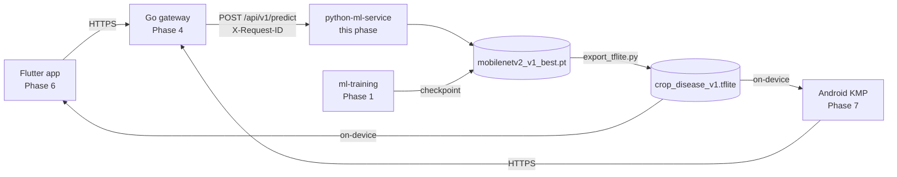
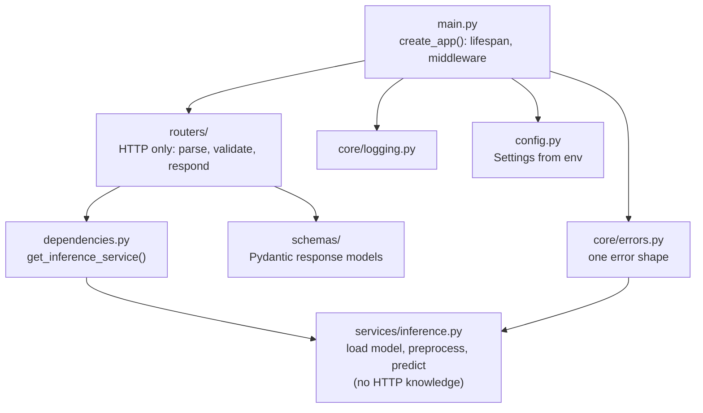
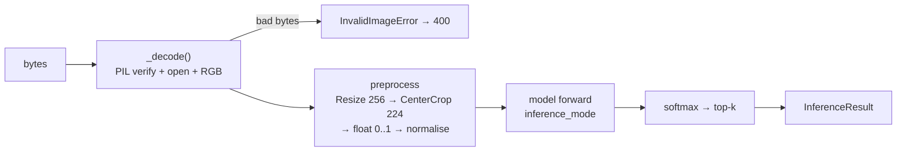
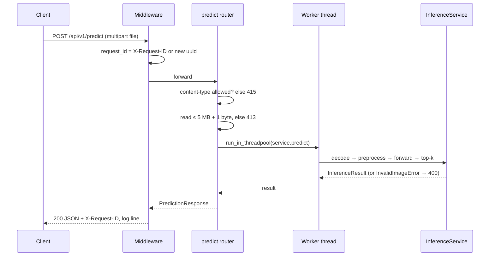
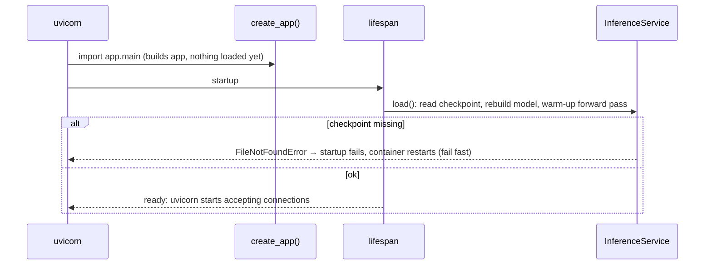
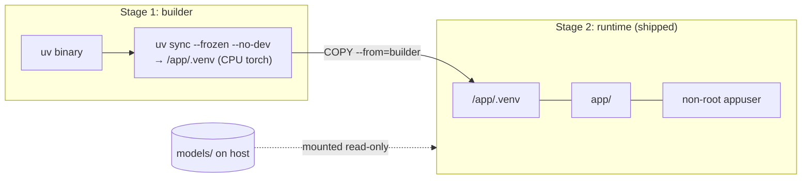
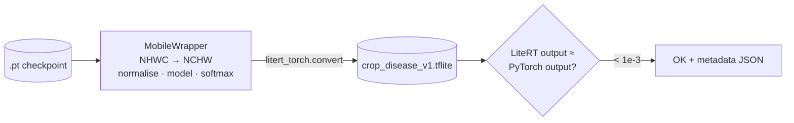
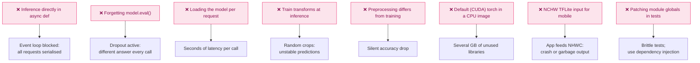

# Phase 2 — Python ML Service (FastAPI)

> **Duration:** 1.5 weeks · **10–15 hrs/week**
> **Goal:** Wrap the MobileNetV2 model from Phase 1 in a production-style REST API with
> model versioning, Pydantic validation, structured logging, one consistent error format,
> pytest coverage, a Docker image and a TFLite export for the mobile apps.
>
> **Code:** everything here is the real code in [`python-ml-service/`](../python-ml-service/).
> It has been run, linted and tested (`uv run pytest`: 25 tests). The Docker image was built,
> and it served a live prediction.
>
> **Prerequisite:** Phase 1 produced `ml-training/outputs/checkpoints/mobilenetv2_v1_best.pt`
> and `class_names.json`. (The tests do **not** need them: they generate a checkpoint.)

---

## Table of Contents

1. [What You Will Build](#1-what-you-will-build)
2. [How the Service Fits the Larger System](#2-how-the-service-fits-the-larger-system)
3. [Architecture and Folder Structure](#3-architecture-and-folder-structure)
4. [Environment Setup](#4-environment-setup)
5. [Configuration](#5-configuration)
6. [Response Schemas](#6-response-schemas)
7. [Inference Service](#7-inference-service)
8. [Errors and Logging](#8-errors-and-logging)
9. [Routers](#9-routers)
10. [The Application Factory](#10-the-application-factory)
11. [Testing](#11-testing)
12. [Docker](#12-docker)
13. [TFLite Export for Mobile](#13-tflite-export-for-mobile)
14. [Manual Testing](#14-manual-testing)
15. [Interview Questions & Model Answers](#15-interview-questions--model-answers)
16. [Common Mistakes to Avoid](#16-common-mistakes-to-avoid)
17. [Reference Links](#17-reference-links)
18. [Phase 2 Completion Checklist](#18-phase-2-completion-checklist)

---

## 1. What You Will Build

| Endpoint | Purpose |
|---|---|
| `POST /api/v1/predict` | Upload a leaf photo, get disease, confidence and top-k alternatives |
| `GET /api/v1/models` | Which model version is serving, its classes and input size |
| `GET /health` | Liveness: is the process up? |
| `GET /ready` | Readiness: is the model loaded? |
| `GET /docs` | Auto-generated interactive API docs |

Plus a Docker image and `models/crop_disease_v1.tflite` for Phases 6–7.

---

## 2. How the Service Fits the Larger System



The gateway passes an `X-Request-ID` header. The service logs it and echoes it back, so one
ID follows a request through every service.

---

## 3. Architecture and Folder Structure

Layers, each with one job. Arrows mean "depends on":



Why this shape:

- **Routers never import a global model.** They ask for it via `Depends(get_inference_service)`.
  Tests pass a different service into `create_app(service=...)` without patching anything.
- **The service has no HTTP code.** It raises plain Python errors (`InvalidImageError`,
  `ModelNotLoadedError`), and `core/errors.py` maps them to HTTP responses.
- **One error shape.** Every non-2xx response is `{"error", "detail", "request_id"}`, including
  FastAPI's own 404 / 405 / 422.

```
python-ml-service/
├── pyproject.toml / uv.lock     ← dependencies (CPU torch on Linux) + tool config
├── app/
│   ├── main.py                  ← create_app(): lifespan, request-id middleware, routers
│   ├── config.py                ← Settings (pydantic-settings)
│   ├── dependencies.py          ← get_inference_service()
│   ├── core/{logging,errors}.py
│   ├── schemas/prediction.py
│   ├── services/inference.py
│   └── routers/{health,predict,models}.py
├── scripts/export_tflite.py     ← standalone uv script (own dependencies)
├── tests/{conftest,test_api,test_inference}.py
├── models/                      ← checkpoint copied from Phase 1 (gitignored, .gitkeep only)
├── Dockerfile / .dockerignore / .env.example
└── README.md
```

---

## 4. Environment Setup

The project exists in the repo, so you only need `uv sync`. These are the commands that created it:

```bash
uv init --app --python 3.11 --name python-ml-service python-ml-service
cd python-ml-service

# Runtime dependencies
uv add fastapi "uvicorn[standard]" python-multipart pydantic pydantic-settings structlog pillow torch torchvision

# Dev-only: tests, lint, type-check
uv add --dev pytest pytest-asyncio httpx ruff mypy
```

Day to day:

```bash
cd python-ml-service
uv sync                 # .venv exactly as uv.lock says
uv run pytest           # 25 tests, ~1 s
uv run ruff check .
```

`pyproject.toml` also routes torch to the **CPU-only** wheel index on Linux. Without that, the
Docker image would pull several GB of CUDA libraries it can never use.

**File:** `python-ml-service/pyproject.toml`

```toml
[project]
name = "python-ml-service"
version = "0.1.0"
description = "Phase 2: FastAPI service that serves the crop disease classifier"
authors = [
    { name = "Paul Mburu", email = "paulmburu53@gmail.com" }
]
requires-python = ">=3.11"
dependencies = [
    "fastapi>=0.162.0",
    "pillow>=13.0.0",
    "pydantic>=2.14.1",
    "pydantic-settings>=2.16.2",
    "python-multipart>=0.0.32",
    "structlog>=26.1.0",
    "torch>=2.15.0",
    "torchvision>=0.29.2",
    "uvicorn[standard]>=0.54.0",
]

[tool.uv]
package = false  # an application, not an installable library

[dependency-groups]
dev = [
    "httpx>=0.28.1",
    "mypy>=2.4.1",
    "pytest>=9.2.0",
    "pytest-asyncio>=1.4.1",
    "ruff>=0.17.3",
]

[tool.ruff]
line-length = 120
target-version = "py311"

[tool.ruff.lint]
select = ["E", "F", "I", "B", "UP"]

[tool.pytest.ini_options]
testpaths = ["tests"]
asyncio_mode = "auto"
asyncio_default_fixture_loop_scope = "function"
addopts = "-q"

[tool.mypy]
python_version = "3.11"
ignore_missing_imports = true

# Linux (Docker) gets CPU-only torch wheels (~200 MB) instead of the CUDA build (several GB).
# macOS keeps the normal PyPI wheels, which include Apple-GPU (MPS) support.
[[tool.uv.index]]
name = "pytorch-cpu"
url = "https://download.pytorch.org/whl/cpu"
explicit = true

[tool.uv.sources]
torch = [{ index = "pytorch-cpu", marker = "sys_platform == 'linux'" }]
torchvision = [{ index = "pytorch-cpu", marker = "sys_platform == 'linux'" }]
```

---

## 5. Configuration

Settings come from environment variables (or `.env`), with safe defaults. Nothing secret is in code.

**File:** `python-ml-service/app/config.py`

```python
"""Service settings, read from environment variables (or a local .env file).

Every field can be overridden with an env var of the same name in upper case,
e.g. MODEL_VERSION=v2 or MAX_UPLOAD_MB=10. See .env.example.
"""

from functools import lru_cache
from pathlib import Path
from typing import Literal

from pydantic_settings import BaseSettings, SettingsConfigDict


class Settings(BaseSettings):
    # protected_namespaces=() lets us use field names starting with "model_" without warnings.
    model_config = SettingsConfigDict(env_file=".env", extra="ignore", protected_namespaces=())

    app_name: str = "crop-disease-ml-service"
    environment: Literal["development", "production", "test"] = "development"
    log_level: str = "INFO"
    log_json: bool = False  # True in Docker: one JSON object per log line

    model_dir: Path = Path("models")
    model_version: str = "v1"
    device: Literal["cpu", "mps", "cuda", "auto"] = "cpu"  # cpu is predictable for serving

    max_upload_mb: float = 5.0
    allowed_content_types: tuple[str, ...] = ("image/jpeg", "image/png", "image/webp")
    cors_origins: list[str] = ["http://localhost:3000"]

    @property
    def checkpoint_path(self) -> Path:
        """Matches the file name Phase 1 writes: mobilenetv2_<version>_best.pt."""
        return self.model_dir / f"mobilenetv2_{self.model_version}_best.pt"

    @property
    def max_upload_bytes(self) -> int:
        return int(self.max_upload_mb * 1024 * 1024)


@lru_cache
def get_settings() -> Settings:
    """Settings are read once per process."""
    return Settings()
```

**File:** `python-ml-service/.env.example`

```text
# Copy to .env and adjust. Every value has a sensible default (see app/config.py).
ENVIRONMENT=development
LOG_LEVEL=INFO
LOG_JSON=false

MODEL_DIR=models
MODEL_VERSION=v1
# cpu | mps | cuda | auto  (auto picks the Apple GPU on an M-series Mac)
DEVICE=cpu

MAX_UPLOAD_MB=5
CORS_ORIGINS=["http://localhost:3000"]
```

---

## 6. Response Schemas

These Pydantic models are the **public contract** the Go gateway and the apps rely on, and
they generate the `/docs` page.

**File:** `python-ml-service/app/schemas/prediction.py`

```python
"""API response shapes (Pydantic). These are the public contract the Go gateway consumes."""

from typing import Literal

from pydantic import BaseModel, ConfigDict, Field


class _Schema(BaseModel):
    model_config = ConfigDict(protected_namespaces=())  # allow "model_version" field names


class Prediction(_Schema):
    class_name: str = Field(examples=["Tomato___Late_blight"], description="Raw label from training")
    plant: str = Field(examples=["Tomato"])
    condition: str = Field(examples=["Late blight"])
    confidence: float = Field(ge=0, le=1, examples=[0.93])


class PredictionResponse(_Schema):
    status: Literal["ok", "uncertain"] = Field(
        description="'uncertain' when top-1 confidence is below the model's threshold: "
        "ask the user for a clearer photo instead of showing a diagnosis")
    prediction: Prediction = Field(description="Top-1 result")
    top_k: list[Prediction] = Field(description="Best k results, highest confidence first")
    is_healthy: bool
    confidence_threshold: float = Field(examples=[0.62])
    model_version: str = Field(examples=["v1"])
    inference_ms: float = Field(examples=[38.5])


class ModelInfo(_Schema):
    model_version: str
    num_classes: int
    class_names: list[str]
    image_size: int
    val_acc: float | None
    confidence_threshold: float
    device: str


class HealthResponse(_Schema):
    status: str = Field(examples=["ok"])
    model_loaded: bool
    model_version: str | None = None


class ErrorResponse(_Schema):
    """Every error the service returns (400, 404, 413, 415, 422, 500, 503) has this shape."""

    error: str = Field(examples=["unsupported_media_type"])
    detail: str | list = Field(examples=["Allowed types: image/jpeg, image/png"])
    request_id: str | None = None
```

Real `POST /api/v1/predict?top_k=2` response from the potato model (see `docs/API_CONTRACT.md`):

```json
{
  "status": "ok",
  "prediction": {"class_name": "Potato___Late_blight", "plant": "Potato", "condition": "Late blight", "confidence": 0.9967},
  "top_k": [
    {"class_name": "Potato___Late_blight", "plant": "Potato", "condition": "Late blight", "confidence": 0.9967},
    {"class_name": "Potato___Early_blight", "plant": "Potato", "condition": "Early blight", "confidence": 0.002}
  ],
  "is_healthy": false,
  "confidence_threshold": 0.5,
  "model_version": "v1",
  "inference_ms": 31.85
}
```

`status` is `"uncertain"` when the top confidence is below `confidence_threshold` (chosen on
validation data in Phase 1 and stored in the checkpoint). Clients must check `status` before
showing a diagnosis.

---

## 7. Inference Service

**File:** `python-ml-service/app/services/inference.py`

```python
"""Model loading and prediction. No HTTP code here, so it can be tested and reused directly.

The preprocessing below MUST match Phase 1's eval pipeline
(ml-training/src/crop_ml/transforms.py::build_eval_transforms). The image
size and normalisation values come from the checkpoint, so they cannot drift;
only the resize/crop steps are duplicated, and test_inference.py guards them.

All methods are synchronous and CPU-bound. Routers call them through
run_in_threadpool so the event loop keeps serving other requests.
"""

import io
import time
from dataclasses import dataclass
from pathlib import Path

import structlog
import torch
from PIL import Image, UnidentifiedImageError
from torch import nn
from torchvision.models import mobilenet_v2
from torchvision.transforms import v2 as T

log = structlog.get_logger(__name__)

HEALTHY_LABEL = "healthy"


class ModelNotLoadedError(RuntimeError):
    pass


class InvalidImageError(ValueError):
    pass


@dataclass(frozen=True)
class ClassScore:
    class_name: str
    plant: str
    condition: str
    confidence: float


@dataclass(frozen=True)
class InferenceResult:
    top_k: list[ClassScore]
    model_version: str
    inference_ms: float


def parse_class_name(folder: str) -> tuple[str, str]:
    """'Pepper__bell___Bacterial_spot' -> ('Pepper bell', 'Bacterial spot'). Same rule as Phase 1."""
    # Three naming styles exist in this dataset: "Potato___Early_blight",
    # "Tomato__Target_Spot" and "Tomato_Bacterial_spot". Use the longest separator present.
    sep = next((s for s in ("___", "__", "_") if s in folder), "_")
    plant, _, condition = folder.partition(sep)

    def clean(s: str) -> str:
        return " ".join(s.replace("_", " ").split())

    return clean(plant), clean(condition) or "unknown"


def build_preprocess(image_size: int, mean: list[float], std: list[float]) -> T.Compose:
    """Phase 1 eval pipeline: resize short side to 256/224 * size, centre crop, normalise."""
    return T.Compose([
        T.Resize(int(image_size * 256 / 224)),
        T.CenterCrop(image_size),
        T.ToImage(),
        T.ToDtype(torch.float32, scale=True),
        T.Normalize(mean, std),
    ])


def resolve_device(name: str) -> torch.device:
    if name == "auto":
        if torch.backends.mps.is_available():
            return torch.device("mps")
        return torch.device("cuda" if torch.cuda.is_available() else "cpu")
    return torch.device(name)


class InferenceService:
    """Loads one checkpoint and turns image bytes into ranked predictions."""

    def __init__(self, checkpoint_path: Path, device: str = "cpu") -> None:
        self.checkpoint_path = checkpoint_path
        self.device = resolve_device(device)
        self._model: nn.Module | None = None
        self.class_names: list[str] = []
        self.model_version = ""
        self.image_size = 224
        self.val_acc: float | None = None
        self.confidence_threshold = 0.5
        self._preprocess: T.Compose | None = None

    @property
    def is_loaded(self) -> bool:
        return self._model is not None

    def load(self) -> None:
        """Read the checkpoint (Phase 1 contract), rebuild the network, warm it up."""
        if not self.checkpoint_path.exists():
            raise FileNotFoundError(
                f"Checkpoint not found: {self.checkpoint_path}. Copy it from "
                "ml-training/outputs/checkpoints/ (see README)."
            )
        # weights_only=True refuses to unpickle arbitrary objects: safe for files from elsewhere.
        ckpt = torch.load(self.checkpoint_path, map_location="cpu", weights_only=True)
        model = mobilenet_v2(weights=None)
        model.classifier[1] = nn.Linear(model.last_channel, ckpt["num_classes"])
        model.load_state_dict(ckpt["model_state_dict"])
        self._model = model.to(self.device).eval()

        self.class_names = list(ckpt["class_names"])
        self.model_version = ckpt["model_version"]
        self.image_size = int(ckpt["image_size"])
        self.val_acc = ckpt.get("val_acc")
        # Chosen on validation data in Phase 1; 0.5 for older checkpoints that predate it.
        self.confidence_threshold = float(ckpt.get("confidence_threshold", 0.5))
        self._preprocess = build_preprocess(self.image_size, ckpt["mean"], ckpt["std"])

        # First call is slow (allocations); pay that cost at startup, not on a user request.
        with torch.inference_mode():
            self._model(torch.zeros(1, 3, self.image_size, self.image_size, device=self.device))
        log.info("model_loaded", version=self.model_version, classes=len(self.class_names),
                 device=str(self.device), path=str(self.checkpoint_path))

    def _decode(self, image_bytes: bytes) -> Image.Image:
        try:
            with Image.open(io.BytesIO(image_bytes)) as img:
                img.verify()  # cheap integrity check; verify() invalidates img, so reopen below
            return Image.open(io.BytesIO(image_bytes)).convert("RGB")
        except (UnidentifiedImageError, OSError, SyntaxError) as exc:
            raise InvalidImageError("File is not a readable image") from exc

    def predict(self, image_bytes: bytes, top_k: int = 3) -> InferenceResult:
        """Decode, preprocess and classify one image. Blocking: call from a worker thread."""
        if self._model is None or self._preprocess is None:
            raise ModelNotLoadedError("Model is not loaded")
        start = time.perf_counter()
        tensor = self._preprocess(self._decode(image_bytes)).unsqueeze(0).to(self.device)
        with torch.inference_mode():
            probs = torch.softmax(self._model(tensor), dim=1)[0].cpu()
        k = max(1, min(top_k, len(self.class_names)))
        conf, idx = probs.topk(k)
        scores = [
            ClassScore(name, *parse_class_name(name), confidence=round(float(c), 4))
            for c, name in ((c, self.class_names[i]) for c, i in zip(conf.tolist(), idx.tolist(), strict=True))
        ]
        return InferenceResult(scores, self.model_version, round((time.perf_counter() - start) * 1000, 2))
```

What `predict()` does with one image:



**Preprocessing must match training.** If serving resized differently from Phase 1's eval
pipeline, accuracy would quietly drop. The checkpoint carries `image_size`, `mean` and `std`,
and `test_preprocess_matches_phase1_eval_pipeline` checks the numbers.

---

## 8. Errors and Logging

**File:** `python-ml-service/app/core/errors.py`

```python
"""Turn every failure into the same ErrorResponse JSON: {"error", "detail", "request_id"}.

Clients (the Go gateway, the Flutter app) then need only one error parser.
"""

import structlog
from fastapi import FastAPI, Request, status
from fastapi.exceptions import RequestValidationError
from fastapi.responses import JSONResponse
from starlette.exceptions import HTTPException as StarletteHTTPException

from app.schemas.prediction import ErrorResponse
from app.services.inference import InvalidImageError, ModelNotLoadedError

log = structlog.get_logger(__name__)

_CODES = {
    400: "bad_request", 404: "not_found", 405: "method_not_allowed", 413: "payload_too_large",
    415: "unsupported_media_type", 422: "validation_error", 503: "service_unavailable",
}


def _error(request: Request, code: int, error: str, detail) -> JSONResponse:
    body = ErrorResponse(error=error, detail=detail, request_id=getattr(request.state, "request_id", None))
    return JSONResponse(status_code=code, content=body.model_dump())


def register_error_handlers(app: FastAPI) -> None:
    @app.exception_handler(StarletteHTTPException)
    async def http_error(request: Request, exc: StarletteHTTPException) -> JSONResponse:
        return _error(request, exc.status_code, _CODES.get(exc.status_code, "http_error"), exc.detail)

    @app.exception_handler(RequestValidationError)
    async def validation_error(request: Request, exc: RequestValidationError) -> JSONResponse:
        detail = [{"loc": list(e["loc"]), "msg": e["msg"]} for e in exc.errors()]
        return _error(request, 422, "validation_error", detail)

    @app.exception_handler(InvalidImageError)
    async def invalid_image(request: Request, exc: InvalidImageError) -> JSONResponse:
        return _error(request, 400, "invalid_image", str(exc))

    @app.exception_handler(ModelNotLoadedError)
    async def not_loaded(request: Request, exc: ModelNotLoadedError) -> JSONResponse:
        return _error(request, 503, "model_not_loaded", str(exc))

    @app.exception_handler(Exception)
    async def unexpected(request: Request, exc: Exception) -> JSONResponse:
        # Log the real cause; never leak stack traces to clients.
        log.exception("unhandled_error", path=request.url.path)
        return _error(request, status.HTTP_500_INTERNAL_SERVER_ERROR, "internal_error", "Unexpected server error")
```

| Situation | Status | `error` |
|---|---|---|
| Not an allowed image type | 415 | `unsupported_media_type` |
| Empty file | 400 | `bad_request` |
| Bytes are not a readable image | 400 | `invalid_image` |
| Over 5 MB | 413 | `payload_too_large` |
| Missing file / bad `top_k` | 422 | `validation_error` |
| Model not loaded | 503 | `model_not_loaded` |
| Unknown route | 404 | `not_found` |
| Anything unexpected | 500 | `internal_error` (details only in logs) |

**File:** `python-ml-service/app/core/logging.py`

```python
"""structlog setup: readable coloured logs locally, JSON lines in production.

Call configure_logging() once at startup, then everywhere:
    log = structlog.get_logger(__name__)
    log.info("prediction_made", class_name="Potato___healthy", ms=41.2)
"""

import logging

import structlog


def configure_logging(level: str = "INFO", json_logs: bool = False) -> None:
    renderer = structlog.processors.JSONRenderer() if json_logs else structlog.dev.ConsoleRenderer()
    structlog.configure(
        processors=[
            structlog.contextvars.merge_contextvars,  # carries request_id into every line
            structlog.processors.add_log_level,
            structlog.processors.TimeStamper(fmt="iso", utc=True),
            structlog.processors.format_exc_info,
            renderer,
        ],
        wrapper_class=structlog.make_filtering_bound_logger(logging.getLevelName(level.upper())),
        cache_logger_on_first_use=True,
    )
```

A request in Docker (`LOG_JSON=true`) logs one JSON line:

```json
{"method": "POST", "path": "/api/v1/predict", "status": 200, "ms": 158.1, "request_id": "a7667d93...", "event": "request", "level": "info", "timestamp": "2026-10-28T23:57:16.776246Z"}
```

---

## 9. Routers

**File:** `python-ml-service/app/dependencies.py`

```python
"""FastAPI dependencies. Routers ask for the service here instead of importing a global,
so tests can swap in a fake with app.dependency_overrides or create_app(service=...)."""

from fastapi import Request

from app.services.inference import InferenceService


def get_inference_service(request: Request) -> InferenceService:
    return request.app.state.inference
```

### 9.1 Predict

**File:** `python-ml-service/app/routers/predict.py`

```python
"""POST /api/v1/predict: upload a leaf photo, get the disease prediction.

curl -F "file=@leaf.jpg" "http://localhost:8000/api/v1/predict?top_k=3"
"""

from typing import Annotated

from fastapi import APIRouter, Depends, File, HTTPException, Query, UploadFile, status
from fastapi.concurrency import run_in_threadpool

from app.config import Settings, get_settings
from app.dependencies import get_inference_service
from app.schemas.prediction import ErrorResponse, Prediction, PredictionResponse
from app.services.inference import HEALTHY_LABEL, InferenceService

router = APIRouter(prefix="/api/v1", tags=["prediction"])


async def read_limited(file: UploadFile, max_bytes: int) -> bytes:
    """Read at most max_bytes + 1 bytes, so a huge upload is rejected without loading it all."""
    data = await file.read(max_bytes + 1)
    if len(data) > max_bytes:
        raise HTTPException(status.HTTP_413_CONTENT_TOO_LARGE, f"File exceeds {max_bytes // (1024 * 1024)} MB")
    if not data:
        raise HTTPException(status.HTTP_400_BAD_REQUEST, "Empty file")
    return data


@router.post(
    "/predict",
    response_model=PredictionResponse,
    responses={c: {"model": ErrorResponse} for c in (400, 413, 415, 422, 503)},
    summary="Classify a crop leaf image",
)
async def predict(
    file: Annotated[UploadFile, File(description="JPEG, PNG or WebP leaf photo")],
    service: Annotated[InferenceService, Depends(get_inference_service)],
    settings: Annotated[Settings, Depends(get_settings)],
    top_k: Annotated[int, Query(ge=1, le=10)] = 3,
) -> PredictionResponse:
    if file.content_type not in settings.allowed_content_types:
        raise HTTPException(
            status.HTTP_415_UNSUPPORTED_MEDIA_TYPE,
            f"Got {file.content_type!r}. Allowed: {', '.join(settings.allowed_content_types)}",
        )
    data = await read_limited(file, settings.max_upload_bytes)

    # Decoding + the forward pass are CPU-bound; a worker thread keeps the event loop responsive.
    result = await run_in_threadpool(service.predict, data, top_k)

    top = [Prediction(**vars(s)) for s in result.top_k]
    return PredictionResponse(
        status="ok" if top[0].confidence >= service.confidence_threshold else "uncertain",
        prediction=top[0],
        top_k=top,
        is_healthy=top[0].condition.lower() == HEALTHY_LABEL,
        confidence_threshold=service.confidence_threshold,
        model_version=result.model_version,
        inference_ms=result.inference_ms,
    )
```



**Why `run_in_threadpool`:** decoding and the forward pass are CPU work. Done directly inside
`async def`, they would freeze the event loop, and every other request (even `/health`) would
wait. In a worker thread, the loop keeps serving. PyTorch releases the GIL during heavy ops, so
threads do overlap.

### 9.2 Health and readiness

**File:** `python-ml-service/app/routers/health.py`

```python
"""Liveness and readiness probes.

GET /health  -> 200 while the process is up (Docker/Kubernetes liveness: restart if it fails)
GET /ready   -> 200 only when the model is loaded, else 503 (readiness: send traffic only when ready)
"""

from typing import Annotated

from fastapi import APIRouter, Depends
from fastapi.responses import JSONResponse

from app.dependencies import get_inference_service
from app.schemas.prediction import HealthResponse
from app.services.inference import InferenceService

router = APIRouter(tags=["health"])


@router.get("/health", response_model=HealthResponse)
async def health(service: Annotated[InferenceService, Depends(get_inference_service)]) -> HealthResponse:
    return HealthResponse(status="ok", model_loaded=service.is_loaded, model_version=service.model_version or None)


@router.get("/ready", response_model=HealthResponse, responses={503: {"model": HealthResponse}})
async def ready(service: Annotated[InferenceService, Depends(get_inference_service)]) -> JSONResponse:
    body = HealthResponse(
        status="ready" if service.is_loaded else "not_ready",
        model_loaded=service.is_loaded,
        model_version=service.model_version or None,
    )
    return JSONResponse(status_code=200 if service.is_loaded else 503, content=body.model_dump())
```

### 9.3 Models

**File:** `python-ml-service/app/routers/models.py`

```python
"""GET /api/v1/models: which model is being served (version, classes, input size)."""

from typing import Annotated

from fastapi import APIRouter, Depends, HTTPException, status

from app.dependencies import get_inference_service
from app.schemas.prediction import ErrorResponse, ModelInfo
from app.services.inference import InferenceService

router = APIRouter(prefix="/api/v1", tags=["models"])


@router.get("/models", response_model=ModelInfo, responses={503: {"model": ErrorResponse}})
async def model_info(service: Annotated[InferenceService, Depends(get_inference_service)]) -> ModelInfo:
    if not service.is_loaded:
        raise HTTPException(status.HTTP_503_SERVICE_UNAVAILABLE, "Model is not loaded")
    return ModelInfo(
        model_version=service.model_version,
        num_classes=len(service.class_names),
        class_names=service.class_names,
        image_size=service.image_size,
        val_acc=service.val_acc,
        confidence_threshold=service.confidence_threshold,
        device=str(service.device),
    )
```

---

## 10. The Application Factory

**File:** `python-ml-service/app/main.py`

```python
"""FastAPI application factory.

Run locally (from python-ml-service/):
    uv run uvicorn app.main:app --reload --port 8000
    open http://localhost:8000/docs        # interactive API docs

Request flow:
    middleware (request id + timing log) -> router -> InferenceService (worker thread)
    errors anywhere -> app/core/errors.py -> ErrorResponse JSON
"""

import time
import uuid
from collections.abc import AsyncIterator
from contextlib import asynccontextmanager

import structlog
from fastapi import FastAPI, Request, Response
from fastapi.middleware.cors import CORSMiddleware

from app.config import get_settings
from app.core.errors import register_error_handlers
from app.core.logging import configure_logging
from app.routers import health, models, predict
from app.services.inference import InferenceService

log = structlog.get_logger(__name__)


def create_app(service: InferenceService | None = None) -> FastAPI:
    """Build the app. Pass `service` (e.g. a fake in tests) to skip loading the real model."""
    settings = get_settings()
    configure_logging(settings.log_level, settings.log_json)

    @asynccontextmanager
    async def lifespan(app: FastAPI) -> AsyncIterator[None]:
        if service is None:
            # Load once at startup. A missing model fails fast here instead of on the first request.
            real = InferenceService(settings.checkpoint_path, settings.device)
            real.load()
            app.state.inference = real
        log.info("startup_complete", env=settings.environment)
        yield
        log.info("shutdown")

    app = FastAPI(
        title="Crop Disease ML Service",
        version="1.0.0",
        description="Classifies crop leaf photos into PlantVillage disease classes.",
        lifespan=lifespan,
    )
    if service is not None:
        app.state.inference = service

    app.add_middleware(
        CORSMiddleware, allow_origins=settings.cors_origins, allow_methods=["GET", "POST"], allow_headers=["*"]
    )

    @app.middleware("http")
    async def request_context(request: Request, call_next) -> Response:
        # Reuse the gateway's X-Request-ID if present so one id follows a request across services.
        request_id = request.headers.get("X-Request-ID") or uuid.uuid4().hex
        request.state.request_id = request_id
        structlog.contextvars.bind_contextvars(request_id=request_id)
        start = time.perf_counter()
        try:
            response = await call_next(request)
        finally:
            structlog.contextvars.unbind_contextvars("request_id")
        response.headers["X-Request-ID"] = request_id
        log.info("request", method=request.method, path=request.url.path, status=response.status_code,
                 ms=round((time.perf_counter() - start) * 1000, 1), request_id=request_id)
        return response

    register_error_handlers(app)
    app.include_router(health.router)
    app.include_router(predict.router)
    app.include_router(models.router)
    return app


app = create_app()
```

Startup sequence:



Run it:

```bash
cp ../ml-training/outputs/checkpoints/{mobilenetv2_v1_best.pt,class_names.json} models/
uv run uvicorn app.main:app --reload --port 8000
open http://localhost:8000/docs
```

---

## 11. Testing

`tests/conftest.py` builds a **real checkpoint with random weights** in the exact Phase 1 format.
The tests then exercise the real `InferenceService` and every HTTP path in about one second, with
no Phase 1 files, no server and no network. httpx's `ASGITransport` calls the app in-process.

**File:** `python-ml-service/tests/conftest.py`

```python
"""Shared fixtures.

- `checkpoint`: a real (random-weight) checkpoint in the Phase 1 format, so the
  real InferenceService is tested without needing Phase 1 to have run.
- `client`: an httpx client talking to the app in-process with a loaded service.
"""

import io
from collections.abc import AsyncIterator
from pathlib import Path

import httpx
import pytest
import torch
from PIL import Image
from torch import nn
from torchvision.models import mobilenet_v2

from app.main import create_app
from app.services.inference import InferenceService

CLASS_NAMES = ["Pepper__bell___Bacterial_spot", "Potato___healthy", "Tomato__Target_Spot"]


def make_checkpoint(path: Path, class_names: list[str] = CLASS_NAMES, threshold: float | None = 0.5) -> Path:
    """Write a checkpoint with exactly the keys Phase 1's train.py saves."""
    model = mobilenet_v2(weights=None)
    model.classifier[1] = nn.Linear(model.last_channel, len(class_names))
    ckpt = {
        "model_state_dict": model.state_dict(),
        "num_classes": len(class_names),
        "class_names": class_names,
        "model_version": "v1",
        "val_acc": 0.5,
        "image_size": 224,
        "mean": [0.485, 0.456, 0.406],
        "std": [0.229, 0.224, 0.225],
    }
    if threshold is not None:
        ckpt["confidence_threshold"] = threshold
    torch.save(ckpt, path)
    return path


def image_bytes(fmt: str = "JPEG", size: tuple[int, int] = (300, 200)) -> bytes:
    buf = io.BytesIO()
    Image.new("RGB", size, (40, 160, 60)).save(buf, format=fmt)
    return buf.getvalue()


@pytest.fixture(scope="session")
def checkpoint(tmp_path_factory: pytest.TempPathFactory) -> Path:
    return make_checkpoint(tmp_path_factory.mktemp("models") / "mobilenetv2_v1_best.pt")


@pytest.fixture(scope="session")
def loaded_service(checkpoint: Path) -> InferenceService:
    service = InferenceService(checkpoint)
    service.load()
    return service


@pytest.fixture
async def client(loaded_service: InferenceService) -> AsyncIterator[httpx.AsyncClient]:
    app = create_app(service=loaded_service)
    async with httpx.AsyncClient(transport=httpx.ASGITransport(app=app), base_url="http://test") as c:
        yield c


@pytest.fixture
async def unloaded_client(tmp_path: Path) -> AsyncIterator[httpx.AsyncClient]:
    app = create_app(service=InferenceService(tmp_path / "missing.pt"))
    async with httpx.AsyncClient(transport=httpx.ASGITransport(app=app), base_url="http://test") as c:
        yield c
```

**File:** `python-ml-service/tests/test_api.py`

```python
"""HTTP-level tests for every endpoint and every error path."""

import httpx
import pytest

from .conftest import CLASS_NAMES, image_bytes


async def test_health_and_ready_when_loaded(client):
    assert (await client.get("/health")).json() == {"status": "ok", "model_loaded": True, "model_version": "v1"}
    r = await client.get("/ready")
    assert r.status_code == 200 and r.json()["status"] == "ready"


async def test_ready_is_503_when_model_missing(unloaded_client):
    assert (await unloaded_client.get("/health")).status_code == 200  # process alive
    assert (await unloaded_client.get("/ready")).status_code == 503  # but not ready


@pytest.mark.parametrize(("fmt", "mime"), [("JPEG", "image/jpeg"), ("PNG", "image/png"), ("WEBP", "image/webp")])
async def test_predict_returns_ranked_predictions(client, fmt, mime):
    r = await client.post("/api/v1/predict?top_k=2", files={"file": (f"leaf.{fmt}", image_bytes(fmt), mime)})
    assert r.status_code == 200, r.text
    body = r.json()
    assert len(body["top_k"]) == 2
    assert body["prediction"] == body["top_k"][0]
    assert body["top_k"][0]["confidence"] >= body["top_k"][1]["confidence"]
    assert body["prediction"]["class_name"] in CLASS_NAMES
    assert body["model_version"] == "v1" and body["inference_ms"] > 0
    assert r.headers["X-Request-ID"]


async def test_request_id_is_propagated(client):
    r = await client.get("/health", headers={"X-Request-ID": "abc123"})
    assert r.headers["X-Request-ID"] == "abc123"


async def test_wrong_content_type_is_415(client):
    r = await client.post("/api/v1/predict", files={"file": ("a.txt", b"hello", "text/plain")})
    assert r.status_code == 415
    assert r.json()["error"] == "unsupported_media_type"


async def test_corrupt_image_is_400(client):
    r = await client.post("/api/v1/predict", files={"file": ("a.jpg", b"not really a jpeg", "image/jpeg")})
    assert r.status_code == 400
    assert r.json()["error"] == "invalid_image"


async def test_empty_file_is_400(client):
    r = await client.post("/api/v1/predict", files={"file": ("a.jpg", b"", "image/jpeg")})
    assert r.status_code == 400


async def test_oversized_upload_is_413(client):
    big = b"\xff" * (5 * 1024 * 1024 + 1)
    r = await client.post("/api/v1/predict", files={"file": ("big.jpg", big, "image/jpeg")})
    assert r.status_code == 413
    assert r.json()["error"] == "payload_too_large"


async def test_missing_file_is_422_with_same_error_shape(client):
    r = await client.post("/api/v1/predict")
    assert r.status_code == 422
    assert set(r.json()) == {"error", "detail", "request_id"}


async def test_top_k_out_of_range_is_422(client):
    r = await client.post("/api/v1/predict?top_k=0", files={"file": ("a.jpg", image_bytes(), "image/jpeg")})
    assert r.status_code == 422


async def test_predict_is_503_when_model_missing(unloaded_client):
    r = await unloaded_client.post("/api/v1/predict", files={"file": ("a.jpg", image_bytes(), "image/jpeg")})
    assert r.status_code == 503
    assert r.json()["error"] == "model_not_loaded"


async def test_models_endpoint(client, unloaded_client):
    info = (await client.get("/api/v1/models")).json()
    assert info["class_names"] == CLASS_NAMES and info["image_size"] == 224
    assert (await unloaded_client.get("/api/v1/models")).status_code == 503


async def test_unknown_route_uses_error_shape(client):
    r = await client.get("/nope")
    assert r.status_code == 404 and r.json()["error"] == "not_found"


async def test_low_confidence_is_uncertain(tmp_path):
    from app.main import create_app
    from app.services.inference import InferenceService

    from .conftest import make_checkpoint

    # A random 3-class model is never 99.9% sure, so every prediction must come back "uncertain".
    service = InferenceService(make_checkpoint(tmp_path / "m.pt", threshold=0.999))
    service.load()
    app = create_app(service=service)
    async with httpx.AsyncClient(transport=httpx.ASGITransport(app=app), base_url="http://test") as c:
        r = await c.post("/api/v1/predict", files={"file": ("a.jpg", image_bytes(), "image/jpeg")})
    body = r.json()
    assert r.status_code == 200 and body["status"] == "uncertain" and body["confidence_threshold"] == 0.999


def test_old_checkpoint_without_threshold_defaults_to_half(tmp_path):
    from app.services.inference import InferenceService

    from .conftest import make_checkpoint

    service = InferenceService(make_checkpoint(tmp_path / "m.pt", threshold=None))
    service.load()
    assert service.confidence_threshold == 0.5
```

**File:** `python-ml-service/tests/test_inference.py`

```python
"""Unit tests for InferenceService (no HTTP)."""

import pytest
import torch

from app.services.inference import (
    InferenceService,
    InvalidImageError,
    ModelNotLoadedError,
    build_preprocess,
    parse_class_name,
)

from .conftest import CLASS_NAMES, image_bytes, make_checkpoint


def test_load_reads_phase1_contract(loaded_service):
    assert loaded_service.class_names == CLASS_NAMES
    assert loaded_service.model_version == "v1"
    assert loaded_service.image_size == 224


def test_confidences_are_probabilities(loaded_service):
    result = loaded_service.predict(image_bytes(), top_k=10)
    assert len(result.top_k) == len(CLASS_NAMES)  # top_k capped at number of classes
    assert sum(s.confidence for s in result.top_k) == pytest.approx(1.0, abs=1e-3)


def test_predict_before_load_raises(tmp_path):
    with pytest.raises(ModelNotLoadedError):
        InferenceService(tmp_path / "x.pt").predict(image_bytes())


def test_load_missing_checkpoint_explains_fix(tmp_path):
    with pytest.raises(FileNotFoundError, match="ml-training"):
        InferenceService(tmp_path / "x.pt").load()


def test_invalid_bytes_raise_invalid_image(loaded_service):
    with pytest.raises(InvalidImageError):
        loaded_service.predict(b"\x00\x01garbage")


def test_preprocess_matches_phase1_eval_pipeline():
    """Phase 1 eval: Resize(256) -> CenterCrop(224) -> [0,1] float -> ImageNet normalise."""
    from PIL import Image

    img = Image.new("RGB", (400, 300), (255, 0, 0))
    t = build_preprocess(224, [0.485, 0.456, 0.406], [0.229, 0.224, 0.225])(img)
    assert t.shape == (3, 224, 224) and t.dtype == torch.float32
    assert t[0, 0, 0].item() == pytest.approx((1.0 - 0.485) / 0.229, abs=1e-4)  # pure red pixel


def test_parse_class_name_matches_phase1():
    assert parse_class_name("Pepper__bell___Bacterial_spot") == ("Pepper bell", "Bacterial spot")
    assert parse_class_name("Tomato__Target_Spot") == ("Tomato", "Target Spot")
    assert parse_class_name("Tomato_healthy") == ("Tomato", "healthy")


def test_any_class_count_loads(tmp_path):
    names = [f"Plant___c{i}" for i in range(15)]
    service = InferenceService(make_checkpoint(tmp_path / "m.pt", names))
    service.load()
    assert len(service.predict(image_bytes(), top_k=3).top_k) == 3
```

```bash
uv run pytest -v
```

**Expected:** `25 passed`.

---

## 12. Docker

**File:** `python-ml-service/Dockerfile`

```dockerfile
# Multi-stage build.
#   Stage 1 (builder): uv installs locked dependencies into /app/.venv (CPU-only torch on Linux).
#   Stage 2 (runtime): copies only the venv + app code. No uv, no compilers, non-root user.
#
# Build:  docker build -t crop-ml-service .
# Run:    docker run -p 8000:8000 -v "$PWD/models:/app/models:ro" crop-ml-service

FROM python:3.11-slim AS builder
COPY --from=ghcr.io/astral-sh/uv:0.12 /uv /bin/uv
ENV UV_COMPILE_BYTECODE=1 UV_LINK_MODE=copy UV_PYTHON_DOWNLOADS=never
WORKDIR /app
# Dependencies first: this layer is cached until pyproject.toml/uv.lock change.
COPY pyproject.toml uv.lock ./
RUN --mount=type=cache,target=/root/.cache/uv uv sync --frozen --no-dev --no-install-project

FROM python:3.11-slim AS runtime
ENV PATH="/app/.venv/bin:$PATH" PYTHONUNBUFFERED=1 LOG_JSON=true ENVIRONMENT=production
RUN useradd --create-home --uid 1000 appuser
WORKDIR /app
COPY --from=builder /app/.venv /app/.venv
COPY app ./app
# Models are mounted at runtime (-v ./models:/app/models) or baked in by uncommenting:
# COPY models ./models
USER appuser
EXPOSE 8000
# Liveness check; uses Python so we don't need curl in the image.
HEALTHCHECK --interval=30s --timeout=5s --start-period=30s --retries=3 \
  CMD ["python", "-c", "import urllib.request; urllib.request.urlopen('http://localhost:8000/health', timeout=3)"]
CMD ["uvicorn", "app.main:app", "--host", "0.0.0.0", "--port", "8000"]
```

**File:** `python-ml-service/.dockerignore`

```text
.venv
.env
__pycache__
.pytest_cache
.ruff_cache
.mypy_cache
tests
scripts
models
*.md
```



The repo-root compose file:

**File:** `docker-compose.yml`

```yaml
# Runs the platform locally. Later phases add services here.
#   docker compose up --build
#   curl http://localhost:8000/ready     # ML service (needs a checkpoint in python-ml-service/models/)
#   curl http://localhost:8001/ready     # RAG service (needs the Ollama app running on the host)
services:
  ml-service:
    build: ./python-ml-service
    ports:
      - "8000:8000"
    volumes:
      # Read-only mount of the checkpoint copied from ml-training (see python-ml-service/README.md).
      - ./python-ml-service/models:/app/models:ro
    environment:
      LOG_LEVEL: INFO
      MODEL_VERSION: v1
    restart: unless-stopped

  rag-service:
    build: ./rag-service
    ports:
      - "8001:8001"
    volumes:
      # The vector index persists across restarts; it is built automatically on first start.
      - rag-index:/data/chroma
    environment:
      LOG_LEVEL: INFO
      # Ollama runs on the host so it can use the Mac GPU; Docker cannot.
      OLLAMA_BASE_URL: http://host.docker.internal:11434
      LLM_MODEL: llama3.1:8b
    extra_hosts:
      # Docker Desktop defines host.docker.internal already; this makes it work on Linux too.
      - "host.docker.internal:host-gateway"
    restart: unless-stopped

volumes:
  rag-index:
```

```bash
# from the repo root, with Docker Desktop / OrbStack running
docker compose up --build -d
curl http://localhost:8000/ready          # {"status":"ready","model_loaded":true,"model_version":"v1"}
docker compose ps                         # STATUS shows "(healthy)"
docker compose down
```

**Image size:** ≈1.5 GB. CPU-only torch is ~700 MB unpacked, and the rest is Python and the other
libraries. Without the CPU index (default CUDA wheels) it would be several GB. To go smaller, serve
the model with ONNX Runtime or LiteRT instead of full PyTorch (a later optimisation).

---

## 13. TFLite Export for Mobile

**File:** `python-ml-service/scripts/export_tflite.py`

```python
# /// script
# requires-python = ">=3.11,<3.12"
# dependencies = [
#   "litert-torch>=0.10",
#   "torch>=2.4,<2.15",   # litert-torch 0.10 requires torch < 2.15
#   "torchvision",
#   "ai-edge-litert",
#   "numpy",
# ]
# ///
"""Export the PyTorch checkpoint to a TFLite (LiteRT) model for the Flutter/KMP apps.

This is a standalone uv script: it declares its own dependencies above, so its
pinned torch version never conflicts with the service's environment.

Run (from python-ml-service/):
    uv run scripts/export_tflite.py                    # models/mobilenetv2_v1_best.pt -> models/crop_disease_v1.tflite
    uv run scripts/export_tflite.py --version v2

What the mobile app must feed the .tflite model:
    input  float32 [1, H, W, 3]   RGB, values 0..1 (just divide pixels by 255), channels LAST (NHWC)
    output float32 [1, num_classes] probabilities (softmax already applied)
Resizing/cropping to HxW is the app's job; ImageNet normalisation is built into the model.
The .json written next to the model holds class order and the confidence threshold.
"""

import argparse
import json
from pathlib import Path

import numpy as np
import torch
from torch import nn
from torchvision.models import mobilenet_v2


class MobileWrapper(nn.Module):
    """Makes the model phone-friendly: NHWC input in [0,1], normalisation and softmax inside."""

    def __init__(self, model: nn.Module, mean: list[float], std: list[float]) -> None:
        super().__init__()
        self.model = model
        self.register_buffer("mean", torch.tensor(mean).view(1, 3, 1, 1))
        self.register_buffer("std", torch.tensor(std).view(1, 3, 1, 1))

    def forward(self, x: torch.Tensor) -> torch.Tensor:
        x = x.permute(0, 3, 1, 2)  # NHWC (what mobile image APIs give you) -> NCHW (what PyTorch expects)
        x = (x - self.mean) / self.std
        return torch.softmax(self.model(x), dim=1)


def load_wrapped(checkpoint: Path) -> tuple[nn.Module, dict]:
    ckpt = torch.load(checkpoint, map_location="cpu", weights_only=True)
    model = mobilenet_v2(weights=None)
    model.classifier[1] = nn.Linear(model.last_channel, ckpt["num_classes"])
    model.load_state_dict(ckpt["model_state_dict"])
    return MobileWrapper(model, ckpt["mean"], ckpt["std"]).eval(), ckpt


def main() -> None:
    p = argparse.ArgumentParser(description=__doc__.splitlines()[0])
    p.add_argument("--model-dir", type=Path, default=Path("models"))
    p.add_argument("--version", default="v1")
    a = p.parse_args()

    checkpoint = a.model_dir / f"mobilenetv2_{a.version}_best.pt"
    out = a.model_dir / f"crop_disease_{a.version}.tflite"
    wrapped, ckpt = load_wrapped(checkpoint)
    size = int(ckpt["image_size"])
    sample = torch.rand(1, size, size, 3)

    import litert_torch  # imported late: heavy, and only needed here

    edge_model = litert_torch.convert(wrapped, (sample,))
    edge_model.export(str(out))

    # Verify: the TFLite model must agree with PyTorch on the same input.
    with torch.inference_mode():
        expected = wrapped(sample).numpy()
    from ai_edge_litert.interpreter import Interpreter

    interp = Interpreter(model_path=str(out))
    interp.allocate_tensors()
    inp, outp = interp.get_input_details()[0], interp.get_output_details()[0]
    interp.set_tensor(inp["index"], sample.numpy())
    interp.invoke()
    got = interp.get_tensor(outp["index"])
    max_diff = float(np.abs(got - expected).max())

    meta = {"model_version": ckpt["model_version"], "input_shape": inp["shape"].tolist(), "input_layout": "NHWC",
            "input_range": [0, 1], "output": "probabilities", "class_names": ckpt["class_names"],
            # Below this top-1 probability the app shows "retake photo" (same rule as the API).
            "confidence_threshold": float(ckpt.get("confidence_threshold", 0.5))}
    out.with_suffix(".json").write_text(json.dumps(meta, indent=2))
    print(f"Exported {out} ({out.stat().st_size / 1e6:.1f} MB)")
    print(f"input {inp['shape'].tolist()} {inp['dtype'].__name__} | output {outp['shape'].tolist()}")
    print(f"max |tflite - torch| = {max_diff:.2e}  {'OK' if max_diff < 1e-3 else 'MISMATCH'}")
    print(f"metadata -> {out.with_suffix('.json')}")


if __name__ == "__main__":
    main()
```

```bash
uv run scripts/export_tflite.py
```

**Expected output:**

```
Exported models/crop_disease_v1.tflite (9.0 MB)      # size measured with a 4-class model; 15 classes adds ~0.05 MB
input [1, 224, 224, 3] float32 | output [1, 15]      # 15 = classes in your checkpoint
max |tflite - torch| = 5.07e-07  OK
metadata -> models/crop_disease_v1.json
```



**What the mobile app must do:** resize/crop the photo to 224×224 RGB, divide pixel values by 255,
and pass a `[1, 224, 224, 3]` float32 tensor. Normalisation and softmax are inside the model, and
class order is in `crop_disease_v1.json`.

Why a standalone script: `litert-torch` currently requires `torch < 2.15`, while the service uses
torch 2.15. The `# /// script` header gives the export its own environment, so the two never conflict.

---

## 14. Manual Testing

```bash
curl http://localhost:8000/health
curl http://localhost:8000/ready
curl http://localhost:8000/api/v1/models

# predict (use any leaf photo from ml-training/data/plantvillage/...)
curl -F "file=@leaf.jpg" "http://localhost:8000/api/v1/predict?top_k=3"

# error paths
curl -F "file=@README.md;type=text/plain" http://localhost:8000/api/v1/predict   # 415
curl -X POST http://localhost:8000/api/v1/predict                                # 422
```

Or use the **Try it out** buttons at `http://localhost:8000/docs`.

---

## 15. Interview Questions & Model Answers

### Q1. "Why FastAPI over Flask or Django?"

> "It is async-native, so one process handles many concurrent connections. Request validation
> comes from type hints via Pydantic, so I don't hand-write checks. And it generates an OpenAPI
> spec and `/docs` from the same code, which the gateway team can consume directly."

### Q2. "Why run inference in a thread instead of directly in the async handler?"

> "The event loop is single-threaded. A 30–100 ms forward pass inside `async def` would block
> every other request, health checks included. `run_in_threadpool` moves decode, preprocess and
> inference to a worker thread, so the loop stays responsive. PyTorch releases the GIL inside its
> kernels, so the threads genuinely overlap."

*Reference: `app/routers/predict.py`*

### Q3. "How does model versioning work?"

> "Phase 1 writes `mobilenetv2_<version>_best.pt`, and the version is also stored inside the
> checkpoint. The service loads `MODEL_VERSION` from the environment. Every response and
> `/api/v1/models` report the version, so a result can always be traced to a model. To roll
> forward or back I change one env var and restart. No code changes."

### Q4. "What does Pydantic give you?"

> "Declared types that are enforced at runtime, so a bad `top_k` becomes a clear 422 before my
> code runs. The same models document the API in OpenAPI. pydantic-settings applies the same
> idea to configuration from environment variables."

### Q5. "/health vs /ready?"

> "Liveness versus readiness. `/health` is 200 whenever the process runs; if it fails, the
> orchestrator restarts the container. `/ready` is 200 only when the model is loaded, and
> load balancers use it to decide whether to send traffic. In my service the model loads in the
> lifespan before uvicorn accepts connections, and a missing model makes startup fail fast. So
> `/ready` mainly protects against an instance that started without a usable model; the tests
> cover that case."

### Q6. "How do you test FastAPI without a server?"

> "httpx's `ASGITransport` calls the ASGI app in-process, with the real middleware, routing and
> error handlers. `create_app(service=...)` lets each test pass in the service it wants: a loaded
> one built from a generated checkpoint, or an unloaded one. No monkey-patching, and the suite
> runs in about a second without the real model."

### Q7. "Walk me through a corrupt image upload."

> "Content type `image/jpeg` passes, and the size is under the limit. In the worker thread,
> `_decode` calls PIL's `verify()`, which fails. The service raises `InvalidImageError`. The handler
> in `core/errors.py` maps it to 400 `{"error": "invalid_image", ...}` with the request ID. No
> stack trace reaches the client."

### Q8. "Why a multi-stage Docker build?"

> "The builder stage has uv and the package cache. The runtime stage copies only the finished
> virtualenv and the app code, and runs as a non-root user. The bigger saving here, though, was
> using CPU-only torch wheels on Linux: that's the difference between about 1.5 GB and several GB."

### Q9. "How does one instance handle concurrent requests?"

> "The event loop accepts requests concurrently and hands CPU work to Starlette's thread pool.
> For more throughput I'd run more replicas behind a load balancer rather than more threads, since
> each replica is stateless and holds its own copy of the model."

### Q10. "Why TFLite for mobile?"

> "TFLite (now called LiteRT) has first-class runtimes for Android and Flutter. I convert directly
> from PyTorch with `litert-torch`, which avoids the old ONNX → TensorFlow chain that tended to break.
> I wrap the model so it accepts NHWC images in 0–1, the format phone camera APIs produce, with
> normalisation and softmax inside, and the script checks the TFLite output against PyTorch
> (max difference ~5e-7)."

---

## 16. Common Mistakes to Avoid



---

## 17. Reference Links

| Resource | Why it matters |
|---|---|
| [FastAPI tutorial](https://fastapi.tiangolo.com/tutorial/) | Core reference |
| [FastAPI: request files](https://fastapi.tiangolo.com/tutorial/request-files/) | `UploadFile` |
| [FastAPI: lifespan events](https://fastapi.tiangolo.com/advanced/events/) | Loading the model at startup |
| [FastAPI: handling errors](https://fastapi.tiangolo.com/tutorial/handling-errors/) | Custom exception handlers |
| [FastAPI: testing dependencies](https://fastapi.tiangolo.com/advanced/testing-dependencies/) | Injecting fakes |
| [pydantic-settings](https://docs.pydantic.dev/latest/concepts/pydantic_settings/) | Env-based settings |
| [structlog](https://www.structlog.org/en/stable/) | Structured logging |
| [httpx: ASGI transport](https://www.python-httpx.org/advanced/transports/#asgi-transport) | In-process tests |
| [uv: PyTorch integration](https://docs.astral.sh/uv/guides/integration/pytorch/) | CPU-only index on Linux |
| [uv: Docker guide](https://docs.astral.sh/uv/guides/integration/docker/) | The Dockerfile pattern used here |
| [uv: scripts with inline dependencies](https://docs.astral.sh/uv/guides/scripts/) | How `export_tflite.py` runs |
| [LiteRT: convert PyTorch models](https://ai.google.dev/edge/litert/models/convert_pytorch) | `litert-torch` export |
| [Docker multi-stage builds](https://docs.docker.com/build/building/multi-stage/) | Builder pattern |

---

## 18. Phase 2 Completion Checklist

### Code and tests

- [ ] `uv sync && uv run pytest`: 25 passed
- [ ] `uv run ruff check .`: clean
- [ ] Service starts with your real Phase 1 checkpoint and `/ready` returns 200
- [ ] A real leaf photo gets a sensible prediction

### Docker

- [ ] `docker compose up --build` from the repo root; `docker compose ps` shows `(healthy)`
- [ ] `curl -F "file=@leaf.jpg" localhost:8000/api/v1/predict` works against the container

### TFLite

- [ ] `uv run scripts/export_tflite.py` prints `OK`
- [ ] `models/crop_disease_v1.tflite` + `crop_disease_v1.json` exist

### GitHub

- [ ] `.gitignore` excludes `python-ml-service/models/*` (except `.gitkeep`), `.env`, `.venv/`
- [ ] `pyproject.toml`, `uv.lock`, `Dockerfile`, `.dockerignore` committed
- [ ] README has a screenshot of `/docs`

### Interview readiness

- [ ] Explain why inference runs in a worker thread
- [ ] Trace a request from `curl` to response, including errors
- [ ] Explain liveness vs readiness
- [ ] Explain how preprocessing stays identical between training and serving
- [ ] Explain the TFLite input format and why it is NHWC

---

> **Next:** Phase 3 — RAG Pipeline. The Go gateway (Phase 4) will proxy to
> `http://localhost:8000`, and Phases 6–7 consume `models/crop_disease_v1.tflite`.
