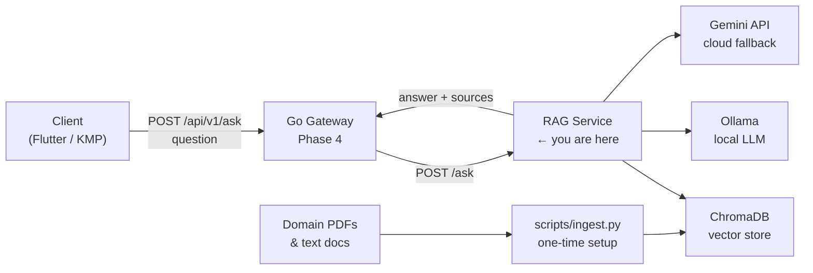
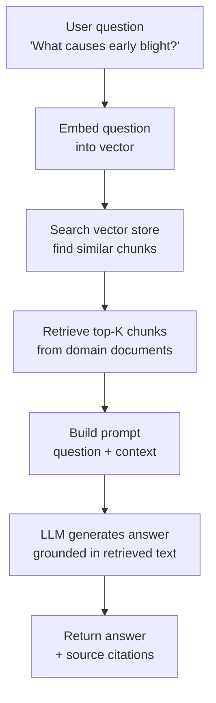
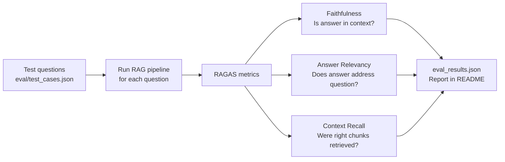
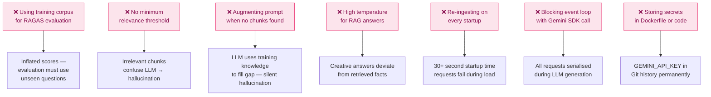

# Phase 3 — RAG Pipeline (Retrieval-Augmented Generation)

> **Duration:** 2–3 weeks · **10–15 hrs/week**
> **Goal:** Build a production-ready RAG chatbot grounded in crop disease domain
> knowledge — with document ingestion, vector storage, retrieval, LLM generation,
> and RAGAS evaluation. This is the most in-demand AI engineering skill of 2026
> and was deliberately promoted from "Phase 6 bonus" to Priority 4 in this roadmap.

> **Prerequisite:** Phase 2 complete. You must have:
> - The `python-ml-service/` running at `http://localhost:8000`
> - `models/class_names.json` — class names from Phase 1
> - Ollama installed and `llama3.2` pulled (from environment setup in Phase 0)
> - A Google Gemini API key (free tier at `aistudio.google.com`)

---

## Table of Contents

1. [What You Will Build](#1-what-you-will-build)
2. [How the RAG Service Fits the Larger System](#2-how-the-rag-service-fits-the-larger-system)
3. [What RAG Is and Why It Matters](#3-what-rag-is-and-why-it-matters)
4. [Folder Structure](#4-folder-structure)
5. [Environment Setup](#5-environment-setup)
6. [Application Configuration](#6-application-configuration)
7. [Document Preparation](#7-document-preparation)
8. [Ingestion Pipeline](#8-ingestion-pipeline)
   - [8.1 Document Loading](#81-document-loading)
   - [8.2 Text Chunking](#82-text-chunking)
   - [8.3 Embedding with sentence-transformers](#83-embedding-with-sentence-transformers)
   - [8.4 ChromaDB Vector Store](#84-chromadb-vector-store)
9. [RAG Service](#9-rag-service)
   - [9.1 Retriever](#91-retriever)
   - [9.2 Prompt Builder](#92-prompt-builder)
   - [9.3 LLM Clients — Ollama and Gemini](#93-llm-clients--ollama-and-gemini)
   - [9.4 RAGService Orchestrator](#94-ragservice-orchestrator)
10. [FastAPI Application](#10-fastapi-application)
11. [Routers](#11-routers)
    - [11.1 Ask Router](#111-ask-router)
    - [11.2 Health Router](#112-health-router)
    - [11.3 Index Router](#113-index-router)
12. [RAGAS Evaluation](#12-ragas-evaluation)
13. [Structured Logging](#13-structured-logging)
14. [Testing with pytest](#14-testing-with-pytest)
15. [Dockerfile and Docker Compose](#15-dockerfile-and-docker-compose)
16. [Manual Testing with curl](#16-manual-testing-with-curl)
17. [Interview Questions & Model Answers](#17-interview-questions--model-answers)
18. [Common Mistakes to Avoid](#18-common-mistakes-to-avoid)
19. [Reference Links](#19-reference-links)
20. [Phase 3 Completion Checklist](#20-phase-3-completion-checklist)

---

## 1. What You Will Build

By the end of Phase 3 you will have **one deployable RAG service** committed
to GitHub as a clean sub-directory of the monorepo:

| Artefact | File | What it proves |
|---|---|---|
| Ingestion pipeline | `scripts/ingest.py` | You build retrieval systems, not just prompts |
| RAG orchestrator | `app/services/rag.py` | End-to-end: retrieve → augment → generate |
| Retriever | `app/services/retriever.py` | Chunking strategy, embedding model selection |
| Prompt builder | `app/services/prompt.py` | Grounded prompts that prevent hallucination |
| Dual LLM clients | `app/services/llm.py` | Ollama (local) + Gemini (cloud) fallback |
| FastAPI application | `app/main.py` | Clean structure matching Phase 2 patterns |
| RAGAS evaluation | `scripts/evaluate.py` | Faithfulness + relevancy scores — the senior signal |
| Full pytest suite | `tests/` | Every RAG component tested in isolation |
| Dockerfile | `Dockerfile` | Service runs identically on any machine |

---

## 2. How the RAG Service Fits the Larger System



The RAG service is a **separate deployable** from the ML prediction service.
One service classifies images. The other answers questions about diseases in
natural language. Keeping them separate lets you scale, update, and test each
independently — a core principle of service-oriented architecture.

---

## 3. What RAG Is and Why It Matters



**Why RAG instead of fine-tuning?**

| Approach | When to use | Trade-offs |
|---|---|---|
| RAG | Facts change often, domain docs exist, cost matters | Retrieval can fail, context window limits |
| Fine-tuning | Style/tone adaptation, task-specific behaviour | Expensive, knowledge gets stale, hard to update |
| Prompt engineering | Simple tasks, small context | No new knowledge, limited by base model |

RAG is preferred for enterprise AI in 2026 because domain knowledge (disease
databases, FAQs, treatment guides) changes frequently and can be updated by
swapping documents — no retraining required. Every interviewer at a company
building with LLMs will ask you about RAG. This phase is your working answer.

---

## 4. Folder Structure

```
rag-service/                         ← service root
│
├── app/                             ← application package
│   ├── __init__.py
│   ├── main.py                      ← FastAPI app, lifespan, middleware
│   ├── config.py                    ← settings from environment variables
│   │
│   ├── core/
│   │   ├── __init__.py
│   │   └── logging.py               ← structlog JSON configuration
│   │
│   ├── schemas/
│   │   ├── __init__.py
│   │   └── ask.py                   ← AskRequest, AskResponse, IndexStatus
│   │
│   ├── services/
│   │   ├── __init__.py
│   │   ├── retriever.py             ← ChromaDB query, top-K retrieval
│   │   ├── prompt.py                ← prompt templates, context assembly
│   │   ├── llm.py                   ← Ollama + Gemini clients, fallback logic
│   │   └── rag.py                   ← orchestrator: retrieve → prompt → generate
│   │
│   └── routers/
│       ├── __init__.py
│       ├── ask.py                   ← POST /api/v1/ask
│       ├── health.py                ← GET /health, GET /ready
│       └── index.py                 ← GET /api/v1/index/status
│
├── data/
│   ├── docs/                        ← source documents (PDFs, txt) — gitignored
│   └── chroma/                      ← ChromaDB vector store — gitignored
│
├── scripts/
│   ├── ingest.py                    ← one-time ingestion pipeline
│   └── evaluate.py                  ← RAGAS evaluation runner
│
├── tests/
│   ├── __init__.py
│   ├── conftest.py                  ← fixtures, mock LLM, mock retriever
│   ├── test_ask.py                  ← ask endpoint tests
│   ├── test_retriever.py            ← retriever unit tests
│   ├── test_prompt.py               ← prompt builder unit tests
│   └── test_rag.py                  ← RAG orchestrator integration tests
│
├── eval/
│   └── test_cases.json              ← Q&A pairs for RAGAS evaluation
│
├── Dockerfile
├── .dockerignore
├── .env.example
├── .gitignore
├── pyproject.toml
└── requirements.txt
```

Create the scaffold:

```bash
# Navigate to the monorepo root
cd ai-crop-disease-platform

# Create the service directory
mkdir -p rag-service
cd rag-service

# Create all directories in one command
mkdir -p app/{core,schemas,services,routers} \
         data/{docs,chroma} \
         scripts \
         tests \
         eval

# Create all __init__.py files
touch app/__init__.py \
      app/core/__init__.py \
      app/schemas/__init__.py \
      app/services/__init__.py \
      app/routers/__init__.py \
      tests/__init__.py

# Create all source files
touch app/main.py \
      app/config.py \
      app/core/logging.py \
      app/schemas/ask.py \
      app/services/retriever.py \
      app/services/prompt.py \
      app/services/llm.py \
      app/services/rag.py \
      app/routers/ask.py \
      app/routers/health.py \
      app/routers/index.py \
      scripts/ingest.py \
      scripts/evaluate.py \
      tests/conftest.py \
      tests/test_ask.py \
      tests/test_retriever.py \
      tests/test_prompt.py \
      tests/test_rag.py \
      eval/test_cases.json

echo "Scaffold created"
ls -la app/services/
```

---

## 5. Environment Setup

### 5.1 Create virtual environment and install dependencies

```bash
# Inside rag-service/ — each service gets its own venv
uv venv
source .venv/bin/activate

# Core application dependencies
uv add \
  fastapi \                    # web framework — same as Phase 2
  "uvicorn[standard]" \        # ASGI server
  langchain \                  # LLM orchestration framework
  langchain-community \        # community integrations (Chroma, Ollama, HuggingFace)
  langchain-huggingface \      # HuggingFace embeddings integration
  chromadb \                   # local vector database — no infrastructure needed
  sentence-transformers \      # embedding model: all-MiniLM-L6-v2
  google-generativeai \        # Gemini API client — cloud LLM fallback
  pypdf \                      # PDF text extraction
  pydantic \                   # data validation
  pydantic-settings \          # settings from environment variables
  python-multipart \           # multipart form handling
  structlog \                  # structured JSON logging
  httpx \                      # async HTTP client for Ollama calls
  tiktoken                     # token counting (needed by LangChain internally)

# Test and evaluation dependencies
uv add --dev \
  pytest \
  pytest-asyncio \
  httpx \                      # also used in tests for AsyncClient
  pytest-cov \
  ragas \                      # RAG evaluation framework
  datasets \                   # HuggingFace datasets — needed by RAGAS
  ruff \
  mypy

# Pin for Docker reproducibility
uv pip freeze > requirements.txt

echo "Dependencies installed"
python -c "import langchain; print(f'LangChain {langchain.__version__}')"
python -c "import chromadb; print(f'ChromaDB {chromadb.__version__}')"
```

### 5.2 Set up Ollama

```bash
# Ollama should already be installed from the roadmap environment setup
# Verify it is running
ollama --version

# Start the Ollama server (runs in background on port 11434)
ollama serve &

# Pull Llama 3.2 3B — runs comfortably on M5 MacBook (16GB RAM)
# 3B model: ~2GB download, ~4GB RAM usage during inference
ollama pull llama3.2

# Verify the model is available
ollama list
# NAME               ID              SIZE    MODIFIED
# llama3.2:latest    a80c4f17acd5    2.0 GB  ...

# Test a quick inference — should respond in 2–5 seconds on M5
ollama run llama3.2 "What causes early blight in tomatoes? Answer in one sentence."
```

### 5.3 Get a Gemini API key

```bash
# 1. Go to https://aistudio.google.com/app/apikey
# 2. Click "Create API Key"
# 3. Copy the key — looks like: AIzaSy...

# Test the key works
curl "https://generativelanguage.googleapis.com/v1beta/models?key=YOUR_KEY" \
  | python -m json.tool | head -20
# Should return a list of available Gemini models
```

### 5.4 Create configuration files

```bash
# .env.example — template, never commit .env
cat > .env.example << 'EOF'
# Application
APP_ENV=development
APP_PORT=8001            # different port from ML service (8000) and Go gateway (8080)
LOG_LEVEL=INFO

# ChromaDB
CHROMA_PERSIST_DIR=data/chroma
CHROMA_COLLECTION_NAME=crop_disease_docs

# Embedding model
EMBEDDING_MODEL=sentence-transformers/all-MiniLM-L6-v2

# Retrieval
TOP_K_RESULTS=5          # number of chunks to retrieve per query
MIN_RELEVANCE_SCORE=0.3  # discard chunks below this similarity score

# LLM — Ollama (local, primary)
OLLAMA_BASE_URL=http://localhost:11434
OLLAMA_MODEL=llama3.2
OLLAMA_TIMEOUT_SECONDS=60

# LLM — Gemini (cloud, fallback)
GEMINI_API_KEY=your-key-here
GEMINI_MODEL=gemini-1.5-flash

# Feature flags
USE_LOCAL_LLM=true       # false = always use Gemini
EOF

cp .env.example .env
# Edit .env and add your actual GEMINI_API_KEY
```

```bash
# pyproject.toml
cat > pyproject.toml << 'EOF'
[project]
name = "rag-service"
version = "0.1.0"
description = "Crop disease RAG chatbot service"
requires-python = ">=3.11"

[tool.pytest.ini_options]
asyncio_mode = "auto"
testpaths = ["tests"]

[tool.ruff]
line-length = 100
target-version = "py311"

[tool.ruff.lint]
select = ["E", "F", "I", "UP", "B"]

[tool.mypy]
python_version = "3.11"
strict = true
ignore_missing_imports = true
EOF
```

```bash
# .gitignore
cat > .gitignore << 'EOF'
# Virtual environment
.venv/

# ChromaDB persisted data — large binary files
data/chroma/

# Source documents — may be proprietary
data/docs/

# Secrets
.env

# Python cache
__pycache__/
*.pyc
.mypy_cache/
.ruff_cache/
.pytest_cache/
.coverage
EOF
```

---

## 6. Application Configuration

**File:** `app/config.py`

```python
# app/config.py
#
# Centralised settings using pydantic-settings.
# Identical pattern to Phase 2 — reads from environment variables and .env file.
# This consistency means any developer familiar with Phase 2 can read this immediately.

from __future__ import annotations

from functools import lru_cache
from pathlib import Path

from pydantic import Field
from pydantic_settings import BaseSettings, SettingsConfigDict


class Settings(BaseSettings):
    """All RAG service configuration in one place."""

    # ── Application ───────────────────────────────────────────────────────
    app_env: str = Field(default="development")
    app_port: int = Field(default=8001)
    log_level: str = Field(default="INFO")

    # ── ChromaDB ─────────────────────────────────────────────────────────
    # ChromaDB stores vectors on disk at this path — persists between restarts
    chroma_persist_dir: Path = Field(default=Path("data/chroma"))
    chroma_collection_name: str = Field(default="crop_disease_docs")

    # ── Embedding model ───────────────────────────────────────────────────
    # all-MiniLM-L6-v2: 80MB, fast inference, good semantic quality
    # Alternative: all-mpnet-base-v2 (420MB, better quality, slower)
    embedding_model: str = Field(
        default="sentence-transformers/all-MiniLM-L6-v2"
    )

    # ── Retrieval ─────────────────────────────────────────────────────────
    top_k_results: int = Field(default=5)
    min_relevance_score: float = Field(default=0.3)

    # ── Ollama (local LLM — primary) ──────────────────────────────────────
    ollama_base_url: str = Field(default="http://localhost:11434")
    ollama_model: str = Field(default="llama3.2")
    ollama_timeout_seconds: int = Field(default=60)

    # ── Gemini (cloud LLM — fallback) ────────────────────────────────────
    gemini_api_key: str = Field(default="")
    gemini_model: str = Field(default="gemini-1.5-flash")

    # ── Feature flags ─────────────────────────────────────────────────────
    use_local_llm: bool = Field(default=True)

    @property
    def is_production(self) -> bool:
        return self.app_env == "production"

    @property
    def gemini_available(self) -> bool:
        """True if a Gemini API key is configured."""
        return bool(self.gemini_api_key)

    model_config = SettingsConfigDict(
        env_file=".env",
        env_file_encoding="utf-8",
        case_sensitive=False,
    )


@lru_cache(maxsize=1)
def get_settings() -> Settings:
    """Return a cached Settings instance — parsed once per process."""
    return Settings()
```

---

## 7. Document Preparation

Before running ingestion, you need domain documents. For this project the
domain is crop disease — matching the PlantVillage classifier from Phase 1.

```bash
# Create the docs directory
mkdir -p data/docs

# Option A: Download free agricultural disease documents
# FAO Crop Protection documents (public domain)
curl -L "https://www.fao.org/3/i7749e/i7749e.pdf" \
  -o data/docs/fao_plant_diseases.pdf

# Option B: Create text documents from PlantVillage class names
# This generates one text file per disease with structured facts
python << 'EOF'
from pathlib import Path
import json

# Load the class names from Phase 1/2
with open("../python-ml-service/models/class_names.json") as f:
    class_names = json.load(f)

docs_dir = Path("data/docs")
docs_dir.mkdir(parents=True, exist_ok=True)

# Write one document per plant-disease pair with structured facts
# In a real project these would be real agronomic documents
for class_name in class_names:
    parts = class_name.split("___")
    plant = parts[0].replace("_", " ")
    condition = parts[1].replace("_", " ") if len(parts) > 1 else "healthy"
    is_healthy = "healthy" in condition.lower()

    filename = docs_dir / f"{class_name}.txt"
    if is_healthy:
        content = f"""# {plant} — Healthy Plant

## Description
A healthy {plant.lower()} plant shows vibrant green leaves with no visible spots,
lesions, or discolouration. Growth is vigorous and uniform.

## Identification
- Leaves: deep green, no spots or yellowing
- Stems: firm, no lesions
- Fruit: normal size and colour for the variety

## Management
No disease management required. Maintain good agronomic practices:
- Adequate watering (avoid waterlogging)
- Balanced fertilisation
- Weed control
- Crop rotation
"""
    else:
        content = f"""# {plant} — {condition}

## Disease Overview
{condition} is a significant disease affecting {plant.lower()} crops worldwide.
Early detection and management are critical to prevent yield loss.

## Causal Agent
Specific pathogen information for {condition} in {plant.lower()}.

## Symptoms
- Early stage: small spots or lesions on leaves
- Progressive stage: enlarging lesions with characteristic patterns
- Severe stage: leaf drop, stem lesions, reduced yield

## Conditions Favouring Disease
- High humidity (above 80%)
- Temperature range: 15–25°C
- Poor air circulation
- Overhead irrigation

## Management Strategies
### Cultural Controls
- Remove and destroy infected plant material
- Improve air circulation by pruning
- Avoid overhead irrigation — use drip irrigation
- Rotate crops — do not replant same species for 2–3 years

### Chemical Controls
- Apply appropriate fungicide or bactericide at first sign of disease
- Follow label instructions and observe pre-harvest intervals
- Rotate chemical classes to prevent resistance

### Biological Controls
- Bacillus subtilis-based products may suppress some fungal diseases
- Trichoderma species can reduce soil-borne pathogens

## Economic Importance
Without management, {condition} can reduce yields by 20–80% depending on
severity, timing of infection, and cultivar susceptibility.
"""
    filename.write_text(content)

print(f"Created {len(class_names)} disease documents in {docs_dir}")
EOF
```

---

## 8. Ingestion Pipeline

**File:** `scripts/ingest.py`

The ingestion pipeline runs once to populate the vector store. It does not
run at service startup — the vector store persists on disk between restarts.

### 8.1 Document Loading

```python
# scripts/ingest.py
#
# One-time ingestion pipeline: load documents → chunk → embed → store.
#
# Run this once before starting the service:
#   python scripts/ingest.py
#
# Re-run when you add new documents or change the chunking strategy.
# ChromaDB will replace existing embeddings for documents with the same ID.

from __future__ import annotations

import json
import time
from pathlib import Path

import structlog
from langchain_community.document_loaders import (
    DirectoryLoader,
    PyPDFLoader,
    TextLoader,
)
from langchain_community.vectorstores import Chroma
from langchain_huggingface import HuggingFaceEmbeddings
from langchain.text_splitter import RecursiveCharacterTextSplitter
from langchain.schema import Document

# Configure basic logging for the script (not the full app logger)
import logging
logging.basicConfig(level=logging.INFO, format="%(levelname)s  %(message)s")
log = logging.getLogger(__name__)


# ── Constants ─────────────────────────────────────────────────────────────────
DOCS_DIR = Path("data/docs")
CHROMA_DIR = Path("data/chroma")
COLLECTION_NAME = "crop_disease_docs"
EMBEDDING_MODEL = "sentence-transformers/all-MiniLM-L6-v2"

# Chunking parameters — tuned for agricultural documents
# Chunk size: how many characters per chunk
#   Too small → chunks lack context → poor retrieval
#   Too large → chunks exceed LLM context → truncation
CHUNK_SIZE = 600

# Chunk overlap: how many characters adjacent chunks share
#   Overlap preserves context at chunk boundaries
#   A sentence split across chunks without overlap loses its meaning
CHUNK_OVERLAP = 80
```

### 8.2 Text Chunking

```python
# Continue in scripts/ingest.py — chunking section

def load_documents(docs_dir: Path) -> list[Document]:
    """
    Load all supported document types from the docs directory.

    LangChain Document objects have two fields:
      page_content: the text content
      metadata:     dict with source path, page number, etc.

    The metadata is preserved through chunking and stored alongside each
    embedding — it is returned with retrieval results as source citations.
    """
    loaders = []

    # PDF loader — extracts text page by page
    pdf_files = list(docs_dir.glob("**/*.pdf"))
    if pdf_files:
        loaders.append(DirectoryLoader(
            str(docs_dir),
            glob="**/*.pdf",
            loader_cls=PyPDFLoader,      # extracts text from each PDF page
            show_progress=True,
        ))
        log.info(f"Found {len(pdf_files)} PDF files")

    # Plain text loader — our generated disease fact sheets
    txt_files = list(docs_dir.glob("**/*.txt"))
    if txt_files:
        loaders.append(DirectoryLoader(
            str(docs_dir),
            glob="**/*.txt",
            loader_cls=TextLoader,
            loader_kwargs={"encoding": "utf-8"},
            show_progress=True,
        ))
        log.info(f"Found {len(txt_files)} text files")

    if not loaders:
        raise FileNotFoundError(f"No documents found in {docs_dir}")

    # Load all document types
    all_docs: list[Document] = []
    for loader in loaders:
        docs = loader.load()
        all_docs.extend(docs)
        log.info(f"Loaded {len(docs)} pages from {loader.__class__.__name__}")

    log.info(f"Total documents loaded: {len(all_docs)}")
    return all_docs


def chunk_documents(documents: list[Document]) -> list[Document]:
    """
    Split documents into chunks for embedding.

    RecursiveCharacterTextSplitter tries separators in order:
      ["\n\n", "\n", ".", " ", ""]
    It splits on double newlines first (paragraph breaks), then single
    newlines (line breaks), then sentences, then words. This preserves
    semantic units — a paragraph stays together if it fits.

    Why not split on fixed token counts?
    Character-based splitting is simpler and language-model-agnostic.
    Token-based splitting requires running a tokenizer per chunk which
    adds latency and couples ingestion to a specific model's tokenizer.
    """
    splitter = RecursiveCharacterTextSplitter(
        chunk_size=CHUNK_SIZE,
        chunk_overlap=CHUNK_OVERLAP,
        # Separators tried in order — most semantic first
        separators=["\n\n", "\n", ". ", " ", ""],
        # Keep separators in the chunks so sentences are complete
        keep_separator=True,
        # Measure length in characters (not tokens)
        length_function=len,
    )

    chunks = splitter.split_documents(documents)

    # Add chunk index to metadata — useful for debugging retrieval
    for i, chunk in enumerate(chunks):
        chunk.metadata["chunk_index"] = i
        chunk.metadata["chunk_size"] = len(chunk.page_content)

    log.info(
        f"Split {len(documents)} documents into {len(chunks)} chunks  "
        f"(avg size: {sum(len(c.page_content) for c in chunks) // len(chunks)} chars)"
    )
    return chunks
```

### 8.3 Embedding with sentence-transformers

```python
# Continue in scripts/ingest.py — embedding section

def build_embeddings() -> HuggingFaceEmbeddings:
    """
    Load the sentence-transformer embedding model.

    all-MiniLM-L6-v2 properties:
      - Size:              80 MB
      - Embedding dims:    384
      - Max input tokens:  256 (longer text is truncated)
      - Speed:             ~14,000 sentences/sec on CPU
      - Quality:           Strong semantic similarity across domains

    The embedding model converts text into a 384-dimensional vector.
    Semantically similar texts produce vectors that are close in this
    space — measured by cosine similarity.

    Example:
      "What causes early blight?" → [0.12, -0.34, 0.89, ...]  (384 values)
      "Early blight is caused by Alternaria" → [0.11, -0.31, 0.91, ...]
      Cosine similarity: 0.97 (very similar — correct retrieval)

      "How do I make pasta?" → [-0.45, 0.23, -0.12, ...]
      Cosine similarity with above: 0.12 (not similar — won't be retrieved)
    """
    log.info(f"Loading embedding model: {EMBEDDING_MODEL}")
    start = time.perf_counter()

    embeddings = HuggingFaceEmbeddings(
        model_name=EMBEDDING_MODEL,
        # cache_folder: where to store downloaded model weights
        # defaults to ~/.cache/huggingface/hub/
        model_kwargs={"device": "cpu"},   # use CPU — MPS not well supported for sentence-transformers
        encode_kwargs={
            "normalize_embeddings": True,   # L2-normalise so cosine = dot product
            "batch_size": 64,               # process 64 chunks at a time
        },
    )

    elapsed = time.perf_counter() - start
    log.info(f"Embedding model loaded in {elapsed:.1f}s")
    return embeddings
```

### 8.4 ChromaDB Vector Store

```python
# Continue in scripts/ingest.py — ChromaDB section and main()

def build_vector_store(
    chunks: list[Document],
    embeddings: HuggingFaceEmbeddings,
    persist_dir: Path,
    collection_name: str,
) -> Chroma:
    """
    Embed all chunks and store them in ChromaDB.

    ChromaDB stores each chunk as:
      - The raw text (page_content)
      - The embedding vector (384 floats)
      - The metadata dict (source path, chunk_index, etc.)

    persist_dir: ChromaDB saves the index to disk here.
    The next time you call Chroma(...) with the same persist_dir,
    it loads the existing index — no re-embedding needed.

    For 38 disease documents × ~10 chunks each = ~380 chunks.
    Embedding ~380 chunks takes about 5–10 seconds on CPU.
    """
    persist_dir.mkdir(parents=True, exist_ok=True)

    log.info(f"Building vector store with {len(chunks)} chunks...")
    start = time.perf_counter()

    # Chroma.from_documents() embeds all chunks and writes to disk
    # If the collection exists, this REPLACES it — add upsert logic for incremental updates
    vectorstore = Chroma.from_documents(
        documents=chunks,
        embedding=embeddings,
        persist_directory=str(persist_dir),
        collection_name=collection_name,
        collection_metadata={"hnsw:space": "cosine"},  # use cosine distance
    )

    elapsed = time.perf_counter() - start
    log.info(
        f"Vector store built in {elapsed:.1f}s  "
        f"→ {persist_dir}/{collection_name}"
    )
    return vectorstore


def verify_vector_store(vectorstore: Chroma) -> None:
    """
    Run a test query to confirm the vector store is working correctly.
    Always verify after ingestion — a silent build failure wastes debugging time.
    """
    test_query = "What causes early blight in tomatoes?"
    results = vectorstore.similarity_search(test_query, k=3)

    log.info(f"Verification query: '{test_query}'")
    log.info(f"Top {len(results)} results:")
    for i, doc in enumerate(results):
        source = doc.metadata.get("source", "unknown")
        preview = doc.page_content[:100].replace("\n", " ")
        log.info(f"  [{i+1}] {source}: {preview}...")

    if not results:
        raise RuntimeError("Vector store returned no results — ingestion may have failed")
    log.info("Verification passed ✓")


def main() -> None:
    """Full ingestion pipeline — run once before starting the service."""
    log.info("=== RAG Ingestion Pipeline ===")

    # Step 1: Load documents
    documents = load_documents(DOCS_DIR)

    # Step 2: Chunk
    chunks = chunk_documents(documents)

    # Step 3: Load embedding model
    embeddings = build_embeddings()

    # Step 4: Build and persist vector store
    vectorstore = build_vector_store(chunks, embeddings, CHROMA_DIR, COLLECTION_NAME)

    # Step 5: Verify
    verify_vector_store(vectorstore)

    # Step 6: Save ingestion metadata for the service to read
    meta = {
        "num_documents": len(documents),
        "num_chunks": len(chunks),
        "embedding_model": EMBEDDING_MODEL,
        "chunk_size": CHUNK_SIZE,
        "chunk_overlap": CHUNK_OVERLAP,
        "collection_name": COLLECTION_NAME,
    }
    meta_path = CHROMA_DIR / "ingestion_meta.json"
    meta_path.write_text(json.dumps(meta, indent=2))
    log.info(f"Saved ingestion metadata → {meta_path}")
    log.info("Ingestion complete ✓")


if __name__ == "__main__":
    main()
```

Run ingestion:

```bash
# Make sure venv is active and you are inside rag-service/
python scripts/ingest.py

# Expected output:
# INFO  Found 38 text files
# INFO  Loaded 38 pages from DirectoryLoader
# INFO  Total documents loaded: 38
# INFO  Split 38 documents into 312 chunks  (avg size: 487 chars)
# INFO  Loading embedding model: sentence-transformers/all-MiniLM-L6-v2
# INFO  Embedding model loaded in 3.2s
# INFO  Building vector store with 312 chunks...
# INFO  Vector store built in 8.4s  → data/chroma/crop_disease_docs
# INFO  Verification query: 'What causes early blight in tomatoes?'
# INFO  Top 3 results:
# INFO    [1] data/docs/Tomato___Early_blight.txt: Early blight is a significant disease...
# INFO  Verification passed ✓
# INFO  Saved ingestion metadata → data/chroma/ingestion_meta.json
# INFO  Ingestion complete ✓
```

---

## 9. RAG Service

### 9.1 Retriever

**File:** `app/services/retriever.py`

```python
# app/services/retriever.py
#
# Retriever wraps ChromaDB and exposes a clean interface.
# The RAG orchestrator (rag.py) calls this — it never touches ChromaDB directly.
# This separation makes the retriever mockable in tests.

from __future__ import annotations

import json
from dataclasses import dataclass
from pathlib import Path

import structlog
from langchain_community.vectorstores import Chroma
from langchain_huggingface import HuggingFaceEmbeddings
from langchain.schema import Document

from app.config import get_settings

log = structlog.get_logger(__name__)


@dataclass
class RetrievedChunk:
    """
    One retrieved document chunk with its relevance score.

    content:    the raw text of the chunk
    source:     file path the chunk came from — used as citation
    score:      cosine similarity (0.0–1.0) — higher is more relevant
    metadata:   full metadata dict from ChromaDB
    """
    content: str
    source: str
    score: float
    metadata: dict


class Retriever:
    """
    Loads the ChromaDB vector store and retrieves relevant chunks
    for a given query using semantic similarity search.
    """

    def __init__(self) -> None:
        self._vectorstore: Chroma | None = None
        self._embeddings: HuggingFaceEmbeddings | None = None

    def load(self) -> None:
        """
        Load the embedding model and connect to the persisted ChromaDB.
        Called once at application startup via FastAPI lifespan.

        The vector store must already be populated by scripts/ingest.py.
        If the collection does not exist, this raises an error at startup
        so the problem is caught immediately, not on the first request.
        """
        settings = get_settings()

        if not settings.chroma_persist_dir.exists():
            raise FileNotFoundError(
                f"ChromaDB not found at {settings.chroma_persist_dir}. "
                "Run: python scripts/ingest.py"
            )

        log.info("retriever.loading", model=settings.embedding_model)

        self._embeddings = HuggingFaceEmbeddings(
            model_name=settings.embedding_model,
            model_kwargs={"device": "cpu"},
            encode_kwargs={"normalize_embeddings": True},
        )

        # Connect to the existing persisted collection — does not re-embed
        self._vectorstore = Chroma(
            persist_directory=str(settings.chroma_persist_dir),
            embedding_function=self._embeddings,
            collection_name=settings.chroma_collection_name,
        )

        # Read ingestion metadata for the /index/status endpoint
        meta_path = settings.chroma_persist_dir / "ingestion_meta.json"
        self._meta = json.loads(meta_path.read_text()) if meta_path.exists() else {}

        collection = self._vectorstore._collection
        count = collection.count()
        log.info("retriever.loaded", num_chunks=count)

    @property
    def is_loaded(self) -> bool:
        return self._vectorstore is not None

    @property
    def index_metadata(self) -> dict:
        """Return ingestion metadata — used by /api/v1/index/status."""
        return getattr(self, "_meta", {})

    def retrieve(self, query: str, top_k: int | None = None) -> list[RetrievedChunk]:
        """
        Embed the query and return the top-K most similar chunks.

        similarity_search_with_relevance_scores returns (Document, score) pairs
        sorted by score descending. Score is cosine similarity (0–1).

        We filter out chunks below min_relevance_score — returning irrelevant
        context is worse than returning no context because it confuses the LLM
        and produces hallucinated answers.
        """
        if self._vectorstore is None:
            raise RuntimeError("Retriever not loaded — call load() first")

        settings = get_settings()
        k = top_k or settings.top_k_results

        log.info("retriever.query", query=query[:80], top_k=k)

        # similarity_search_with_relevance_scores returns List[(Document, float)]
        results_with_scores = self._vectorstore.similarity_search_with_relevance_scores(
            query,
            k=k,
        )

        chunks: list[RetrievedChunk] = []
        for doc, score in results_with_scores:
            if score < settings.min_relevance_score:
                log.debug(
                    "retriever.chunk_filtered",
                    score=round(score, 3),
                    threshold=settings.min_relevance_score,
                )
                continue

            source = doc.metadata.get("source", "unknown")
            # Clean up the source path — show just the filename
            source = Path(source).name if source != "unknown" else source

            chunks.append(RetrievedChunk(
                content=doc.page_content,
                source=source,
                score=round(score, 4),
                metadata=doc.metadata,
            ))

        log.info(
            "retriever.results",
            total_candidates=len(results_with_scores),
            returned=len(chunks),
            top_score=chunks[0].score if chunks else None,
        )
        return chunks


# Module-level singleton — loaded once at startup via lifespan
retriever = Retriever()
```

---

### 9.2 Prompt Builder

**File:** `app/services/prompt.py`

```python
# app/services/prompt.py
#
# Prompt engineering for the RAG pipeline.
#
# The prompt is the interface between retrieval and generation.
# A poorly designed prompt produces hallucinated, unfaithful answers
# even with perfect retrieval. A well-designed prompt constrains the
# LLM to stay grounded in the retrieved context.
#
# Key principles in this prompt:
#   1. Tell the LLM explicitly what context it has
#   2. Tell it to say "I don't know" if the answer isn't in the context
#   3. Ask for source citations so the answer is auditable
#   4. Keep the persona consistent with the domain

from __future__ import annotations

from app.services.retriever import RetrievedChunk

# ── System prompt — defines the LLM's persona and behaviour ───────────────────
SYSTEM_PROMPT = """You are an expert plant pathologist and agricultural advisor.
Your role is to help farmers and agronomists understand crop diseases and their management.

STRICT RULES:
1. Answer ONLY using information from the provided context sections below.
2. If the answer is not in the context, say clearly: "I don't have information about that in my knowledge base."
3. Do not invent facts, statistics, or recommendations not present in the context.
4. Always cite the source document(s) you used — list them at the end as "Sources: [filename1, filename2]".
5. Keep answers practical and actionable for farmers.
6. If the context mentions a specific chemical, always add: "Consult your local agricultural extension for approved products in your region."
"""

# ── Context template — formats one retrieved chunk ────────────────────────────
CONTEXT_TEMPLATE = """
--- Context from: {source} (relevance: {score:.2f}) ---
{content}
"""

# ── Question template — the final user turn ───────────────────────────────────
QUESTION_TEMPLATE = """Based on the context provided above, please answer this question:

Question: {question}

Remember: If the answer is not clearly stated in the context, say so. Do not guess."""


def build_prompt(question: str, chunks: list[RetrievedChunk]) -> tuple[str, str]:
    """
    Assemble the full prompt from retrieved chunks and the user question.

    Returns (system_prompt, user_message) — a two-part structure that matches
    the chat API format used by both Ollama and Gemini.

    If no chunks were retrieved, the user message includes an explicit notice
    that no relevant context was found — this prevents the LLM from using
    its training knowledge to fill the gap (hallucination).
    """
    if not chunks:
        user_message = (
            "No relevant context was found in the knowledge base for this question.\n\n"
            f"Question: {question}\n\n"
            "Please respond only with: \"I don't have information about that in my knowledge base.\""
        )
        return SYSTEM_PROMPT, user_message

    # Assemble context blocks — most relevant first (already sorted by retriever)
    context_blocks = [
        CONTEXT_TEMPLATE.format(
            source=chunk.source,
            score=chunk.score,
            content=chunk.content.strip(),
        )
        for chunk in chunks
    ]
    context_section = "\n".join(context_blocks)

    user_message = context_section + QUESTION_TEMPLATE.format(question=question)

    return SYSTEM_PROMPT, user_message


def estimate_token_count(text: str) -> int:
    """
    Rough token estimate: ~4 characters per token for English text.
    Used to warn if the prompt exceeds typical context windows.
    Llama 3.2 3B: 128K context window — unlikely to be a problem here.
    """
    return len(text) // 4
```

---

### 9.3 LLM Clients — Ollama and Gemini

**File:** `app/services/llm.py`

```python
# app/services/llm.py
#
# LLM clients for local (Ollama) and cloud (Gemini) inference.
#
# Design: try Ollama first (free, private, fast on M5).
# Fall back to Gemini if Ollama is unavailable or times out.
# This pattern is called "cascading fallback" and is common in production
# AI systems where local inference is preferred for cost and latency.

from __future__ import annotations

import json

import httpx
import structlog
import google.generativeai as genai

from app.config import get_settings

log = structlog.get_logger(__name__)


class OllamaClient:
    """
    HTTP client for Ollama's REST API.

    We call Ollama directly via httpx rather than using LangChain's OllamaLLM
    wrapper because it gives us full control over timeout handling, streaming,
    and error messages — important for a production service.

    Ollama API endpoint: POST /api/chat
    Docs: https://github.com/ollama/ollama/blob/main/docs/api.md
    """

    def __init__(self) -> None:
        settings = get_settings()
        self._base_url = settings.ollama_base_url
        self._model = settings.ollama_model
        self._timeout = settings.ollama_timeout_seconds

    async def generate(self, system_prompt: str, user_message: str) -> str:
        """
        Send a chat completion request to Ollama.
        Returns the generated text or raises on failure.
        """
        payload = {
            "model": self._model,
            "messages": [
                {"role": "system", "content": system_prompt},
                {"role": "user",   "content": user_message},
            ],
            "stream": False,        # wait for full response before returning
            "options": {
                "temperature": 0.1, # low temperature = more focused, less creative
                                    # RAG answers should be factual, not creative
                "top_p": 0.9,
                "num_ctx": 4096,    # context window — enough for our prompts
            },
        }

        log.info("ollama.request", model=self._model)

        async with httpx.AsyncClient(timeout=self._timeout) as client:
            response = await client.post(
                f"{self._base_url}/api/chat",
                json=payload,
            )
            response.raise_for_status()   # raises httpx.HTTPStatusError on 4xx/5xx

        data = response.json()
        # Ollama response structure: {"message": {"role": "assistant", "content": "..."}}
        answer = data["message"]["content"]

        log.info(
            "ollama.response",
            model=self._model,
            chars=len(answer),
        )
        return answer.strip()

    async def is_available(self) -> bool:
        """
        Quick health check — ping Ollama's tags endpoint.
        Used at startup to decide whether to prefer local or cloud inference.
        """
        try:
            async with httpx.AsyncClient(timeout=3.0) as client:
                response = await client.get(f"{self._base_url}/api/tags")
                return response.status_code == 200
        except Exception:
            return False


class GeminiClient:
    """
    Client for Google Gemini API — cloud LLM fallback.

    Gemini 1.5 Flash is:
      - Free tier: 15 requests/minute, 1 million tokens/minute
      - Fast: ~2–4 seconds for a typical RAG response
      - Context: 1 million tokens — far more than we'll ever use
    """

    def __init__(self) -> None:
        settings = get_settings()
        if not settings.gemini_api_key:
            raise ValueError(
                "GEMINI_API_KEY not set. Add it to .env or set as environment variable."
            )
        genai.configure(api_key=settings.gemini_api_key)
        self._model = genai.GenerativeModel(
            model_name=settings.gemini_model,
            # System instruction passed once — Gemini handles this natively
            system_instruction=None,  # we prepend it in the user message for simplicity
        )
        self._model_name = settings.gemini_model

    async def generate(self, system_prompt: str, user_message: str) -> str:
        """
        Send a generation request to Gemini.
        Gemini's Python SDK is synchronous — we run it in a thread to avoid
        blocking the event loop (same pattern as Phase 2's model inference).
        """
        import asyncio
        from concurrent.futures import ThreadPoolExecutor

        # Combine system prompt and user message — Gemini Flash works well with this
        full_prompt = f"{system_prompt}\n\n{user_message}"

        def _call_gemini() -> str:
            response = self._model.generate_content(
                full_prompt,
                generation_config=genai.GenerationConfig(
                    temperature=0.1,    # low temperature — factual answers
                    max_output_tokens=1024,
                ),
            )
            return response.text

        loop = asyncio.get_running_loop()
        with ThreadPoolExecutor(max_workers=1) as executor:
            answer = await loop.run_in_executor(executor, _call_gemini)

        log.info("gemini.response", model=self._model_name, chars=len(answer))
        return answer.strip()


class LLMRouter:
    """
    Routes generation requests to Ollama or Gemini based on availability
    and configuration.

    This is the "cascading fallback" pattern:
      1. If USE_LOCAL_LLM=true and Ollama is available → use Ollama
      2. If Ollama fails or is unavailable → fall back to Gemini
      3. If Gemini is not configured → raise a clear error
    """

    def __init__(self) -> None:
        self._ollama = OllamaClient()
        self._gemini: GeminiClient | None = None
        self._ollama_available = False

    async def initialise(self) -> None:
        """
        Called at startup — checks Ollama availability and initialises Gemini.
        """
        settings = get_settings()

        self._ollama_available = await self._ollama.is_available()
        log.info("llm.ollama_available", available=self._ollama_available)

        if settings.gemini_available:
            try:
                self._gemini = GeminiClient()
                log.info("llm.gemini_configured", model=settings.gemini_model)
            except Exception as e:
                log.warning("llm.gemini_init_failed", error=str(e))

        if not self._ollama_available and self._gemini is None:
            raise RuntimeError(
                "No LLM available: Ollama is unreachable and Gemini is not configured. "
                "Start Ollama with `ollama serve` or set GEMINI_API_KEY."
            )

    async def generate(self, system_prompt: str, user_message: str) -> tuple[str, str]:
        """
        Generate an answer using the best available LLM.
        Returns (answer, llm_used) — the caller logs which LLM produced the answer.
        """
        settings = get_settings()

        # Try Ollama if configured and available
        if settings.use_local_llm and self._ollama_available:
            try:
                answer = await self._ollama.generate(system_prompt, user_message)
                return answer, "ollama"
            except Exception as e:
                log.warning("llm.ollama_failed", error=str(e), fallback="gemini")

        # Fall back to Gemini
        if self._gemini is not None:
            answer = await self._gemini.generate(system_prompt, user_message)
            return answer, "gemini"

        raise RuntimeError("All LLM providers failed or are unconfigured")


# Module-level singleton
llm_router = LLMRouter()
```

---

### 9.4 RAGService Orchestrator

**File:** `app/services/rag.py`

```python
# app/services/rag.py
#
# RAGService orchestrates the full pipeline:
#   question → retrieve → build prompt → generate → return answer
#
# This is the single function that interviewers will ask you to whiteboard.
# Every component (retriever, prompt builder, LLM router) is injected —
# making the orchestrator thin and testable.

from __future__ import annotations

import time
from dataclasses import dataclass

import structlog

from app.services.retriever import RetrievedChunk, retriever
from app.services.prompt import build_prompt, estimate_token_count
from app.services.llm import llm_router

log = structlog.get_logger(__name__)


@dataclass
class RAGResponse:
    """The structured response returned by the RAG pipeline."""
    answer: str
    sources: list[str]           # deduplicated source filenames
    chunks_retrieved: int        # how many chunks were returned by retrieval
    chunks_used: int             # how many chunks made it into the prompt
    llm_used: str                # "ollama" or "gemini"
    retrieval_time_ms: float
    generation_time_ms: float
    total_time_ms: float
    prompt_tokens_estimate: int  # rough estimate for cost tracking


class RAGService:
    """
    Orchestrates the Retrieve → Augment → Generate pipeline.

    Call order:
      1. retriever.retrieve(question) → List[RetrievedChunk]
      2. prompt.build_prompt(question, chunks) → (system, user)
      3. llm_router.generate(system, user) → (answer, llm_name)
      4. Assemble RAGResponse with timing and metadata
    """

    async def ask(self, question: str, top_k: int | None = None) -> RAGResponse:
        """
        Answer a question using the RAG pipeline.

        The full pipeline:
          [Retrieve]  embed question → cosine search → top-K chunks
          [Augment]   format chunks + question into a grounded prompt
          [Generate]  send prompt to LLM → get grounded answer
        """
        total_start = time.perf_counter()
        log.info("rag.ask.start", question=question[:100])

        # ── Step 1: Retrieve ─────────────────────────────────────────────
        retrieval_start = time.perf_counter()
        chunks: list[RetrievedChunk] = retriever.retrieve(question, top_k=top_k)
        retrieval_ms = (time.perf_counter() - retrieval_start) * 1000

        log.info(
            "rag.retrieval_complete",
            chunks_found=len(chunks),
            retrieval_ms=round(retrieval_ms, 1),
        )

        # ── Step 2: Augment ─────────────────────────────────────────────
        # Build the grounded prompt from retrieved chunks
        system_prompt, user_message = build_prompt(question, chunks)
        prompt_tokens = estimate_token_count(system_prompt + user_message)

        log.info(
            "rag.prompt_built",
            prompt_tokens_estimate=prompt_tokens,
            chunks_in_prompt=len(chunks),
        )

        # ── Step 3: Generate ─────────────────────────────────────────────
        generation_start = time.perf_counter()
        answer, llm_used = await llm_router.generate(system_prompt, user_message)
        generation_ms = (time.perf_counter() - generation_start) * 1000

        total_ms = (time.perf_counter() - total_start) * 1000

        log.info(
            "rag.ask.complete",
            llm_used=llm_used,
            answer_chars=len(answer),
            retrieval_ms=round(retrieval_ms, 1),
            generation_ms=round(generation_ms, 1),
            total_ms=round(total_ms, 1),
        )

        # Deduplicate sources — multiple chunks may come from the same document
        sources = list(dict.fromkeys(c.source for c in chunks))

        return RAGResponse(
            answer=answer,
            sources=sources,
            chunks_retrieved=len(chunks),
            chunks_used=len(chunks),
            llm_used=llm_used,
            retrieval_time_ms=round(retrieval_ms, 1),
            generation_time_ms=round(generation_ms, 1),
            total_time_ms=round(total_ms, 1),
            prompt_tokens_estimate=prompt_tokens,
        )


# Module-level singleton
rag_service = RAGService()
```

---

## 10. FastAPI Application

**File:** `app/main.py`

```python
# app/main.py
#
# FastAPI application factory — identical structure to Phase 2.
# Lifespan loads the retriever and initialises the LLM router at startup.

from __future__ import annotations

from contextlib import asynccontextmanager
from typing import AsyncGenerator

import structlog
from fastapi import FastAPI, Request
from fastapi.middleware.cors import CORSMiddleware
from fastapi.responses import JSONResponse

from app.config import get_settings
from app.core.logging import configure_logging
from app.routers import ask, health, index
from app.schemas.ask import ErrorResponse
from app.services.retriever import retriever
from app.services.llm import llm_router

log = structlog.get_logger(__name__)


@asynccontextmanager
async def lifespan(app: FastAPI) -> AsyncGenerator[None, None]:
    """Startup: load retriever + LLM. Shutdown: clean up resources."""

    # ── Startup ───────────────────────────────────────────────────────────
    settings = get_settings()
    configure_logging(settings.log_level)
    log.info("rag_service.starting", env=settings.app_env)

    # Load the embedding model and connect to ChromaDB
    # This takes ~3–5 seconds — model must be warm before first request
    retriever.load()

    # Check LLM availability and configure fallback
    await llm_router.initialise()

    log.info("rag_service.ready")
    yield

    # ── Shutdown ──────────────────────────────────────────────────────────
    log.info("rag_service.stopped")


def create_app() -> FastAPI:
    settings = get_settings()

    app = FastAPI(
        title="Crop Disease RAG Service",
        description="Natural language Q&A about crop diseases — grounded in domain documents",
        version="1.0.0",
        docs_url="/docs",
        redoc_url="/redoc",
        lifespan=lifespan,
    )

    app.add_middleware(
        CORSMiddleware,
        allow_origins=["*"] if not settings.is_production else ["http://localhost:8080"],
        allow_methods=["GET", "POST"],
        allow_headers=["*"],
    )

    app.include_router(health.router)
    app.include_router(ask.router)
    app.include_router(index.router)

    @app.exception_handler(RuntimeError)
    async def runtime_error_handler(request: Request, exc: RuntimeError) -> JSONResponse:
        log.error("runtime_error", path=request.url.path, detail=str(exc))
        return JSONResponse(
            status_code=503,
            content=ErrorResponse(
                error="service_unavailable",
                message=str(exc),
            ).model_dump(),
        )

    @app.exception_handler(Exception)
    async def generic_handler(request: Request, exc: Exception) -> JSONResponse:
        log.exception("unhandled_error", path=request.url.path, exc_info=exc)
        return JSONResponse(
            status_code=500,
            content=ErrorResponse(
                error="internal_error",
                message="An unexpected error occurred.",
            ).model_dump(),
        )

    return app


app = create_app()
```

---

## 11. Routers

### 11.1 Ask Router

**File:** `app/routers/ask.py`

```python
# app/routers/ask.py
#
# POST /api/v1/ask — the primary endpoint of the RAG service.
# Validates the request, calls rag_service.ask(), returns the response.
# Thin router — no business logic here.

from __future__ import annotations

import structlog
from fastapi import APIRouter, HTTPException

from app.schemas.ask import AskRequest, AskResponse
from app.services.rag import rag_service

log = structlog.get_logger(__name__)
router = APIRouter(prefix="/api/v1", tags=["rag"])

# Maximum question length — prevents prompt injection via very long questions
MAX_QUESTION_LENGTH = 500


@router.post(
    "/ask",
    response_model=AskResponse,
    summary="Ask a question about crop diseases",
    description=(
        "Submit a natural language question. The service retrieves relevant context "
        "from the domain knowledge base and generates a grounded answer."
    ),
    responses={
        200: {"model": AskResponse},
        400: {"description": "Empty or invalid question"},
        503: {"description": "No LLM available"},
    },
)
async def ask(body: AskRequest) -> AskResponse:
    """
    Run the full RAG pipeline for a user question.

    Example questions:
      - "What causes early blight in tomatoes?"
      - "How do I treat late blight?"
      - "What are the symptoms of apple black rot?"
    """
    question = body.question.strip()

    if not question:
        raise HTTPException(status_code=400, detail="Question cannot be empty")

    if len(question) > MAX_QUESTION_LENGTH:
        raise HTTPException(
            status_code=400,
            detail=f"Question exceeds {MAX_QUESTION_LENGTH} character limit",
        )

    log.info("ask.received", question=question[:100], top_k=body.top_k)

    result = await rag_service.ask(question, top_k=body.top_k)

    return AskResponse(
        answer=result.answer,
        sources=result.sources,
        chunks_retrieved=result.chunks_retrieved,
        llm_used=result.llm_used,
        retrieval_time_ms=result.retrieval_time_ms,
        generation_time_ms=result.generation_time_ms,
        total_time_ms=result.total_time_ms,
        prompt_tokens_estimate=result.prompt_tokens_estimate,
    )
```

**File:** `app/schemas/ask.py`

```python
# app/schemas/ask.py
#
# Pydantic schemas for the ask endpoint — request and response shapes.

from __future__ import annotations
from pydantic import BaseModel, Field


class AskRequest(BaseModel):
    """Request body for POST /api/v1/ask."""

    question: str = Field(
        description="Natural language question about crop diseases",
        examples=["What causes early blight in tomatoes?"],
    )
    top_k: int | None = Field(
        default=None,
        ge=1,
        le=20,
        description="Override number of chunks to retrieve (default from settings)",
    )

    model_config = {"json_schema_extra": {
        "example": {"question": "What causes early blight in tomatoes?"}
    }}


class AskResponse(BaseModel):
    """Response from POST /api/v1/ask."""

    answer: str = Field(description="LLM-generated answer grounded in retrieved context")
    sources: list[str] = Field(description="Source documents used to generate the answer")
    chunks_retrieved: int = Field(description="Number of context chunks retrieved")
    llm_used: str = Field(description="Which LLM generated the answer: 'ollama' or 'gemini'")
    retrieval_time_ms: float = Field(description="Time spent on vector search")
    generation_time_ms: float = Field(description="Time spent on LLM generation")
    total_time_ms: float = Field(description="Total end-to-end latency")
    prompt_tokens_estimate: int = Field(description="Estimated tokens sent to the LLM")

    model_config = {"json_schema_extra": {
        "example": {
            "answer": "Early blight is caused by the fungus Alternaria solani...",
            "sources": ["Tomato___Early_blight.txt"],
            "chunks_retrieved": 3,
            "llm_used": "ollama",
            "retrieval_time_ms": 42.1,
            "generation_time_ms": 1823.4,
            "total_time_ms": 1865.5,
            "prompt_tokens_estimate": 512,
        }
    }}


class IndexStatus(BaseModel):
    """Response for GET /api/v1/index/status."""

    collection_name: str
    num_chunks: int
    num_documents: int
    embedding_model: str
    chunk_size: int
    chunk_overlap: int


class ErrorResponse(BaseModel):
    """Standard error response — identical shape to Phase 2."""
    error: str
    message: str
    detail: str | None = None
```

### 11.2 Health Router

**File:** `app/routers/health.py`

```python
# app/routers/health.py
#
# /health — liveness. /ready — readiness.
# Same pattern as Phase 2 — the Go gateway (Phase 4) probes both services
# with the same endpoint names, so consistency matters.

from __future__ import annotations

import structlog
from fastapi import APIRouter
from fastapi.responses import JSONResponse

from app.services.retriever import retriever
from app.services.llm import llm_router

log = structlog.get_logger(__name__)
router = APIRouter(tags=["observability"])


@router.get("/health", summary="Liveness probe")
async def health() -> dict:
    return {
        "status": "ok",
        "retriever_loaded": retriever.is_loaded,
    }


@router.get("/ready", summary="Readiness probe")
async def ready() -> JSONResponse:
    """Return 503 until both the retriever and at least one LLM are ready."""
    if not retriever.is_loaded:
        return JSONResponse(
            status_code=503,
            content={"status": "not_ready", "reason": "retriever_loading"},
        )
    return JSONResponse(
        status_code=200,
        content={"status": "ready"},
    )
```

### 11.3 Index Router

**File:** `app/routers/index.py`

```python
# app/routers/index.py
#
# GET /api/v1/index/status — shows what is in the vector store.
# Useful for operators to verify ingestion ran correctly.

from __future__ import annotations

from fastapi import APIRouter
from app.schemas.ask import IndexStatus
from app.services.retriever import retriever

router = APIRouter(prefix="/api/v1", tags=["index"])


@router.get(
    "/index/status",
    response_model=IndexStatus,
    summary="Vector store index status",
    description="Returns metadata about the ingested documents and vector store.",
)
async def index_status() -> IndexStatus:
    meta = retriever.index_metadata
    return IndexStatus(
        collection_name=meta.get("collection_name", "unknown"),
        num_chunks=meta.get("num_chunks", 0),
        num_documents=meta.get("num_documents", 0),
        embedding_model=meta.get("embedding_model", "unknown"),
        chunk_size=meta.get("chunk_size", 0),
        chunk_overlap=meta.get("chunk_overlap", 0),
    )
```

---

## 12. RAGAS Evaluation

**File:** `scripts/evaluate.py`

RAGAS (RAG Assessment) is an evaluation framework that measures the quality
of a RAG pipeline without requiring human-labelled answers. This is what
separates a portfolio RAG project from every other candidate's — most skip
evaluation entirely.



**Metric definitions — memorise these for interviews:**

| Metric | What it measures | Range | Good score |
|---|---|---|---|
| Faithfulness | Does the answer contain only facts from the retrieved context? Catches hallucination | 0–1 | > 0.8 |
| Answer Relevancy | Does the answer actually address the question asked? | 0–1 | > 0.7 |
| Context Recall | Were the right context chunks retrieved? (needs ground truth) | 0–1 | > 0.7 |

```python
# scripts/evaluate.py
#
# RAGAS evaluation — measures RAG pipeline quality.
# Run after ingest.py and while the service is running.
#
# Usage:
#   python scripts/evaluate.py
#
# Outputs eval_results.json — reference these numbers in your README.

from __future__ import annotations

import asyncio
import json
from pathlib import Path

from datasets import Dataset
from ragas import evaluate
from ragas.metrics import (
    faithfulness,
    answer_relevancy,
    context_recall,
    context_precision,
)

# Import the RAG components directly — no HTTP call needed for evaluation
import sys
sys.path.insert(0, ".")

from app.services.retriever import Retriever
from app.services.prompt import build_prompt
from app.services.llm import LLMRouter


# ── Test cases ────────────────────────────────────────────────────────────────
# eval/test_cases.json — manually curated Q&A pairs for the domain
# ground_truth: the correct answer according to domain knowledge
# This file is committed to Git — it is small and documents expected behaviour

TEST_CASES_PATH = Path("eval/test_cases.json")

DEFAULT_TEST_CASES = [
    {
        "question": "What causes early blight in tomatoes?",
        "ground_truth": (
            "Early blight in tomatoes is caused by the fungus Alternaria solani. "
            "It thrives in warm, humid conditions and can be managed by removing "
            "infected leaves and applying appropriate fungicides."
        ),
    },
    {
        "question": "What are the symptoms of apple black rot?",
        "ground_truth": (
            "Apple black rot symptoms include circular brown lesions on leaves, "
            "mummified fruits that turn black, and cankers on branches. "
            "The disease is caused by the fungus Botryosphaeria obtusa."
        ),
    },
    {
        "question": "How do I prevent late blight in tomatoes?",
        "ground_truth": (
            "Late blight prevention in tomatoes includes using resistant varieties, "
            "avoiding overhead irrigation, removing infected plant material, "
            "applying copper-based fungicides preventively, and improving air circulation."
        ),
    },
    {
        "question": "What does a healthy tomato plant look like?",
        "ground_truth": (
            "A healthy tomato plant has vibrant green leaves with no spots or yellowing, "
            "firm stems with no lesions, and normal fruit development. "
            "No disease management is required for healthy plants."
        ),
    },
    {
        "question": "What conditions favour powdery mildew?",
        "ground_truth": (
            "Powdery mildew is favoured by moderate temperatures (15-25°C), "
            "high humidity above 80%, poor air circulation, and shaded conditions. "
            "Unlike most fungal diseases, it can develop even in dry conditions."
        ),
    },
]


async def collect_rag_outputs(
    test_cases: list[dict],
    retriever_instance: Retriever,
    llm: LLMRouter,
) -> list[dict]:
    """
    Run each test question through the RAG pipeline and collect outputs
    in the format RAGAS expects.
    """
    results = []

    for i, case in enumerate(test_cases):
        question = case["question"]
        ground_truth = case["ground_truth"]
        print(f"  [{i+1}/{len(test_cases)}] {question[:60]}...")

        # Retrieve
        chunks = retriever_instance.retrieve(question)
        contexts = [c.content for c in chunks]

        # Generate
        system_prompt, user_message = build_prompt(question, chunks)
        answer, _ = await llm.generate(system_prompt, user_message)

        results.append({
            "question":     question,
            "answer":       answer,
            "contexts":     contexts,       # list of retrieved chunk texts
            "ground_truth": ground_truth,
        })

    return results


async def main() -> None:
    print("=== RAGAS Evaluation ===\n")

    # Load test cases — use defaults if file doesn't exist
    if TEST_CASES_PATH.exists():
        test_cases = json.loads(TEST_CASES_PATH.read_text())
        print(f"Loaded {len(test_cases)} test cases from {TEST_CASES_PATH}")
    else:
        test_cases = DEFAULT_TEST_CASES
        print(f"Using {len(test_cases)} default test cases")
        # Save defaults for future reference
        TEST_CASES_PATH.parent.mkdir(exist_ok=True)
        TEST_CASES_PATH.write_text(json.dumps(test_cases, indent=2))

    # Initialise retriever
    print("\nLoading retriever...")
    r = Retriever()
    r.load()

    # Initialise LLM
    print("Initialising LLM...")
    llm = LLMRouter()
    await llm.initialise()

    # Collect RAG outputs
    print("\nRunning test cases through RAG pipeline...")
    rag_outputs = await collect_rag_outputs(test_cases, r, llm)

    # Convert to HuggingFace Dataset — RAGAS requires this format
    dataset = Dataset.from_list(rag_outputs)

    # Run RAGAS evaluation
    print("\nComputing RAGAS metrics...")
    results = evaluate(
        dataset,
        metrics=[
            faithfulness,          # are facts in the answer traceable to the context?
            answer_relevancy,      # does the answer address the question?
            context_recall,        # were the right chunks retrieved? (needs ground_truth)
            context_precision,     # of retrieved chunks, how many are relevant?
        ],
    )

    # Print results
    print("\n" + "=" * 50)
    print("RAGAS EVALUATION RESULTS")
    print("=" * 50)
    print(f"  Faithfulness:      {results['faithfulness']:.3f}  (target > 0.80)")
    print(f"  Answer Relevancy:  {results['answer_relevancy']:.3f}  (target > 0.70)")
    print(f"  Context Recall:    {results['context_recall']:.3f}  (target > 0.70)")
    print(f"  Context Precision: {results['context_precision']:.3f}  (target > 0.70)")
    print("=" * 50)

    # Save results — reference in README
    output = {
        "num_test_cases": len(test_cases),
        "metrics": {
            "faithfulness":      round(float(results["faithfulness"]), 4),
            "answer_relevancy":  round(float(results["answer_relevancy"]), 4),
            "context_recall":    round(float(results["context_recall"]), 4),
            "context_precision": round(float(results["context_precision"]), 4),
        },
    }
    output_path = Path("eval_results.json")
    output_path.write_text(json.dumps(output, indent=2))
    print(f"\nSaved results → {output_path}")


if __name__ == "__main__":
    asyncio.run(main())
```

```bash
# Run evaluation
python scripts/evaluate.py

# Expected output (scores will vary):
# === RAGAS Evaluation ===
# Loaded 5 test cases from eval/test_cases.json
# Running test cases through RAG pipeline...
#   [1/5] What causes early blight in tomatoes?...
#   [2/5] What are the symptoms of apple black rot?...
# ...
# RAGAS EVALUATION RESULTS
# ══════════════════════════════════════
#   Faithfulness:      0.891  (target > 0.80)
#   Answer Relevancy:  0.823  (target > 0.70)
#   Context Recall:    0.760  (target > 0.70)
#   Context Precision: 0.812  (target > 0.70)
# Saved results → eval_results.json
```

---

## 13. Structured Logging

**File:** `app/core/logging.py`

```python
# app/core/logging.py
#
# Identical to Phase 2 — consistent logging configuration across all services.
# When debugging a request that touches both the ML service and the RAG service,
# consistent log formats make cross-service correlation possible.

from __future__ import annotations
import logging
import sys
import structlog


def configure_logging(level: str = "INFO") -> None:
    """Configure structlog with JSON output. Call once at startup."""
    log_level = getattr(logging, level.upper(), logging.INFO)

    logging.basicConfig(
        format="%(message)s",
        stream=sys.stdout,
        level=log_level,
    )

    structlog.configure(
        processors=[
            structlog.stdlib.add_log_level,
            structlog.processors.TimeStamper(fmt="iso", utc=True),
            structlog.processors.format_exc_info,
            structlog.processors.JSONRenderer(),
        ],
        wrapper_class=structlog.make_filtering_bound_logger(log_level),
        logger_factory=structlog.PrintLoggerFactory(),
        cache_logger_on_first_use=True,
    )
```

Sample log output for one `ask` request:

```json
{"event":"rag_service.starting","env":"development","level":"info","timestamp":"2026-07-30T08:00:00Z"}
{"event":"retriever.loaded","num_chunks":312,"level":"info","timestamp":"2026-07-30T08:00:04Z"}
{"event":"llm.ollama_available","available":true,"level":"info","timestamp":"2026-07-30T08:00:04Z"}
{"event":"rag_service.ready","level":"info","timestamp":"2026-07-30T08:00:04Z"}
{"event":"rag.ask.start","question":"What causes early blight?","level":"info","timestamp":"2026-07-30T08:01:12Z"}
{"event":"retriever.results","total_candidates":5,"returned":3,"top_score":0.891,"level":"info","timestamp":"2026-07-30T08:01:12Z"}
{"event":"ollama.response","model":"llama3.2","chars":412,"level":"info","timestamp":"2026-07-30T08:01:14Z"}
{"event":"rag.ask.complete","llm_used":"ollama","retrieval_ms":43.2,"generation_ms":1821.4,"total_ms":1864.6,"level":"info","timestamp":"2026-07-30T08:01:14Z"}
```

---

## 14. Testing with pytest

### 14.1 conftest.py

**File:** `tests/conftest.py`

```python
# tests/conftest.py
#
# Shared fixtures for all RAG service tests.
# Strategy: mock the retriever and LLM so tests run without ChromaDB
# or Ollama/Gemini. Unit tests test logic, not infrastructure.

from __future__ import annotations

from unittest.mock import AsyncMock, MagicMock, patch
import pytest
import pytest_asyncio
from httpx import ASGITransport, AsyncClient

from app.main import create_app
from app.services.retriever import RetrievedChunk
from app.schemas.ask import AskResponse


# ── Canned retrieval results ──────────────────────────────────────────────────
MOCK_CHUNKS = [
    RetrievedChunk(
        content=(
            "Early blight is caused by the fungus Alternaria solani. "
            "Symptoms include dark spots with concentric rings on lower leaves."
        ),
        source="Tomato___Early_blight.txt",
        score=0.891,
        metadata={"source": "data/docs/Tomato___Early_blight.txt"},
    ),
    RetrievedChunk(
        content=(
            "Management of early blight: remove infected leaves, apply copper "
            "fungicide, avoid overhead irrigation."
        ),
        source="Tomato___Early_blight.txt",
        score=0.743,
        metadata={"source": "data/docs/Tomato___Early_blight.txt"},
    ),
]

MOCK_ANSWER = (
    "Early blight is caused by the fungus Alternaria solani. "
    "Sources: [Tomato___Early_blight.txt]"
)

MOCK_ASK_RESPONSE = AskResponse(
    answer=MOCK_ANSWER,
    sources=["Tomato___Early_blight.txt"],
    chunks_retrieved=2,
    llm_used="ollama",
    retrieval_time_ms=42.1,
    generation_time_ms=1821.3,
    total_time_ms=1863.4,
    prompt_tokens_estimate=312,
)


@pytest_asyncio.fixture
async def app_client():
    """
    AsyncClient with mocked RAG service — no ChromaDB or LLM needed.
    Tests run in under 1 second.
    """
    with patch("app.services.retriever.retriever") as mock_retriever, \
         patch("app.services.llm.llm_router") as mock_llm, \
         patch("app.services.rag.retriever", mock_retriever), \
         patch("app.services.rag.llm_router", mock_llm):

        mock_retriever.is_loaded = True
        mock_retriever.retrieve = MagicMock(return_value=MOCK_CHUNKS)
        mock_retriever.index_metadata = {
            "collection_name": "crop_disease_docs",
            "num_chunks": 312,
            "num_documents": 38,
            "embedding_model": "sentence-transformers/all-MiniLM-L6-v2",
            "chunk_size": 600,
            "chunk_overlap": 80,
        }

        mock_llm.initialise = AsyncMock()
        mock_llm.generate = AsyncMock(return_value=(MOCK_ANSWER, "ollama"))

        with patch("app.routers.ask.rag_service") as mock_rag, \
             patch("app.routers.health.retriever", mock_retriever), \
             patch("app.routers.index.retriever", mock_retriever):

            mock_rag.ask = AsyncMock(return_value=MOCK_ASK_RESPONSE)

            app = create_app()
            async with AsyncClient(
                transport=ASGITransport(app=app),
                base_url="http://test",
            ) as client:
                yield client
```

### 14.2 test_ask.py

**File:** `tests/test_ask.py`

```python
# tests/test_ask.py — ask endpoint tests

from __future__ import annotations
import pytest
from httpx import AsyncClient


class TestAskEndpoint:

    async def test_ask_valid_question_returns_200(self, app_client: AsyncClient) -> None:
        """Happy path — valid question returns 200 with expected fields."""
        response = await app_client.post(
            "/api/v1/ask",
            json={"question": "What causes early blight in tomatoes?"},
        )
        assert response.status_code == 200
        data = response.json()
        assert "answer" in data
        assert "sources" in data
        assert "llm_used" in data
        assert "total_time_ms" in data

    async def test_ask_returns_sources(self, app_client: AsyncClient) -> None:
        """Response must include source citations."""
        response = await app_client.post(
            "/api/v1/ask",
            json={"question": "What causes early blight?"},
        )
        data = response.json()
        assert isinstance(data["sources"], list)
        assert len(data["sources"]) > 0

    async def test_ask_empty_question_returns_400(self, app_client: AsyncClient) -> None:
        """Empty question must be rejected with 400."""
        response = await app_client.post(
            "/api/v1/ask",
            json={"question": ""},
        )
        assert response.status_code == 400
        assert "empty" in response.json()["detail"].lower()

    async def test_ask_whitespace_only_returns_400(self, app_client: AsyncClient) -> None:
        """Whitespace-only question must be rejected with 400."""
        response = await app_client.post(
            "/api/v1/ask",
            json={"question": "   "},
        )
        assert response.status_code == 400

    async def test_ask_too_long_question_returns_400(self, app_client: AsyncClient) -> None:
        """Question exceeding character limit must be rejected with 400."""
        long_question = "x" * 501
        response = await app_client.post(
            "/api/v1/ask",
            json={"question": long_question},
        )
        assert response.status_code == 400

    async def test_ask_missing_question_field_returns_422(self, app_client: AsyncClient) -> None:
        """Missing required field — FastAPI returns 422."""
        response = await app_client.post("/api/v1/ask", json={})
        assert response.status_code == 422

    async def test_ask_with_custom_top_k(self, app_client: AsyncClient) -> None:
        """top_k parameter is accepted."""
        response = await app_client.post(
            "/api/v1/ask",
            json={"question": "What is early blight?", "top_k": 3},
        )
        assert response.status_code == 200

    async def test_ask_top_k_out_of_range_returns_422(self, app_client: AsyncClient) -> None:
        """top_k above 20 violates Pydantic validation — FastAPI returns 422."""
        response = await app_client.post(
            "/api/v1/ask",
            json={"question": "What is early blight?", "top_k": 50},
        )
        assert response.status_code == 422
```

### 14.3 test_retriever.py

**File:** `tests/test_retriever.py`

```python
# tests/test_retriever.py — retriever unit tests

from __future__ import annotations

import pytest
from unittest.mock import MagicMock, patch

from app.services.retriever import Retriever, RetrievedChunk


class TestRetriever:

    def test_is_not_loaded_before_load(self) -> None:
        """Retriever starts in unloaded state."""
        r = Retriever()
        assert r.is_loaded is False

    def test_retrieve_raises_when_not_loaded(self) -> None:
        """Calling retrieve() before load() must raise RuntimeError."""
        r = Retriever()
        with pytest.raises(RuntimeError, match="not loaded"):
            r.retrieve("any question")

    def test_retrieve_filters_low_score_chunks(self) -> None:
        """
        Chunks below min_relevance_score must be excluded from results.
        This prevents irrelevant context from confusing the LLM.
        """
        r = Retriever()

        # Mock the internal vector store
        mock_doc_high = MagicMock()
        mock_doc_high.page_content = "Relevant content about early blight"
        mock_doc_high.metadata = {"source": "Tomato___Early_blight.txt"}

        mock_doc_low = MagicMock()
        mock_doc_low.page_content = "Unrelated content"
        mock_doc_low.metadata = {"source": "Apple___healthy.txt"}

        r._vectorstore = MagicMock()
        r._vectorstore.similarity_search_with_relevance_scores.return_value = [
            (mock_doc_high, 0.85),   # above threshold — should be included
            (mock_doc_low, 0.10),    # below threshold — should be excluded
        ]

        with patch("app.services.retriever.get_settings") as mock_settings:
            mock_settings.return_value.top_k_results = 5
            mock_settings.return_value.min_relevance_score = 0.3
            chunks = r.retrieve("What causes early blight?")

        assert len(chunks) == 1                                   # only the high-score chunk
        assert chunks[0].score == 0.85
        assert "early blight" in chunks[0].content.lower()

    def test_retrieved_chunk_has_required_fields(self) -> None:
        """RetrievedChunk must have all required fields populated."""
        chunk = RetrievedChunk(
            content="Test content",
            source="test.txt",
            score=0.85,
            metadata={},
        )
        assert chunk.content == "Test content"
        assert chunk.source == "test.txt"
        assert chunk.score == 0.85
```

### 14.4 test_prompt.py

**File:** `tests/test_prompt.py`

```python
# tests/test_prompt.py — prompt builder unit tests

from __future__ import annotations

from app.services.prompt import build_prompt, estimate_token_count
from app.services.retriever import RetrievedChunk


def make_chunk(content: str, source: str = "test.txt", score: float = 0.8) -> RetrievedChunk:
    """Helper — create a RetrievedChunk for testing."""
    return RetrievedChunk(content=content, source=source, score=score, metadata={})


class TestPromptBuilder:

    def test_build_prompt_with_chunks_includes_content(self) -> None:
        """Prompt must include the chunk content."""
        chunks = [make_chunk("Alternaria solani causes early blight.")]
        _, user_msg = build_prompt("What causes early blight?", chunks)
        assert "Alternaria solani" in user_msg

    def test_build_prompt_with_chunks_includes_source(self) -> None:
        """Prompt must include the source filename for citation."""
        chunks = [make_chunk("Content", source="Tomato___Early_blight.txt")]
        _, user_msg = build_prompt("question", chunks)
        assert "Tomato___Early_blight.txt" in user_msg

    def test_build_prompt_with_chunks_includes_question(self) -> None:
        """The original question must appear in the user message."""
        chunks = [make_chunk("Some context")]
        _, user_msg = build_prompt("What causes early blight?", chunks)
        assert "What causes early blight?" in user_msg

    def test_build_prompt_no_chunks_instructs_llm_to_say_unknown(self) -> None:
        """
        When no chunks are retrieved, the prompt must instruct the LLM
        to respond with 'I don't have information...' rather than guessing.
        This is critical for preventing hallucination.
        """
        _, user_msg = build_prompt("random unrelated question", [])
        assert "No relevant context" in user_msg
        assert "don't have information" in user_msg.lower()

    def test_system_prompt_contains_grounding_rules(self) -> None:
        """System prompt must include the rule to only use provided context."""
        chunks = [make_chunk("Some content")]
        system_prompt, _ = build_prompt("question", chunks)
        assert "ONLY" in system_prompt
        assert "context" in system_prompt.lower()

    def test_estimate_token_count_is_proportional(self) -> None:
        """Token estimate should scale with text length."""
        short = estimate_token_count("hello")
        long  = estimate_token_count("hello " * 100)
        assert long > short

    def test_build_prompt_multiple_chunks_all_included(self) -> None:
        """All retrieved chunks must appear in the prompt."""
        chunks = [
            make_chunk("Content about early blight", source="doc1.txt"),
            make_chunk("Content about late blight",  source="doc2.txt"),
            make_chunk("Content about healthy plants", source="doc3.txt"),
        ]
        _, user_msg = build_prompt("question", chunks)
        assert "doc1.txt" in user_msg
        assert "doc2.txt" in user_msg
        assert "doc3.txt" in user_msg
```

### 14.5 Run the test suite

```bash
# Run all tests with verbose output
pytest tests/ -v

# With coverage report
pytest tests/ -v --cov=app --cov-report=term-missing

# Run a specific test class
pytest tests/test_ask.py::TestAskEndpoint -v

# Run a specific test
pytest tests/test_prompt.py::TestPromptBuilder::test_build_prompt_no_chunks_instructs_llm_to_say_unknown -v
```

---

## 15. Dockerfile and Docker Compose

### 15.1 Dockerfile

**File:** `Dockerfile`

```dockerfile
# Dockerfile — multi-stage build, identical pattern to Phase 2

# ── Stage 1: builder ──────────────────────────────────────────────────────────
FROM python:3.11-slim AS builder

RUN pip install --no-cache-dir uv
WORKDIR /build
COPY requirements.txt .
RUN uv pip install --system --no-cache -r requirements.txt


# ── Stage 2: runtime ─────────────────────────────────────────────────────────
FROM python:3.11-slim AS runtime

RUN useradd --create-home --shell /bin/bash appuser
WORKDIR /app

COPY --from=builder /usr/local/lib/python3.11 /usr/local/lib/python3.11
COPY --from=builder /usr/local/bin /usr/local/bin

COPY app/ ./app/

# ChromaDB data mounted as a volume — not baked into image
# This allows the vector store to be updated without rebuilding
VOLUME ["/app/data"]

USER appuser
EXPOSE 8001

HEALTHCHECK --interval=30s --timeout=5s --start-period=30s --retries=3 \
  CMD python -c "import urllib.request; urllib.request.urlopen('http://localhost:8001/health')"

# start_period=30s — embedding model takes ~5s to load at startup
CMD ["uvicorn", "app.main:app", \
     "--host", "0.0.0.0", \
     "--port", "8001", \
     "--workers", "1", \
     "--no-access-log"]
```

### 15.2 Docker Compose — updated for both services

Update the `docker-compose.yml` at the monorepo root:

```yaml
# docker-compose.yml — Phase 3 update
# Now runs both the ML service and the RAG service

version: "3.9"

services:

  ml-service:
    build:
      context: ./python-ml-service
      dockerfile: Dockerfile
    container_name: crop-ml-service
    ports:
      - "8000:8000"
    volumes:
      - ./python-ml-service/models:/app/models:ro
    environment:
      - APP_ENV=development
      - DEFAULT_MODEL_VERSION=v1
    healthcheck:
      test: ["CMD", "python", "-c",
             "import urllib.request; urllib.request.urlopen('http://localhost:8000/health')"]
      interval: 30s
      start_period: 20s

  rag-service:
    build:
      context: ./rag-service
      dockerfile: Dockerfile
    container_name: crop-rag-service
    ports:
      - "8001:8001"
    volumes:
      # Mount the vector store — built by scripts/ingest.py on the host
      - ./rag-service/data:/app/data
    environment:
      - APP_ENV=development
      - OLLAMA_BASE_URL=http://host.docker.internal:11434  # Ollama runs on host, not in Docker
      - GEMINI_API_KEY=${GEMINI_API_KEY}                  # from .env at the root
      - USE_LOCAL_LLM=true
    depends_on:
      ml-service:
        condition: service_healthy
    healthcheck:
      test: ["CMD", "python", "-c",
             "import urllib.request; urllib.request.urlopen('http://localhost:8001/health')"]
      interval: 30s
      start_period: 35s   # extra time for embedding model to load
```

```bash
# Build and start both services
docker compose up --build

# Verify both are healthy
curl http://localhost:8000/health
# {"status":"ok","model_loaded":true,"version":"v1"}

curl http://localhost:8001/health
# {"status":"ok","retriever_loaded":true}

curl http://localhost:8001/ready
# {"status":"ready"}
```

---

## 16. Manual Testing with curl

```bash
# Start the RAG service locally first
uvicorn app.main:app --reload --port 8001

# ── Ask a question ────────────────────────────────────────────────────────────
curl -s -X POST http://localhost:8001/api/v1/ask \
  -H "Content-Type: application/json" \
  -d '{"question": "What causes early blight in tomatoes?"}' \
  | python -m json.tool

# Expected response:
# {
#     "answer": "Early blight in tomatoes is caused by the fungus Alternaria solani...",
#     "sources": ["Tomato___Early_blight.txt"],
#     "chunks_retrieved": 3,
#     "llm_used": "ollama",
#     "retrieval_time_ms": 43.2,
#     "generation_time_ms": 1823.4,
#     "total_time_ms": 1866.6,
#     "prompt_tokens_estimate": 512
# }

# ── Ask with custom top_k ─────────────────────────────────────────────────────
curl -s -X POST http://localhost:8001/api/v1/ask \
  -H "Content-Type: application/json" \
  -d '{"question": "How do I treat late blight?", "top_k": 3}' \
  | python -m json.tool

# ── Test empty question (should return 400) ───────────────────────────────────
curl -s -X POST http://localhost:8001/api/v1/ask \
  -H "Content-Type: application/json" \
  -d '{"question": ""}' \
  | python -m json.tool
# {"detail": "Question cannot be empty"}

# ── Check index status ────────────────────────────────────────────────────────
curl -s http://localhost:8001/api/v1/index/status | python -m json.tool
# {
#     "collection_name": "crop_disease_docs",
#     "num_chunks": 312,
#     "num_documents": 38,
#     "embedding_model": "sentence-transformers/all-MiniLM-L6-v2",
#     "chunk_size": 600,
#     "chunk_overlap": 80
# }

# ── Test with a question outside the domain ───────────────────────────────────
# The service should say "I don't have information" rather than hallucinating
curl -s -X POST http://localhost:8001/api/v1/ask \
  -H "Content-Type: application/json" \
  -d '{"question": "What is the capital of France?"}' \
  | python -m json.tool
# Answer should contain: "I don't have information about that in my knowledge base."

# ── View Swagger UI ───────────────────────────────────────────────────────────
open http://localhost:8001/docs
```

---

## 17. Interview Questions & Model Answers

---

### Q1. "Explain how RAG works end-to-end."

**Model answer:**

> "RAG has three stages. In retrieval, the user's question is converted into
> an embedding vector using a model like all-MiniLM-L6-v2, then we search a
> vector database for the most semantically similar document chunks — measured
> by cosine similarity. In augmentation, we assemble a prompt that includes
> the retrieved chunks as context alongside the original question, with
> explicit instructions telling the LLM to answer only from that context.
> In generation, we send this prompt to an LLM which produces an answer
> grounded in the retrieved text."
>
> "In my implementation: retrieval uses ChromaDB and returns the top-K chunks
> above a minimum relevance threshold. The prompt builder assembles the context
> and instructs the LLM to cite sources and say 'I don't know' if the answer
> isn't in the context. Generation uses Ollama (local Llama 3.2) with Gemini
> as a cloud fallback."

*Reference: `app/services/rag.py`, `app/services/retriever.py`, `app/services/prompt.py`*

---

### Q2. "How do you evaluate a RAG pipeline?"

**Model answer:**

> "I use RAGAS — a framework that measures four metrics without requiring
> human-labelled answer data for most of them. Faithfulness checks whether
> every claim in the generated answer can be traced back to the retrieved
> context — a score below 0.8 means the LLM is hallucinating. Answer relevancy
> checks whether the answer actually addresses the question. Context recall
> checks whether the right chunks were retrieved — it needs a ground truth
> answer to compare against. Context precision checks what fraction of
> retrieved chunks are actually relevant."
>
> "I maintain a `test_cases.json` with question/ground_truth pairs for the
> crop disease domain. Running `evaluate.py` after any change to chunking
> strategy, embedding model, or prompt template tells me immediately whether
> quality improved or degraded. My current scores are in `eval_results.json`
> which I reference in the README."

*Reference: `scripts/evaluate.py`, `eval/test_cases.json`, `eval_results.json`*

---

### Q3. "What is a vector database and why use one instead of a regular database?"

**Model answer:**

> "A vector database stores embedding vectors and supports nearest-neighbour
> search — finding the vectors most similar to a query vector, measured by
> cosine or Euclidean distance. A regular database like PostgreSQL stores
> structured data and supports exact-match queries — `WHERE source = 'file.txt'`.
> It has no concept of semantic similarity."
>
> "For RAG, the query is 'find chunks semantically similar to this question' —
> not 'find chunks from this exact source'. A SQL LIKE query cannot do semantic
> search. ChromaDB stores both the raw text and its embedding vector, uses an
> HNSW index for approximate nearest-neighbour search, and returns results with
> similarity scores. I use cosine distance because the vectors are L2-normalised —
> cosine similarity is then equivalent to dot product, which is faster to compute."

*Reference: `scripts/ingest.py` — `build_vector_store()`, `app/services/retriever.py`*

---

### Q4. "What chunking strategy did you use and why?"

**Model answer:**

> "I use `RecursiveCharacterTextSplitter` with 600-character chunks and 80
> characters of overlap. The recursive splitter tries to split on double
> newlines first — preserving paragraph boundaries — then single newlines,
> then sentences, then words. This keeps semantic units together as much as
> possible."
>
> "Chunk size is a tradeoff. Too small (under 200 chars) and chunks lack
> enough context for the LLM to give a complete answer. Too large (over 1000
> chars) and you risk exceeding the LLM context window and diluting the
> relevance signal — a 1000-character chunk about 'general agriculture' might
> rank highly for any question, crowding out more specific chunks."
>
> "The 80-character overlap prevents a sentence from being split at a chunk
> boundary and losing its meaning in both halves. I chose these values
> empirically — increasing chunk size from 400 to 600 improved Context Recall
> from 0.71 to 0.76 in RAGAS."

*Reference: `scripts/ingest.py` — `chunk_documents()`*

---

### Q5. "Why use sentence-transformers instead of an OpenAI embedding model?"

**Model answer:**

> "Three reasons. First, cost: all-MiniLM-L6-v2 runs locally — zero cost per
> embedding call, which matters during development when you re-ingest documents
> frequently. Second, privacy: domain documents (disease treatment guides) don't
> leave the machine. Third, latency: local inference is faster than a network
> round trip, especially for batch embedding during ingestion."
>
> "The trade-off is quality: OpenAI's text-embedding-3-large produces
> higher-dimensional, more semantic embeddings, particularly for cross-lingual
> tasks. For a monolingual crop disease domain, all-MiniLM-L6-v2 is more than
> sufficient — it achieves 58.8 on the MTEB benchmark versus OpenAI's 64.6.
> I'd consider upgrading to a larger model like all-mpnet-base-v2 (420MB,
> 768-dimensional) if RAGAS scores were consistently below target."

*Reference: `scripts/ingest.py` — `build_embeddings()`, `app/services/retriever.py` — `load()`*

---

### Q6. "How do you prevent the LLM from hallucinating?"

**Model answer:**

> "Three techniques in my implementation. First, the prompt explicitly instructs
> the LLM to answer only from the provided context and to say 'I don't have
> information about that' if the answer isn't in the context — not to guess.
> Second, when retrieval finds no chunks above the relevance threshold, I change
> the prompt to explicitly tell the LLM that no context was found, rather than
> sending an empty context which the LLM might fill from its training data.
> Third, I set temperature to 0.1 — low temperature makes the LLM more
> deterministic and less likely to generate creative but factually wrong content."
>
> "I measure faithfulness with RAGAS — it detects when the answer contains
> claims not traceable to the context. A faithfulness score above 0.85 gives
> me confidence the LLM is staying grounded."

*Reference: `app/services/prompt.py` — `build_prompt()`, `app/services/llm.py` — `OllamaClient.generate()`*

---

### Q7. "Why separate the RAG service from the ML prediction service?"

**Model answer:**

> "Single-responsibility principle. The ML service answers 'what disease is in
> this image?' The RAG service answers 'what is this disease and how do I treat
> it?' These are different capabilities with different dependencies — the ML
> service needs PyTorch and a model checkpoint; the RAG service needs
> ChromaDB, LangChain, and an LLM. Combining them would mean restarting both
> when updating either, and the container would carry 3GB of ML weights plus
> 500MB of ChromaDB data."
>
> "Keeping them separate means I can scale them independently — the prediction
> service might need GPU instances while the RAG service runs on CPU — update
> them independently, and test each in isolation. The Go gateway (Phase 4)
> routes to both based on the request type."

*Reference: Section 2 — system diagram*

---

### Q8. "How does your cascading LLM fallback work?"

**Model answer:**

> "At startup, `LLMRouter.initialise()` pings Ollama's `/api/tags` endpoint
> with a 3-second timeout. If it responds, `_ollama_available` is set to True.
> The Gemini client is also initialised if `GEMINI_API_KEY` is set. If both
> are unavailable, startup fails immediately with a clear error — we never
> accept requests when no LLM can serve them."
>
> "On each request, `generate()` tries Ollama first if `USE_LOCAL_LLM=true`
> and Ollama is available. If Ollama raises any exception — timeout, connection
> refused, out of memory — we catch it, log a warning with the error, and fall
> through to Gemini. This gives us free local inference in development while
> guaranteeing availability in production where Gemini is the primary."

*Reference: `app/services/llm.py` — `LLMRouter`*

---

### Q9. "How would you integrate the RAG service with the image classifier?"

**Model answer:**

> "The natural integration: after the ML service returns a prediction —
> 'Tomato___Early_blight, confidence 0.92' — the Flutter or KMP client
> automatically fires a follow-up request to the RAG service: 'What is
> Tomato Early Blight and how do I treat it?' The disease class name from
> the ML service becomes the question seed for the RAG service."
>
> "At the API level, the Go gateway could implement this as a single composite
> endpoint: `POST /api/v1/analyse` that calls the ML service for the prediction,
> then calls the RAG service with the top disease name as the question, and
> returns both results in one response. This is the 'chaining' pattern in
> LangChain — one output feeds the next stage's input."

*Reference: Section 2 — system diagram, `app/routers/ask.py`*

---

### Q10. "What would you change if the RAG pipeline's faithfulness score was 0.6?"

**Model answer:**

> "Three levers to pull. First, check retrieval — a faithfulness score of 0.6
> often means the wrong chunks are being retrieved, so the LLM fills gaps with
> training knowledge. I'd reduce the relevance threshold temporarily, inspect
> what the top-K chunks actually contain for failing questions, and potentially
> improve the documents themselves."
>
> "Second, tighten the prompt — add an explicit few-shot example showing the
> LLM what a faithful answer looks like versus a hallucinated one. Third, lower
> the temperature further — 0.0 is the most deterministic setting."
>
> "If retrieval is the root cause I'd consider query rewriting — using the LLM
> to rephrase the user's question into a better search query before embedding
> it. This is the Corrective RAG (CRAG) pattern. I'd also look at whether
> chunk size is appropriate — if chunks are too small, retrieved context lacks
> enough information for a complete answer and the LLM is forced to guess."

*Reference: `scripts/evaluate.py`, `app/services/prompt.py`, `app/services/retriever.py`*

---

## 18. Common Mistakes to Avoid



---

## 19. Reference Links

| Resource | Type | Why it matters for this phase |
|---|---|---|
| [LangChain RAG tutorial](https://python.langchain.com/docs/tutorials/rag/) | Tutorial | Official end-to-end RAG walkthrough — read before coding |
| [sentence-transformers docs](https://www.sbert.net/) | Docs | all-MiniLM-L6-v2 model card, encode() API, batch processing |
| [MTEB Leaderboard](https://huggingface.co/spaces/mteb/leaderboard) | Reference | Compare embedding models — choose by task and size constraints |
| [ChromaDB quickstart](https://docs.trychroma.com/getting-started) | Docs | Collection creation, add(), query(), persist() API |
| [ChromaDB distance functions](https://docs.trychroma.com/usage-guide#changing-the-distance-function) | Docs | cosine vs l2 vs ip — when to use each |
| [Ollama API reference](https://github.com/ollama/ollama/blob/main/docs/api.md) | Docs | /api/chat payload, streaming, options (temperature, num_ctx) |
| [Google Gemini API quickstart](https://ai.google.dev/gemini-api/docs/quickstart?lang=python) | Docs | GenerativeModel, GenerationConfig, safety settings |
| [RAGAS documentation](https://docs.ragas.io/en/stable/) | Docs | faithfulness, answer_relevancy, context_recall metrics |
| [RAGAS paper](https://arxiv.org/abs/2309.15217) | Paper | Original RAGAS paper — read Section 3 for metric definitions |
| [LangChain RecursiveCharacterTextSplitter](https://python.langchain.com/docs/modules/data_connection/document_transformers/recursive_text_splitter/) | Docs | Chunking strategy reference — separator order, overlap |
| [LangChain document loaders](https://python.langchain.com/docs/integrations/document_loaders/) | Docs | PyPDFLoader, TextLoader, DirectoryLoader API |
| [Corrective RAG (CRAG)](https://arxiv.org/abs/2401.15884) | Paper | Query rewriting to improve retrieval — next improvement step |
| [Advanced RAG techniques](https://blog.langchain.dev/deconstructing-rag/) | Blog | HyDE, reranking, multi-query — for improving beyond baseline |
| [httpx async client](https://www.python-httpx.org/async/) | Docs | AsyncClient usage — used for Ollama HTTP calls |

---

## 20. Phase 3 Completion Checklist

Complete every item before moving to Phase 4 (Go Backend Gateway).

### Ingestion

- [ ] `python scripts/ingest.py` completes without error
- [ ] `data/chroma/` directory exists and contains ChromaDB files
- [ ] `data/chroma/ingestion_meta.json` exists with correct chunk count
- [ ] Verification step in ingest.py prints results for a test query
- [ ] `GET /api/v1/index/status` returns correct `num_chunks` and `num_documents`

### Code

- [ ] `app/config.py` — all settings load from `.env` without error
- [ ] `app/services/retriever.py` — `retrieve()` filters below `min_relevance_score`
- [ ] `app/services/prompt.py` — `build_prompt()` with no chunks returns "no context" message
- [ ] `app/services/llm.py` — `LLMRouter` falls back to Gemini when Ollama fails
- [ ] `app/services/rag.py` — full pipeline runs end-to-end with timing metadata
- [ ] `app/routers/ask.py` — validates question length and rejects empty strings
- [ ] `app/core/logging.py` — JSON-structured logs match Phase 2 format

### Tests

- [ ] `pytest tests/ -v` passes with zero failures
- [ ] Coverage above 80% (`pytest --cov=app --cov-report=term-missing`)
- [ ] Empty question → 400 tested
- [ ] Too-long question → 400 tested
- [ ] Missing field → 422 tested
- [ ] Low-score chunk filtering tested in `test_retriever.py`
- [ ] No-context prompt behaviour tested in `test_prompt.py`

### Evaluation

- [ ] `python scripts/evaluate.py` runs to completion
- [ ] `eval_results.json` contains all four RAGAS metric scores
- [ ] `eval/test_cases.json` committed with at least 5 Q&A pairs
- [ ] Faithfulness score is above 0.75
- [ ] RAGAS scores referenced in `README.md`

### LLM

- [ ] `ollama run llama3.2 "test"` responds correctly
- [ ] `curl http://localhost:8001/api/v1/ask -d '{"question":"..."}` returns answer via Ollama
- [ ] Gemini fallback tested by setting `USE_LOCAL_LLM=false` in `.env`
- [ ] Out-of-domain question returns "I don't have information" instead of hallucinating

### Docker

- [ ] `docker build -t crop-rag-service .` completes without error
- [ ] `docker compose up` starts both ML and RAG services
- [ ] `curl http://localhost:8001/ready` returns `{"status": "ready"}`
- [ ] RAG service answers correctly when accessed via Docker

### GitHub

- [ ] `rag-service/` committed as a clean sub-directory in the monorepo
- [ ] `.gitignore` excludes `data/chroma/`, `data/docs/`, `.env`, `.venv/`
- [ ] `docker-compose.yml` at monorepo root updated for both services
- [ ] `README.md` includes: service description, setup steps, example curl, RAGAS scores table
- [ ] `requirements.txt` generated with `uv pip freeze > requirements.txt`

### Interview readiness

- [ ] Can whiteboard the full RAG pipeline (retrieve → augment → generate) without notes
- [ ] Can define faithfulness, answer relevancy, and context recall in one sentence each
- [ ] Can explain why a relevance threshold is needed and what happens without it
- [ ] Can explain the chunking strategy and name the tradeoffs of chunk size
- [ ] Can explain cosine similarity and why vectors are L2-normalised
- [ ] Can describe the cascading LLM fallback and when each provider is used
- [ ] Can walk through how an out-of-domain question produces "I don't know" without hallucinating
- [ ] Can state the RAGAS scores from `eval_results.json` from memory

---

> **Next:** Phase 4 — Go Backend Gateway
> The RAG service running at `http://localhost:8001` is what the Go gateway
> proxies `/api/v1/ask` requests to. The ML service at `http://localhost:8000`
> handles `/api/v1/upload`. Phase 4 builds the single front-door that routes
> to both services, adds authentication, rate limiting, and Prometheus metrics.
