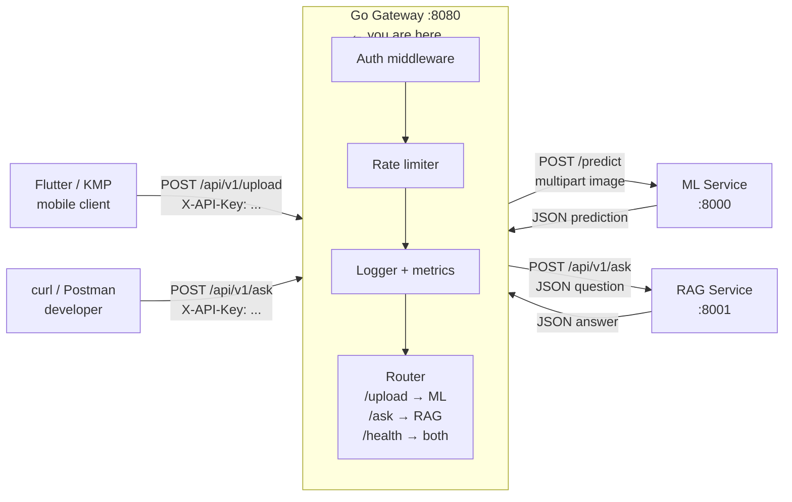
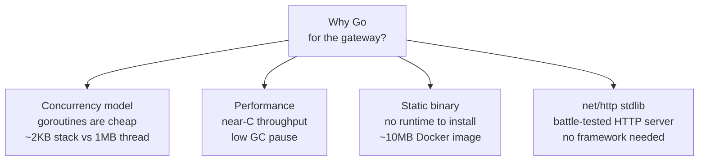
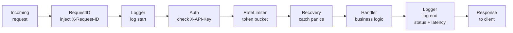
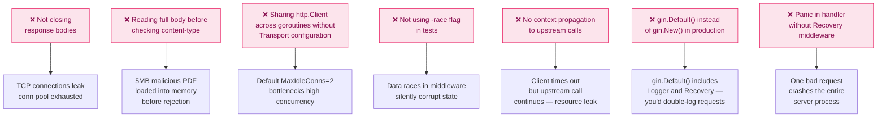

# Phase 4 — Go Backend Gateway

> **Duration:** 2 weeks · **10–15 hrs/week**
> **Goal:** Build a production-grade Go REST API that acts as the single
> front-door for the entire system — routing image uploads to the Python ML
> service, routing questions to the RAG service, enforcing API key
> authentication, per-IP rate limiting, structured logging, Prometheus metrics,
> graceful shutdown, and comprehensive unit tests. By the end, one
> `docker compose up` at the monorepo root starts all three services together.

> **Prerequisite:** Phases 1–3 complete. You must have:
> - `python-ml-service/` running and responding at `http://localhost:8000`
> - `rag-service/` running and responding at `http://localhost:8001`
> - Go 1.22+ installed (`go version`)
> - Docker Desktop running

---

## Table of Contents

1. [What You Will Build](#1-what-you-will-build)
2. [How the Gateway Fits the Larger System](#2-how-the-gateway-fits-the-larger-system)
3. [Why Go for the Gateway](#3-why-go-for-the-gateway)
4. [Folder Structure](#4-folder-structure)
5. [Environment Setup](#5-environment-setup)
6. [Configuration](#6-configuration)
7. [Domain Types](#7-domain-types)
8. [Upstream Clients](#8-upstream-clients)
   - [8.1 ML Service Client](#81-ml-service-client)
   - [8.2 RAG Service Client](#82-rag-service-client)
9. [Middleware](#9-middleware)
   - [9.1 Request ID Injection](#91-request-id-injection)
   - [9.2 Structured Logger](#92-structured-logger)
   - [9.3 API Key Authentication](#93-api-key-authentication)
   - [9.4 Per-IP Rate Limiter](#94-per-ip-rate-limiter)
   - [9.5 Recovery (Panic Handler)](#95-recovery-panic-handler)
10. [Handlers](#10-handlers)
    - [10.1 Upload Handler](#101-upload-handler)
    - [10.2 Ask Handler](#102-ask-handler)
    - [10.3 Health Handler](#103-health-handler)
11. [Metrics — Prometheus](#11-metrics--prometheus)
12. [Server — Graceful Shutdown](#12-server--graceful-shutdown)
13. [Main Entry Point](#13-main-entry-point)
14. [Testing](#14-testing)
    - [14.1 Handler Tests](#141-handler-tests)
    - [14.2 Middleware Tests](#142-middleware-tests)
    - [14.3 Client Tests](#143-client-tests)
    - [14.4 Integration Test](#144-integration-test)
15. [Dockerfile and Docker Compose](#15-dockerfile-and-docker-compose)
16. [Manual Testing with curl](#16-manual-testing-with-curl)
17. [Interview Questions & Model Answers](#17-interview-questions--model-answers)
18. [Common Mistakes to Avoid](#18-common-mistakes-to-avoid)
19. [Reference Links](#19-reference-links)
20. [Phase 4 Completion Checklist](#20-phase-4-completion-checklist)

---

## 1. What You Will Build

By the end of Phase 4 you will have **one deployable Go service** committed
to GitHub as a clean sub-directory of the monorepo:

| Artefact | File | What it proves |
|---|---|---|
| ML service client | `internal/client/mlclient.go` | You build typed HTTP clients, not raw `http.Get` calls |
| RAG service client | `internal/client/ragclient.go` | Timeout, retry, and error-wrapping patterns |
| API key middleware | `internal/middleware/auth.go` | You secure services at the gateway, not per-service |
| Per-IP rate limiter | `internal/middleware/ratelimit.go` | Token bucket algorithm, concurrent-safe |
| Structured logger | `internal/middleware/logger.go` | Request ID, latency, status on every request |
| Upload handler | `internal/handler/upload.go` | File validation, proxy to ML service |
| Ask handler | `internal/handler/ask.go` | JSON proxy to RAG service |
| Health handler | `internal/handler/health.go` | Aggregate health of upstream services |
| Prometheus metrics | `internal/metrics/metrics.go` | Request count, latency histograms, upstream health |
| Graceful shutdown | `cmd/server/main.go` | SIGINT/SIGTERM → drain → exit cleanly |
| Full test suite | `internal/*/` | Handler tests, middleware tests, mock upstreams |

---

## 2. How the Gateway Fits the Larger System



The gateway owns **cross-cutting concerns** — authentication, rate limiting,
logging, and metrics. The upstream services (ML, RAG) know nothing about API
keys or request tracing. This separation means you can add a new upstream
service by writing one new handler and one new client — no auth or rate-limit
code changes required.

---

## 3. Why Go for the Gateway



| Concern | Go approach | Python FastAPI equivalent |
|---|---|---|
| Concurrency | Goroutine per request (native) | async/await + event loop |
| CPU-bound work | Goroutines use real threads | ThreadPoolExecutor needed |
| Binary size | Single static binary ~10 MB | 500 MB+ Python + deps |
| Startup time | < 50ms | 3–5s (model loading) |
| Type safety | Compile-time | mypy (optional) |

The gateway does no heavy computation — it validates, proxies, and responds.
Go's strengths (fast startup, low memory, native concurrency) are exactly what
a proxy layer needs.

---

## 4. Folder Structure

```
go-gateway/                          ← service root
│
├── cmd/
│   └── server/
│       └── main.go                  ← entry point: wire everything, start server
│
├── internal/                        ← private packages — not importable externally
│   ├── client/
│   │   ├── mlclient.go              ← HTTP client for ML service
│   │   ├── mlclient_test.go
│   │   ├── ragclient.go             ← HTTP client for RAG service
│   │   └── ragclient_test.go
│   │
│   ├── config/
│   │   └── config.go                ← settings from environment variables
│   │
│   ├── handler/
│   │   ├── upload.go                ← POST /api/v1/upload
│   │   ├── upload_test.go
│   │   ├── ask.go                   ← POST /api/v1/ask
│   │   ├── ask_test.go
│   │   ├── health.go                ← GET /health, GET /ready
│   │   └── health_test.go
│   │
│   ├── middleware/
│   │   ├── auth.go                  ← API key validation
│   │   ├── auth_test.go
│   │   ├── logger.go                ← structured request logging
│   │   ├── logger_test.go
│   │   ├── ratelimit.go             ← per-IP token bucket
│   │   ├── ratelimit_test.go
│   │   ├── recovery.go              ← panic → 500 recovery
│   │   └── requestid.go             ← inject X-Request-ID header
│   │
│   ├── metrics/
│   │   └── metrics.go               ← Prometheus counters, histograms, gauges
│   │
│   └── types/
│       ├── request.go               ← shared request/response types
│       └── errors.go                ← typed error responses
│
├── Dockerfile
├── .dockerignore
├── .env.example
├── .gitignore
├── go.mod
├── go.sum
└── Makefile                         ← build, test, lint shortcuts
```

Create the scaffold:

```bash
# Navigate to monorepo root
cd ai-crop-disease-platform

# Create service directory
mkdir -p go-gateway
cd go-gateway

# Create directory structure
mkdir -p cmd/server \
         internal/client \
         internal/config \
         internal/handler \
         internal/middleware \
         internal/metrics \
         internal/types

# Create placeholder files
touch cmd/server/main.go \
      internal/client/mlclient.go \
      internal/client/mlclient_test.go \
      internal/client/ragclient.go \
      internal/client/ragclient_test.go \
      internal/config/config.go \
      internal/handler/upload.go \
      internal/handler/upload_test.go \
      internal/handler/ask.go \
      internal/handler/ask_test.go \
      internal/handler/health.go \
      internal/handler/health_test.go \
      internal/middleware/auth.go \
      internal/middleware/auth_test.go \
      internal/middleware/logger.go \
      internal/middleware/logger_test.go \
      internal/middleware/ratelimit.go \
      internal/middleware/ratelimit_test.go \
      internal/middleware/recovery.go \
      internal/middleware/requestid.go \
      internal/metrics/metrics.go \
      internal/types/request.go \
      internal/types/errors.go \
      Makefile

echo "Scaffold created"
```

---

## 5. Environment Setup

### 5.1 Verify Go installation

```bash
# Go 1.22+ required for range-over-integer and improved http routing
go version
# go version go1.22.x darwin/arm64

# If not installed:
brew install go

# After install, add GOPATH/bin to PATH — needed for installed tools
echo 'export PATH="$PATH:$(go env GOPATH)/bin"' >> ~/.zshrc
source ~/.zshrc
```

### 5.2 Initialise the Go module

```bash
# Inside go-gateway/
# go mod init declares this directory as a Go module
# The module path is how other files import packages from this module
go mod init github.com/yourusername/crop-disease-platform/go-gateway

# Verify the module file was created
cat go.mod
# module github.com/yourusername/crop-disease-platform/go-gateway
# go 1.22
```

### 5.3 Install dependencies

```bash
# Gin — HTTP router/framework
# Chosen over net/http because it provides:
#   - Route groups (/api/v1/...)
#   - Path parameters (:id)
#   - Built-in JSON binding
#   - Middleware chain via Use()
go get github.com/gin-gonic/gin

# logrus — structured logging (JSON output)
# Alternative: log/slog (stdlib, 1.21+) — both are fine
go get github.com/sirupsen/logrus

# Prometheus client — /metrics endpoint
go get github.com/prometheus/client_golang/prometheus
go get github.com/prometheus/client_golang/prometheus/promhttp

# Token bucket rate limiter — stdlib-compatible
go get golang.org/x/time/rate

# UUID generation for request IDs
go get github.com/google/uuid

# Verify go.sum was updated
cat go.sum | head -5

# Download all dependencies
go mod download

# Tidy — remove unused, add missing
go mod tidy
```

### 5.4 Create configuration files

```bash
# .env.example
cat > .env.example << 'EOF'
# Server
APP_ENV=development
PORT=8080
READ_TIMEOUT_SECONDS=30
WRITE_TIMEOUT_SECONDS=30
IDLE_TIMEOUT_SECONDS=120

# Upstream services
ML_SERVICE_URL=http://localhost:8000
RAG_SERVICE_URL=http://localhost:8001
UPSTREAM_TIMEOUT_SECONDS=60     # how long to wait for upstream response
UPSTREAM_RETRY_COUNT=2          # number of retries on 5xx from upstream

# Security
API_KEY=dev-api-key-change-in-production

# Rate limiting
RATE_LIMIT_RPS=100              # requests per second per IP
RATE_LIMIT_BURST=20             # burst capacity

# Observability
LOG_LEVEL=info                  # debug | info | warn | error
METRICS_ENABLED=true
EOF

cp .env.example .env
```

```bash
# .gitignore
cat > .gitignore << 'EOF'
# Compiled binary
bin/
*.exe

# Environment secrets
.env

# Go test cache
*.test
*.out

# macOS artefacts
.DS_Store
EOF
```

### 5.5 Create Makefile

```makefile
# Makefile — common development tasks
# Run with: make <target>

.PHONY: run build test lint clean docker-build

# Run the server locally (reads .env via godotenv in main.go)
run:
	go run cmd/server/main.go

# Build the binary into bin/
build:
	go build -o bin/gateway ./cmd/server

# Run all tests with race detector enabled
# -race detects data races in concurrent code — always enable for Go tests
test:
	go test -race -v ./...

# Run tests with coverage report
test-cover:
	go test -race -coverprofile=coverage.out ./...
	go tool cover -html=coverage.out -o coverage.html
	@echo "Coverage report: coverage.html"

# Lint using golangci-lint
# Install: brew install golangci-lint
lint:
	golangci-lint run ./...

# Format all Go files
fmt:
	gofmt -w .

# Remove build artefacts
clean:
	rm -rf bin/ coverage.out coverage.html

# Build Docker image
docker-build:
	docker build -t crop-go-gateway .

# Run all checks before committing — CI equivalent
check: fmt lint test
	@echo "All checks passed ✓"
```

---

## 6. Configuration

**File:** `internal/config/config.go`

```go
// internal/config/config.go
//
// Centralised configuration loaded from environment variables.
//
// Go does not have a standard settings library like pydantic-settings,
// so we read os.Getenv() with fallback defaults in one place.
// All configuration lives here — no scattered os.Getenv() calls in handlers.
//
// Pattern: singleton loaded once at startup, passed by value to constructors.
// Not a global — passed explicitly so tests can override it.

package config

import (
	"fmt"
	"os"
	"strconv"
	"time"
)

// Config holds all application configuration.
// Fields are exported (uppercase) so they are accessible outside the package.
type Config struct {
	// ── Server ───────────────────────────────────────────────────────────
	AppEnv        string
	Port          string
	ReadTimeout   time.Duration
	WriteTimeout  time.Duration
	IdleTimeout   time.Duration

	// ── Upstream services ─────────────────────────────────────────────────
	MLServiceURL          string
	RAGServiceURL         string
	UpstreamTimeout       time.Duration
	UpstreamRetryCount    int

	// ── Security ──────────────────────────────────────────────────────────
	APIKey string

	// ── Rate limiting ─────────────────────────────────────────────────────
	RateLimitRPS   float64 // requests per second per IP
	RateLimitBurst int     // burst capacity (token bucket)

	// ── Observability ─────────────────────────────────────────────────────
	LogLevel       string
	MetricsEnabled bool
}

// Load reads configuration from environment variables with safe defaults.
// Call once at application startup: cfg := config.Load()
func Load() (*Config, error) {
	cfg := &Config{
		// Defaults — safe values for local development
		AppEnv:             getEnv("APP_ENV", "development"),
		Port:               getEnv("PORT", "8080"),
		ReadTimeout:        getDuration("READ_TIMEOUT_SECONDS", 30),
		WriteTimeout:       getDuration("WRITE_TIMEOUT_SECONDS", 30),
		IdleTimeout:        getDuration("IDLE_TIMEOUT_SECONDS", 120),

		MLServiceURL:       getEnv("ML_SERVICE_URL", "http://localhost:8000"),
		RAGServiceURL:      getEnv("RAG_SERVICE_URL", "http://localhost:8001"),
		UpstreamTimeout:    getDuration("UPSTREAM_TIMEOUT_SECONDS", 60),
		UpstreamRetryCount: getInt("UPSTREAM_RETRY_COUNT", 2),

		APIKey:             getEnv("API_KEY", ""),

		RateLimitRPS:       getFloat("RATE_LIMIT_RPS", 100.0),
		RateLimitBurst:     getInt("RATE_LIMIT_BURST", 20),

		LogLevel:           getEnv("LOG_LEVEL", "info"),
		MetricsEnabled:     getBool("METRICS_ENABLED", true),
	}

	// Validate required fields — fail fast at startup rather than on first request
	if cfg.APIKey == "" {
		return nil, fmt.Errorf("API_KEY is required — set it in .env or as an environment variable")
	}
	if cfg.MLServiceURL == "" {
		return nil, fmt.Errorf("ML_SERVICE_URL is required")
	}
	if cfg.RAGServiceURL == "" {
		return nil, fmt.Errorf("RAG_SERVICE_URL is required")
	}

	return cfg, nil
}

// IsProduction returns true when running in the production environment.
// Used to disable debug logging and Swagger UI in production.
func (c *Config) IsProduction() bool {
	return c.AppEnv == "production"
}

// ── Helper functions ──────────────────────────────────────────────────────────

// getEnv reads an environment variable, returning the default if unset or empty.
func getEnv(key, defaultVal string) string {
	if v := os.Getenv(key); v != "" {
		return v
	}
	return defaultVal
}

// getDuration reads an integer environment variable and converts it to
// time.Duration in seconds. Returns the default if the variable is not set
// or cannot be parsed.
func getDuration(key string, defaultSeconds int) time.Duration {
	if v := os.Getenv(key); v != "" {
		if n, err := strconv.Atoi(v); err == nil {
			return time.Duration(n) * time.Second
		}
	}
	return time.Duration(defaultSeconds) * time.Second
}

// getInt reads an integer environment variable with a fallback default.
func getInt(key string, defaultVal int) int {
	if v := os.Getenv(key); v != "" {
		if n, err := strconv.Atoi(v); err == nil {
			return n
		}
	}
	return defaultVal
}

// getFloat reads a float64 environment variable with a fallback default.
func getFloat(key string, defaultVal float64) float64 {
	if v := os.Getenv(key); v != "" {
		if f, err := strconv.ParseFloat(v, 64); err == nil {
			return f
		}
	}
	return defaultVal
}

// getBool reads a boolean environment variable ("true"/"false") with a default.
func getBool(key string, defaultVal bool) bool {
	if v := os.Getenv(key); v != "" {
		if b, err := strconv.ParseBool(v); err == nil {
			return b
		}
	}
	return defaultVal
}
```

---

## 7. Domain Types

**File:** `internal/types/request.go`

```go
// internal/types/request.go
//
// Shared request and response types used by handlers and clients.
// Keeping types in one package prevents import cycles and makes
// the API contract explicit and searchable.

package types

// ── ML Service types ─────────────────────────────────────────────────────────

// TopPrediction is one entry in the top-K list from the ML service.
type TopPrediction struct {
	Label      string  `json:"label"`
	Confidence float64 `json:"confidence"`
}

// PredictionResponse mirrors the ML service's PredictionResponse schema.
// Field names and json tags must match the Python Pydantic model exactly.
type PredictionResponse struct {
	Label              string          `json:"label"`
	Confidence         float64         `json:"confidence"`
	Top3               []TopPrediction `json:"top_3"`
	ModelVersion       string          `json:"model_version"`
	InferenceTimeMs    float64         `json:"inference_time_ms"`
	IsHealthy          bool            `json:"is_healthy"`
}

// ── RAG Service types ─────────────────────────────────────────────────────────

// AskRequest is sent to the RAG service.
type AskRequest struct {
	Question string `json:"question"`
	TopK     *int   `json:"top_k,omitempty"` // pointer — nil means "use default"
}

// AskResponse mirrors the RAG service's AskResponse schema.
type AskResponse struct {
	Answer               string   `json:"answer"`
	Sources              []string `json:"sources"`
	ChunksRetrieved      int      `json:"chunks_retrieved"`
	LLMUsed              string   `json:"llm_used"`
	RetrievalTimeMs      float64  `json:"retrieval_time_ms"`
	GenerationTimeMs     float64  `json:"generation_time_ms"`
	TotalTimeMs          float64  `json:"total_time_ms"`
	PromptTokensEstimate int      `json:"prompt_tokens_estimate"`
}

// ── Gateway-level request types ───────────────────────────────────────────────

// AskGatewayRequest is the body accepted by the gateway's POST /api/v1/ask.
// Identical to AskRequest — the gateway forwards it verbatim.
type AskGatewayRequest struct {
	Question string `json:"question" binding:"required"`
	TopK     *int   `json:"top_k,omitempty"`
}

// HealthStatus describes the liveness and readiness of one upstream service.
type HealthStatus struct {
	Service   string `json:"service"`
	Status    string `json:"status"`    // "ok" | "degraded" | "unreachable"
	LatencyMs int64  `json:"latency_ms"`
}

// GatewayHealthResponse is returned by GET /health.
type GatewayHealthResponse struct {
	Status    string         `json:"status"`    // "ok" | "degraded" | "unhealthy"
	Upstreams []HealthStatus `json:"upstreams"`
}
```

**File:** `internal/types/errors.go`

```go
// internal/types/errors.go
//
// Typed error response — consistent JSON shape for all 4xx/5xx responses.
// Clients parse the same structure regardless of which error occurred.

package types

import (
	"net/http"

	"github.com/gin-gonic/gin"
)

// ErrorResponse is the standard error body returned on all non-2xx responses.
type ErrorResponse struct {
	Error   string `json:"error"`             // machine-readable code
	Message string `json:"message"`           // human-readable explanation
	Detail  string `json:"detail,omitempty"`  // optional extra context
}

// AbortWithError writes an ErrorResponse to the Gin context and aborts the chain.
// Use this instead of c.JSON(status, ...) so all errors use the same shape.
func AbortWithError(c *gin.Context, status int, code, message string) {
	c.AbortWithStatusJSON(status, ErrorResponse{
		Error:   code,
		Message: message,
	})
}

// AbortWithDetail is like AbortWithError but includes an extra detail field.
func AbortWithDetail(c *gin.Context, status int, code, message, detail string) {
	c.AbortWithStatusJSON(status, ErrorResponse{
		Error:   code,
		Message: message,
		Detail:  detail,
	})
}

// Common error codes — use these constants so code and message stay consistent.
const (
	ErrUnauthorised      = "unauthorised"
	ErrRateLimited       = "rate_limited"
	ErrBadRequest        = "bad_request"
	ErrFileTooLarge      = "file_too_large"
	ErrInvalidFileType   = "invalid_file_type"
	ErrUpstreamTimeout   = "upstream_timeout"
	ErrUpstreamError     = "upstream_error"
	ErrInternalError     = "internal_error"
)

// HTTPStatusFor maps error codes to HTTP status codes.
// Not used everywhere, but useful for routing decisions.
var HTTPStatusFor = map[string]int{
	ErrUnauthorised:    http.StatusUnauthorized,
	ErrRateLimited:     http.StatusTooManyRequests,
	ErrBadRequest:      http.StatusBadRequest,
	ErrFileTooLarge:    http.StatusRequestEntityTooLarge,
	ErrInvalidFileType: http.StatusBadRequest,
	ErrUpstreamTimeout: http.StatusGatewayTimeout,
	ErrUpstreamError:   http.StatusBadGateway,
	ErrInternalError:   http.StatusInternalServerError,
}
```

---

## 8. Upstream Clients

### 8.1 ML Service Client

**File:** `internal/client/mlclient.go`

```go
// internal/client/mlclient.go
//
// HTTP client for the Python ML service.
//
// Design principles:
//   1. Typed — returns *types.PredictionResponse, not map[string]any
//   2. Timeout-aware — each request has a deadline
//   3. Retry on 5xx — transient upstream errors are retried with backoff
//   4. Multipart-aware — forwards the raw file upload without buffering
//
// This client is a thin wrapper over net/http.
// We do not use an HTTP client library because the stdlib is sufficient
// and adds no dependency. The client is created once and reused — this
// reuses the TCP connection pool inside http.Client.

package client

import (
	"bytes"
	"context"
	"encoding/json"
	"fmt"
	"io"
	"mime/multipart"
	"net/http"
	"path/filepath"
	"time"

	"github.com/yourusername/crop-disease-platform/go-gateway/internal/types"
)

// MLClient is the HTTP client for the Python ML service.
type MLClient struct {
	baseURL    string
	httpClient *http.Client
	retryCount int
}

// NewMLClient creates a new MLClient.
// timeout is the maximum time to wait for a complete response from the ML service.
// The ML service inference takes 30–100ms on MPS; 60s allows for cold start.
func NewMLClient(baseURL string, timeout time.Duration, retryCount int) *MLClient {
	return &MLClient{
		baseURL:    baseURL,
		retryCount: retryCount,
		httpClient: &http.Client{
			Timeout: timeout,
			// Default transport reuses TCP connections (keep-alive)
			// This avoids the overhead of a new TCP handshake per request
			Transport: &http.Transport{
				MaxIdleConns:        10,               // max idle connections in pool
				MaxIdleConnsPerHost: 5,                // max idle connections to ML service
				IdleConnTimeout:     90 * time.Second, // close idle connections after 90s
			},
		},
	}
}

// Predict sends an image file to the ML service and returns the prediction.
//
// fileBytes: raw image bytes
// filename:  original filename (used to set the multipart filename field)
// contentType: MIME type, e.g. "image/jpeg"
// requestID: propagated from the gateway request for cross-service tracing
func (c *MLClient) Predict(
	ctx context.Context,
	fileBytes []byte,
	filename string,
	contentType string,
	requestID string,
) (*types.PredictionResponse, error) {
	var lastErr error

	// Retry loop — retry on 5xx (server errors), not on 4xx (client errors)
	for attempt := 0; attempt <= c.retryCount; attempt++ {
		if attempt > 0 {
			// Exponential backoff: 100ms, 200ms, 400ms
			backoff := time.Duration(100*(1<<uint(attempt-1))) * time.Millisecond
			select {
			case <-ctx.Done():
				// Context cancelled (request timeout) — stop retrying immediately
				return nil, fmt.Errorf("context cancelled during retry backoff: %w", ctx.Err())
			case <-time.After(backoff):
			}
		}

		resp, err := c.doPredict(ctx, fileBytes, filename, contentType, requestID)
		if err != nil {
			lastErr = err
			continue // retry on network error
		}
		return resp, nil
	}

	return nil, fmt.Errorf("all %d attempts failed: %w", c.retryCount+1, lastErr)
}

// doPredict performs a single HTTP request to the ML service /predict endpoint.
func (c *MLClient) doPredict(
	ctx context.Context,
	fileBytes []byte,
	filename string,
	contentType string,
	requestID string,
) (*types.PredictionResponse, error) {
	// Build a multipart/form-data body — the ML service expects a 'file' field
	var body bytes.Buffer
	writer := multipart.NewWriter(&body)

	// CreateFormFile adds the file field with the correct Content-Disposition header
	// The field name "file" must match the FastAPI endpoint parameter name
	part, err := writer.CreateFormFile("file", filepath.Base(filename))
	if err != nil {
		return nil, fmt.Errorf("create form file: %w", err)
	}

	if _, err = part.Write(fileBytes); err != nil {
		return nil, fmt.Errorf("write file bytes: %w", err)
	}

	// Close the writer to write the final boundary marker
	if err = writer.Close(); err != nil {
		return nil, fmt.Errorf("close multipart writer: %w", err)
	}

	// Build the HTTP request with the context for cancellation/timeout
	req, err := http.NewRequestWithContext(ctx, http.MethodPost,
		c.baseURL+"/api/v1/predict", &body)
	if err != nil {
		return nil, fmt.Errorf("build request: %w", err)
	}

	// Set headers
	req.Header.Set("Content-Type", writer.FormDataContentType()) // includes boundary
	req.Header.Set("X-Request-ID", requestID)                   // cross-service tracing

	// Execute the request
	resp, err := c.httpClient.Do(req)
	if err != nil {
		return nil, fmt.Errorf("ml service request: %w", err)
	}
	defer resp.Body.Close()

	// Read response body — limit to 1MB to prevent memory exhaustion
	respBody, err := io.ReadAll(io.LimitReader(resp.Body, 1<<20))
	if err != nil {
		return nil, fmt.Errorf("read ml service response: %w", err)
	}

	// Check for upstream errors
	if resp.StatusCode >= 500 {
		// 5xx — transient error, allow retry
		return nil, fmt.Errorf("ml service 5xx (%d): %s", resp.StatusCode, string(respBody))
	}
	if resp.StatusCode >= 400 {
		// 4xx — client error, do not retry (bad input from our side)
		return nil, &UpstreamClientError{
			StatusCode: resp.StatusCode,
			Body:       string(respBody),
		}
	}

	// Parse successful response
	var prediction types.PredictionResponse
	if err = json.Unmarshal(respBody, &prediction); err != nil {
		return nil, fmt.Errorf("parse ml service response: %w", err)
	}

	return &prediction, nil
}

// Health checks if the ML service is reachable and ready.
// Used by the gateway's /health endpoint to aggregate upstream status.
func (c *MLClient) Health(ctx context.Context) (bool, int64) {
	start := time.Now()
	req, err := http.NewRequestWithContext(ctx, http.MethodGet, c.baseURL+"/health", nil)
	if err != nil {
		return false, 0
	}

	resp, err := c.httpClient.Do(req)
	latencyMs := time.Since(start).Milliseconds()
	if err != nil || resp.StatusCode != http.StatusOK {
		return false, latencyMs
	}
	resp.Body.Close()
	return true, latencyMs
}

// UpstreamClientError represents a 4xx error from an upstream service.
// It is not retried — the error is on the gateway's side (bad input).
type UpstreamClientError struct {
	StatusCode int
	Body       string
}

func (e *UpstreamClientError) Error() string {
	return fmt.Sprintf("upstream client error %d: %s", e.StatusCode, e.Body)
}
```

### 8.2 RAG Service Client

**File:** `internal/client/ragclient.go`

```go
// internal/client/ragclient.go
//
// HTTP client for the Python RAG service.
// Simpler than MLClient — sends JSON, receives JSON.
// Same retry and timeout patterns as MLClient for consistency.

package client

import (
	"bytes"
	"context"
	"encoding/json"
	"fmt"
	"io"
	"net/http"
	"time"

	"github.com/yourusername/crop-disease-platform/go-gateway/internal/types"
)

// RAGClient is the HTTP client for the RAG service.
type RAGClient struct {
	baseURL    string
	httpClient *http.Client
	retryCount int
}

// NewRAGClient creates a new RAGClient.
// RAG generation takes 1–5 seconds (LLM latency) — use a generous timeout.
func NewRAGClient(baseURL string, timeout time.Duration, retryCount int) *RAGClient {
	return &RAGClient{
		baseURL:    baseURL,
		retryCount: retryCount,
		httpClient: &http.Client{
			Timeout: timeout,
			Transport: &http.Transport{
				MaxIdleConns:        10,
				MaxIdleConnsPerHost: 5,
				IdleConnTimeout:     90 * time.Second,
			},
		},
	}
}

// Ask sends a question to the RAG service and returns the grounded answer.
func (c *RAGClient) Ask(
	ctx context.Context,
	req types.AskRequest,
	requestID string,
) (*types.AskResponse, error) {
	var lastErr error

	for attempt := 0; attempt <= c.retryCount; attempt++ {
		if attempt > 0 {
			backoff := time.Duration(200*(1<<uint(attempt-1))) * time.Millisecond
			select {
			case <-ctx.Done():
				return nil, fmt.Errorf("context cancelled: %w", ctx.Err())
			case <-time.After(backoff):
			}
		}

		resp, err := c.doAsk(ctx, req, requestID)
		if err != nil {
			lastErr = err
			// Only retry on network errors and 5xx — not 4xx
			if isClientError(err) {
				return nil, err // do not retry bad input
			}
			continue
		}
		return resp, nil
	}

	return nil, fmt.Errorf("all %d attempts failed: %w", c.retryCount+1, lastErr)
}

func (c *RAGClient) doAsk(
	ctx context.Context,
	askReq types.AskRequest,
	requestID string,
) (*types.AskResponse, error) {
	// Marshal the request to JSON
	body, err := json.Marshal(askReq)
	if err != nil {
		return nil, fmt.Errorf("marshal ask request: %w", err)
	}

	httpReq, err := http.NewRequestWithContext(
		ctx, http.MethodPost,
		c.baseURL+"/api/v1/ask",
		bytes.NewReader(body),
	)
	if err != nil {
		return nil, fmt.Errorf("build rag request: %w", err)
	}

	httpReq.Header.Set("Content-Type", "application/json")
	httpReq.Header.Set("X-Request-ID", requestID)

	resp, err := c.httpClient.Do(httpReq)
	if err != nil {
		return nil, fmt.Errorf("rag service request: %w", err)
	}
	defer resp.Body.Close()

	respBody, err := io.ReadAll(io.LimitReader(resp.Body, 1<<20))
	if err != nil {
		return nil, fmt.Errorf("read rag response: %w", err)
	}

	if resp.StatusCode >= 500 {
		return nil, fmt.Errorf("rag service 5xx (%d): %s", resp.StatusCode, string(respBody))
	}
	if resp.StatusCode >= 400 {
		return nil, &UpstreamClientError{StatusCode: resp.StatusCode, Body: string(respBody)}
	}

	var answer types.AskResponse
	if err = json.Unmarshal(respBody, &answer); err != nil {
		return nil, fmt.Errorf("parse rag response: %w", err)
	}

	return &answer, nil
}

// Health checks if the RAG service is reachable and ready.
func (c *RAGClient) Health(ctx context.Context) (bool, int64) {
	start := time.Now()
	req, err := http.NewRequestWithContext(ctx, http.MethodGet, c.baseURL+"/health", nil)
	if err != nil {
		return false, 0
	}
	resp, err := c.httpClient.Do(req)
	latencyMs := time.Since(start).Milliseconds()
	if err != nil || resp.StatusCode != http.StatusOK {
		return false, latencyMs
	}
	resp.Body.Close()
	return true, latencyMs
}

// isClientError returns true for UpstreamClientError (4xx) — do not retry these.
func isClientError(err error) bool {
	_, ok := err.(*UpstreamClientError)
	return ok
}
```

---

## 9. Middleware

Middleware flow — every request passes through all middleware before reaching a handler:



### 9.1 Request ID Injection

**File:** `internal/middleware/requestid.go`

```go
// internal/middleware/requestid.go
//
// Injects a unique X-Request-ID into every request.
// If the client already sent an X-Request-ID, we preserve it — this
// allows end-to-end tracing from mobile client through gateway to Python services.
// The request ID is stored in the Gin context and forwarded to upstream services.

package middleware

import (
	"github.com/gin-gonic/gin"
	"github.com/google/uuid"
)

// RequestIDKey is the Gin context key for the request ID.
// Using a typed constant avoids key collisions with other context values.
const RequestIDKey = "request_id"

// RequestID injects a unique request ID into every request.
// Priority: client's X-Request-ID → newly generated UUID.
func RequestID() gin.HandlerFunc {
	return func(c *gin.Context) {
		// Check if client sent their own request ID — forward it if so
		requestID := c.GetHeader("X-Request-ID")
		if requestID == "" {
			// Generate a new UUID — this request originated at the gateway
			requestID = uuid.New().String()
		}

		// Store in context so handlers and downstream middleware can read it
		c.Set(RequestIDKey, requestID)

		// Add to response headers so the client can correlate logs
		c.Header("X-Request-ID", requestID)

		c.Next()
	}
}

// GetRequestID retrieves the request ID from the Gin context.
// Returns an empty string if not set — callers handle the zero value.
func GetRequestID(c *gin.Context) string {
	if id, exists := c.Get(RequestIDKey); exists {
		if s, ok := id.(string); ok {
			return s
		}
	}
	return ""
}
```

### 9.2 Structured Logger

**File:** `internal/middleware/logger.go`

```go
// internal/middleware/logger.go
//
// Structured request logging middleware.
// Logs one JSON line per request on completion with:
//   - request_id, method, path, status, latency_ms, client_ip, user_agent
//
// Logging on completion (not on arrival) lets us include the response status
// and latency in the same log line — one line per request is easier to query
// than two lines (start + end) that must be joined by request_id.

package middleware

import (
	"time"

	"github.com/gin-gonic/gin"
	"github.com/sirupsen/logrus"
)

// Logger returns a Gin middleware that logs each completed request.
// log is a logrus logger configured in main.go — injected, not global.
func Logger(log *logrus.Logger) gin.HandlerFunc {
	return func(c *gin.Context) {
		start := time.Now()
		path := c.Request.URL.Path

		// Process the request — call the next middleware/handler
		c.Next()

		// Log after the handler completes — we now have the status and latency
		latencyMs := time.Since(start).Milliseconds()
		status := c.Writer.Status()

		// Choose log level based on status code
		entry := log.WithFields(logrus.Fields{
			"request_id": GetRequestID(c),
			"method":     c.Request.Method,
			"path":       path,
			"status":     status,
			"latency_ms": latencyMs,
			"client_ip":  c.ClientIP(),
			"user_agent": c.Request.UserAgent(),
		})

		switch {
		case status >= 500:
			entry.Error("request.completed")
		case status >= 400:
			entry.Warn("request.completed")
		default:
			entry.Info("request.completed")
		}
	}
}
```

### 9.3 API Key Authentication

**File:** `internal/middleware/auth.go`

```go
// internal/middleware/auth.go
//
// API key authentication middleware.
// Every request must include the header: X-API-Key: <key>
//
// Why header instead of query parameter?
//   - Query parameters appear in server logs and browser history
//   - Headers are not logged by default and not cached
//   - Industry standard for internal service APIs
//
// Why not JWT?
//   - JWT is appropriate for user-specific tokens (Phase 5 enhancement)
//   - For machine-to-machine calls (gateway → Python services), a shared
//     secret API key is simpler and sufficient
//   - JWT verification adds CPU cost for every request

package middleware

import (
	"net/http"

	"github.com/gin-gonic/gin"
	"github.com/yourusername/crop-disease-platform/go-gateway/internal/types"
)

const apiKeyHeader = "X-API-Key"

// APIKeyAuth returns a middleware that validates the X-API-Key header.
// validKey is the expected key, loaded from configuration at startup.
func APIKeyAuth(validKey string) gin.HandlerFunc {
	return func(c *gin.Context) {
		providedKey := c.GetHeader(apiKeyHeader)

		if providedKey == "" {
			// No key provided — return 401 Unauthorized
			types.AbortWithError(c, http.StatusUnauthorized,
				types.ErrUnauthorised,
				"Missing X-API-Key header",
			)
			return
		}

		// Constant-time comparison prevents timing attacks.
		// A naive == comparison leaks information about key length through timing —
		// an attacker can measure response time to guess the key character by character.
		// subtle.ConstantTimeCompare takes the same time regardless of where strings differ.
		if !secureCompare(validKey, providedKey) {
			types.AbortWithError(c, http.StatusUnauthorized,
				types.ErrUnauthorised,
				"Invalid API key",
			)
			return
		}

		c.Next()
	}
}

// secureCompare performs a constant-time string comparison.
// Both strings are compared fully regardless of where they first differ.
func secureCompare(a, b string) bool {
	if len(a) != len(b) {
		// Length check is not constant-time, but leaking key length is acceptable
		// for our use case — the key length is not secret
		return false
	}
	var result byte
	for i := 0; i < len(a); i++ {
		// XOR each pair of bytes — if equal, XOR produces 0
		// OR accumulates any differences — if result > 0, strings differ
		result |= a[i] ^ b[i]
	}
	return result == 0
}
```

### 9.4 Per-IP Rate Limiter

**File:** `internal/middleware/ratelimit.go`

```go
// internal/middleware/ratelimit.go
//
// Per-IP rate limiting using the token bucket algorithm.
//
// Token bucket algorithm:
//   - Each IP gets a "bucket" that holds up to `burst` tokens
//   - Tokens refill at `rps` tokens per second
//   - Each request consumes one token
//   - If the bucket is empty: reject with 429 Too Many Requests
//
// Why token bucket over fixed window?
//   - Fixed window (100 req/min): allows 200 req in 2 seconds straddling a window boundary
//   - Token bucket: never allows more than `burst` simultaneous requests
//   - Token bucket is fairer under bursty traffic

package middleware

import (
	"net/http"
	"sync"
	"time"

	"github.com/gin-gonic/gin"
	"golang.org/x/time/rate"
	"github.com/yourusername/crop-disease-platform/go-gateway/internal/types"
)

// ipEntry holds a rate limiter and its last access time.
// lastSeen allows us to clean up limiters for IPs that haven't been seen recently.
type ipEntry struct {
	limiter  *rate.Limiter
	lastSeen time.Time
}

// IPRateLimiter manages one token bucket per client IP address.
// sync.Map provides concurrent-safe access without a single global mutex.
type IPRateLimiter struct {
	limiters sync.Map
	rps      rate.Limit
	burst    int
}

// NewIPRateLimiter creates a new rate limiter.
// rps: sustained requests per second per IP
// burst: maximum instantaneous requests (bucket capacity)
func NewIPRateLimiter(rps float64, burst int) *IPRateLimiter {
	rl := &IPRateLimiter{
		rps:   rate.Limit(rps),
		burst: burst,
	}
	// Start background cleanup goroutine — removes stale entries every 5 minutes
	// Without cleanup, the map grows unbounded as new IPs connect
	go rl.cleanupLoop()
	return rl
}

// getLimiter retrieves or creates a token bucket for the given IP address.
func (rl *IPRateLimiter) getLimiter(ip string) *rate.Limiter {
	entry := &ipEntry{
		limiter:  rate.NewLimiter(rl.rps, rl.burst),
		lastSeen: time.Now(),
	}
	// LoadOrStore is atomic — prevents two goroutines creating limiters for the same IP
	actual, _ := rl.limiters.LoadOrStore(ip, entry)
	e := actual.(*ipEntry)
	e.lastSeen = time.Now()
	return e.limiter
}

// Allow checks whether the given IP is within its rate limit.
// Returns true and consumes one token if allowed; false if the bucket is empty.
func (rl *IPRateLimiter) Allow(ip string) bool {
	return rl.getLimiter(ip).Allow()
}

// cleanupLoop removes entries that haven't been seen in 10 minutes.
// Runs as a goroutine in the background — uses a ticker, not a sleep loop,
// so it fires at regular intervals even if the cleanup itself takes time.
func (rl *IPRateLimiter) cleanupLoop() {
	ticker := time.NewTicker(5 * time.Minute)
	defer ticker.Stop()
	for range ticker.C {
		cutoff := time.Now().Add(-10 * time.Minute)
		rl.limiters.Range(func(key, value any) bool {
			entry := value.(*ipEntry)
			if entry.lastSeen.Before(cutoff) {
				rl.limiters.Delete(key)
			}
			return true // continue iteration
		})
	}
}

// RateLimit returns a Gin middleware that enforces per-IP rate limiting.
func RateLimit(limiter *IPRateLimiter) gin.HandlerFunc {
	return func(c *gin.Context) {
		ip := c.ClientIP()
		if !limiter.Allow(ip) {
			types.AbortWithDetail(c, http.StatusTooManyRequests,
				types.ErrRateLimited,
				"Rate limit exceeded",
				"Slow down — too many requests from your IP address",
			)
			return
		}
		c.Next()
	}
}
```

### 9.5 Recovery (Panic Handler)

**File:** `internal/middleware/recovery.go`

```go
// internal/middleware/recovery.go
//
// Panic recovery middleware — catches any panic in a handler and converts
// it to a 500 Internal Server Error rather than crashing the process.
//
// In Go, a panic in a goroutine terminates the entire program unless recovered.
// HTTP server goroutines can panic due to nil pointer dereferences, index out
// of bounds, or other bugs. Without recovery, one bad request crashes the server.
// With recovery, the server logs the panic and serves subsequent requests normally.

package middleware

import (
	"net/http"
	"runtime/debug"

	"github.com/gin-gonic/gin"
	"github.com/sirupsen/logrus"
	"github.com/yourusername/crop-disease-platform/go-gateway/internal/types"
)

// Recovery returns a middleware that catches panics and returns 500.
func Recovery(log *logrus.Logger) gin.HandlerFunc {
	return func(c *gin.Context) {
		defer func() {
			if err := recover(); err != nil {
				// Print the full stack trace to the log — essential for debugging
				log.WithFields(logrus.Fields{
					"request_id": GetRequestID(c),
					"panic":      err,
					"stack":      string(debug.Stack()),
				}).Error("panic.recovered")

				// Return 500 to the client — do not expose the panic details
				c.AbortWithStatusJSON(http.StatusInternalServerError,
					types.ErrorResponse{
						Error:   types.ErrInternalError,
						Message: "An unexpected error occurred. The team has been notified.",
					},
				)
			}
		}()
		c.Next()
	}
}
```

---

## 10. Handlers

### 10.1 Upload Handler

**File:** `internal/handler/upload.go`

```go
// internal/handler/upload.go
//
// POST /api/v1/upload — accept an image from the client, validate it,
// and proxy it to the ML service. Return the prediction to the caller.
//
// Validation order (fast-to-slow, cheap-to-expensive):
//   1. Content-type header (header check — no I/O)
//   2. File size (read header, no full read)
//   3. Read bytes
//   4. Forward to ML service

package handler

import (
	"errors"
	"net/http"

	"github.com/gin-gonic/gin"
	"github.com/sirupsen/logrus"
	"github.com/yourusername/crop-disease-platform/go-gateway/internal/client"
	"github.com/yourusername/crop-disease-platform/go-gateway/internal/middleware"
	"github.com/yourusername/crop-disease-platform/go-gateway/internal/types"
)

const (
	maxFileSizeBytes = 5 * 1024 * 1024  // 5 MB — matches ML service limit
)

// allowedContentTypes is the set of accepted MIME types for image uploads.
var allowedContentTypes = map[string]bool{
	"image/jpeg": true,
	"image/png":  true,
	"image/webp": true,
}

// UploadHandler handles POST /api/v1/upload.
type UploadHandler struct {
	mlClient *client.MLClient
	log      *logrus.Logger
}

// NewUploadHandler creates a new UploadHandler.
// mlClient is injected — makes the handler testable with a mock client.
func NewUploadHandler(mlClient *client.MLClient, log *logrus.Logger) *UploadHandler {
	return &UploadHandler{mlClient: mlClient, log: log}
}

// Handle processes the upload request.
func (h *UploadHandler) Handle(c *gin.Context) {
	requestID := middleware.GetRequestID(c)

	// ── 1. Parse multipart form ───────────────────────────────────────────
	// ParseMultipartForm reads the form data, buffering up to 10MB in memory
	// (the rest goes to disk). We then check size ourselves.
	if err := c.Request.ParseMultipartForm(10 << 20); err != nil {
		h.log.WithField("request_id", requestID).Warn("upload.parse_form_failed")
		types.AbortWithError(c, http.StatusBadRequest, types.ErrBadRequest,
			"Could not parse multipart form")
		return
	}

	file, header, err := c.Request.FormFile("file")
	if err != nil {
		types.AbortWithError(c, http.StatusBadRequest, types.ErrBadRequest,
			"Missing 'file' field in form data")
		return
	}
	defer file.Close()

	// ── 2. Validate content-type ──────────────────────────────────────────
	contentType := header.Header.Get("Content-Type")
	if !allowedContentTypes[contentType] {
		types.AbortWithDetail(c, http.StatusBadRequest, types.ErrInvalidFileType,
			"Unsupported file type",
			"Accepted types: image/jpeg, image/png, image/webp",
		)
		return
	}

	// ── 3. Validate file size ─────────────────────────────────────────────
	if header.Size > maxFileSizeBytes {
		sizeMB := float64(header.Size) / (1024 * 1024)
		types.AbortWithDetail(c, http.StatusRequestEntityTooLarge, types.ErrFileTooLarge,
			"Image exceeds size limit",
			fmt.Sprintf("Image is %.1f MB. Maximum: 5 MB", sizeMB),
		)
		return
	}

	// ── 4. Read file bytes ────────────────────────────────────────────────
	fileBytes := make([]byte, header.Size)
	if _, err = io.ReadFull(file, fileBytes); err != nil {
		h.log.WithError(err).WithField("request_id", requestID).Error("upload.read_failed")
		types.AbortWithError(c, http.StatusInternalServerError, types.ErrInternalError,
			"Could not read uploaded file")
		return
	}

	// ── 5. Forward to ML service ──────────────────────────────────────────
	h.log.WithFields(logrus.Fields{
		"request_id":   requestID,
		"filename":     header.Filename,
		"size_bytes":   header.Size,
		"content_type": contentType,
	}).Info("upload.forwarding")

	prediction, err := h.mlClient.Predict(
		c.Request.Context(),
		fileBytes,
		header.Filename,
		contentType,
		requestID,
	)
	if err != nil {
		h.handleUpstreamError(c, err, requestID)
		return
	}

	h.log.WithFields(logrus.Fields{
		"request_id": requestID,
		"label":      prediction.Label,
		"confidence": prediction.Confidence,
	}).Info("upload.prediction_received")

	c.JSON(http.StatusOK, prediction)
}

// handleUpstreamError translates ML service errors into appropriate HTTP responses.
func (h *UploadHandler) handleUpstreamError(c *gin.Context, err error, requestID string) {
	var clientErr *client.UpstreamClientError
	if errors.As(err, &clientErr) {
		// 4xx from ML service — bad image (corrupt, wrong format)
		types.AbortWithDetail(c, http.StatusBadRequest, types.ErrBadRequest,
			"ML service rejected the image", clientErr.Body)
		return
	}

	// Network error or 5xx — timeout or ML service is down
	if errors.Is(err, context.DeadlineExceeded) {
		types.AbortWithError(c, http.StatusGatewayTimeout, types.ErrUpstreamTimeout,
			"ML service timed out — try again shortly")
		return
	}

	h.log.WithError(err).WithField("request_id", requestID).Error("upload.upstream_error")
	types.AbortWithError(c, http.StatusBadGateway, types.ErrUpstreamError,
		"ML service unavailable — try again shortly")
}
```

### 10.2 Ask Handler

**File:** `internal/handler/ask.go`

```go
// internal/handler/ask.go
//
// POST /api/v1/ask — accept a JSON question, validate it,
// and proxy it to the RAG service. Return the grounded answer.

package handler

import (
	"context"
	"errors"
	"net/http"

	"github.com/gin-gonic/gin"
	"github.com/sirupsen/logrus"
	"github.com/yourusername/crop-disease-platform/go-gateway/internal/client"
	"github.com/yourusername/crop-disease-platform/go-gateway/internal/middleware"
	"github.com/yourusername/crop-disease-platform/go-gateway/internal/types"
)

const maxQuestionLength = 500

// AskHandler handles POST /api/v1/ask.
type AskHandler struct {
	ragClient *client.RAGClient
	log       *logrus.Logger
}

// NewAskHandler creates a new AskHandler.
func NewAskHandler(ragClient *client.RAGClient, log *logrus.Logger) *AskHandler {
	return &AskHandler{ragClient: ragClient, log: log}
}

// Handle processes the ask request.
func (h *AskHandler) Handle(c *gin.Context) {
	requestID := middleware.GetRequestID(c)

	// ── 1. Parse and validate request body ───────────────────────────────
	// ShouldBindJSON returns 400 if the body is invalid JSON or missing required fields
	var req types.AskGatewayRequest
	if err := c.ShouldBindJSON(&req); err != nil {
		types.AbortWithDetail(c, http.StatusBadRequest, types.ErrBadRequest,
			"Invalid request body", err.Error())
		return
	}

	// Validate question content beyond structural validation
	question := strings.TrimSpace(req.Question)
	if question == "" {
		types.AbortWithError(c, http.StatusBadRequest, types.ErrBadRequest,
			"Question cannot be empty")
		return
	}
	if len(question) > maxQuestionLength {
		types.AbortWithDetail(c, http.StatusBadRequest, types.ErrBadRequest,
			"Question too long",
			fmt.Sprintf("Maximum %d characters", maxQuestionLength),
		)
		return
	}

	// ── 2. Forward to RAG service ──────────────────────────────────────────
	h.log.WithFields(logrus.Fields{
		"request_id":      requestID,
		"question_length": len(question),
	}).Info("ask.forwarding")

	answer, err := h.ragClient.Ask(
		c.Request.Context(),
		types.AskRequest{Question: question, TopK: req.TopK},
		requestID,
	)
	if err != nil {
		h.handleUpstreamError(c, err, requestID)
		return
	}

	h.log.WithFields(logrus.Fields{
		"request_id":    requestID,
		"llm_used":      answer.LLMUsed,
		"total_time_ms": answer.TotalTimeMs,
	}).Info("ask.answer_received")

	c.JSON(http.StatusOK, answer)
}

func (h *AskHandler) handleUpstreamError(c *gin.Context, err error, requestID string) {
	var clientErr *client.UpstreamClientError
	if errors.As(err, &clientErr) {
		types.AbortWithDetail(c, http.StatusBadRequest, types.ErrBadRequest,
			"RAG service rejected the request", clientErr.Body)
		return
	}
	if errors.Is(err, context.DeadlineExceeded) {
		types.AbortWithError(c, http.StatusGatewayTimeout, types.ErrUpstreamTimeout,
			"RAG service timed out — LLM generation may be slow, try again")
		return
	}
	h.log.WithError(err).WithField("request_id", requestID).Error("ask.upstream_error")
	types.AbortWithError(c, http.StatusBadGateway, types.ErrUpstreamError,
		"RAG service unavailable — try again shortly")
}
```

### 10.3 Health Handler

**File:** `internal/handler/health.go`

```go
// internal/handler/health.go
//
// GET /health — aggregate health of all upstream services.
// The gateway is healthy only if all upstreams are reachable.
// This gives the load balancer / orchestrator a single endpoint to check.

package handler

import (
	"context"
	"net/http"
	"sync"
	"time"

	"github.com/gin-gonic/gin"
	"github.com/yourusername/crop-disease-platform/go-gateway/internal/client"
	"github.com/yourusername/crop-disease-platform/go-gateway/internal/types"
)

// HealthHandler handles GET /health and GET /ready.
type HealthHandler struct {
	mlClient  *client.MLClient
	ragClient *client.RAGClient
}

// NewHealthHandler creates a new HealthHandler.
func NewHealthHandler(ml *client.MLClient, rag *client.RAGClient) *HealthHandler {
	return &HealthHandler{mlClient: ml, ragClient: rag}
}

// Health checks all upstreams concurrently and returns an aggregate status.
func (h *HealthHandler) Health(c *gin.Context) {
	// Check both services concurrently — total latency = max(ml, rag), not sum
	// A 3-second health check with sequential calls would be unacceptably slow
	ctx, cancel := context.WithTimeout(c.Request.Context(), 3*time.Second)
	defer cancel()

	type result struct {
		name      string
		ok        bool
		latencyMs int64
	}

	results := make(chan result, 2) // buffered — goroutines don't block on send
	var wg sync.WaitGroup

	wg.Add(2)
	go func() {
		defer wg.Done()
		ok, ms := h.mlClient.Health(ctx)
		results <- result{"ml-service", ok, ms}
	}()
	go func() {
		defer wg.Done()
		ok, ms := h.ragClient.Health(ctx)
		results <- result{"rag-service", ok, ms}
	}()

	// Close results channel when both goroutines finish
	go func() {
		wg.Wait()
		close(results)
	}()

	// Collect results
	var statuses []types.HealthStatus
	allOK := true
	for r := range results {
		status := "ok"
		if !r.ok {
			status = "unreachable"
			allOK = false
		}
		statuses = append(statuses, types.HealthStatus{
			Service:   r.name,
			Status:    status,
			LatencyMs: r.latencyMs,
		})
	}

	overallStatus := "ok"
	httpStatus := http.StatusOK
	if !allOK {
		overallStatus = "degraded"
		httpStatus = http.StatusServiceUnavailable
	}

	c.JSON(httpStatus, types.GatewayHealthResponse{
		Status:    overallStatus,
		Upstreams: statuses,
	})
}

// Ready is a simpler readiness probe — returns 200 without checking upstreams.
// The gateway process itself is ready as soon as it starts.
// Upstream health is checked by /health (liveness) not /ready (readiness).
func (h *HealthHandler) Ready(c *gin.Context) {
	c.JSON(http.StatusOK, gin.H{"status": "ready"})
}
```

---

## 11. Metrics — Prometheus

**File:** `internal/metrics/metrics.go`

```go
// internal/metrics/metrics.go
//
// Prometheus metrics exposed at GET /metrics.
// Three metric types used here:
//
//   Counter:   monotonically increasing count (total requests, total errors)
//   Histogram: distribution of values (request latency in buckets)
//   Gauge:     current value that can go up or down (not used here — see Phase 5)
//
// Labels partition metrics by dimensions:
//   handler="upload", status="200" → count for upload 200s
//   handler="ask",    status="429" → count for ask rate-limited
//
// These metrics are scraped by Prometheus every 15s.
// In Phase 5 they will be visualised in Grafana.

package metrics

import (
	"net/http"
	"strconv"
	"time"

	"github.com/gin-gonic/gin"
	"github.com/prometheus/client_golang/prometheus"
	"github.com/prometheus/client_golang/prometheus/promauto"
	"github.com/prometheus/client_golang/prometheus/promhttp"
)

// Metrics holds all Prometheus metric objects.
// promauto registers them with the default registry automatically.
type Metrics struct {
	// RequestTotal counts every completed request
	// Labels: handler (upload|ask|health), method (POST|GET), status (200|400|500...)
	RequestTotal *prometheus.CounterVec

	// RequestDuration measures how long each request takes
	// Buckets: 10ms, 50ms, 100ms, 250ms, 500ms, 1s, 2.5s, 5s, 10s
	RequestDuration *prometheus.HistogramVec

	// UpstreamRequestTotal counts requests forwarded to each upstream
	// Labels: upstream (ml-service|rag-service), status (success|timeout|error)
	UpstreamRequestTotal *prometheus.CounterVec

	// UpstreamLatency measures round-trip time to each upstream
	UpstreamLatency *prometheus.HistogramVec
}

// New creates and registers all metrics.
func New() *Metrics {
	return &Metrics{
		RequestTotal: promauto.NewCounterVec(
			prometheus.CounterOpts{
				Name: "gateway_requests_total",
				Help: "Total number of HTTP requests handled by the gateway",
			},
			[]string{"handler", "method", "status"},
		),

		RequestDuration: promauto.NewHistogramVec(
			prometheus.HistogramOpts{
				Name:    "gateway_request_duration_seconds",
				Help:    "End-to-end request duration in seconds",
				Buckets: []float64{0.01, 0.05, 0.1, 0.25, 0.5, 1, 2.5, 5, 10},
			},
			[]string{"handler"},
		),

		UpstreamRequestTotal: promauto.NewCounterVec(
			prometheus.CounterOpts{
				Name: "gateway_upstream_requests_total",
				Help: "Total requests forwarded to upstream services",
			},
			[]string{"upstream", "status"},
		),

		UpstreamLatency: promauto.NewHistogramVec(
			prometheus.HistogramOpts{
				Name:    "gateway_upstream_latency_seconds",
				Help:    "Latency of requests to upstream services",
				Buckets: prometheus.DefBuckets,
			},
			[]string{"upstream"},
		),
	}
}

// Middleware returns a Gin middleware that records request metrics.
// handlerName identifies which handler (upload, ask, health) is being measured.
func (m *Metrics) Middleware(handlerName string) gin.HandlerFunc {
	return func(c *gin.Context) {
		start := time.Now()

		c.Next()

		duration := time.Since(start).Seconds()
		status := strconv.Itoa(c.Writer.Status())

		m.RequestTotal.WithLabelValues(handlerName, c.Request.Method, status).Inc()
		m.RequestDuration.WithLabelValues(handlerName).Observe(duration)
	}
}

// RecordUpstream records the result of a call to an upstream service.
// status: "success", "timeout", "error"
func (m *Metrics) RecordUpstream(upstream string, status string, latency time.Duration) {
	m.UpstreamRequestTotal.WithLabelValues(upstream, status).Inc()
	m.UpstreamLatency.WithLabelValues(upstream).Observe(latency.Seconds())
}

// Handler returns the Prometheus HTTP handler for the /metrics endpoint.
func Handler() http.Handler {
	return promhttp.Handler()
}
```

---

## 12. Server — Graceful Shutdown

**File:** `cmd/server/main.go`

```go
// cmd/server/main.go
//
// Application entry point — wires all components together and manages
// the server lifecycle.
//
// Graceful shutdown sequence:
//   1. SIGINT or SIGTERM received (Ctrl+C or `kill <pid>` or Docker stop)
//   2. Stop accepting new connections
//   3. Wait for in-flight requests to complete (up to 10 seconds)
//   4. Exit cleanly
//
// Without graceful shutdown:
//   - In-flight requests get a connection reset error (502 on the client)
//   - Database transactions may be left open
//   - Kubernetes may mark the pod as crashed, causing unnecessary restarts

package main

import (
	"context"
	"fmt"
	"net/http"
	"os"
	"os/signal"
	"syscall"
	"time"

	"github.com/gin-gonic/gin"
	"github.com/sirupsen/logrus"
	"github.com/yourusername/crop-disease-platform/go-gateway/internal/client"
	"github.com/yourusername/crop-disease-platform/go-gateway/internal/config"
	"github.com/yourusername/crop-disease-platform/go-gateway/internal/handler"
	"github.com/yourusername/crop-disease-platform/go-gateway/internal/metrics"
	"github.com/yourusername/crop-disease-platform/go-gateway/internal/middleware"
)

func main() {
	// ── Logging setup ──────────────────────────────────────────────────────
	log := logrus.New()
	log.SetFormatter(&logrus.JSONFormatter{
		TimestampFormat: time.RFC3339,
	})
	log.SetOutput(os.Stdout)

	// ── Configuration ──────────────────────────────────────────────────────
	cfg, err := config.Load()
	if err != nil {
		log.WithError(err).Fatal("config.load_failed")
	}

	level, err := logrus.ParseLevel(cfg.LogLevel)
	if err != nil {
		level = logrus.InfoLevel
	}
	log.SetLevel(level)

	log.WithFields(logrus.Fields{
		"env":  cfg.AppEnv,
		"port": cfg.Port,
	}).Info("server.starting")

	// ── Upstream clients ───────────────────────────────────────────────────
	mlClient := client.NewMLClient(
		cfg.MLServiceURL,
		cfg.UpstreamTimeout,
		cfg.UpstreamRetryCount,
	)
	ragClient := client.NewRAGClient(
		cfg.RAGServiceURL,
		cfg.UpstreamTimeout,
		cfg.UpstreamRetryCount,
	)

	// ── Metrics ────────────────────────────────────────────────────────────
	m := metrics.New()

	// ── Rate limiter ───────────────────────────────────────────────────────
	rateLimiter := middleware.NewIPRateLimiter(cfg.RateLimitRPS, cfg.RateLimitBurst)

	// ── Handlers ───────────────────────────────────────────────────────────
	uploadHandler := handler.NewUploadHandler(mlClient, log)
	askHandler    := handler.NewAskHandler(ragClient, log)
	healthHandler := handler.NewHealthHandler(mlClient, ragClient)

	// ── Router ─────────────────────────────────────────────────────────────
	// gin.ReleaseMode disables debug logging and the startup banner
	if cfg.IsProduction() {
		gin.SetMode(gin.ReleaseMode)
	}

	router := gin.New() // gin.New() vs gin.Default(): New() has no built-in middleware

	// Global middleware — applied to every route in order
	router.Use(middleware.RequestID())                     // inject X-Request-ID
	router.Use(middleware.Logger(log))                     // log every request
	router.Use(middleware.Recovery(log))                   // catch panics → 500

	// Public routes — no auth required
	router.GET("/health", healthHandler.Health)
	router.GET("/ready",  healthHandler.Ready)

	// Prometheus metrics — no auth so Prometheus can scrape without a key
	if cfg.MetricsEnabled {
		router.GET("/metrics", gin.WrapH(metrics.Handler()))
	}

	// Protected API routes — all require X-API-Key
	api := router.Group("/api/v1")
	api.Use(middleware.APIKeyAuth(cfg.APIKey))          // auth
	api.Use(middleware.RateLimit(rateLimiter))          // rate limiting

	// Route-specific metrics middleware
	api.POST("/upload",
		m.Middleware("upload"),
		uploadHandler.Handle,
	)
	api.POST("/ask",
		m.Middleware("ask"),
		askHandler.Handle,
	)

	// ── HTTP server ─────────────────────────────────────────────────────────
	srv := &http.Server{
		Addr:         fmt.Sprintf(":%s", cfg.Port),
		Handler:      router,
		ReadTimeout:  cfg.ReadTimeout,
		WriteTimeout: cfg.WriteTimeout,
		IdleTimeout:  cfg.IdleTimeout,
	}

	// Start server in a goroutine — ListenAndServe blocks until the server stops
	go func() {
		log.WithField("addr", srv.Addr).Info("server.listening")
		if err := srv.ListenAndServe(); err != nil && err != http.ErrServerClosed {
			log.WithError(err).Fatal("server.listen_failed")
		}
	}()

	// ── Graceful shutdown ──────────────────────────────────────────────────
	// Block until we receive SIGINT (Ctrl+C) or SIGTERM (Docker stop / k8s)
	quit := make(chan os.Signal, 1)
	signal.Notify(quit, syscall.SIGINT, syscall.SIGTERM)
	sig := <-quit

	log.WithField("signal", sig.String()).Info("server.shutdown_initiated")

	// Give in-flight requests 10 seconds to complete
	ctx, cancel := context.WithTimeout(context.Background(), 10*time.Second)
	defer cancel()

	if err := srv.Shutdown(ctx); err != nil {
		log.WithError(err).Error("server.shutdown_error")
	}

	log.Info("server.stopped")
}
```

---

## 14. Testing

### 14.1 Handler Tests

**File:** `internal/handler/upload_test.go`

```go
// internal/handler/upload_test.go
//
// Tests for the upload handler using net/http/httptest.
// We mock the MLClient interface so tests run without a running ML service.
//
// Go testing patterns used here:
//   - Table-driven tests: one test function, multiple cases in a slice
//   - httptest.NewRecorder: captures response without a real server
//   - Gin test mode: suppresses Gin's startup banner

package handler_test

import (
	"bytes"
	"encoding/json"
	"mime/multipart"
	"net/http"
	"net/http/httptest"
	"testing"

	"github.com/gin-gonic/gin"
	"github.com/sirupsen/logrus"
	"github.com/yourusername/crop-disease-platform/go-gateway/internal/handler"
	"github.com/yourusername/crop-disease-platform/go-gateway/internal/types"
)

// mockMLClient satisfies the MLClient interface without making real HTTP calls.
// In Go, interfaces are satisfied implicitly — no `implements` keyword needed.
type mockMLClient struct {
	prediction *types.PredictionResponse
	err        error
}

func (m *mockMLClient) Predict(ctx context.Context, fileBytes []byte, filename, contentType, requestID string) (*types.PredictionResponse, error) {
	return m.prediction, m.err
}

func (m *mockMLClient) Health(ctx context.Context) (bool, int64) { return true, 5 }

// buildUploadRequest creates a multipart/form-data request with a fake image.
func buildUploadRequest(t *testing.T, contentType string, fileBytes []byte) *http.Request {
	t.Helper()
	var body bytes.Buffer
	writer := multipart.NewWriter(&body)
	part, err := writer.CreateFormFile("file", "leaf.jpg")
	if err != nil {
		t.Fatal(err)
	}
	part.Write(fileBytes)
	writer.Close()

	req := httptest.NewRequest(http.MethodPost, "/api/v1/upload", &body)
	req.Header.Set("Content-Type", writer.FormDataContentType())
	// Manually set file content-type — normally set by the HTTP client
	// In multipart, each part has its own Content-Type header
	return req
}

func TestUploadHandler(t *testing.T) {
	gin.SetMode(gin.TestMode)
	log := logrus.New()
	log.SetOutput(io.Discard) // suppress log output during tests

	validPrediction := &types.PredictionResponse{
		Label: "Tomato___Early_blight", Confidence: 0.92,
		ModelVersion: "v1", IsHealthy: false,
	}

	// Table-driven tests — each case is one scenario
	cases := []struct {
		name           string
		mockPrediction *types.PredictionResponse
		mockErr        error
		contentType    string
		fileSize       int
		wantStatus     int
		wantLabel      string
	}{
		{
			name:           "valid JPEG returns prediction",
			mockPrediction: validPrediction,
			contentType:    "image/jpeg",
			fileSize:       1024,
			wantStatus:     http.StatusOK,
			wantLabel:      "Tomato___Early_blight",
		},
		{
			name:        "PDF rejected with 400",
			contentType: "application/pdf",
			fileSize:    512,
			wantStatus:  http.StatusBadRequest,
		},
		{
			name:        "file over 5MB rejected with 413",
			contentType: "image/jpeg",
			fileSize:    6 * 1024 * 1024, // 6 MB
			wantStatus:  http.StatusRequestEntityTooLarge,
		},
		{
			name:        "upstream timeout returns 504",
			contentType: "image/jpeg",
			fileSize:    1024,
			mockErr:     context.DeadlineExceeded,
			wantStatus:  http.StatusGatewayTimeout,
		},
	}

	for _, tc := range cases {
		t.Run(tc.name, func(t *testing.T) {
			mock := &mockMLClient{prediction: tc.mockPrediction, err: tc.mockErr}
			h := handler.NewUploadHandler(mock, log)

			router := gin.New()
			router.POST("/api/v1/upload", h.Handle)

			fileBytes := bytes.Repeat([]byte("x"), tc.fileSize)
			req := buildUploadRequest(t, tc.contentType, fileBytes)
			w := httptest.NewRecorder()
			router.ServeHTTP(w, req)

			if w.Code != tc.wantStatus {
				t.Errorf("status = %d, want %d; body = %s",
					w.Code, tc.wantStatus, w.Body.String())
			}

			if tc.wantLabel != "" {
				var resp types.PredictionResponse
				json.Unmarshal(w.Body.Bytes(), &resp)
				if resp.Label != tc.wantLabel {
					t.Errorf("label = %q, want %q", resp.Label, tc.wantLabel)
				}
			}
		})
	}
}
```

### 14.2 Middleware Tests

**File:** `internal/middleware/auth_test.go`

```go
// internal/middleware/auth_test.go

package middleware_test

import (
	"net/http"
	"net/http/httptest"
	"testing"

	"github.com/gin-gonic/gin"
	"github.com/yourusername/crop-disease-platform/go-gateway/internal/middleware"
)

func TestAPIKeyAuth(t *testing.T) {
	gin.SetMode(gin.TestMode)
	validKey := "test-api-key-abc123"

	router := gin.New()
	router.Use(middleware.APIKeyAuth(validKey))
	router.GET("/test", func(c *gin.Context) {
		c.Status(http.StatusOK)
	})

	cases := []struct {
		name       string
		header     string
		wantStatus int
	}{
		{"valid key",     validKey,       http.StatusOK},
		{"missing key",   "",             http.StatusUnauthorized},
		{"wrong key",     "wrong-key",    http.StatusUnauthorized},
		{"empty key",     "",             http.StatusUnauthorized},
		{"partial key",   "test-api-key", http.StatusUnauthorized},
	}

	for _, tc := range cases {
		t.Run(tc.name, func(t *testing.T) {
			req := httptest.NewRequest(http.MethodGet, "/test", nil)
			if tc.header != "" {
				req.Header.Set("X-API-Key", tc.header)
			}
			w := httptest.NewRecorder()
			router.ServeHTTP(w, req)
			if w.Code != tc.wantStatus {
				t.Errorf("status = %d, want %d", w.Code, tc.wantStatus)
			}
		})
	}
}
```

**File:** `internal/middleware/ratelimit_test.go`

```go
// internal/middleware/ratelimit_test.go

package middleware_test

import (
	"net/http"
	"net/http/httptest"
	"testing"

	"github.com/gin-gonic/gin"
	"github.com/yourusername/crop-disease-platform/go-gateway/internal/middleware"
)

func TestRateLimiter(t *testing.T) {
	gin.SetMode(gin.TestMode)

	// 1 RPS, burst 3 — easy to exhaust in a test
	limiter := middleware.NewIPRateLimiter(1, 3)

	router := gin.New()
	router.Use(middleware.RateLimit(limiter))
	router.GET("/test", func(c *gin.Context) { c.Status(http.StatusOK) })

	// First 3 requests (within burst): all should succeed
	for i := 0; i < 3; i++ {
		req := httptest.NewRequest(http.MethodGet, "/test", nil)
		req.RemoteAddr = "1.2.3.4:1234" // fixed IP — same bucket
		w := httptest.NewRecorder()
		router.ServeHTTP(w, req)
		if w.Code != http.StatusOK {
			t.Errorf("request %d: expected 200, got %d", i+1, w.Code)
		}
	}

	// 4th request: bucket exhausted — should be rate limited
	req := httptest.NewRequest(http.MethodGet, "/test", nil)
	req.RemoteAddr = "1.2.3.4:1234"
	w := httptest.NewRecorder()
	router.ServeHTTP(w, req)
	if w.Code != http.StatusTooManyRequests {
		t.Errorf("expected 429 after burst, got %d", w.Code)
	}
}

func TestRateLimiterDifferentIPs(t *testing.T) {
	gin.SetMode(gin.TestMode)

	// burst=1 — each IP gets exactly one request before limiting
	limiter := middleware.NewIPRateLimiter(1, 1)

	router := gin.New()
	router.Use(middleware.RateLimit(limiter))
	router.GET("/test", func(c *gin.Context) { c.Status(http.StatusOK) })

	// Two different IPs — each should get their own bucket
	for _, ip := range []string{"1.1.1.1:100", "2.2.2.2:200"} {
		req := httptest.NewRequest(http.MethodGet, "/test", nil)
		req.RemoteAddr = ip
		w := httptest.NewRecorder()
		router.ServeHTTP(w, req)
		if w.Code != http.StatusOK {
			t.Errorf("IP %s: expected 200, got %d", ip, w.Code)
		}
	}
}
```

### 14.3 Client Tests

**File:** `internal/client/mlclient_test.go`

```go
// internal/client/mlclient_test.go
//
// Tests for MLClient using httptest.NewServer to fake the ML service.
// This tests the HTTP client code (request building, response parsing)
// without a real ML service running.

package client_test

import (
	"context"
	"encoding/json"
	"net/http"
	"net/http/httptest"
	"testing"
	"time"

	"github.com/yourusername/crop-disease-platform/go-gateway/internal/client"
	"github.com/yourusername/crop-disease-platform/go-gateway/internal/types"
)

func TestMLClientPredict(t *testing.T) {
	// Create a fake ML service that returns a canned prediction
	fakePrediction := types.PredictionResponse{
		Label: "Tomato___Early_blight", Confidence: 0.92, ModelVersion: "v1",
	}
	server := httptest.NewServer(http.HandlerFunc(func(w http.ResponseWriter, r *http.Request) {
		// Verify the client sends the right path and method
		if r.URL.Path != "/api/v1/predict" {
			t.Errorf("unexpected path: %s", r.URL.Path)
		}
		if r.Method != http.MethodPost {
			t.Errorf("unexpected method: %s", r.Method)
		}
		// Verify X-Request-ID is forwarded
		if r.Header.Get("X-Request-ID") == "" {
			t.Error("missing X-Request-ID header")
		}
		w.Header().Set("Content-Type", "application/json")
		json.NewEncoder(w).Encode(fakePrediction)
	}))
	defer server.Close()

	c := client.NewMLClient(server.URL, 5*time.Second, 0)
	result, err := c.Predict(context.Background(), []byte("fake-image"), "leaf.jpg", "image/jpeg", "req-123")
	if err != nil {
		t.Fatalf("unexpected error: %v", err)
	}
	if result.Label != "Tomato___Early_blight" {
		t.Errorf("label = %q, want %q", result.Label, "Tomato___Early_blight")
	}
}

func TestMLClientRetryOn5xx(t *testing.T) {
	// Server that fails twice then succeeds — verifies retry logic
	attempts := 0
	server := httptest.NewServer(http.HandlerFunc(func(w http.ResponseWriter, r *http.Request) {
		attempts++
		if attempts < 3 {
			w.WriteHeader(http.StatusInternalServerError)
			return
		}
		w.Header().Set("Content-Type", "application/json")
		json.NewEncoder(w).Encode(types.PredictionResponse{Label: "recovered"})
	}))
	defer server.Close()

	c := client.NewMLClient(server.URL, 5*time.Second, 2) // 2 retries
	result, err := c.Predict(context.Background(), []byte("x"), "f.jpg", "image/jpeg", "r")
	if err != nil {
		t.Fatalf("expected success after retries, got: %v", err)
	}
	if result.Label != "recovered" {
		t.Errorf("label = %q, want %q", result.Label, "recovered")
	}
	if attempts != 3 {
		t.Errorf("attempts = %d, want 3", attempts)
	}
}
```

### 14.4 Integration Test

**File:** `internal/handler/integration_test.go`

```go
// internal/handler/integration_test.go
//
// End-to-end integration test: full middleware chain + handler + mock upstreams.
// Tests that auth, rate limit, and handler all work together correctly.
// Uses httptest.Server to simulate real upstreams.

package handler_test

import (
	"bytes"
	"encoding/json"
	"mime/multipart"
	"net/http"
	"net/http/httptest"
	"testing"
	"time"

	"github.com/yourusername/crop-disease-platform/go-gateway/internal/client"
	"github.com/yourusername/crop-disease-platform/go-gateway/internal/handler"
	"github.com/yourusername/crop-disease-platform/go-gateway/internal/middleware"
	"github.com/yourusername/crop-disease-platform/go-gateway/internal/types"
	"github.com/gin-gonic/gin"
	"github.com/sirupsen/logrus"
)

func TestFullUploadPipeline(t *testing.T) {
	gin.SetMode(gin.TestMode)

	// Fake ML service
	fakeML := httptest.NewServer(http.HandlerFunc(func(w http.ResponseWriter, r *http.Request) {
		w.Header().Set("Content-Type", "application/json")
		json.NewEncoder(w).Encode(types.PredictionResponse{
			Label: "Tomato___healthy", Confidence: 0.91, ModelVersion: "v1", IsHealthy: true,
		})
	}))
	defer fakeML.Close()

	mlClient  := client.NewMLClient(fakeML.URL, 5*time.Second, 0)
	ragClient := client.NewRAGClient("http://unused", 5*time.Second, 0)
	log       := logrus.New()
	log.SetOutput(io.Discard)

	uploadH := handler.NewUploadHandler(mlClient, log)
	rateLimiter := middleware.NewIPRateLimiter(100, 20)

	router := gin.New()
	api := router.Group("/api/v1")
	api.Use(middleware.RequestID())
	api.Use(middleware.APIKeyAuth("test-key"))
	api.Use(middleware.RateLimit(rateLimiter))
	api.POST("/upload", uploadH.Handle)

	// Build multipart upload request
	var body bytes.Buffer
	writer := multipart.NewWriter(&body)
	part, _ := writer.CreateFormFile("file", "leaf.jpg")
	part.Write(bytes.Repeat([]byte("x"), 1024))
	writer.Close()

	req := httptest.NewRequest(http.MethodPost, "/api/v1/upload", &body)
	req.Header.Set("Content-Type", writer.FormDataContentType())
	req.Header.Set("X-API-Key", "test-key")
	w := httptest.NewRecorder()
	router.ServeHTTP(w, req)

	if w.Code != http.StatusOK {
		t.Fatalf("status = %d, want 200; body = %s", w.Code, w.Body.String())
	}

	var result types.PredictionResponse
	json.Unmarshal(w.Body.Bytes(), &result)
	if !result.IsHealthy {
		t.Error("expected IsHealthy = true")
	}
}
```

### 14.5 Run the test suite

```bash
# Run all tests — -race detects data races in concurrent middleware
go test -race -v ./...

# Run with coverage
go test -race -coverprofile=coverage.out ./...
go tool cover -func=coverage.out   # per-function coverage

# Run a specific package
go test -race -v ./internal/middleware/...

# Run a specific test
go test -race -v -run TestAPIKeyAuth ./internal/middleware/

# Benchmark the rate limiter — confirms concurrent-safe implementation
go test -bench=BenchmarkRateLimiter -benchmem ./internal/middleware/
```

---

## 15. Dockerfile and Docker Compose

### 15.1 Dockerfile

**File:** `Dockerfile`

```dockerfile
# Dockerfile for the Go gateway
# Multi-stage build — produces a minimal static binary image

# ── Stage 1: builder ──────────────────────────────────────────────────────────
FROM golang:1.22-alpine AS builder

# Install git — needed by go mod download for some packages
RUN apk add --no-cache git

WORKDIR /build

# Copy go.mod and go.sum first — Docker layer caching
# If these don't change, the `go mod download` layer is reused on rebuild
COPY go.mod go.sum ./
RUN go mod download

# Copy source code
COPY . .

# Build a static binary — CGO_ENABLED=0 produces a fully static binary
# that has no dependency on the host's C library.
# -ldflags="-s -w" strips debug symbols and DWARF info → smaller binary
# GOOS=linux: build for Linux even when building on macOS
RUN CGO_ENABLED=0 GOOS=linux go build \
    -ldflags="-s -w" \
    -o /gateway \
    ./cmd/server


# ── Stage 2: runtime ─────────────────────────────────────────────────────────
# scratch: the smallest possible base image — literally nothing
# Only works because our binary is fully static (no C library needed)
# Final image size: ~10 MB (just the binary)
FROM scratch

# Copy the binary from the builder stage
COPY --from=builder /gateway /gateway

# Copy CA certificates — needed for HTTPS calls to Gemini API
COPY --from=builder /etc/ssl/certs/ca-certificates.crt /etc/ssl/certs/

EXPOSE 8080

# Run as PID 1 — receives signals directly (SIGTERM for graceful shutdown)
ENTRYPOINT ["/gateway"]
```

### 15.2 Docker Compose — full three-service stack

Update `docker-compose.yml` at the monorepo root:

```yaml
# docker-compose.yml — Phase 4 final: all three services

version: "3.9"

services:

  ml-service:
    build:
      context: ./python-ml-service
      dockerfile: Dockerfile
    container_name: crop-ml-service
    ports:
      - "8000:8000"
    volumes:
      - ./python-ml-service/models:/app/models:ro
    environment:
      - APP_ENV=development
      - DEFAULT_MODEL_VERSION=v1
    healthcheck:
      test: ["CMD", "python", "-c",
             "import urllib.request; urllib.request.urlopen('http://localhost:8000/health')"]
      interval: 30s
      start_period: 20s
      retries: 3

  rag-service:
    build:
      context: ./rag-service
      dockerfile: Dockerfile
    container_name: crop-rag-service
    ports:
      - "8001:8001"
    volumes:
      - ./rag-service/data:/app/data
    environment:
      - APP_ENV=development
      - OLLAMA_BASE_URL=http://host.docker.internal:11434
      - GEMINI_API_KEY=${GEMINI_API_KEY}
    depends_on:
      ml-service:
        condition: service_healthy
    healthcheck:
      test: ["CMD", "python", "-c",
             "import urllib.request; urllib.request.urlopen('http://localhost:8001/health')"]
      interval: 30s
      start_period: 35s
      retries: 3

  go-gateway:
    build:
      context: ./go-gateway
      dockerfile: Dockerfile
    container_name: crop-go-gateway
    ports:
      - "8080:8080"   # single public port — clients only talk to this
    environment:
      - APP_ENV=development
      - PORT=8080
      - ML_SERVICE_URL=http://ml-service:8000    # Docker internal DNS
      - RAG_SERVICE_URL=http://rag-service:8001  # Docker internal DNS
      - API_KEY=${API_KEY}
      - RATE_LIMIT_RPS=100
      - RATE_LIMIT_BURST=20
      - LOG_LEVEL=info
    depends_on:
      ml-service:
        condition: service_healthy
      rag-service:
        condition: service_healthy
    healthcheck:
      test: ["CMD-SHELL", "wget -qO- http://localhost:8080/health || exit 1"]
      interval: 30s
      start_period: 5s   # Go starts in < 1s — no long start_period needed
      retries: 3
    restart: unless-stopped
```

```bash
# Create a root .env for docker-compose secrets
cat > .env << 'EOF'
API_KEY=dev-api-key-change-in-production
GEMINI_API_KEY=your-gemini-key-here
EOF

# Build and start all three services
docker compose up --build

# Verify all services are healthy
docker compose ps
# NAME                  STATUS
# crop-ml-service       Up (healthy)
# crop-rag-service      Up (healthy)
# crop-go-gateway       Up (healthy)
```

---

## 16. Manual Testing with curl

```bash
# All requests go to port 8080 — the Go gateway
# The Python services (8000, 8001) are NOT exposed in production

# ── Gateway health (no auth required) ────────────────────────────────────────
curl -s http://localhost:8080/health | python -m json.tool
# {
#     "status": "ok",
#     "upstreams": [
#         {"service": "ml-service", "status": "ok", "latency_ms": 2},
#         {"service": "rag-service", "status": "ok", "latency_ms": 3}
#     ]
# }

# ── Upload an image (auth required) ───────────────────────────────────────────
curl -s -X POST http://localhost:8080/api/v1/upload \
  -H "X-API-Key: dev-api-key-change-in-production" \
  -F "file=@/path/to/leaf.jpg;type=image/jpeg" \
  | python -m json.tool
# {
#     "label": "Tomato___Early_blight",
#     "confidence": 0.9231,
#     "top_3": [...],
#     "model_version": "v1",
#     "inference_time_ms": 34.1,
#     "is_healthy": false
# }

# ── Ask a question (auth required) ────────────────────────────────────────────
curl -s -X POST http://localhost:8080/api/v1/ask \
  -H "X-API-Key: dev-api-key-change-in-production" \
  -H "Content-Type: application/json" \
  -d '{"question": "What causes early blight in tomatoes?"}' \
  | python -m json.tool

# ── Test missing API key → 401 ────────────────────────────────────────────────
curl -s -X POST http://localhost:8080/api/v1/ask \
  -H "Content-Type: application/json" \
  -d '{"question": "test"}' \
  | python -m json.tool
# {"error": "unauthorised", "message": "Missing X-API-Key header"}

# ── Test wrong API key → 401 ──────────────────────────────────────────────────
curl -s -X POST http://localhost:8080/api/v1/ask \
  -H "X-API-Key: wrong-key" \
  -H "Content-Type: application/json" \
  -d '{"question": "test"}' \
  | python -m json.tool
# {"error": "unauthorised", "message": "Invalid API key"}

# ── Test rate limiting ─────────────────────────────────────────────────────────
# Send 25 rapid requests — some should get 429
for i in {1..25}; do
  curl -s -o /dev/null -w "%{http_code}\n" \
    -X POST http://localhost:8080/api/v1/ask \
    -H "X-API-Key: dev-api-key-change-in-production" \
    -H "Content-Type: application/json" \
    -d '{"question": "test"}'
done
# Should see a mix of 200 and 429 responses

# ── Check Prometheus metrics ───────────────────────────────────────────────────
curl -s http://localhost:8080/metrics | grep gateway_requests_total
# gateway_requests_total{handler="upload",method="POST",status="200"} 3
# gateway_requests_total{handler="ask",method="POST",status="200"} 5
# gateway_requests_total{handler="ask",method="POST",status="429"} 2
```

---

## 17. Interview Questions & Model Answers

---

### Q1. "Why did you use Go for the gateway instead of another Python FastAPI service?"

**Model answer:**

> "The gateway does no computation — it validates, proxies, and responds. For
> that workload Go has three specific advantages. First, goroutines: Go handles
> concurrent requests natively with goroutines, which use about 2KB of stack
> versus 1MB for an OS thread. Under load, the gateway can handle thousands of
> concurrent upstream calls without special async plumbing. Second, the gateway
> starts in under 50ms versus 3–5 seconds for Python with a model loaded —
> this matters for Kubernetes rolling updates and cold starts. Third, the static
> binary is about 10MB versus 500MB+ for Python with dependencies, which means
> faster Docker pulls and smaller attack surface."
>
> "That said, Go is the right choice here because the gateway is a thin proxy,
> not a computation service. If the gateway needed ML inference or NLP
> processing I would keep it in Python."

---

### Q2. "Explain the token bucket rate limiting algorithm."

**Model answer:**

> "The token bucket works like this: each client IP has a bucket that holds
> up to `burst` tokens. Tokens refill at `rps` tokens per second. Each request
> consumes one token. If the bucket is empty the request is rejected with 429."
>
> "I use `golang.org/x/time/rate` which implements this correctly. I create
> one limiter per IP, stored in a `sync.Map` for concurrent-safe access without
> a global mutex. A background goroutine cleans up entries for IPs not seen in
> 10 minutes — without this the map grows unbounded."
>
> "Token bucket is better than a fixed window counter because fixed windows
> allow double the limit straddling a window boundary — if the window resets
> at minute boundaries, a client can send 100 at 12:00:59 and 100 at 12:01:01
> for 200 requests in 2 seconds. Token bucket prevents this."

*Reference: `internal/middleware/ratelimit.go`*

---

### Q3. "Why use constant-time comparison for API key validation?"

**Model answer:**

> "A naive `==` comparison in most languages short-circuits at the first
> differing character. An attacker who can measure response time to microsecond
> precision can determine key length and then find the correct key character
> by character — measuring which value takes slightly longer to compare. This
> is a timing side-channel attack."
>
> "My `secureCompare` function XORs every byte pair and ORs the results. It
> always iterates the full length, so the time taken is the same regardless
> of where the strings differ. Length inequality is returned early — leaking
> key length is acceptable since our key length is not secret."

*Reference: `internal/middleware/auth.go` — `secureCompare()`*

---

### Q4. "Explain graceful shutdown and why it matters."

**Model answer:**

> "When Docker stops a container or Kubernetes rolls out a new version, it
> sends SIGTERM to the process. Without graceful shutdown, the Go server
> immediately closes all connections — clients with in-flight requests get
> a connection reset error, typically surfacing as a 502 or empty response."
>
> "My main.go registers a signal handler for SIGINT and SIGTERM. When received,
> it calls `srv.Shutdown(ctx)` with a 10-second timeout. `Shutdown` stops
> accepting new connections immediately, then waits for all active handlers to
> return before closing the server. Clients in the middle of a 2-second RAG
> query get their complete response. After 10 seconds — a hard timeout for
> pathological cases — the process exits."

*Reference: `cmd/server/main.go` — shutdown section*

---

### Q5. "How does the gateway handle upstream service failures?"

**Model answer:**

> "Three scenarios. First, the upstream returns 5xx — I retry up to
> `UPSTREAM_RETRY_COUNT` times with exponential backoff (100ms, 200ms).
> Transient server errors often resolve in milliseconds. Second, the upstream
> returns 4xx — I do not retry. A 4xx means the request was rejected for a
> reason (bad image, invalid question) — retrying the same request will get
> the same 4xx. Third, the context deadline exceeds — I return 504 Gateway
> Timeout to the client with a message to try again."
>
> "I use `errors.As` to check whether an error is an `UpstreamClientError`
> (4xx) and handle it differently from a network error. This is Go's idiomatic
> error typing — no instanceof, just interface assertion."

*Reference: `internal/client/mlclient.go`, `internal/handler/upload.go` — `handleUpstreamError()`*

---

### Q6. "What Go concurrency patterns did you use and why?"

**Model answer:**

> "Three patterns. First, goroutines with a WaitGroup in the health handler —
> I check both upstream services concurrently instead of sequentially. Without
> this, a 3-second health check would take 6 seconds with two slow upstreams.
> With goroutines they run in parallel and the total time equals the slower one."
>
> "Second, a buffered channel to collect goroutine results without blocking —
> each goroutine sends to a channel of capacity 2, so neither blocks waiting
> for the other to finish. Third, `sync.Map` in the rate limiter — concurrent-
> safe map without a global mutex. `LoadOrStore` is atomic — two goroutines
> serving different requests for the same new IP won't both create limiters."

*Reference: `internal/handler/health.go`, `internal/middleware/ratelimit.go`*

---

### Q7. "What are table-driven tests and why use them in Go?"

**Model answer:**

> "A table-driven test defines a slice of test cases — each case has inputs
> and expected outputs — then ranges over them in a single test function.
> This pattern is idiomatic Go because: one, adding a new test case is one
> struct literal, not a new function; two, the test name is data, not code,
> so all cases are visible at a glance; three, `t.Run(name, func)` runs each
> case as a sub-test, so `-run TestUpload/valid_JPEG` runs only that case;
> four, failing output shows the case name making debugging immediate."
>
> "My `TestUploadHandler` has six cases in one table: valid JPEG, PNG,
> oversized file, wrong type, upstream timeout, and upstream error. Without
> tables that would be six separate functions with repeated setup code."

*Reference: `internal/handler/upload_test.go`*

---

### Q8. "What is the `internal/` directory convention in Go?"

**Model answer:**

> "In Go, any package under a directory named `internal/` can only be imported
> by code in the parent directory or its subdirectories. It is enforced by the
> Go compiler — not just a naming convention. In my project,
> `internal/middleware`, `internal/handler`, and `internal/client` are under
> `go-gateway/internal/`, so they can only be imported by code in
> `go-gateway/`. If this module were published as a library, other modules
> could not import the internal packages."
>
> "This enforces the architecture: external code can only use what I export
> from `cmd/server/` or any non-internal packages. It prevents internal
> implementation details from becoming accidental public API."

*Reference: folder structure — `internal/` directory*

---

### Q9. "Why inject the logger instead of using a global logger?"

**Model answer:**

> "Two reasons. First, testability: if middleware and handlers read a global
> logger, tests cannot suppress or capture log output. With an injected logger,
> tests pass `logrus.New()` with output set to `io.Discard` — no log noise
> during test runs. Second, configurability: the logger is created once in
> `main.go` with the configured log level and format, then passed to every
> component. Changing the log level only requires changing one place — `main.go`
> reads it from the config."
>
> "This is the dependency injection pattern applied to logging — same principle
> as injecting a database client or an HTTP client. Global state makes code
> harder to test and harder to reason about."

*Reference: `cmd/server/main.go`, `internal/middleware/logger.go`*

---

### Q10. "How do Prometheus metrics work and what do you expose?"

**Model answer:**

> "Prometheus uses a pull model: the Prometheus server scrapes `/metrics` on a
> schedule (every 15 seconds in a typical setup). The Go client library
> maintains in-memory metric state — counters, histograms, gauges — and
> renders them as text when `/metrics` is scraped."
>
> "I expose four metrics. `gateway_requests_total` is a counter labelled by
> handler, method, and status — lets me see how many 429s the rate limiter
> is producing per handler. `gateway_request_duration_seconds` is a histogram
> with 9 latency buckets from 10ms to 10s — lets me compute p99 latency.
> `gateway_upstream_requests_total` counts calls to each upstream by status
> — lets me detect when the ML service is returning 5xx. `gateway_upstream_
> latency_seconds` tracks upstream round-trip time — lets me see if the RAG
> service's LLM generation is slowing down."

*Reference: `internal/metrics/metrics.go`*

---

## 18. Common Mistakes to Avoid



---

## 19. Reference Links

| Resource | Type | Why it matters for this phase |
|---|---|---|
| [Gin framework docs](https://gin-gonic.com/docs/) | Docs | Router, middleware chain, context, binding — read fully |
| [Go net/http/httptest](https://pkg.go.dev/net/http/httptest) | Docs | NewRecorder and NewServer — how to test handlers and clients |
| [golang.org/x/time/rate](https://pkg.go.dev/golang.org/x/time/rate) | Docs | Token bucket limiter — Limiter, Allow(), Reserve() API |
| [Go blog: Error handling](https://go.dev/blog/error-handling-and-go) | Blog | errors.As, errors.Is, wrapping — idiomatic Go error handling |
| [Go blog: Concurrency patterns](https://go.dev/blog/pipelines) | Blog | Context propagation, goroutines, channels — official guide |
| [sync.Map docs](https://pkg.go.dev/sync#Map) | Docs | LoadOrStore, Range, Delete — concurrent map operations |
| [Prometheus Go client](https://github.com/prometheus/client_golang) | Docs | CounterVec, HistogramVec, promauto, promhttp.Handler() |
| [logrus docs](https://github.com/sirupsen/logrus) | Docs | JSONFormatter, WithFields, log levels |
| [Go module layout](https://go.dev/doc/modules/layout) | Docs | cmd/, internal/, pkg/ conventions — official Go guidance |
| [Go table-driven tests](https://go.dev/wiki/TableDrivenTests) | Wiki | Official Go wiki — table test pattern and t.Run() |
| [Docker scratch image](https://hub.docker.com/_/scratch) | Docs | Minimal base image for static Go binaries |
| [Go graceful shutdown](https://pkg.go.dev/net/http#Server.Shutdown) | Docs | Server.Shutdown() API — drain timeout, error handling |
| [os/signal package](https://pkg.go.dev/os/signal) | Docs | signal.Notify, SIGINT, SIGTERM — Go signal handling |
| [Go race detector](https://go.dev/doc/articles/race_detector) | Docs | -race flag — always use in tests for concurrent code |

---

## 20. Phase 4 Completion Checklist

Complete every item before moving to Phase 5 (Production + CI/CD).

### Code

- [ ] `internal/config/config.go` — `Load()` validates required fields and returns error on missing key
- [ ] `internal/client/mlclient.go` — `Predict()` builds multipart body, sets `X-Request-ID`, retries on 5xx
- [ ] `internal/client/ragclient.go` — `Ask()` sends JSON, retries on 5xx, does not retry 4xx
- [ ] `internal/middleware/requestid.go` — preserves client `X-Request-ID` if present
- [ ] `internal/middleware/auth.go` — uses constant-time comparison, returns 401 on missing/wrong key
- [ ] `internal/middleware/ratelimit.go` — per-IP token bucket with background cleanup goroutine
- [ ] `internal/middleware/logger.go` — logs method, path, status, latency on completion
- [ ] `internal/middleware/recovery.go` — catches panics, logs stack trace, returns 500
- [ ] `internal/handler/upload.go` — validates content-type and size before reading bytes
- [ ] `internal/handler/ask.go` — validates question not empty and within length limit
- [ ] `internal/handler/health.go` — checks both upstreams concurrently via goroutines
- [ ] `internal/metrics/metrics.go` — four metrics defined with correct label sets
- [ ] `cmd/server/main.go` — graceful shutdown on SIGINT/SIGTERM with 10s drain

### Tests

- [ ] `go test -race -v ./...` passes with zero failures and zero races
- [ ] Coverage above 80% (`go test -coverprofile=coverage.out ./...`)
- [ ] Upload handler: valid image, wrong type, oversized, upstream timeout all tested
- [ ] Auth middleware: valid key, missing key, wrong key, partial key all tested
- [ ] Rate limiter: burst exhaustion and different-IP isolation tested
- [ ] ML client: success, retry on 5xx, 4xx no-retry all tested with fake server
- [ ] Integration test: full middleware chain + handler + fake upstream passes

### Docker

- [ ] `docker build -t crop-go-gateway .` completes in under 60s
- [ ] Final image size is under 15 MB (`docker images crop-go-gateway`)
- [ ] `docker compose up --build` starts all three services
- [ ] `docker compose ps` shows all three as `(healthy)`
- [ ] `curl http://localhost:8080/health` shows both upstreams as `"ok"`

### Manual testing

- [ ] `curl -F "file=@leaf.jpg" -H "X-API-Key: ..."` returns prediction JSON
- [ ] `curl -d '{"question":"..."}' -H "X-API-Key: ..."` returns RAG answer JSON
- [ ] Missing `X-API-Key` → 401 with `{"error":"unauthorised"}`
- [ ] 25 rapid requests from the same IP produce some 429 responses
- [ ] `curl http://localhost:8080/metrics` shows `gateway_requests_total` lines

### Makefile

- [ ] `make run` starts the server locally
- [ ] `make test` runs all tests with race detector
- [ ] `make build` produces `bin/gateway` binary
- [ ] `make check` runs fmt + lint + test and passes

### GitHub

- [ ] `go-gateway/` committed as a clean sub-directory in the monorepo
- [ ] `.gitignore` excludes `bin/`, `.env`, `*.out`
- [ ] `docker-compose.yml` at monorepo root updated with all three services
- [ ] Root `.env` template documents `API_KEY` and `GEMINI_API_KEY`
- [ ] `README.md` updated with: one-command start, endpoint table, curl examples

### Interview readiness

- [ ] Can explain the token bucket algorithm and how `sync.Map` makes it thread-safe
- [ ] Can explain why constant-time comparison is needed for API key validation
- [ ] Can describe the graceful shutdown sequence step by step
- [ ] Can explain the difference between 5xx retry and 4xx no-retry in clients
- [ ] Can describe how goroutines make the health check concurrent without blocking
- [ ] Can explain what the `internal/` directory enforces and why it matters
- [ ] Can name the four Prometheus metrics and what each measures
- [ ] Can trace a full request — from `curl` through middleware chain to upstream and back

---

> **Next:** Phase 5 — Production + CI/CD
> The three-service stack now runs locally via `docker compose up`. Phase 5
> adds GitHub Actions CI (test on push, build and push Docker images on merge),
> cloud deployment to GCP Cloud Run, Prometheus + Grafana dashboards, and
> professional `ARCHITECTURE.md` and `README.md` documentation.
