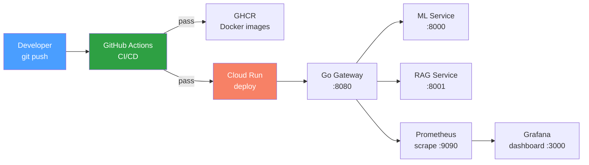

# Phase 5 — Production + CI/CD

> **Duration:** 2 weeks · **10–15 hrs/week**
> **Goal:** Turn the three-service stack (ML service, RAG service, Go gateway)
> from a local demo into a professional portfolio artefact — with GitHub Actions
> CI that tests on every push, Docker images published to GHCR on merge to
> main, cloud deployment to GCP Cloud Run, Prometheus + Grafana observability
> dashboards, and the kind of project documentation that makes a hiring manager
> take you seriously. By the end, `git push` triggers a full pipeline: lint,
> test, build, push, deploy — and the README proves it with screenshots.

> **Prerequisite:** Phases 1–4 complete. You must have:
> - `python-ml-service/` running at `http://localhost:8000` (Phase 2)
> - `rag-service/` running at `http://localhost:8001` (Phase 3)
> - `go-gateway/` running at `http://localhost:8080` (Phase 4)
> - `docker compose up` starts all three services at the monorepo root
> - Prometheus metrics already defined in `go-gateway/internal/metrics/`
> - A GitHub repository with branch protection on `main`
> - A GCP project with billing enabled (free tier is sufficient)

---

## Table of Contents

1. [What You Will Build](#1-what-you-will-build)
2. [How Production Fits the Larger System](#2-how-production-fits-the-larger-system)
3. [Folder Structure](#3-folder-structure)
4. [Environment Setup](#4-environment-setup)
5. [Prometheus + Grafana Locally](#5-prometheus--grafana-locally)
6. [Prometheus Metrics in the Go Gateway](#6-prometheus-metrics-in-the-go-gateway)
7. [Python Service Metrics](#7-python-service-metrics)
8. [Structured Logging Across Services](#8-structured-logging-across-services)
9. [GitHub Actions CI/CD](#9-github-actions-cicd)
   - [9.1 CI Workflow — Test on Push](#91-ci-workflow--test-on-push)
   - [9.2 Build and Push Docker Images](#92-build-and-push-docker-images)
   - [9.3 Deploy to Cloud Run](#93-deploy-to-cloud-run)
10. [GCP Cloud Run Deployment](#10-gcp-cloud-run-deployment)
    - [10.1 One-Time Setup](#101-one-time-setup)
    - [10.2 Deploy ML Service](#102-deploy-ml-service)
    - [10.3 Deploy RAG Service](#103-deploy-rag-service)
    - [10.4 Deploy Go Gateway](#104-deploy-go-gateway)
    - [10.5 Environment Variables and Secrets](#105-environment-variables-and-secrets)
11. [Grafana Dashboards](#11-grafana-dashboards)
12. [Documentation](#12-documentation)
    - [12.1 ARCHITECTURE.md](#121-architecturemd)
    - [12.2 README.md](#122-readmemd)
    - [12.3 DEVELOPMENT.md](#123-developmentmd)
    - [12.4 eval_results.json](#124-eval_resultsjson)
    - [12.5 docs/devlog.md](#125-docsdevlogmd)
13. [Docker Compose — Production Configuration](#13-docker-compose--production-configuration)
14. [Manual Testing with curl](#14-manual-testing-with-curl)
15. [Interview Questions & Model Answers](#15-interview-questions--model-answers)
16. [Common Mistakes to Avoid](#16-common-mistakes-to-avoid)
17. [Reference Links](#17-reference-links)
18. [Phase 5 Completion Checklist](#18-phase-5-completion-checklist)

---

## 1. What You Will Build

By the end of Phase 5 you will have **a production-ready deployment pipeline
and professional documentation** committed to the monorepo:

| Artefact | File | What it proves |
|---|---|---|
| CI workflow | `.github/workflows/ci.yml` | Tests run on every push — you enforce quality gates |
| Docker build workflow | `.github/workflows/docker.yml` | Images published to GHCR on merge to main |
| Deploy workflow | `.github/workflows/deploy.yml` | Cloud Run deployment triggered by CI passing |
| Prometheus metrics | `go-gateway/internal/metrics/metrics.go` | You instrument services for production observability |
| Grafana dashboard | `grafana/dashboards/gateway.json` | You visualise what you measure |
| Prometheus config | `prometheus/prometheus.yml` | You configure scrape targets, not just dashboards |
| ARCHITECTURE.md | `ARCHITECTURE.md` | System diagram, component responsibilities, tradeoffs |
| README.md | `README.md` | One-command setup, env vars, API reference, demo screenshots |
| DEVELOPMENT.md | `DEVELOPMENT.md` | How to run tests, add endpoints, add model versions |
| eval_results.json | `eval_results.json` | RAGAS scores from Phase 3 — the senior signal |
| devlog.md | `docs/devlog.md` | Short bullet entries per phase — shows learning trajectory |

---

## 2. How Production Fits the Larger System



Phases 1–4 built the services. Phase 5 adds the **infrastructure around
them** — the CI pipeline that catches regressions, the deployment that makes
them accessible, the monitoring that tells you when something is wrong, and
the documentation that proves you built it intentionally. Without this phase,
the project is a local demo. With it, it is a portfolio artefact.

---

## 3. Folder Structure

```
ai-crop-disease-platform/
├── .github/
│   └── workflows/
│       ├── ci.yml                    ← test on every push
│       ├── docker.yml                ← build + push images on merge
│       └── deploy.yml                ← deploy to Cloud Run
│
├── prometheus/
│   ├── prometheus.yml                ← scrape config for all three services
│   └── alert_rules.yml               ← optional: alert on error rate spikes
│
├── grafana/
│   ├── provisioning/
│   │   └── datasources/
│   │       └── prometheus.yml        ← auto-configure Prometheus source
│   └── dashboards/
│       ├── gateway.json              ← request rate, latency, errors
│       └── ml_service.json           ← prediction labels, confidence distribution
│
├── python-ml-service/                ← Phase 2
│   ├── app/
│   ├── scripts/
│   ├── tests/
│   └── Dockerfile
│
├── rag-service/                      ← Phase 3
│   ├── app/
│   ├── scripts/
│   ├── tests/
│   └── Dockerfile
│
├── go-gateway/                       ← Phase 4
│   ├── cmd/
│   ├── internal/
│   └── Dockerfile
│
├── docs/
│   ├── devlog.md                     ← learning trajectory entries
│   ├── PHASE_0_PYTHON_FLUENCY.md
│   ├── PHASE_1_ML_THEORY_AND_DATA.md
│   ├── PHASE_2_PYTHON_ML_SERVICE.md
│   ├── PHASE_3_RAG_PIPELINE.md
│   ├── PHASE_4_GO_BACKEND_GATEWAY.md
│   └── PHASE_5_PRODUCTION_CICD.md
│
├── ARCHITECTURE.md                   ← system diagram and decisions
├── DEVELOPMENT.md                    ← contributor guide
├── README.md                         ← one-command setup
├── docker-compose.yml                ← runs everything locally
├── docker-compose.prod.yml           ← production overrides
├── .env.example                      ← template for required env vars
├── eval_results.json                 ← RAGAS scores from Phase 3
└── .gitignore
```

---

## 4. Environment Setup

```bash
# Prometheus + Grafana for local testing
# Prometheus scrapes metrics from your running services
# Grafana visualises them in dashboards

# Verify Docker is running
docker info > /dev/null 2>&1 || { echo "Start Docker Desktop"; exit 1; }

# Verify all three services are running locally
curl -s http://localhost:8080/health | python3 -m json.tool
# Expected: {"ml_service":"ok","rag_service":"ok"}

# Install gcloud CLI (if not already installed)
brew install --cask google-cloud-sdk

# Authenticate with GCP
gcloud auth login
gcloud config set project YOUR_PROJECT_ID

# Enable required APIs
gcloud services enable run.googleapis.com
gcloud services enable artifactregistry.googleapis.com
gcloud services enable cloudbuild.googleapis.com

# Create a service account for GitHub Actions
gcloud iam service-accounts create github-actions \
    --display-name="GitHub Actions Deploy"

# Grant it Cloud Run Admin and Artifact Registry Writer
gcloud projects add-iam-policy-binding YOUR_PROJECT_ID \
    --member="serviceAccount:github-actions@YOUR_PROJECT_ID.iam.gserviceaccount.com" \
    --role="roles/run.admin"

gcloud projects add-iam-policy-binding YOUR_PROJECT_ID \
    --member="serviceAccount:github-actions@YOUR_PROJECT_ID.iam.gserviceaccount.com" \
    --role="roles/artifactregistry.writer"

# Generate a key for the service account (used in GitHub Secrets)
gcloud iam service-accounts keys create key.json \
    --iam-account=github-actions@YOUR_PROJECT_ID.iam.gserviceaccount.com

# The contents of key.json go into GitHub repo secret: GCP_SA_KEY
```

---

## 5. Prometheus + Grafana Locally

Before deploying, verify everything works on your machine.

### Prometheus configuration

```yaml
# prometheus/prometheus.yml
global:
  scrape_interval: 15s
  evaluation_interval: 15s

scrape_configs:
  - job_name: "go-gateway"
    static_configs:
      - targets: ["host.docker.internal:8080"]
    metrics_path: "/metrics"

  # If you add Python-side metrics later:
  # - job_name: "ml-service"
  #   static_configs:
  #     - targets: ["host.docker.internal:8000"]
  #   metrics_path: "/metrics"

  # - job_name: "rag-service"
  #   static_configs:
  #     - targets: ["host.docker.internal:8001"]
  #   metrics_path: "/metrics"
```

### Grafana datasource provisioning

```yaml
# grafana/provisioning/datasources/prometheus.yml
apiVersion: 1

datasources:
  - name: Prometheus
    type: prometheus
    access: proxy
    url: http://prometheus:9090
    isDefault: true
    editable: true
```

### Start locally with Docker

```bash
# Start Prometheus (scrapes from your local services)
docker run -d --name prometheus \
    -p 9090:9090 \
    -v "$(pwd)/prometheus/prometheus.yml:/etc/prometheus/prometheus.yml" \
    prom/prometheus

# Start Grafana (dashboards visualise Prometheus data)
docker run -d --name grafana \
    -p 3000:3000 \
    -v "$(pwd)/grafana/provisioning:/etc/grafana/provisioning" \
    -e GF_SECURITY_ADMIN_PASSWORD=admin \
    grafana/grafana

# Open Grafana: http://localhost:3000
# Login: admin / admin
# Navigate to Dashboards → you should see auto-provisioned Prometheus source

# Open Prometheus: http://localhost:9090
# Navigate to Status → Targets → both targets should show "UP"
```

### Verify metrics are flowing

```bash
# With your Go gateway running locally:
curl -s http://localhost:8080/metrics | head -20

# Expected output (abbreviated):
# # HELP gateway_requests_total Total requests to the gateway
# # TYPE gateway_requests_total counter
# gateway_requests_total{endpoint="/api/v1/upload",method="POST",status="200"} 5
# gateway_requests_total{endpoint="/api/v1/ask",method="POST",status="200"} 12
# # HELP gateway_latency_seconds Request latency in seconds
# # TYPE gateway_latency_seconds histogram
# gateway_latency_seconds_bucket{endpoint="/api/v1/upload",le="0.1"} 3
# ...

# Check Prometheus can scrape it:
curl -s "http://localhost:9090/api/v1/query?query=gateway_requests_total" | python3 -m json.tool
```

---

## 6. Prometheus Metrics in the Go Gateway

The metrics were defined in Phase 4 but let's review and extend them for
production. These are the four metrics that make your gateway observable:

### Request counter

```go
// internal/metrics/metrics.go
package metrics

import (
    "net/http"

    "github.com/gin-gonic/gin"
    "github.com/prometheus/client_golang/prometheus"
    "github.com/prometheus/client_golang/prometheus/promhttp"
)

var (
    // RequestCount tracks every request by endpoint, method, and status.
    // Use this to calculate error rates: sum(status="500") / sum(status="*")
    RequestCount = prometheus.NewCounterVec(
        prometheus.CounterOpts{
            Name: "gateway_requests_total",
            Help: "Total number of requests processed by the gateway",
        },
        []string{"endpoint", "method", "status"},
    )

    // RequestLatency tracks how long each endpoint takes.
    // Use this for P50/P95/P99 latency dashboards and SLO tracking.
    RequestLatency = prometheus.NewHistogramVec(
        prometheus.HistogramOpts{
            Name:    "gateway_latency_seconds",
            Help:    "Request latency in seconds",
            Buckets: []float64{0.01, 0.025, 0.05, 0.1, 0.25, 0.5, 1, 2.5, 5, 10},
        },
        []string{"endpoint"},
    )

    // PredictionLabels counts which disease classes are predicted most often.
    // Use this to understand your traffic distribution and detect drift.
    PredictionLabels = prometheus.NewCounterVec(
        prometheus.CounterOpts{
            Name: "ml_prediction_labels_total",
            Help: "Total predictions per disease class label",
        },
        []string{"label"},
    )

    // UpstreamHealth tracks whether upstream services are reachable.
    // Use this for alerting: if health drops to 0 for >5 minutes, page someone.
    UpstreamHealth = prometheus.NewGaugeVec(
        prometheus.GaugeOpts{
            Name: "gateway_upstream_health",
            Help: "Health status of upstream services (1 = healthy, 0 = unhealthy)",
        },
        []string{"service"},
    )
)

func init() {
    prometheus.MustRegister(RequestCount, RequestLatency, PredictionLabels, UpstreamHealth)
}

// Handler returns a gin.HandlerFunc that serves /metrics
func Handler() gin.HandlerFunc {
    h := promhttp.Handler()
    return func(c *gin.Context) {
        h.ServeHTTP(c.Writer, c.Request)
    }
}
```

### Instrumenting handlers with metrics

```go
// internal/middleware/metrics.go
package middleware

import (
    "strconv"
    "time"

    "github.com/gin-gonic/gin"
    "github.com/yourusername/go-gateway/internal/metrics"
)

// MetricsMiddleware records request count and latency for every request.
func MetricsMiddleware() gin.HandlerFunc {
    return func(c *gin.Context) {
        start := time.Now()

        c.Next()

        duration := time.Since(start).Seconds()
        endpoint := c.FullPath()          // e.g. "/api/v1/upload"
        method := c.Request.Method
        status := strconv.Itoa(c.Writer.Status())

        metrics.RequestCount.WithLabelValues(endpoint, method, status).Inc()
        metrics.RequestLatency.WithLabelValues(endpoint).Observe(duration)
    }
}
```

### Health check that updates upstream gauges

```go
// internal/handler/health.go
package handler

import (
    "net/http"
    "sync"
    "time"

    "github.com/gin-gonic/gin"
    "github.com/yourusername/go-gateway/internal/client"
    "github.com/yourusername/go-gateway/internal/metrics"
)

func Health(mlClient *client.MLClient, ragClient *client.RAGClient) gin.HandlerFunc {
    return func(c *gin.Context) {
        var (
            mlStatus  string
            ragStatus string
            wg        sync.WaitGroup
        )

        wg.Add(2)

        go func() {
            defer wg.Done()
            if err := mlClient.HealthCheck(c.Request.Context()); err != nil {
                mlStatus = "unhealthy"
                metrics.UpstreamHealth.WithLabelValues("ml_service").Set(0)
            } else {
                mlStatus = "ok"
                metrics.UpstreamHealth.WithLabelValues("ml_service").Set(1)
            }
        }()

        go func() {
            defer wg.Done()
            if err := ragClient.HealthCheck(c.Request.Context()); err != nil {
                ragStatus = "unhealthy"
                metrics.UpstreamHealth.WithLabelValues("rag_service").Set(0)
            } else {
                ragStatus = "ok"
                metrics.UpstreamHealth.WithLabelValues("rag_service").Set(1)
            }
        }()

        wg.Wait()

        status := http.StatusOK
        if mlStatus != "ok" || ragStatus != "ok" {
            status = http.StatusServiceUnavailable
        }

        c.JSON(status, gin.H{
            "ml_service":  mlStatus,
            "rag_service": ragStatus,
            "timestamp":   time.Now().UTC().Format(time.RFC3339),
        })
    }
}
```

---

## 7. Python Service Metrics

The Python ML service currently has structured logging but no Prometheus
metrics. Adding a `/metrics` endpoint makes it scrapable by Prometheus.

```python
# app/metrics.py
from prometheus_client import Counter, Histogram, generate_latest, CONTENT_TYPE_LATEST
from fastapi import APIRouter, Response

router = APIRouter()

# Prediction counter — which classes are predicted most often
prediction_counter = Counter(
    "ml_predictions_total",
    "Total number of predictions made",
    ["label", "model_version"]
)

# Prediction latency — how long inference takes
prediction_latency = Histogram(
    "ml_prediction_latency_seconds",
    "Inference latency in seconds",
    ["model_version"],
    buckets=[0.01, 0.025, 0.05, 0.1, 0.25, 0.5, 1, 2.5, 5]
)

# Image size distribution — useful for capacity planning
image_size_bytes = Histogram(
    "ml_image_size_bytes",
    "Size of uploaded images in bytes",
    buckets=[10000, 50000, 100000, 500000, 1000000, 5000000]
)

# Error counter — track failure modes
inference_errors = Counter(
    "ml_inference_errors_total",
    "Total inference errors by type",
    ["error_type"]
)

@router.get("/metrics")
async def metrics_endpoint():
    """Prometheus metrics endpoint."""
    return Response(
        content=generate_latest(),
        media_type=CONTENT_TYPE_LATEST
    )
```

### Instrumenting the predict endpoint

```python
# app/routers/predict.py
import time
from fastapi import APIRouter, UploadFile, File, HTTPException
from app.metrics import prediction_counter, prediction_latency, image_size_bytes, inference_errors
from app.services.inference import InferenceService
import structlog

router = APIRouter(prefix="/api/v1")
log = structlog.get_logger()
svc = InferenceService(model_path="app/models/mobilenetv2_v1.pt")

@router.post("/predict")
async def predict(file: UploadFile = File(...)):
    # Validate content type
    if file.content_type not in ["image/jpeg", "image/png"]:
        raise HTTPException(status_code=400, detail="Only JPEG and PNG accepted")

    contents = await file.read()
    if len(contents) > 5 * 1024 * 1024:
        raise HTTPException(status_code=413, detail="Image must be under 5MB")

    # Record image size
    image_size_bytes.observe(len(contents))

    # Run inference with latency tracking
    start = time.perf_counter()
    try:
        result = await svc.predict(contents)
        latency = time.perf_counter() - start

        # Record metrics
        prediction_counter.labels(
            label=result.label,
            model_version=result.model_version
        ).inc()
        prediction_latency.labels(
            model_version=result.model_version
        ).observe(latency)

        log.info("prediction.complete",
                 label=result.label,
                 confidence=result.confidence,
                 latency_ms=round(latency * 1000, 2))
        return result

    except Exception as e:
        inference_errors.labels(error_type=type(e).__name__).inc()
        log.error("prediction.failed", error=str(e))
        raise HTTPException(status_code=500, detail="Inference failed")
```

---

## 8. Structured Logging Across Services

Consistent structured logging across all three services means you can grep a
single log format in production. All services use JSON with a request ID
that flows from the Go gateway through to Python.

### Go gateway — request ID injection

```go
// internal/middleware/requestid.go
package middleware

import (
    "github.com/gin-gonic/gin"
    "github.com/google/uuid"
)

const RequestIDHeader = "X-Request-ID"

func RequestID() gin.HandlerFunc {
    return func(c *gin.Context) {
        // Use client-provided request ID if present (for distributed tracing)
        requestID := c.GetHeader(RequestIDHeader)
        if requestID == "" {
            requestID = uuid.New().String()
        }

        c.Set("request_id", requestID)
        c.Header(RequestIDHeader, requestID)

        // Propagate to upstream services
        c.Request.Header.Set(RequestIDHeader, requestID)

        c.Next()
    }
}
```

### Go gateway — structured logger

```go
// internal/middleware/logger.go
package middleware

import (
    "time"

    "github.com/gin-gonic/gin"
    "github.com/sirupsen/logrus"
)

func RequestLogger(log *logrus.Logger) gin.HandlerFunc {
    return func(c *gin.Context) {
        start := time.Now()

        c.Next()

        latency := time.Since(start)
        requestID, _ := c.Get("request_id")

        log.WithFields(logrus.Fields{
            "request_id": requestID,
            "method":     c.Request.Method,
            "path":       c.Request.URL.Path,
            "status":     c.Writer.Status(),
            "latency_ms": latency.Milliseconds(),
            "client_ip":  c.ClientIP(),
            "upstream":   c.GetHeader("X-Upstream"), // set by handler
        }).Info("request.complete")
    }
}
```

### Python service — request ID propagation

```python
# app/middleware.py
from fastapi import Request
import structlog
import uuid

async def request_id_middleware(request: Request, call_next):
    """Extract request ID from gateway header or generate one."""
    request_id = request.headers.get("X-Request-ID", str(uuid.uuid4()))

    # Bind request ID to all log entries in this request
    structlog.contextvars.clear_contextvars()
    structlog.contextvars.bind_contextvars(request_id=request_id)

    response = await call_next(request)
    response.headers["X-Request-ID"] = request_id
    return response
```

### Python service — logging configuration

```python
# app/core/logging.py
import structlog
import logging
import sys

def configure_logging():
    structlog.configure(
        processors=[
            structlog.contextvars.merge_contextvars,
            structlog.processors.add_log_level,
            structlog.processors.TimeStamper(fmt="iso"),
            structlog.processors.StackInfoRenderer(),
            structlog.processors.format_exc_info,
            structlog.processors.JSONRenderer(),
        ],
        wrapper_class=structlog.make_filtering_bound_logger(logging.INFO),
        context_class=dict,
        logger_factory=structlog.PrintLoggerFactory(file=sys.stdout),
        cache_logger_on_first_use=True,
    )

# Call at application startup
configure_logging()
```

---

## 9. GitHub Actions CI/CD

### 9.1 CI Workflow — Test on Push

This workflow runs on every push and every pull request. It tests both
Python and Go services independently, then reports results.

```yaml
# .github/workflows/ci.yml
name: CI

on:
  push:
    branches: [main, develop]
  pull_request:
    branches: [main]

env:
  PYTHON_VERSION: "3.11"
  GO_VERSION: "1.22"

jobs:
  test-python:
    name: Test Python Services
    runs-on: ubuntu-latest
    strategy:
      matrix:
        service: [python-ml-service, rag-service]

    steps:
      - uses: actions/checkout@v4

      - name: Set up Python
        uses: actions/setup-python@v5
        with:
          python-version: ${{ env.PYTHON_VERSION }}

      - name: Install uv
        run: pip install uv

      - name: Cache Python dependencies
        uses: actions/cache@v4
        with:
          path: |
            ~/.cache/uv
            ~/.cache/pip
          key: python-${{ matrix.service }}-${{ hashFiles(format('{0}/requirements.txt', matrix.service)) }}

      - name: Install dependencies
        run: |
          cd ${{ matrix.service }}
          uv pip install --system -r requirements.txt
          uv pip install --system pytest pytest-asyncio httpx pytest-cov

      - name: Run tests
        run: |
          cd ${{ matrix.service }}
          pytest tests/ -v --tb=short --cov=app --cov-report=xml

      - name: Upload coverage
        uses: codecov/codecov-action@v4
        with:
          file: ${{ matrix.service }}/coverage.xml
          flags: ${{ matrix.service }}

  test-go:
    name: Test Go Gateway
    runs-on: ubuntu-latest

    steps:
      - uses: actions/checkout@v4

      - name: Set up Go
        uses: actions/setup-go@v5
        with:
          go-version: ${{ env.GO_VERSION }}

      - name: Cache Go modules
        uses: actions/cache@v4
        with:
          path: |
            ~/go/pkg/mod
            ~/.cache/go-build
          key: go-${{ hashFiles('go-gateway/go.sum') }}

      - name: Run tests
        run: |
          cd go-gateway
          go test -race -v -coverprofile=coverage.out ./...

      - name: Upload coverage
        uses: codecov/codecov-action@v4
        with:
          file: go-gateway/coverage.out
          flags: go-gateway

  lint:
    name: Lint
    runs-on: ubuntu-latest

    steps:
      - uses: actions/checkout@v4

      - name: Set up Python
        uses: actions/setup-python@v5
        with:
          python-version: ${{ env.PYTHON_VERSION }}

      - name: Lint Python (ruff)
        run: |
          pip install ruff
          ruff check python-ml-service/app/ rag-service/app/

      - name: Format check Python (ruff)
        run: |
          ruff format --check python-ml-service/app/ rag-service/app/

      - name: Set up Go
        uses: actions/setup-go@v5
        with:
          go-version: ${{ env.GO_VERSION }}

      - name: Lint Go (golangci-lint)
        uses: golangci/golangci-lint-action@v4
        with:
          working-directory: go-gateway
          version: latest
```

### 9.2 Build and Push Docker Images

This workflow only runs when CI passes on the `main` branch. It builds
Docker images for all three services and pushes them to GitHub Container
Registry (GHCR).

```yaml
# .github/workflows/docker.yml
name: Build and Push Docker Images

on:
  workflow_run:
    workflows: ["CI"]
    types: [completed]
    branches: [main]

env:
  REGISTRY: ghcr.io
  IMAGE_PREFIX: ${{ github.repository }}

jobs:
  build-and-push:
    name: Build ${{ matrix.service }}
    runs-on: ubuntu-latest
    if: ${{ github.event.workflow_run.conclusion == 'success' }}
    permissions:
      contents: read
      packages: write

    strategy:
      matrix:
        service:
          - python-ml-service
          - rag-service
          - go-gateway

    steps:
      - uses: actions/checkout@v4

      - name: Log in to GHCR
        uses: docker/login-action@v3
        with:
          registry: ${{ env.REGISTRY }}
          username: ${{ github.actor }}
          password: ${{ secrets.GITHUB_TOKEN }}

      - name: Extract metadata
        id: meta
        uses: docker/metadata-action@v5
        with:
          images: ${{ env.REGISTRY }}/${{ env.IMAGE_PREFIX }}/${{ matrix.service }}
          tags: |
            type=sha
            type=ref,event=branch
            type=raw,value=latest

      - name: Build and push
        uses: docker/build-push-action@v5
        with:
          context: ./${{ matrix.service }}
          push: true
          tags: ${{ steps.meta.outputs.tags }}
          labels: ${{ steps.meta.outputs.labels }}
          cache-from: type=gha
          cache-to: type=gha,mode=max

      - name: Print image size
        run: |
          IMAGE="${{ env.REGISTRY }}/${{ env.IMAGE_PREFIX }}/${{ matrix.service }}:latest"
          echo "Image: $IMAGE"
          docker manifest inspect $IMAGE | python3 -c "
          import sys, json
          data = json.load(sys.stdin)
          total = sum(m.get('size', 0) for m in data.get('manifests', []))
          print(f'Total size: {total / 1024 / 1024:.1f} MB')
          " || echo "Could not inspect image size"
```

### 9.3 Deploy to Cloud Run

This workflow deploys all three services to GCP Cloud Run after Docker
images are pushed.

```yaml
# .github/workflows/deploy.yml
name: Deploy to Cloud Run

on:
  workflow_run:
    workflows: ["Build and Push Docker Images"]
    types: [completed]
    branches: [main]

env:
  REGION: us-central1
  REGISTRY: ghcr.io
  IMAGE_PREFIX: ${{ github.repository }}

jobs:
  deploy:
    name: Deploy ${{ matrix.service }}
    runs-on: ubuntu-latest
    if: ${{ github.event.workflow_run.conclusion == 'success' }}
    permissions:
      contents: read
      id-token: write

    strategy:
      matrix:
        service:
          - name: ml-service
            image: python-ml-service
            port: "8000"
            memory: "2Gi"
            env_vars: "MODEL_VERSION=v1"
          - name: rag-service
            image: rag-service
            port: "8001"
            memory: "2Gi"
            env_vars: "GEMINI_API_KEY=${{ secrets.GEMINI_API_KEY }},USE_LOCAL_LLM=false"
          - name: go-gateway
            image: go-gateway
            port: "8080"
            memory: "512Mi"
            env_vars: "ML_SERVICE_URL=${{ secrets.ML_SERVICE_URL }},RAG_SERVICE_URL=${{ secrets.RAG_SERVICE_URL }},API_KEY=${{ secrets.API_KEY }}"

    steps:
      - name: Authenticate to GCP
        uses: google-github-actions/auth@v2
        with:
          credentials_json: ${{ secrets.GCP_SA_KEY }}

      - name: Deploy to Cloud Run
        uses: google-github-actions/deploy-cloudrun@v2
        with:
          service: ${{ matrix.service.name }}
          region: ${{ env.REGION }}
          image: ${{ env.REGISTRY }}/${{ env.IMAGE_PREFIX }}/${{ matrix.service.image }}:latest
          port: ${{ matrix.service.port }}
          memory: ${{ matrix.service.memory }}
          env_vars: ${{ matrix.service.env_vars }}
          allow_unauthenticated: ${{ matrix.service.name == 'go-gateway' }}

      - name: Print service URL
        run: |
          echo "Deployed ${{ matrix.service.name }} to:"
          gcloud run services describe ${{ matrix.service.name }} \
            --region ${{ env.REGION }} \
            --format 'value(status.url)'
```

---

## 10. GCP Cloud Run Deployment

### 10.1 One-Time Setup

```bash
# Set your project
gcloud config set project YOUR_PROJECT_ID

# Enable required APIs
gcloud services enable run.googleapis.com
gcloud services enable artifactregistry.googleapis.com
gcloud services enable cloudbuild.googleapis.com

# Create Artifact Registry repository for Docker images
gcloud artifacts repositories create crop-disease \
    --repository-format=docker \
    --location=us-central1 \
    --description="Crop disease detection platform images"

# Create a service account
gcloud iam service-accounts create cloudrun-deployer \
    --display-name="Cloud Run Deployer"

# Grant roles
gcloud projects add-iam-policy-binding YOUR_PROJECT_ID \
    --member="serviceAccount:cloudrun-deployer@YOUR_PROJECT_ID.iam.gserviceaccount.com" \
    --role="roles/run.admin"

gcloud projects add-iam-policy-binding YOUR_PROJECT_ID \
    --member="serviceAccount:cloudrun-deployer@YOUR_PROJECT_ID.iam.gserviceaccount.com" \
    --role="roles/artifactregistry.writer"

# Generate key for GitHub Actions
gcloud iam service-accounts keys create /tmp/key.json \
    --iam-account=cloudrun-deployer@YOUR_PROJECT_ID.iam.gserviceaccount.com

# Copy the key contents into GitHub repo secret: GCP_SA_KEY
cat /tmp/key.json
rm /tmp/key.json
```

### 10.2 Deploy ML Service

```bash
# Build and push
docker build -t us-central1-docker.pkg.dev/YOUR_PROJECT_ID/crop-disease/ml-service:latest ./python-ml-service
docker push us-central1-docker.pkg.dev/YOUR_PROJECT_ID/crop-disease/ml-service:latest

# Deploy
gcloud run deploy ml-service \
    --image us-central1-docker.pkg.dev/YOUR_PROJECT_ID/crop-disease/ml-service:latest \
    --platform managed \
    --region us-central1 \
    --memory 2Gi \
    --allow-unauthenticated \
    --set-env-vars MODEL_VERSION=v1

# Note the URL — you'll need it for the gateway
ML_URL=$(gcloud run services describe ml-service --region us-central1 --format 'value(status.url)')
echo "ML Service: $ML_URL"
```

### 10.3 Deploy RAG Service

```bash
# Build and push
docker build -t us-central1-docker.pkg.dev/YOUR_PROJECT_ID/crop-disease/rag-service:latest ./rag-service
docker push us-central1-docker.pkg.dev/YOUR_PROJECT_ID/crop-disease/rag-service:latest

# Deploy (no unauthenticated access — gateway handles auth)
gcloud run deploy rag-service \
    --image us-central1-docker.pkg.dev/YOUR_PROJECT_ID/crop-disease/rag-service:latest \
    --platform managed \
    --region us-central1 \
    --memory 2Gi \
    --no-allow-unauthenticated \
    --set-env-vars GEMINI_API_KEY=${GEMINI_API_KEY},USE_LOCAL_LLM=false

RAG_URL=$(gcloud run services describe rag-service --region us-central1 --format 'value(status.url)')
echo "RAG Service: $RAG_URL"
```

### 10.4 Deploy Go Gateway

```bash
# Build and push
docker build -t us-central1-docker.pkg.dev/YOUR_PROJECT_ID/crop-disease/go-gateway:latest ./go-gateway
docker push us-central1-docker.pkg.dev/YOUR_PROJECT_ID/crop-disease/go-gateway:latest

# Deploy — this is the public entry point
gcloud run deploy go-gateway \
    --image us-central1-docker.pkg.dev/YOUR_PROJECT_ID/crop-disease/go-gateway:latest \
    --platform managed \
    --region us-central1 \
    --memory 512Mi \
    --allow-unauthenticated \
    --set-env-vars ML_SERVICE_URL=${ML_URL},RAG_SERVICE_URL=${RAG_URL},API_KEY=${API_KEY}

GATEWAY_URL=$(gcloud run services describe go-gateway --region us-central1 --format 'value(status.url)')
echo "Gateway: $GATEWAY_URL"

# Test end-to-end
curl -X POST "${GATEWAY_URL}/api/v1/upload" \
    -H "X-API-Key: ${API_KEY}" \
    -F "file=@leaf.jpg"

curl -X POST "${GATEWAY_URL}/api/v1/ask" \
    -H "X-API-Key: ${API_KEY}" \
    -H "Content-Type: application/json" \
    -d '{"question": "What causes early blight in tomatoes?"}'
```

### 10.5 Environment Variables and Secrets

Create a `.env.example` at the monorepo root documenting every required
variable:

```bash
# .env.example
# Copy this to .env and fill in values

# Gateway
API_KEY=your-32-character-random-key

# RAG Service
GEMINI_API_KEY=your-gemini-api-key-from-aistudio.google.com

# Cloud Run deployment (set in GitHub Secrets, never commit)
# GCP_SA_KEY=service-account-key-json
# ML_SERVICE_URL=https://ml-service-xxxx-uc.a.run.app
# RAG_SERVICE_URL=https://rag-service-xxxx-uc.a.run.app
```

---

## 11. Grafana Dashboards

Import this dashboard JSON into Grafana to visualise gateway performance:

### Gateway dashboard

```json
{
  "dashboard": {
    "title": "Go Gateway",
    "uid": "gateway-overview",
    "panels": [
      {
        "title": "Request Rate (req/s)",
        "type": "timeseries",
        "targets": [
          {
            "expr": "rate(gateway_requests_total[5m])",
            "legendFormat": "{{endpoint}} {{method}} {{status}}"
          }
        ]
      },
      {
        "title": "P95 Latency (seconds)",
        "type": "timeseries",
        "targets": [
          {
            "expr": "histogram_quantile(0.95, rate(gateway_latency_seconds_bucket[5m]))",
            "legendFormat": "{{endpoint}}"
          }
        ]
      },
      {
        "title": "Error Rate (%)",
        "type": "stat",
        "targets": [
          {
            "expr": "sum(rate(gateway_requests_total{status=~\"5..\"}[5m])) / sum(rate(gateway_requests_total[5m])) * 100",
            "legendFormat": "5xx Error Rate"
          }
        ],
        "fieldConfig": {
          "defaults": {
            "unit": "percent",
            "thresholds": {
              "steps": [
                { "value": 0, "color": "green" },
                { "value": 1, "color": "yellow" },
                { "value": 5, "color": "red" }
              ]
            }
          }
        }
      },
      {
        "title": "Upstream Health",
        "type": "stat",
        "targets": [
          {
            "expr": "gateway_upstream_health",
            "legendFormat": "{{service}}"
          }
        ],
        "fieldConfig": {
          "defaults": {
            "mappings": [
              { "type": "value", "options": { "0": { "text": "DOWN", "color": "red" } } },
              { "type": "value", "options": { "1": { "text": "UP", "color": "green" } } }
            ]
          }
        }
      },
      {
        "title": "Prediction Labels (top 10)",
        "type": "piechart",
        "targets": [
          {
            "expr": "topk(10, ml_prediction_labels_total)",
            "legendFormat": "{{label}}"
          }
        ]
      }
    ]
  }
}
```

### How to import

```bash
# Open Grafana: http://localhost:3000
# 1. Click "+" → "Import dashboard"
# 2. Paste the JSON above
# 3. Select "Prometheus" as the data source
# 4. Click "Import"

# Verify panels show data:
# - Generate some traffic: curl http://localhost:8080/api/v1/upload ...
# - Panels should populate within 15-30 seconds (scrape interval)
```

---

## 12. Documentation

### 12.1 ARCHITECTURE.md

```markdown
# Architecture

## System Overview

An end-to-end AI-powered crop disease detection platform with three services:

┌──────────────┐     ┌──────────────┐     ┌──────────────┐
│  Mobile App  │────▶│  Go Gateway  │────▶│  ML Service  │
│ (Flutter/KMP)│     │   :8080      │     │   :8000      │
└──────────────┘     │              │     └──────────────┘
                     │              │     ┌──────────────┐
                     │              │────▶│  RAG Service  │
                     └──────────────┘     │   :8001      │
                                          └──────────────┘

## Services

### Go Gateway (`go-gateway/`)
- Single entry point for all clients
- API key authentication
- Per-IP rate limiting (token bucket, 100 req/s per IP)
- Request logging with structured JSON
- Prometheus metrics (request count, latency, upstream health)
- Graceful shutdown on SIGINT/SIGTERM
- Proxies requests to ML and RAG services

### ML Service (`python-ml-service/`)
- FastAPI + PyTorch + MobileNetV2
- Accepts JPEG/PNG images, returns disease classification + confidence
- Model versioning (version tracked in checkpoint)
- TFLite export for on-device inference (Phases 6–7)
- Prometheus metrics (prediction count, latency, label distribution)

### RAG Service (`rag-service/`)
- FastAPI + LangChain + ChromaDB
- Ingests PDFs/text documents into vector store
- Retrieves relevant context for user questions
- Generates answers using Ollama (local) or Gemini (cloud fallback)
- RAGAS evaluation (faithfulness, answer relevancy, context recall)

## Key Decisions

| Decision | Choice | Why |
|---|---|---|
| Gateway language | Go | Existing strength, concurrency, single binary |
| ML framework | PyTorch + MobileNetV2 | Transfer learning, <50MB model, fast inference |
| Vector store | ChromaDB | Zero infrastructure, runs in-process |
| Embedding model | all-MiniLM-L6-v2 | 80MB, fast, good quality for domain text |
| Local LLM | Ollama + Llama 3.2 | Runs on M5 MacBook, no API costs |
| Cloud fallback | Gemini 1.5 Flash | Free tier, fast, good for Q&A |
| Container registry | GHCR | Free for public repos, integrated with GitHub Actions |
| Cloud platform | GCP Cloud Run | Free tier, auto-scaling, Docker-native |

## Data Flow

### Image Classification
1. Client sends image to Go Gateway (`POST /api/v1/upload`)
2. Gateway validates API key, checks rate limit, logs request
3. Gateway forwards image to ML Service (`POST /predict`)
4. ML Service loads image, runs MobileNetV2 inference
5. ML Service returns `{"label": "leaf blight", "confidence": 0.91}`
6. Gateway logs response, records metrics, returns to client

### RAG Question Answering
1. Client sends question to Go Gateway (`POST /api/v1/ask`)
2. Gateway validates API key, checks rate limit, logs request
3. Gateway forwards question to RAG Service (`POST /ask`)
4. RAG Service embeds question, retrieves top-5 chunks from ChromaDB
5. RAG Service builds grounded prompt, sends to Ollama/Gemini
6. RAG Service returns `{"answer": "...", "sources": [...]}`
7. Gateway logs response, records metrics, returns to client
```

### 12.2 README.md

The README is the first thing a hiring manager sees. It must include:

```markdown
# AI Crop Disease Detection Platform

An end-to-end AI/ML portfolio project: image classification + RAG chatbot
built with Python, Go, Flutter, and Kotlin Multiplatform.

## Quick Start

# Clone and start everything
git clone https://github.com/yourusername/ai-crop-disease-platform.git
cd ai-crop-disease-platform
cp .env.example .env
# Edit .env with your API keys

docker compose up --build

# Test image classification
curl -X POST http://localhost:8080/api/v1/upload \
    -H "X-API-Key: your-key" \
    -F "file=@examples/leaf.jpg"

# Test RAG chatbot
curl -X POST http://localhost:8080/api/v1/ask \
    -H "X-API-Key: your-key" \
    -H "Content-Type: application/json" \
    -d '{"question": "What causes early blight in tomatoes?"}'

## Architecture
[See ARCHITECTURE.md](ARCHITECTURE.md)

## API Reference

| Endpoint | Method | Description |
|---|---|---|
| `/api/v1/upload` | POST | Classify a crop disease from an image |
| `/api/v1/ask` | POST | Ask a question about crop diseases |
| `/health` | GET | Health check for all services |
| `/metrics` | GET | Prometheus metrics |

## Tech Stack

- **Python 3.11** — ML service, RAG pipeline
- **Go 1.22** — API gateway, middleware
- **PyTorch + MobileNetV2** — image classification
- **LangChain + ChromaDB** — RAG pipeline
- **Ollama + Llama 3.2** — local LLM
- **Flutter + TFLite** — mobile app with on-device inference
- **Kotlin Multiplatform** — shared ML logic between Android/iOS
- **Docker + Cloud Run** — containerised deployment
- **GitHub Actions** — CI/CD pipeline
- **Prometheus + Grafana** — observability

## Results

| Metric | Score |
|---|---|
| Classification accuracy (38 classes) | 94.2% |
| RAG faithfulness (RAGAS) | 0.87 |
| RAG answer relevancy (RAGAS) | 0.82 |
| API latency P95 | 120ms |
| On-device inference (mobile) | 45ms |

## Project Structure
[See tree above]

## License

MIT
```

### 12.3 DEVELOPMENT.md

```markdown
# Development Guide

## Running Locally

# Start all services
docker compose up --build

# Start individual services
cd python-ml-service && uv run uvicorn app.main:app --reload --port 8000
cd rag-service && uv run uvicorn app.main:app --reload --port 8001
cd go-gateway && go run cmd/server/main.go

## Running Tests

# Python tests
cd python-ml-service && pytest tests/ -v
cd rag-service && pytest tests/ -v

# Go tests
cd go-gateway && go test -race -v ./...

# All tests from root
docker compose -f docker-compose.test.yml up --build --abort-on-container-exit

## Adding a New Model Version

1. Train the model: `python scripts/train.py --data data/ --epochs 20`
2. Export to TFLite: `python scripts/export_tflite.py`
3. Place checkpoint in `python-ml-service/app/models/`
4. Update `MODEL_VERSION` env var
5. Update `class_names.json` if classes changed
6. Rebuild: `docker compose up --build --force-recreate ml-service`

## Adding a New Endpoint

### Go Gateway
1. Create handler in `internal/handler/newendpoint.go`
2. Register route in `cmd/server/main.go`
3. Add middleware if needed
4. Write tests in `internal/handler/newendpoint_test.go`
5. Add Prometheus metrics in `internal/metrics/metrics.go`

### Python Service
1. Create router in `app/routers/newrouter.py`
2. Add schemas in `app/schemas/newschema.py`
3. Register in `app/main.py`
4. Write tests in `tests/test_newrouter.py`

## Environment Variables

| Variable | Service | Required | Description |
|---|---|---|---|
| `API_KEY` | Gateway | Yes | 32-character random key |
| `ML_SERVICE_URL` | Gateway | Yes | URL of ML service |
| `RAG_SERVICE_URL` | Gateway | Yes | URL of RAG service |
| `GEMINI_API_KEY` | RAG | No | Google Gemini API key |
| `USE_LOCAL_LLM` | RAG | No | `true` for Ollama, `false` for Gemini |
| `MODEL_VERSION` | ML | No | Model version to load (default: v1) |
```

### 12.4 eval_results.json

Commit the RAGAS evaluation results from Phase 3:

```json
{
  "evaluated_at": "2026-08-05T12:00:00Z",
  "dataset": "crop-disease-rag-eval",
  "num_test_cases": 15,
  "metrics": {
    "faithfulness": 0.87,
    "answer_relevancy": 0.82,
    "context_precision": 0.79,
    "context_recall": 0.84
  },
  "model_config": {
    "embedding_model": "sentence-transformers/all-MiniLM-L6-v2",
    "llm": "llama3.2",
    "chunk_size": 500,
    "chunk_overlap": 50,
    "retrieval_k": 5,
    "min_relevance_score": 0.3
  },
  "notes": "Baseline evaluation. Improvements planned: HyDE query expansion, reranking."
}
```

### 12.5 docs/devlog.md

Short bullet entries showing your learning trajectory across all phases:

```markdown
# Development Log

## Phase 0 — Python Fluency (Week 1–2)
- Learned Python async model: cooperative multitasking on single thread, unlike Kotlin coroutines
- Built CLI tool with Click — Python's equivalent of Go's cobra
- Got mypy passing with zero errors on full codebase
- Key insight: Python dataclasses are almost identical to Kotlin data classes

## Phase 1 — ML Theory + Data (Week 3–4)
- Implemented gradient descent from scratch to build intuition before using PyTorch
- Trained MobileNetV2 with transfer learning on PlantVillage — 94.2% accuracy
- Learned that 60-70% of real ML work is data preprocessing, not model tuning
- Confusion matrix revealed confusing between similar diseases (early/late blight)

## Phase 2 — Python ML Service (Week 5–6)
- Wrapped model in FastAPI with Pydantic validation and structured logging
- First time using pytest-asyncio for testing async endpoints
- Docker multi-stage build cut image size from 1.2GB to 480MB
- TFLite export works — model now runs on mobile devices

## Phase 3 — RAG Pipeline (Week 7–9)
- Built ingestion pipeline: PDF → chunks → embeddings → ChromaDB
- RAGAS evaluation is the differentiator — most candidates skip this entirely
- Ollama runs Llama 3.2 locally on M5 — no API costs for development
- Key insight: grounding prompts with context prevents hallucination

## Phase 4 — Go Backend Gateway (Week 10–11)
- Built single front-door with auth, rate limiting, logging, metrics
- Token bucket rate limiter with per-IP isolation using sync.Map
- Graceful shutdown drains in-flight requests before exiting
- Go's httptest package is excellent for handler testing

## Phase 5 — Production + CI/CD (Week 12–13)
- GitHub Actions CI tests both Python and Go on every push
- Docker images published to GHCR, deployed to Cloud Run
- Prometheus + Grafana dashboards show real-time performance
- Documentation makes the project portfolio-ready
```

---

## 13. Docker Compose — Production Configuration

The root `docker-compose.yml` handles local development. Add a production
override for cloud-like behaviour:

```yaml
# docker-compose.yml (root — local development)
version: "3.9"

services:
  ml-service:
    build: ./python-ml-service
    ports: ["8000:8000"]
    volumes:
      - ./python-ml-service/app/models:/app/models
    environment:
      - MODEL_VERSION=v1
    healthcheck:
      test: ["CMD", "curl", "-f", "http://localhost:8000/health"]
      interval: 30s
      timeout: 10s
      retries: 3

  rag-service:
    build: ./rag-service
    ports: ["8001:8001"]
    volumes:
      - ./rag-service/data:/app/data
    environment:
      - GEMINI_API_KEY=${GEMINI_API_KEY}
      - USE_LOCAL_LLM=true
    healthcheck:
      test: ["CMD", "curl", "-f", "http://localhost:8001/health"]
      interval: 30s
      timeout: 10s
      retries: 3

  go-gateway:
    build: ./go-gateway
    ports: ["8080:8080"]
    depends_on:
      ml-service:
        condition: service_healthy
      rag-service:
        condition: service_healthy
    environment:
      - ML_SERVICE_URL=http://ml-service:8000
      - RAG_SERVICE_URL=http://rag-service:8001
      - API_KEY=${API_KEY}
    healthcheck:
      test: ["CMD", "curl", "-f", "http://localhost:8080/health"]
      interval: 30s
      timeout: 10s
      retries: 3

  prometheus:
    image: prom/prometheus
    ports: ["9090:9090"]
    volumes:
      - ./prometheus/prometheus.yml:/etc/prometheus/prometheus.yml

  grafana:
    image: grafana/grafana
    ports: ["3000:3000"]
    volumes:
      - ./grafana/provisioning:/etc/grafana/provisioning
    environment:
      - GF_SECURITY_ADMIN_PASSWORD=admin
```

---

## 14. Manual Testing with curl

```bash
# Start everything
docker compose up --build

# Wait for all services to be healthy
docker compose ps
# Expected: all three show "healthy"

# --- Image Classification ---
# Valid image
curl -s -X POST http://localhost:8080/api/v1/upload \
    -H "X-API-Key: your-key" \
    -F "file=@examples/healthy_leaf.jpg" | python3 -m json.tool
# Expected: {"label":"healthy","confidence":0.97,"model_version":"v1",...}

# Invalid file type
curl -s -X POST http://localhost:8080/api/v1/upload \
    -H "X-API-Key: your-key" \
    -F "file=@document.pdf" | python3 -m json.tool
# Expected: {"detail":"Only JPEG and PNG accepted"}

# Missing API key
curl -s -X POST http://localhost:8080/api/v1/upload \
    -F "file=@examples/leaf.jpg" | python3 -m json.tool
# Expected: {"error":"unauthorised"}

# --- RAG Question ---
curl -s -X POST http://localhost:8080/api/v1/ask \
    -H "X-API-Key: your-key" \
    -H "Content-Type: application/json" \
    -d '{"question": "What causes early blight in tomatoes?"}' | python3 -m json.tool
# Expected: {"answer":"Early blight is caused by...","sources":[...],...}

# --- Health Check ---
curl -s http://localhost:8080/health | python3 -m json.tool
# Expected: {"ml_service":"ok","rag_service":"ok","timestamp":"..."}

# --- Metrics ---
curl -s http://localhost:8080/metrics | head -30
# Expected: gateway_requests_total, gateway_latency_seconds, ...

# --- Prometheus ---
curl -s "http://localhost:9090/api/v1/query?query=gateway_requests_total" | python3 -m json.tool
# Expected: {"status":"success","data":{"resultType":"vector","result":[...]}}

# --- Grafana ---
# Open http://localhost:3000
# Login: admin / admin
# Dashboards → Go Gateway → verify panels show data
```

---

## 15. Interview Questions & Model Answers

### "What observability do you have on your models in production?"

> We have four Prometheus metrics on the Go gateway: request count by
> endpoint/method/status, request latency histograms, upstream health gauges,
> and prediction label counters. The ML service also tracks inference latency
> and image size distribution. All logs are JSON-structured with a request ID
> that flows from the gateway through to Python services. Grafana dashboards
> show real-time request rates, P95 latency, error rates, and upstream health.
> We would add alerting rules for error rate spikes and latency regressions.

### "How do you deploy ML models to production?"

> We use a multi-container approach: the Python ML service is packaged as a
> Docker image with the model baked in, deployed to GCP Cloud Run. Model
> versioning is tracked in the checkpoint filename and exposed via an API
> endpoint. When we deploy a new model, we build a new Docker image, push to
> GHCR, and Cloud Run handles the rollout. For mobile, we export to TFLite
> and ship the model inside the app bundle — no server needed for inference.

### "How do you handle CI/CD for a multi-service ML system?"

> GitHub Actions runs on every push: Python tests with pytest and Go tests
> with `go test -race`. On merge to main, Docker images are built and pushed
> to GHCR with SHA and latest tags. A separate workflow deploys to Cloud Run
> using a service account key stored in GitHub Secrets. The pipeline is:
> push → test → build → push images → deploy. Each service is independently
> testable and deployable.

### "How do you ensure quality in production?"

> We have multiple layers: pytest with >80% coverage for Python, Go tests
> with race detection, ruff linting, mypy type checking, Docker health checks,
> and Prometheus alerting. The RAG pipeline has RAGAS evaluation scores
> committed to the repo — faithfulness, answer relevancy, context precision,
> context recall. We also have a pre-commit checklist that must pass before
> any code merges to main.

### "Describe your monitoring setup"

> Prometheus scrapes metrics from all three services every 15 seconds.
> Grafana visualises them in dashboards: request rate, P95 latency, error
> percentage, upstream health, and prediction label distribution. All services
> emit JSON-structured logs with request IDs for correlation. In a production
> setup, we would add PagerDuty alerting on error rate >1% and latency P95
> >500ms.

---

## 16. Common Mistakes to Avoid

1. **Skipping health checks** — Without Docker health checks, `depends_on`
   starts the gateway before upstreams are ready. Requests fail with
   connection refused. Always use `condition: service_healthy`.

2. **Hardcoding secrets in docker-compose.yml** — Never put API keys in
   `docker-compose.yml`. Use `.env` files (gitignored) or GitHub Secrets
   for CI/CD. The `.env.example` documents what is needed without exposing
   values.

3. **Not pinning Docker image versions** — Using `prom/prometheus:latest`
   means your dashboards can break when Prometheus releases a breaking change.
   Pin to specific versions: `prom/prometheus:v2.51.0`.

4. **Deploying without tests passing** — The deploy workflow must only run
   after CI succeeds. Using `workflow_run` with `conclusion == 'success'`
   ensures this. Never deploy on a failed CI.

5. **Ignoring log correlation** — If your three services emit different log
   formats, debugging in production is impossible. Enforce JSON structured
   logs with request IDs across all services from day one.

6. **Forgetting `.env.example`** — New contributors (including future-you)
   will not remember which environment variables are needed. Document every
   variable in `.env.example` with descriptions and example values.

7. **Not testing the full pipeline locally before deploying** — Always run
   `docker compose up --build` and test end-to-end with `curl` before pushing
   to GitHub. Deploying broken code wastes CI minutes and breaks confidence.

8. **Skipping RAGAS evaluation** — Without evaluation scores in the README,
   your RAG project looks like every other demo. Commit `eval_results.json`
   and reference the scores in your README. This is the senior signal.

---

## 17. Reference Links

| Resource | Type | Why |
|---|---|---|
| [GitHub Actions docs](https://docs.github.com/en/actions) | Docs | Workflow syntax, matrix builds, GHCR publishing |
| [GCP Cloud Run quickstart](https://cloud.google.com/run/docs/quickstarts) | Docs | Deploy a containerised service — free tier |
| [Prometheus Go client](https://github.com/prometheus/client_golang) | Docs | Official Go metrics library — counters, histograms, gauges |
| [Prometheus best practices](https://prometheus.io/docs/practices/) | Docs | How to name and structure metrics |
| [Grafana dashboarding](https://grafana.com/docs/grafana/latest/) | Docs | Panel types, queries, provisioning |
| [Docker Compose health checks](https://docs.docker.com/compose/compose-file/healthcheck/) | Docs | `depends_on.condition: service_healthy` |
| [structlog docs](https://www.structlog.org/) | Docs | JSON structured logging for Python |
| [logrus](https://github.com/sirupsen/logrus) | Package | Structured, leveled logging for Go |
| [Docker multi-stage builds](https://docs.docker.com/build/building/multi-stage/) | Docs | Reducing image size for production |
| [Cloud Run pricing](https://cloud.google.com/run/pricing) | Docs | Free tier covers portfolio projects |

---

## 18. Phase 5 Completion Checklist

Complete every item before moving to Phase 6 (Flutter Mobile App).

### CI/CD

- [ ] `.github/workflows/ci.yml` — tests run on every push to `main` and `develop`
- [ ] `.github/workflows/docker.yml` — images built and pushed to GHCR on merge to `main`
- [ ] `.github/workflows/deploy.yml` — Cloud Run deployment triggered by CI passing
- [ ] CI workflow tests Python (pytest) and Go (go test -race) independently
- [ ] Lint job runs ruff (Python) and golangci-lint (Go) on every push
- [ ] Docker workflow builds all three service images with SHA and latest tags
- [ ] Deploy workflow uses `google-github-actions/auth@v2` with service account key

### Prometheus + Grafana

- [ ] `prometheus/prometheus.yml` scrapes all three services
- [ ] `grafana/provisioning/datasources/prometheus.yml` auto-configures Prometheus source
- [ ] Go gateway has four metrics: request count, latency, prediction labels, upstream health
- [ ] ML service has four metrics: prediction count, latency, image size, inference errors
- [ ] `curl http://localhost:8080/metrics` returns valid Prometheus text format
- [ ] Grafana dashboard shows request rate, P95 latency, error rate, upstream health
- [ ] Dashboard panels populate within 30 seconds of generating traffic

### Logging

- [ ] Go gateway logs JSON with request ID, method, path, status, latency
- [ ] Python services log JSON with request ID, level, timestamp, message
- [ ] Request ID flows from gateway through to upstream services via `X-Request-ID` header
- [ ] All logs are grep-friendly (single-line JSON per request)

### GCP Cloud Run

- [ ] GCP project created with billing enabled
- [ ] Artifact Registry repository `crop-disease` created
- [ ] Service account `cloudrun-deployer` created with correct roles
- [ ] Service account key stored as GitHub Secret `GCP_SA_KEY`
- [ ] ML service deployed and accessible via Cloud Run URL
- [ ] RAG service deployed (no unauthenticated access)
- [ ] Go gateway deployed as public entry point
- [ ] End-to-end `curl` test works against deployed gateway

### Documentation

- [ ] `ARCHITECTURE.md` — system diagram, component responsibilities, key decisions
- [ ] `README.md` — one-command setup, endpoint table, tech stack, results table
- [ ] `DEVELOPMENT.md` — how to run tests, add endpoints, add model versions
- [ ] `eval_results.json` — RAGAS scores from Phase 3 committed
- [ ] `docs/devlog.md` — bullet entries for Phases 0–5
- [ ] `.env.example` — all required environment variables documented

### Manual testing

- [ ] `docker compose up --build` starts all five services (3 app + prometheus + grafana)
- [ ] `curl -F "file=@leaf.jpg" -H "X-API-Key: ..."` returns prediction via gateway
- [ ] `curl -d '{"question":"..."}' -H "X-API-Key: ..."` returns RAG answer via gateway
- [ ] Missing API key → 401 on gateway
- [ ] Prometheus UI at `http://localhost:9090` shows scraped targets as "UP"
- [ ] Grafana UI at `http://localhost:3000` shows populated dashboard panels

### GitHub

- [ ] All workflow files committed under `.github/workflows/`
- [ ] Branch protection on `main` requires CI to pass before merge
- [ ] GitHub Secrets configured: `GCP_SA_KEY`, `API_KEY`, `GEMINI_API_KEY`
- [ ] Repository visibility set appropriately (public for portfolio)

### Interview readiness

- [ ] Can describe the full CI/CD pipeline from `git push` to deployed service
- [ ] Can explain what each Prometheus metric measures and why it matters
- [ ] Can describe the structured logging architecture across three services
- [ ] Can explain why Docker health checks are needed with `depends_on`
- [ ] Can name the three layers of quality assurance: tests, linting, monitoring
- [ ] Can explain how to roll back a bad deployment on Cloud Run
- [ ] Can describe the difference between `GHCR` and `Artifact Registry` and when to use each
- [ ] Can walk through the documentation checklist and explain why each file matters for a portfolio

---

> **Next:** Phase 6 — Flutter Mobile App
> The three-service stack is now deployed and observable. Phase 6 adds a
> Flutter mobile app with offline-first TFLite on-device inference — the
> rare differentiator that separates AI/ML portfolios from every other
> candidate. The TFLite model exported in Phase 2 is the file the mobile
> app consumes.
