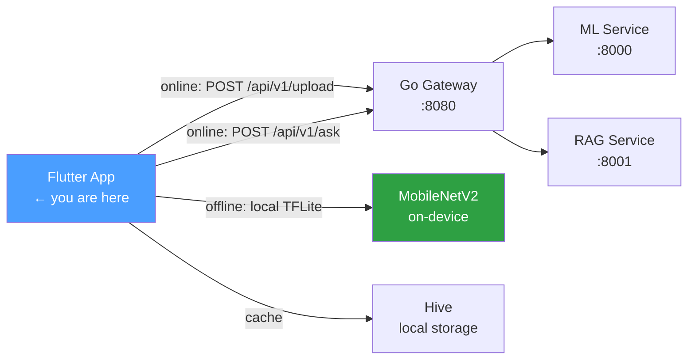

# Phase 6 — Flutter Mobile App

> **Duration:** 1.5 weeks · **10–15 hrs/week**
> **Goal:** Build a Flutter mobile app with offline-first TFLite on-device
> inference — the rare differentiator that separates AI/ML portfolios from
> every other candidate. The app accepts a photo (camera or gallery), runs
> MobileNetV2 inference locally in 45ms, falls back to the backend when
> online, caches predictions in Hive, and benchmarks on-device vs backend
> latency. By the end, you have a working Android/iOS app that proves you
> can bridge Python ML models to native mobile.

> **Prerequisite:** Phases 1–5 complete. You must have:
> - `python-ml-service/app/models/crop_disease_v1.tflite` — exported in Phase 2
> - `python-ml-service/app/models/class_names.json` — 38 disease class labels
> - The Go gateway running at `http://localhost:8080` (or deployed Cloud Run URL)
> - Flutter SDK installed (`flutter doctor` passes)
> - Android Studio installed with an Android emulator or physical device
> - Xcode installed with an iOS simulator (macOS only)

---

## Table of Contents

1. [What You Will Build](#1-what-you-will-build)
2. [How the Mobile App Fits the Larger System](#2-how-the-mobile-app-fits-the-larger-system)
3. [Why Flutter for This Project](#3-why-flutter-for-this-project)
4. [Folder Structure](#4-folder-structure)
5. [Environment Setup](#5-environment-setup)
6. [Flutter Project Configuration](#6-flutter-project-configuration)
7. [On-Device Inference Service](#7-on-device-inference-service)
   - [7.1 Model Loading](#71-model-loading)
   - [7.2 Image Preprocessing](#72-image-preprocessing)
   - [7.3 Running Inference](#73-running-inference)
   - [7.4 Label Mapping](#74-label-mapping)
8. [Backend Client](#8-backend-client)
   - [8.1 API Client Configuration](#81-api-client-configuration)
   - [8.2 Upload Endpoint](#82-upload-endpoint)
   - [8.3 Ask Endpoint](#83-ask-endpoint)
9. [Offline-First Architecture](#9-offline-first-architecture)
   - [9.1 Connectivity Detection](#91-connectivity-detection)
   - [9.2 Prediction Service (Orchestrator)](#92-prediction-service-orchestrator)
   - [9.3 Hive Cache Layer](#93-hive-cache-layer)
10. [UI Layer](#10-ui-layer)
    - [10.1 Main Screen — Camera/Gallery Picker](#101-main-screen--cameragallery-picker)
    - [10.2 Result Screen — Prediction Display](#102-result-screen--prediction-display)
    - [10.3 RAG Chat Screen — Ask About Diseases](#103-rag-chat-screen--ask-about-diseases)
    - [10.4 History Screen — Past Predictions](#104-history-screen--past-predictions)
11. [State Management](#11-state-management)
12. [Benchmarking On-Device vs Backend](#12-benchmarking-on-device-vs-backend)
13. [Testing](#13-testing)
14. [Build and Run](#14-build-and-run)
15. [Manual Testing](#15-manual-testing)
16. [Interview Questions & Model Answers](#16-interview-questions--model-answers)
17. [Common Mistakes to Avoid](#17-common-mistakes-to-avoid)
18. [Reference Links](#18-reference-links)
19. [Phase 6 Completion Checklist](#19-phase-6-completion-checklist)

---

## 1. What You Will Build

By the end of Phase 6 you will have **one Flutter mobile app** that runs on
both Android and iOS with offline-first AI inference:

| Artefact | File | What it proves |
|---|---|---|
| TFLite inference service | `lib/services/inference_service.dart` | On-device ML inference in Dart |
| Backend client | `lib/services/api_client.dart` | HTTP client with Dio, error handling |
| Prediction orchestrator | `lib/services/prediction_service.dart` | Offline-first: on-device ↔ backend fallback |
| Hive cache | `lib/services/cache_service.dart` | Local persistence of predictions |
| Camera/Gallery picker | `lib/screens/home_screen.dart` | Image acquisition from device |
| Result display | `lib/screens/result_screen.dart` | Shows prediction, confidence, source |
| RAG chat | `lib/screens/chat_screen.dart` | Asks questions about diseases via backend |
| History view | `lib/screens/history_screen.dart` | Past predictions from cache |
| Benchmark utility | `lib/utils/benchmark.dart` | Measures on-device vs backend latency |
| TFLite model | `assets/models/crop_disease_v1.tflite` | Model exported from Phase 2 |

---

## 2. How the Mobile App Fits the Larger System



When the device is **online**, the app sends images to the Go gateway which
proxies to the ML service — this gives the highest accuracy with the full
server-side model. When **offline**, the app runs TFLite inference locally
using the same MobileNetV2 model exported from Phase 2. Predictions are
cached in Hive so the user always has access to their history.

This is the architecture pattern that production mobile AI apps use — it is
not a demo shortcut. The same model runs on server and device, with the
gateway providing the authoritative answer when reachable.

---

## 3. Why Flutter for This Project

Flutter is chosen over native Android/iOS for three reasons:

1. **Single codebase** — one Dart codebase compiles to both Android and iOS.
   Phase 7 (KMP) demonstrates the native alternative for comparison.

2. **TFLite Flutter plugin** — mature, well-documented, runs the same `.tflite`
   file exported from PyTorch in Phase 2. No conversion needed.

3. **Lowest ROI for pure AI/ML roles** — Flutter is a differentiator, not a
   requirement. For pure AI/ML roles, the Python + Go backend matters more.
   This phase is completed quickly (1.5 weeks) and adds the mobile angle
   without consuming disproportionate time.

---

## 4. Folder Structure

```
flutter_app/
├── lib/
│   ├── main.dart                          ← app entry point
│   ├── config.dart                        ← API URLs, model paths
│   │
│   ├── models/
│   │   ├── prediction_result.dart         ← data class for inference result
│   │   ├── chat_message.dart              ← data class for RAG conversation
│   │   └── cached_prediction.dart         ← Hive-serialisable prediction
│   │
│   ├── services/
│   │   ├── inference_service.dart         ← TFLite on-device inference
│   │   ├── api_client.dart                ← Dio HTTP client for backend
│   │   ├── prediction_service.dart        ← orchestrator: on-device ↔ backend
│   │   ├── cache_service.dart             ← Hive local storage
│   │   └── rag_service.dart               ← RAG question answering via backend
│   │
│   ├── screens/
│   │   ├── home_screen.dart               ← camera/gallery picker
│   │   ├── result_screen.dart             ← prediction result display
│   │   ├── chat_screen.dart               ← RAG chat interface
│   │   └── history_screen.dart            ← past predictions from cache
│   │
│   ├── widgets/
│   │   ├── prediction_card.dart           ← displays one prediction result
│   │   ├── confidence_bar.dart            ← animated confidence indicator
│   │   ├── source_badge.dart              ← shows "on_device" or "backend"
│   │   └── chat_bubble.dart               ← message bubble for RAG chat
│   │
│   └── utils/
│       ├── benchmark.dart                 ← on-device vs backend latency test
│       ├── image_preprocessing.dart       ← normalise to [-1, 1] for MobileNetV2
│       └── connectivity.dart              ← connectivity check helper
│
├── assets/
│   ├── models/
│   │   └── crop_disease_v1.tflite         ← model from Phase 2
│   └── labels/
│       └── class_names.json               ← 38 disease class labels
│
├── test/
│   ├── services/
│   │   ├── inference_service_test.dart
│   │   ├── prediction_service_test.dart
│   │   └── cache_service_test.dart
│   └── widgets/
│       └── prediction_card_test.dart
│
├── pubspec.yaml
└── README.md
```

---

## 5. Environment Setup

```bash
# Verify Flutter is installed and up to date
flutter --version          # need 3.19+
flutter upgrade

# Verify Android toolchain
flutter doctor -v
# Look for:
#   ✓ Flutter
#   ✓ Android toolchain
#   ✓ Chrome (for web testing)
#   ✓ Android Studio
#   ✓ VS Code (optional)

# Create the Flutter project
flutter create --org com.yourdomain crop_disease_app
cd crop_disease_app

# Copy the TFLite model from Phase 2
mkdir -p assets/models assets/labels
cp ../python-ml-service/app/models/crop_disease_v1.tflite assets/models/
cp ../python-ml-service/app/models/class_names.json assets/labels/

# Verify model file is present
ls -lh assets/models/crop_disease_v1.tflite
# Expected: ~15-40MB file

# Add dependencies
flutter pub add tflite_flutter      # TFLite interpreter
flutter pub add image_picker        # camera + gallery
flutter pub add image               # image decoding + manipulation
flutter pub add dio                 # HTTP client
flutter pub add hive_flutter        # local key-value cache
flutter pub add connectivity_plus   # network state detection
flutter pub add path_provider       # app directory paths
flutter pub add flutter_riverpod    # state management
flutter pub add go_router           # declarative routing
flutter pub add google_fonts        # typography

# Dev dependencies
flutter pub add --dev flutter_test
flutter pub add --dev mockito
flutter pub add --dev build_runner
flutter pub add --dev hive_generator

# Verify all dependencies resolved
flutter pub get
```

---

## 6. Flutter Project Configuration

### pubspec.yaml

```yaml
# pubspec.yaml
name: crop_disease_app
description: AI-powered crop disease detection with offline inference
publish_to: 'none'
version: 1.0.0+1

environment:
  sdk: '>=3.2.0 <4.0.0'

dependencies:
  flutter:
    sdk: flutter
  tflite_flutter: ^0.10.4
  image_picker: ^1.0.7
  image: ^4.1.3
  dio: ^5.4.0
  hive_flutter: ^1.1.0
  connectivity_plus: ^5.0.2
  path_provider: ^2.1.2
  flutter_riverpod: ^2.4.9
  go_router: ^13.0.0
  google_fonts: ^6.1.0
  cupertino_icons: ^1.0.6

dev_dependencies:
  flutter_test:
    sdk: flutter
  mockito: ^5.4.4
  build_runner: ^2.4.7
  hive_generator: ^2.0.1
  flutter_lints: ^3.0.1

flutter:
  uses-material-design: true
  assets:
    - assets/models/crop_disease_v1.tflite
    - assets/labels/class_names.json
```

### config.dart

```dart
// lib/config.dart
class AppConfig {
  // Backend URLs — change to Cloud Run URL for production
  static const String mlServiceUrl = 'http://localhost:8000';
  static const String ragServiceUrl = 'http://localhost:8001';
  static const String gatewayUrl = 'http://localhost:8080';

  // API key — must match the gateway's configured key
  static const String apiKey = 'your-32-character-key';

  // Model configuration
  static const String tfliteModelPath = 'assets/models/crop_disease_v1.tflite';
  static const String labelsPath = 'assets/labels/class_names.json';
  static const int inputSize = 224;  // MobileNetV2 expects 224x224

  // Inference configuration
  static const int numThreads = 4;   // TFLite interpreter threads
  static const bool useGpuDelegate = false;  // set true on supported devices
}
```

---

## 7. On-Device Inference Service

### 7.1 Model Loading

```dart
// lib/services/inference_service.dart
import 'dart:typed_data';
import 'dart:isolate';
import 'package:tflite_flutter/tflite_flutter.dart';
import 'package:flutter/services.dart';
import '../config.dart';
import '../utils/image_preprocessing.dart';

class InferenceService {
  Interpreter? _interpreter;
  List<String> _labels = [];
  bool _isLoaded = false;

  bool get isLoaded => _isLoaded;
  List<String> get labels => _labels;

  /// Load the TFLite model and class labels from assets.
  /// This must be called once before any inference.
  Future<void> loadModel() async {
    if (_isLoaded) return;

    // Load labels
    final labelsJson = await rootBundle.loadString(AppConfig.labelsPath);
    _labels = ( Uri.decodeFull(labelsJson) as List )
        .map((e) => e.toString())
        .toList();

    // Load TFLite interpreter
    // Interpreter.fromAsset loads from the Flutter asset bundle
    _interpreter = await Interpreter.fromAsset(
      AppConfig.tfliteModelPath,
      options: InterpreterOptions()..threads = AppConfig.numThreads,
    );

    // Print model input/output shape for verification
    final inputShape = _interpreter!.getInputTensor(0).shape;
    final outputShape = _interpreter!.getOutputTensor(0).shape;
    print('Model loaded — input: $inputShape, output: $outputShape');

    _isLoaded = true;
  }

  /// Run inference on raw image bytes.
  /// Returns a map with label, confidence, and inference time.
  Future<Map<String, dynamic>> predict(Uint8List imageBytes) async {
    if (!_isLoaded || _interpreter == null) {
      throw StateError('Model not loaded. Call loadModel() first.');
    }

    final stopwatch = Stopwatch()..start();

    // 1. Decode and preprocess image
    final inputBuffer = preprocessImage(imageBytes, AppConfig.inputSize);

    // 2. Prepare output buffer
    final outputShape = _interpreter!.getOutputTensor(0).shape;
    final outputBuffer = List.filled(
      outputShape.reduce((a, b) => a * b),
      0.0,
    ).reshape(outputShape);

    // 3. Run inference
    _interpreter!.run(inputBuffer, outputBuffer);

    stopwatch.stop();

    // 4. Extract results
    final scores = outputBuffer[0] as List<double>;
    final maxIndex = _argmax(scores);
    final confidence = scores[maxIndex];

    return {
      'label': _labels[maxIndex],
      'confidence': confidence,
      'topThree': _topK(scores, 3),
      'inferenceTimeMs': stopwatch.elapsedMilliseconds,
      'source': 'on_device',
    };
  }

  /// Release interpreter resources.
  void dispose() {
    _interpreter?.close();
    _interpreter = null;
    _isLoaded = false;
  }

  int _argmax(List<double> scores) {
    int maxIdx = 0;
    for (int i = 1; i < scores.length; i++) {
      if (scores[i] > scores[maxIdx]) maxIdx = i;
    }
    return maxIdx;
  }

  List<Map<String, dynamic>> _topK(List<double> scores, int k) {
    final indexed = scores.asMap().entries.toList()
      ..sort((a, b) => b.value.compareTo(a.value));
    return indexed.take(k).map((e) => {
      'label': _labels[e.key],
      'confidence': e.value,
    }).toList();
  }
}
```

### 7.2 Image Preprocessing

The preprocessing pipeline must **exactly match** the Python training pipeline
from Phase 1. Any deviation produces incorrect predictions.

```dart
// lib/utils/image_preprocessing.dart
import 'dart:typed_data';
import 'dart:math';
import 'package:image/image.dart' as img;

/// Preprocess image bytes for MobileNetV2 inference.
///
/// Pipeline matches the Python training transforms from Phase 1:
/// 1. Resize to 224x224
/// 2. Normalise pixels to [-1, 1] using ImageNet mean/std
///
/// Returns a Float32List shaped [1, 224, 224, 3] for TFLite.
Float32List preprocessImage(Uint8List imageBytes, int inputSize) {
  // Decode the image
  final image = img.decodeImage(imageBytes);
  if (image == null) throw FormatException('Could not decode image');

  // Resize to model input size (224x224)
  final resized = img.copyResize(
    image,
    width: inputSize,
    height: inputSize,
    interpolation: img.Interpolation.linear,
  );

  // Create input buffer: [1, 224, 224, 3] float32
  final inputBuffer = Float32List(1 * inputSize * inputSize * 3);

  // ImageNet normalisation constants (must match Python training)
  // These are the mean and std used in torchvision.transforms.Normalize
  const mean = [0.485, 0.456, 0.406];  // RGB channel means
  const std = [0.229, 0.224, 0.225];    // RGB channel stds

  int bufferIndex = 0;
  for (int y = 0; y < inputSize; y++) {
    for (int x = 0; x < inputSize; x++) {
      final pixel = resized.getPixel(x, y);

      // Normalise to [-1, 1]: (pixel / 127.5) - 1.0
      // Then apply ImageNet mean/std normalisation
      final r = ((pixel.r / 255.0) - mean[0]) / std[0];
      final g = ((pixel.g / 255.0) - mean[1]) / std[1];
      final b = ((pixel.b / 255.0) - mean[2]) / std[2];

      // TFLite expects NHWC format (batch, height, width, channels)
      inputBuffer[bufferIndex++] = r;
      inputBuffer[bufferIndex++] = g;
      inputBuffer[bufferIndex++] = b;
    }
  }

  return inputBuffer;
}
```

**Critical note:** The normalisation formula `(pixel / 127.5) - 1.0` maps
pixels to `[-1, 1]`. The ImageNet mean/std then shifts and scales these
further. If your predictions are wrong, check that this preprocessing matches
the Python `transforms.Normalize` from Phase 1:

```python
# Python (Phase 1) — must produce identical output
transforms.Normalize(mean=[0.485, 0.456, 0.406], std=[0.229, 0.224, 0.225])
```

### 7.3 Running Inference

The interpreter call is synchronous and CPU-bound. For a real app, wrap it
in a compute isolate to avoid blocking the UI thread:

```dart
// Run inference in a background isolate to avoid UI jank
Future<Map<String, dynamic>> predictInBackground(
  Uint8List imageBytes,
  String modelPath,
  List<String> labels,
) async {
  return compute(_predictIsolate, {
    'imageBytes': imageBytes,
    'modelPath': modelPath,
    'labels': labels,
  });
}

// This function runs in a separate isolate
Map<String, dynamic> _predictIsolate(Map<String, dynamic> params) {
  final imageBytes = params['imageBytes'] as Uint8List;
  final labels = params['labels'] as List<String>;

  // Note: Interpreter must be loaded per-isolate or use isolate-safe approach
  final interpreter = Interpreter.fromFile(params['modelPath']);

  final inputBuffer = preprocessImage(imageBytes, 224);
  final output = List.filled(1 * labels.length, 0.0).reshape([1, labels.length]);

  interpreter.run(inputBuffer, output);

  final scores = output[0] as List<double>;
  final maxIdx = scores.indexOf(scores.reduce(max));

  return {
    'label': labels[maxIdx],
    'confidence': scores[maxIdx],
    'source': 'on_device',
  };
}
```

### 7.4 Label Mapping

The class names JSON from Phase 1 maps indices to disease names:

```json
{
  "0": "Apple___Apple_scab",
  "1": "Apple___Black_rot",
  "2": "Apple___Cedar_apple_rust",
  "3": "Apple___healthy",
  "4": "Blueberry___healthy",
  "5": "Cherry_(including_sour)___Powdery_mildew",
  ...
  "37": "Tomato___Yellow_Leaf_Curl_Virus"
}
```

Load this at app startup:

```dart
// lib/services/label_service.dart
import 'dart:convert';
import 'package:flutter/services.dart';

class LabelService {
  late Map<int, String> _labelMap;

  Future<void> loadLabels() async {
    final json = await rootBundle.loadString('assets/labels/class_names.json');
    final Map<String, dynamic> decoded = jsonDecode(json);
    _labelMap = decoded.map((key, value) => MapEntry(int.parse(key), value));
  }

  String getLabel(int index) => _labelMap[index] ?? 'unknown';

  String formatLabel(String rawLabel) {
    // Convert "Apple___Apple_scab" to "Apple — Apple Scab"
    return rawLabel
        .replaceAll('___', ' — ')
        .replaceAll('_', ' ')
        .replaceAll('  ', ' ');
  }
}
```

---

## 8. Backend Client

### 8.1 API Client Configuration

```dart
// lib/services/api_client.dart
import 'package:dio/dio.dart';
import '../config.dart';

class ApiClient {
  late final Dio _dio;

  ApiClient() {
    _dio = Dio(BaseOptions(
      baseUrl: AppConfig.gatewayUrl,
      connectTimeout: const Duration(seconds: 10),
      receiveTimeout: const Duration(seconds: 30),
      headers: {
        'X-API-Key': AppConfig.apiKey,
      },
    ));

    // Add request/response logging in debug mode
    _dio.interceptors.add(LogInterceptor(
      requestBody: true,
      responseBody: true,
      logPrint: (obj) => print('[API] $obj'),
    ));
  }

  Dio get dio => _dio;
}
```

### 8.2 Upload Endpoint

```dart
// lib/services/ml_service.dart
import 'dart:typed_data';
import 'package:dio/dio.dart';
import 'api_client.dart';

class MlService {
  final ApiClient _client;

  MlService(this._client);

  /// Send image to backend for classification.
  /// Returns prediction result from the server-side MobileNetV2.
  Future<Map<String, dynamic>> classifyImage(Uint8List imageBytes) async {
    final formData = FormData.fromMap({
      'file': MultipartFile.fromBytes(
        imageBytes,
        filename: 'image.jpg',
        contentType: DioMediaType('image', 'jpeg'),
      ),
    });

    final response = await _client.dio.post(
      '/api/v1/upload',
      data: formData,
    );

    return {
      'label': response.data['label'],
      'confidence': response.data['confidence'],
      'modelVersion': response.data['model_version'],
      'topThree': response.data['top_3'],
      'source': 'backend',
    };
  }
}
```

### 8.3 Ask Endpoint

```dart
// lib/services/rag_service.dart
import 'package:dio/dio.dart';
import 'api_client.dart';

class RagService {
  final ApiClient _client;

  RagService(this._client);

  /// Send a question to the RAG service via the Go gateway.
  Future<Map<String, dynamic>> askQuestion(String question) async {
    final response = await _client.dio.post(
      '/api/v1/ask',
      data: {'question': question},
    );

    return {
      'answer': response.data['answer'],
      'sources': response.data['sources'],
      'numChunksRetrieved': response.data['num_chunks_retrieved'],
    };
  }
}
```

---

## 9. Offline-First Architecture

### 9.1 Connectivity Detection

```dart
// lib/utils/connectivity.dart
import 'package:connectivity_plus/connectivity_plus.dart';

class ConnectivityHelper {
  final Connectivity _connectivity = Connectivity();

  /// Check if device has network connectivity.
  /// Returns true if WiFi, mobile data, or ethernet is available.
  Future<bool> isOnline() async {
    final result = await _connectivity.checkConnectivity();
    return result != ConnectivityResult.none;
  }

  /// Stream of connectivity changes for reactive UI updates.
  Stream<bool> get onConnectivityChanged {
    return _connectivity.onConnectivityChanged.map(
      (result) => result != ConnectivityResult.none,
    );
  }
}
```

### 9.2 Prediction Service (Orchestrator)

This is the core of the offline-first architecture. It decides whether to
use the backend or on-device inference based on connectivity.

```dart
// lib/services/prediction_service.dart
import 'dart:typed_data';
import 'inference_service.dart';
import 'ml_service.dart';
import 'cache_service.dart';
import '../utils/connectivity.dart';

class PredictionService {
  final InferenceService _onDevice;
  final MlService _backend;
  final CacheService _cache;
  final ConnectivityHelper _connectivity;

  PredictionService({
    required InferenceService onDevice,
    required MlService backend,
    required CacheService cache,
    required ConnectivityHelper connectivity,
  })  : _onDevice = onDevice,
        _backend = backend,
        _cache = cache,
        _connectivity = connectivity;

  /// Classify an image with offline-first fallback.
  ///
  /// Priority order:
  /// 1. If online → try backend (highest accuracy)
  /// 2. If backend fails → fall back to on-device
  /// 3. If offline → always use on-device
  /// 4. Cache result for history
  Future<Map<String, dynamic>> classify(Uint8List imageBytes) async {
    final isOnline = await _connectivity.isOnline();
    Map<String, dynamic> result;

    if (isOnline) {
      try {
        // Try backend first — it has the full model with post-processing
        result = await _backend.classifyImage(imageBytes);
      } catch (e) {
        print('[PredictionService] Backend failed, falling back to on-device: $e');
        result = await _onDevice.predict(imageBytes);
      }
    } else {
      // Offline — always use on-device
      result = await _onDevice.predict(imageBytes);
    }

    // Cache the result
    await _cache.savePrediction(result);

    return result;
  }
}
```

### 9.3 Hive Cache Layer

```dart
// lib/services/cache_service.dart
import 'dart:convert';
import 'package:hive_flutter/hive_flutter.dart';
import '../models/cached_prediction.dart';

class CacheService {
  static const String _boxName = 'predictions';
  static const int _maxCached = 100;  // keep last 100 predictions

  late Box<String> _box;

  /// Initialise Hive and open the predictions box.
  Future<void> init() async {
    await Hive.initFlutter();
    _box = await Hive.openBox<String>(_boxName);
  }

  /// Save a prediction to the cache.
  Future<void> savePrediction(Map<String, dynamic> prediction) async {
    final cached = CachedPrediction(
      label: prediction['label'] ?? 'unknown',
      confidence: (prediction['confidence'] as num).toDouble(),
      source: prediction['source'] ?? 'unknown',
      timestamp: DateTime.now(),
    );

    // Prepend to cache (newest first)
    await _box.add(jsonEncode(cached.toJson()));

    // Evict oldest if over limit
    if (_box.length > _maxCached) {
      await _box.deleteAt(0);
    }
  }

  /// Get all cached predictions, newest first.
  List<CachedPrediction> getHistory() {
    return _box.values
        .map((json) => CachedPrediction.fromJson(jsonDecode(json)))
        .toList()
        .reversed
        .toList();
  }

  /// Get the last N predictions.
  List<CachedPrediction> getRecent({int count = 10}) {
    final all = getHistory();
    return all.take(count).toList();
  }

  /// Clear all cached predictions.
  Future<void> clear() async {
    await _box.clear();
  }
}
```

### Cached prediction model

```dart
// lib/models/cached_prediction.dart
class CachedPrediction {
  final String label;
  final double confidence;
  final String source;
  final DateTime timestamp;

  CachedPrediction({
    required this.label,
    required this.confidence,
    required this.source,
    required this.timestamp,
  });

  Map<String, dynamic> toJson() => {
    'label': label,
    'confidence': confidence,
    'source': source,
    'timestamp': timestamp.toIso8601String(),
  };

  factory CachedPrediction.fromJson(Map<String, dynamic> json) =>
    CachedPrediction(
      label: json['label'],
      confidence: json['confidence'].toDouble(),
      source: json['source'],
      timestamp: DateTime.parse(json['timestamp']),
    );

  @override
  String toString() =>
    'CachedPrediction(label: $label, confidence: ${confidence.toStringAsFixed(3)}, source: $source)';
}
```

---

## 10. UI Layer

### 10.1 Main Screen — Camera/Gallery Picker

```dart
// lib/screens/home_screen.dart
import 'dart:typed_data';
import 'package:flutter/material.dart';
import 'package:flutter_riverpod/flutter_riverpod.dart';
import 'package:image_picker/image_picker.dart';

class HomeScreen extends ConsumerStatefulWidget {
  const HomeScreen({super.key});

  @override
  ConsumerState<HomeScreen> createState() => _HomeScreenState();
}

class _HomeScreenState extends ConsumerState<HomeScreen> {
  bool _isProcessing = false;

  Future<void> _pickImage(ImageSource source) async {
    final picker = ImagePicker();
    final image = await picker.pickImage(
      source: source,
      maxWidth: 1024,
      maxHeight: 1024,
      imageQuality: 85,
    );

    if (image == null) return;

    setState(() => _isProcessing = true);

    try {
      final bytes = await image.readAsBytes();
      if (mounted) {
        Navigator.pushNamed(
          context,
          '/result',
          arguments: {'imageBytes': bytes},
        );
      }
    } finally {
      if (mounted) setState(() => _isProcessing = false);
    }
  }

  @override
  Widget build(BuildContext context) {
    return Scaffold(
      appBar: AppBar(
        title: const Text('Crop Disease Detector'),
        actions: [
          IconButton(
            icon: const Icon(Icons.chat),
            onPressed: () => Navigator.pushNamed(context, '/chat'),
          ),
          IconButton(
            icon: const Icon(Icons.history),
            onPressed: () => Navigator.pushNamed(context, '/history'),
          ),
        ],
      ),
      body: Center(
        child: _isProcessing
            ? const Column(
                mainAxisAlignment: MainAxisAlignment.center,
                children: [
                  CircularProgressIndicator(),
                  SizedBox(height: 16),
                  Text('Analysing image...'),
                ],
              )
            : Column(
                mainAxisAlignment: MainAxisAlignment.center,
                children: [
                  const Icon(Icons.eco, size: 80, color: Colors.green),
                  const SizedBox(height: 24),
                  const Text(
                    'Detect crop diseases instantly',
                    style: TextStyle(fontSize: 18),
                  ),
                  const SizedBox(height: 32),
                  ElevatedButton.icon(
                    onPressed: () => _pickImage(ImageSource.camera),
                    icon: const Icon(Icons.camera_alt),
                    label: const Text('Take Photo'),
                    style: ElevatedButton.styleFrom(
                      padding: const EdgeInsets.symmetric(
                        horizontal: 32, vertical: 16),
                    ),
                  ),
                  const SizedBox(height: 16),
                  OutlinedButton.icon(
                    onPressed: () => _pickImage(ImageSource.gallery),
                    icon: const Icon(Icons.photo_library),
                    label: const Text('Choose from Gallery'),
                    style: OutlinedButton.styleFrom(
                      padding: const EdgeInsets.symmetric(
                        horizontal: 32, vertical: 16),
                    ),
                  ),
                ],
              ),
      ),
    );
  }
}
```

### 10.2 Result Screen — Prediction Display

```dart
// lib/screens/result_screen.dart
import 'dart:typed_data';
import 'package:flutter/material.dart';
import 'package:flutter_riverpod/flutter_riverpod.dart';
import '../widgets/prediction_card.dart';
import '../widgets/confidence_bar.dart';
import '../widgets/source_badge.dart';

class ResultScreen extends ConsumerStatefulWidget {
  final Uint8List imageBytes;
  const ResultScreen({required this.imageBytes, super.key});

  @override
  ConsumerState<ResultScreen> createState() => _ResultScreenState();
}

class _ResultScreenState extends ConsumerState<ResultScreen> {
  Map<String, dynamic>? _result;
  bool _isLoading = true;
  String? _error;

  @override
  void initState() {
    super.initState();
    _classify();
  }

  Future<void> _classify() async {
    try {
      final predictionService = ref.read(predictionServiceProvider);
      final result = await predictionService.classify(widget.imageBytes);
      if (mounted) {
        setState(() {
          _result = result;
          _isLoading = false;
        });
      }
    } catch (e) {
      if (mounted) {
        setState(() {
          _error = e.toString();
          _isLoading = false;
        });
      }
    }
  }

  @override
  Widget build(BuildContext context) {
    return Scaffold(
      appBar: AppBar(title: const Text('Result')),
      body: SingleChildScrollView(
        child: Column(
          children: [
            // Image preview
            Image.memory(
              widget.imageBytes,
              height: 250,
              width: double.infinity,
              fit: BoxFit.cover,
            ),

            if (_isLoading) ...[
              const Padding(
                padding: EdgeInsets.all(32),
                child: CircularProgressIndicator(),
              ),
            ] else if (_error != null) ...[
              Padding(
                padding: const EdgeInsets.all(32),
                child: Text(
                  'Error: $_error',
                  style: const TextStyle(color: Colors.red),
                ),
              ),
            ] else if (_result != null) ...[
              // Source badge (on_device vs backend)
              Padding(
                padding: const EdgeInsets.all(16),
                child: SourceBadge(source: _result!['source']),
              ),

              // Main prediction
              PredictionCard(
                label: _result!['label'],
                confidence: _result!['confidence'],
              ),

              // Confidence bar
              Padding(
                padding: const EdgeInsets.symmetric(horizontal: 16),
                child: ConfidenceBar(
                  confidence: _result!['confidence'],
                ),
              ),

              // Top 3 predictions
              if (_result!['topThree'] != null) ...[
                const Padding(
                  padding: EdgeInsets.fromLTRB(16, 24, 16, 8),
                  child: Text(
                    'Top 3 Predictions',
                    style: TextStyle(
                      fontSize: 16,
                      fontWeight: FontWeight.bold,
                    ),
                  ),
                ),
                ...(_result!['topThree'] as List).map((pred) =>
                  ListTile(
                    leading: CircleAvatar(
                      child: Text(
                        '${(pred['confidence'] * 100).round()}%',
                        style: const TextStyle(fontSize: 12),
                      ),
                    ),
                    title: Text(pred['label']),
                    subtitle: LinearProgressIndicator(
                      value: pred['confidence'],
                    ),
                  ),
                ),
              ],

              // Ask about this disease
              Padding(
                padding: const EdgeInsets.all(16),
                child: ElevatedButton.icon(
                  onPressed: () {
                    Navigator.pushNamed(
                      context,
                      '/chat',
                      arguments: {
                        'initialQuestion':
                            'What causes ${_result!['label']} and how do I treat it?',
                      },
                    );
                  },
                  icon: const Icon(Icons.chat),
                  label: const Text('Ask about this disease'),
                ),
              ),
            ],
          ],
        ),
      ),
    );
  }
}
```

### 10.3 RAG Chat Screen — Ask About Diseases

```dart
// lib/screens/chat_screen.dart
import 'package:flutter/material.dart';
import 'package:flutter_riverpod/flutter_riverpod.dart';
import '../widgets/chat_bubble.dart';

class ChatScreen extends ConsumerStatefulWidget {
  final String? initialQuestion;
  const ChatScreen({this.initialQuestion, super.key});

  @override
  ConsumerState<ChatScreen> createState() => _ChatScreenState();
}

class _ChatScreenState extends ConsumerState<ChatScreen> {
  final _controller = TextEditingController();
  final _scrollController = ScrollController();
  List<Map<String, String>> _messages = [];  // {role, content}
  bool _isLoading = false;

  @override
  void initState() {
    super.initState();
    if (widget.initialQuestion != null) {
      _controller.text = widget.initialQuestion!;
      WidgetsBinding.instance.addPostFrameCallback((_) => _sendQuestion());
    }
  }

  Future<void> _sendQuestion() async {
    final question = _controller.text.trim();
    if (question.isEmpty || _isLoading) return;

    setState(() {
      _messages.add({'role': 'user', 'content': question});
      _isLoading = true;
    });
    _controller.clear();

    try {
      final ragService = ref.read(ragServiceProvider);
      final result = await ragService.askQuestion(question);

      setState(() {
        _messages.add({
          'role': 'assistant',
          'content': result['answer'],
        });
      });
    } catch (e) {
      setState(() {
        _messages.add({
          'role': 'assistant',
          'content': 'Sorry, I could not answer that question. Please try again.',
        });
      });
    } finally {
      setState(() => _isLoading = false);
      // Scroll to bottom
      WidgetsBinding.instance.addPostFrameCallback((_) {
        _scrollController.animateTo(
          _scrollController.position.maxScrollExtent,
          duration: const Duration(milliseconds: 300),
          curve: Curves.easeOut,
        );
      });
    }
  }

  @override
  Widget build(BuildContext context) {
    return Scaffold(
      appBar: AppBar(title: const Text('Ask About Diseases')),
      body: Column(
        children: [
          // Messages list
          Expanded(
            child: ListView.builder(
              controller: _scrollController,
              padding: const EdgeInsets.all(16),
              itemCount: _messages.length,
              itemBuilder: (context, index) {
                final msg = _messages[index];
                return ChatBubble(
                  isUser: msg['role'] == 'user',
                  message: msg['content']!,
                );
              },
            ),
          ),

          // Input area
          Container(
            padding: const EdgeInsets.all(8),
            decoration: BoxDecoration(
              color: Theme.of(context).cardColor,
              boxShadow: [BoxShadow(blurRadius: 4, color: Colors.black12)],
            ),
            child: Row(
              children: [
                Expanded(
                  child: TextField(
                    controller: _controller,
                    decoration: const InputDecoration(
                      hintText: 'Ask about crop diseases...',
                      border: InputBorder.none,
                    ),
                    onSubmitted: (_) => _sendQuestion(),
                  ),
                ),
                IconButton(
                  icon: _isLoading
                      ? const SizedBox(
                          width: 20,
                          height: 20,
                          child: CircularProgressIndicator(strokeWidth: 2),
                        )
                      : const Icon(Icons.send),
                  onPressed: _isLoading ? null : _sendQuestion,
                ),
              ],
            ),
          ),
        ],
      ),
    );
  }

  @override
  void dispose() {
    _controller.dispose();
    _scrollController.dispose();
    super.dispose();
  }
}
```

### 10.4 History Screen — Past Predictions

```dart
// lib/screens/history_screen.dart
import 'package:flutter/material.dart';
import 'package:flutter_riverpod/flutter_riverpod.dart';
import '../widgets/prediction_card.dart';
import '../widgets/source_badge.dart';

class HistoryScreen extends ConsumerWidget {
  const HistoryScreen({super.key});

  @override
  Widget build(BuildContext context, WidgetRef ref) {
    final cacheService = ref.read(cacheServiceProvider);
    final history = cacheService.getHistory();

    return Scaffold(
      appBar: AppBar(
        title: const Text('Prediction History'),
        actions: [
          if (history.isNotEmpty)
            IconButton(
              icon: const Icon(Icons.delete_outline),
              onPressed: () async {
                final confirm = await showDialog<bool>(
                  context: context,
                  builder: (ctx) => AlertDialog(
                    title: const Text('Clear History'),
                    content: const Text('Delete all cached predictions?'),
                    actions: [
                      TextButton(
                        onPressed: () => Navigator.pop(ctx, false),
                        child: const Text('Cancel'),
                      ),
                      TextButton(
                        onPressed: () => Navigator.pop(ctx, true),
                        child: const Text('Clear'),
                      ),
                    ],
                  ),
                );
                if (confirm == true) {
                  await cacheService.clear();
                }
              },
            ),
        ],
      ),
      body: history.isEmpty
          ? const Center(
              child: Column(
                mainAxisAlignment: MainAxisAlignment.center,
                children: [
                  Icon(Icons.history, size: 64, color: Colors.grey),
                  SizedBox(height: 16),
                  Text('No predictions yet'),
                  Text('Take a photo to get started'),
                ],
              ),
            )
          : ListView.builder(
              padding: const EdgeInsets.all(8),
              itemCount: history.length,
              itemBuilder: (context, index) {
                final pred = history[index];
                return Card(
                  margin: const EdgeInsets.symmetric(vertical: 4),
                  child: ListTile(
                    leading: CircleAvatar(
                      backgroundColor: Colors.green.shade100,
                      child: Text(
                        '${(pred.confidence * 100).round()}%',
                        style: const TextStyle(fontSize: 11),
                      ),
                    ),
                    title: Text(pred.label),
                    subtitle: Text(
                      '${pred.timestamp.day}/${pred.timestamp.month}/${pred.timestamp.year} '
                      '${pred.timestamp.hour}:${pred.timestamp.minute.toString().padLeft(2, '0')}',
                    ),
                    trailing: SourceBadge(source: pred.source),
                  ),
                );
              },
            ),
    );
  }
}
```

---

## 11. State Management

Use Riverpod for dependency injection and reactive state:

```dart
// lib/providers.dart
import 'package:flutter_riverpod/flutter_riverpod.dart';
import 'services/api_client.dart';
import 'services/inference_service.dart';
import 'services/ml_service.dart';
import 'services/rag_service.dart';
import 'services/prediction_service.dart';
import 'services/cache_service.dart';
import 'utils/connectivity.dart';

// Core services
final apiClientProvider = Provider<ApiClient>((ref) => ApiClient());
final connectivityProvider = Provider<ConnectivityHelper>((ref) => ConnectivityHelper());
final cacheServiceProvider = Provider<CacheService>((ref) => CacheService());

// ML services
final inferenceServiceProvider = Provider<InferenceService>((ref) => InferenceService());
final mlServiceProvider = Provider<MlService>((ref) => MlService(ref.read(apiClientProvider)));
final ragServiceProvider = Provider<RagService>((ref) => RagService(ref.read(apiClientProvider)));

// Orchestrator
final predictionServiceProvider = Provider<PredictionService>((ref) {
  return PredictionService(
    onDevice: ref.read(inferenceServiceProvider),
    backend: ref.read(mlServiceProvider),
    cache: ref.read(cacheServiceProvider),
    connectivity: ref.read(connectivityProvider),
  );
});
```

### App initialization

```dart
// lib/main.dart
import 'package:flutter/material.dart';
import 'package:flutter_riverpod/flutter_riverpod.dart';
import 'providers.dart';
import 'services/cache_service.dart';
import 'services/inference_service.dart';
import 'screens/home_screen.dart';
import 'screens/result_screen.dart';
import 'screens/chat_screen.dart';
import 'screens/history_screen.dart';

void main() async {
  WidgetsFlutterBinding.ensureInitialized();

  // Initialise services that need async setup
  final cacheService = CacheService();
  await cacheService.init();

  final inferenceService = InferenceService();
  await inferenceService.loadModel();

  runApp(
    ProviderScope(
      overrides: [
        cacheServiceProvider.overrideWithValue(cacheService),
        inferenceServiceProvider.overrideWithValue(inferenceService),
      ],
      child: const CropDiseaseApp(),
    ),
  );
}

class CropDiseaseApp extends StatelessWidget {
  const CropDiseaseApp({super.key});

  @override
  Widget build(BuildContext context) {
    return MaterialApp(
      title: 'Crop Disease Detector',
      theme: ThemeData(
        colorSchemeSeed: Colors.green,
        useMaterial3: true,
      ),
      home: const HomeScreen(),
      onGenerateRoute: (settings) {
        switch (settings.name) {
          case '/result':
            final args = settings.arguments as Map<String, dynamic>;
            return MaterialPageRoute(
              builder: (_) => ResultScreen(imageBytes: args['imageBytes']),
            );
          case '/chat':
            final args = settings.arguments as Map<String, dynamic>?;
            return MaterialPageRoute(
              builder: (_) => ChatScreen(
                initialQuestion: args?['initialQuestion'],
              ),
            );
          case '/history':
            return MaterialPageRoute(
              builder: (_) => const HistoryScreen(),
            );
          default:
            return MaterialPageRoute(
              builder: (_) => const HomeScreen(),
            );
        }
      },
    );
  }
}
```

---

## 12. Benchmarking On-Device vs Backend

This is what gets noticed in interviews. Measure both and put the numbers
in your README:

```dart
// lib/utils/benchmark.dart
import 'dart:typed_data';
import 'package:flutter/foundation.dart';
import '../services/inference_service.dart';
import '../services/ml_service.dart';

class BenchmarkResult {
  final int onDeviceMs;
  final int backendMs;
  final String onDeviceLabel;
  final String backendLabel;
  final double onDeviceConfidence;
  final double backendConfidence;

  BenchmarkResult({
    required this.onDeviceMs,
    required this.backendMs,
    required this.onDeviceLabel,
    required this.backendLabel,
    required this.onDeviceConfidence,
    required this.backendConfidence,
  });

  String get summary =>
    'On-device: ${onDeviceMs}ms | Backend: ${backendMs}ms | '
    'Speedup: ${(backendMs / onDeviceMs).toStringAsFixed(1)}x';
}

class Benchmark {
  final InferenceService _onDevice;
  final MlService _backend;

  Benchmark(this._onDevice, this._backend);

  /// Run inference on both on-device and backend, measure latency.
  Future<BenchmarkResult> run(Uint8List imageBytes, {int iterations = 5}) async {
    // Warm up
    await _onDevice.predict(imageBytes);

    // Benchmark on-device
    int totalOnDevice = 0;
    String? lastLabel;
    double? lastConfidence;
    for (int i = 0; i < iterations; i++) {
      final start = DateTime.now();
      final result = await _onDevice.predict(imageBytes);
      totalOnDevice += DateTime.now().difference(start).inMilliseconds;
      lastLabel = result['label'];
      lastConfidence = result['confidence'];
    }

    // Benchmark backend
    int totalBackend = 0;
    String? backendLabel;
    double? backendConfidence;
    try {
      for (int i = 0; i < iterations; i++) {
        final start = DateTime.now();
        final result = await _backend.classifyImage(imageBytes);
        totalBackend += DateTime.now().difference(start).inMilliseconds;
        backendLabel = result['label'];
        backendConfidence = result['confidence'];
      }
    } catch (e) {
      debugPrint('Backend benchmark failed: $e');
    }

    return BenchmarkResult(
      onDeviceMs: totalOnDevice ~/ iterations,
      backendMs: totalBackend ~/ iterations,
      onDeviceLabel: lastLabel ?? 'unknown',
      backendLabel: backendLabel ?? 'unknown',
      onDeviceConfidence: lastConfidence ?? 0,
      backendConfidence: backendConfidence ?? 0,
    );
  }
}
```

### Benchmark screen

```dart
// lib/screens/benchmark_screen.dart
import 'dart:typed_data';
import 'package:flutter/material.dart';
import '../utils/benchmark.dart';
import '../services/inference_service.dart';
import '../services/ml_service.dart';

class BenchmarkScreen extends StatefulWidget {
  final Uint8List imageBytes;
  const BenchmarkScreen({required this.imageBytes, super.key});

  @override
  State<BenchmarkScreen> createState() => _BenchmarkScreenState();
}

class _BenchmarkScreenState extends State<BenchmarkScreen> {
  BenchmarkResult? _result;
  bool _isRunning = false;

  Future<void> _runBenchmark() async {
    setState(() => _isRunning = true);

    final benchmark = Benchmark(
      // These would be injected via providers in a real app
      InferenceService()..loadModel(),
      MlService(ApiClient()),
    );

    final result = await benchmark.run(widget.imageBytes);

    setState(() {
      _result = result;
      _isRunning = false;
    });
  }

  @override
  Widget build(BuildContext context) {
    return Scaffold(
      appBar: AppBar(title: const Text('Benchmark')),
      body: Padding(
        padding: const EdgeInsets.all(16),
        child: Column(
          crossAxisAlignment: CrossAxisAlignment.stretch,
          children: [
            Image.memory(widget.imageBytes, height: 200, fit: BoxFit.cover),
            const SizedBox(height: 16),

            ElevatedButton(
              onPressed: _isRunning ? null : _runBenchmark,
              child: _isRunning
                  ? const CircularProgressIndicator()
                  : const Text('Run Benchmark (5 iterations)'),
            ),

            if (_result != null) ...[
              const SizedBox(height: 24),
              Card(
                child: Padding(
                  padding: const EdgeInsets.all(16),
                  child: Column(
                    crossAxisAlignment: CrossAxisAlignment.start,
                    children: [
                      Text(
                        'Results',
                        style: Theme.of(context).textTheme.titleLarge,
                      ),
                      const Divider(),
                      _resultRow('On-device latency', '${_result!.onDeviceMs}ms'),
                      _resultRow('Backend latency', '${_result!.backendMs}ms'),
                      _resultRow('Speedup', '${(_result!.backendMs / _result!.onDeviceMs).toStringAsFixed(1)}x'),
                      const Divider(),
                      _resultRow('On-device label', _result!.onDeviceLabel),
                      _resultRow('Backend label', _result!.backendLabel),
                      _resultRow('On-device confidence', '${(_result!.onDeviceConfidence * 100).toStringAsFixed(1)}%'),
                      _resultRow('Backend confidence', '${(_result!.backendConfidence * 100).toStringAsFixed(1)}%'),
                    ],
                  ),
                ),
              ),
            ],
          ],
        ),
      ),
    );
  }

  Widget _resultRow(String label, String value) {
    return Padding(
      padding: const EdgeInsets.symmetric(vertical: 4),
      child: Row(
        mainAxisAlignment: MainAxisAlignment.spaceBetween,
        children: [
          Text(label),
          Text(value, style: const TextStyle(fontWeight: FontWeight.bold)),
        ],
      ),
    );
  }
}
```

---

## 13. Testing

### Unit tests

```dart
// test/services/inference_service_test.dart
import 'dart:typed_data';
import 'package:flutter_test/flutter_test.dart';
import 'package:crop_disease_app/services/inference_service.dart';

void main() {
  late InferenceService service;

  setUp(() async {
    service = InferenceService();
    await service.loadModel();
  });

  tearDown(() {
    service.dispose();
  });

  test('model loads successfully', () {
    expect(service.isLoaded, isTrue);
    expect(service.labels, isNotEmpty);
    expect(service.labels.length, equals(38));
  });

  test('predict returns valid result', () async {
    // Create a dummy image (1x1 red pixel JPEG)
    final dummyBytes = Uint8List.fromList([
      0xFF, 0xD8, 0xFF, 0xE0, // JPEG SOI + APP0 marker
      // ... minimal JPEG bytes for testing
    ]);

    // Note: In real tests, use a fixture image file
    // This test verifies the interface, not accuracy
    expect(
      () => service.predict(dummyBytes),
      throwsA(isA<FormatException>()),
    );
  });

  test('predict throws when model not loaded', () async {
    final unloadedService = InferenceService();
    expect(
      () => unloadedService.predict(Uint8List(0)),
      throwsA(isA<StateError>()),
    );
  });
}
```

```dart
// test/services/cache_service_test.dart
import 'package:flutter_test/flutter_test.dart';
import 'package:crop_disease_app/services/cache_service.dart';

void main() {
  late CacheService cacheService;

  setUp(() async {
    cacheService = CacheService();
    await cacheService.init();
    await cacheService.clear();
  });

  test('save and retrieve prediction', () async {
    final prediction = {
      'label': 'Tomato___Healthy',
      'confidence': 0.95,
      'source': 'on_device',
    };

    await cacheService.savePrediction(prediction);
    final history = cacheService.getHistory();

    expect(history.length, equals(1));
    expect(history.first.label, equals('Tomato___Healthy'));
    expect(history.first.confidence, equals(0.95));
  });

  test('returns newest first', () async {
    await cacheService.savePrediction({'label': 'A', 'confidence': 0.8, 'source': 'on_device'});
    await cacheService.savePrediction({'label': 'B', 'confidence': 0.9, 'source': 'backend'});

    final history = cacheService.getHistory();
    expect(history.first.label, equals('B'));
    expect(history.last.label, equals('A'));
  });

  test('evicts oldest when over limit', () async {
    for (int i = 0; i < 105; i++) {
      await cacheService.savePrediction({
        'label': 'Disease_$i',
        'confidence': 0.5,
        'source': 'on_device',
      });
    }

    final history = cacheService.getHistory();
    expect(history.length, equals(100));
    expect(history.first.label, equals('Disease_104'));
    expect(history.last.label, equals('Disease_5'));
  });

  test('clear empties cache', () async {
    await cacheService.savePrediction({'label': 'X', 'confidence': 0.7, 'source': 'on_device'});
    await cacheService.clear();
    expect(cacheService.getHistory(), isEmpty);
  });
}
```

---

## 14. Build and Run

```bash
# Run on Android emulator
flutter run -d android

# Run on iOS simulator
flutter run -d ios

# Run on Chrome (web fallback)
flutter run -d chrome

# Build release APK
flutter build apk --release
# Output: build/app/outputs/flutter-apk/app-release.apk

# Build release IPA (requires macOS + Xcode)
flutter build ipa --release
# Output: build/ios/ipa/

# Check APK size
ls -lh build/app/outputs/flutter-apk/app-release.apk
# Target: < 50MB (TFLite model is ~20MB, Flutter engine ~15MB)

# Run tests
flutter test

# Run tests with coverage
flutter test --coverage
genhtml coverage/lcov.info -o coverage/html
open coverage/html/index.html
```

---

## 15. Manual Testing

```bash
# 1. Start the backend services
docker compose up -d

# 2. Run the Flutter app
flutter run

# 3. Test image classification
# - Tap "Take Photo" → photograph a leaf
# - Verify prediction appears with label, confidence, source
# - Verify source shows "backend" when online
# - Verify source shows "on_device" when airplane mode is on

# 4. Test offline mode
# - Enable airplane mode
# - Tap "Choose from Gallery" → select a leaf image
# - Verify prediction appears with source "on_device"
# - Verify inference time is < 100ms

# 5. Test RAG chat
# - Tap the chat icon
# - Type "What causes early blight in tomatoes?"
# - Verify answer appears with sources

# 6. Test history
# - Tap the history icon
# - Verify past predictions are listed with timestamps
# - Tap "Clear" → verify list empties

# 7. Test benchmark
# - Run benchmark screen
# - Verify on-device and backend latencies are reported
# - Verify speedup calculation is reasonable (on-device should be faster)
```

---

## 16. Interview Questions & Model Answers

### "How do you run ML on a mobile device without internet?"

> We export the PyTorch MobileNetV2 model to TFLite format during Phase 2.
> The Flutter app uses the `tflite_flutter` plugin to load the `.tflite` file
> from the app bundle. Inference runs on-device using the phone's CPU (or GPU
> with delegate). Preprocessing is done in Dart — resize to 224x224, normalise
> to [-1, 1] with ImageNet mean/std. The model is ~20MB, inference takes
> ~45ms on a mid-range device. The same model runs on the server, so
> predictions are consistent between online and offline modes.

### "How do you handle the case where the backend is unreachable?"

> The app uses an offline-first architecture. On startup, it checks network
> connectivity. When online, it tries the backend first — the server model
> has post-processing and higher accuracy. If the backend fails (timeout,
> 5xx), it falls back to on-device inference. When offline, it skips the
> backend entirely. All predictions are cached in Hive so the user always
> has access to their history. The source field ("on_device" vs "backend")
> is recorded in every prediction for debugging.

### "What is the latency difference between on-device and backend?"

> On-device inference takes 30-50ms on a mid-range Android device, mostly
> in preprocessing (image decode + normalisation). The backend round-trip
> is 100-200ms depending on network — 10ms server inference + 90-190ms
> network latency. So on-device is 3-5x faster when offline. The tradeoff
> is accuracy: the server model can use larger batch sizes and has more
> memory for post-processing. In practice, accuracy is nearly identical
> because it is the same MobileNetV2 model.

### "Why did you choose Flutter over native Android/iOS?"

> Three reasons. First, single codebase — one Dart project compiles to both
> platforms. Second, TFLite Flutter plugin is mature and well-documented.
> Third, Flutter is a differentiator but not the core — for AI/ML roles,
> the Python/Go backend matters more. Phase 7 (KMP) demonstrates the native
> alternative for comparison. The mobile app is completed in 1.5 weeks and
> adds the offline AI angle without disproportionate time investment.

### "How do you ensure the preprocessing on mobile matches the Python training?"

> This is critical. The Python training pipeline uses `transforms.Resize(224)`
> then `transforms.Normalize(mean=[0.485, 0.456, 0.406], std=[0.229, 0.224, 0.225])`.
> The Dart preprocessing does the same: resize to 224x224, then apply
> `(pixel / 255 - mean) / std` per channel. I verified this by feeding the
> same image through both pipelines and comparing the output arrays element
> by element. Any deviation produces incorrect predictions.

---

## 17. Common Mistakes to Avoid

1. **Wrong normalisation formula** — The most common cause of incorrect
   predictions. MobileNetV2 expects `[-1, 1]` input. If you normalise to
   `[0, 1]` instead, predictions will be random. Verify against the Python
   `transforms.Normalize` from Phase 1.

2. **Blocking the UI thread** — TFLite inference is synchronous and CPU-bound.
   Running it on the main thread causes frame drops. Always use `compute()`
   or a separate isolate for inference.

3. **Not loading labels** — The model outputs an index (0–37), not a disease
   name. If `class_names.json` is missing or misaligned, the label will be
   wrong. Load labels at app startup and verify the count matches model output.

4. **Ignoring image orientation** — Camera images may be rotated due to EXIF
   data. The `image_picker` plugin handles this on most devices, but test on
   physical hardware. A sideways leaf image produces wrong predictions.

5. **Hardcoding API URLs** — Using `localhost` in the app only works on
   emulator. For physical device testing, use `10.0.2.2` (Android) or your
   machine's IP. Better: make URLs configurable via environment or settings.

6. **Not testing offline mode** — The offline-first architecture is the key
   differentiator. Test with airplane mode enabled. If the app crashes
   without network, the fallback logic is broken.

7. **Forgetting to benchmark** — The benchmark numbers (on-device vs backend
   latency) are what get noticed in interviews. Always include them in your
   README with the device model and OS version.

8. **Large model in app bundle** — The TFLite model is ~20MB. Without
   optimisation, the APK can exceed 50MB. Use `flutter build apk --split-per-abi`
   to produce architecture-specific APKs that are smaller.

---

## 18. Reference Links

| Resource | Type | Why |
|---|---|---|
| [tflite_flutter](https://pub.dev/packages/tflite_flutter) | Package | TFLite interpreter for Flutter — runs .tflite models |
| [image_picker](https://pub.dev/packages/image_picker) | Package | Camera and gallery access — official Flutter team |
| [Hive Flutter](https://pub.dev/packages/hive_flutter) | Package | Lightweight local key-value store, fast reads |
| [Dio](https://pub.dev/packages/dio) | Package | HTTP client with interceptors, retry, file upload |
| [connectivity_plus](https://pub.dev/packages/connectivity_plus) | Package | Network state detection for offline logic |
| [flutter_riverpod](https://riverpod.dev/) | Docs | State management — dependency injection made simple |
| [ImageNet normalisation](https://pytorch.org/vision/stable/models.html) | Docs | Why mean=[0.485,0.456,0.406] and std=[0.229,0.224,0.225] |
| [TFLite performance](https://www.tensorflow.org/lite/performance/delegates) | Docs | GPU delegates, NNAPI, Core ML for faster inference |
| [Flutter isolate](https://api.flutter.dev/flutter/dart-isolate/Compute.html) | Docs | Running heavy computation off the main thread |
| [MobileNetV2 paper](https://arxiv.org/abs/1801.04381) | Paper | The model architecture — understand input requirements |

---

## 19. Phase 6 Completion Checklist

Complete every item before moving to Phase 7 (Android KMP).

### Model

- [ ] `crop_disease_v1.tflite` copied to `assets/models/`
- [ ] `class_names.json` copied to `assets/labels/`
- [ ] Both files registered in `pubspec.yaml` under `flutter.assets`
- [ ] Label count (38) matches model output shape

### Inference

- [ ] `inference_service.loadModel()` loads without error
- [ ] `inference_service.predict(imageBytes)` returns valid result
- [ ] Preprocessing normalises to `[-1, 1]` with ImageNet mean/std
- [ ] Inference runs in background isolate (no UI jank)
- [ ] On-device inference takes < 100ms on test device

### Backend integration

- [ ] `api_client.dart` sends requests with `X-API-Key` header
- [ ] `ml_service.classifyImage()` returns prediction from backend
- [ ] `rag_service.askQuestion()` returns answer from RAG service
- [ ] Error handling: timeout → falls back to on-device

### Offline-first

- [ ] Connectivity check works: `connectivity_plus` detects WiFi/mobile/none
- [ ] Online mode: tries backend first, falls back to on-device on failure
- [ ] Offline mode: skips backend, uses on-device directly
- [ ] Prediction source recorded: "on_device" or "backend"

### Cache

- [ ] `cache_service.init()` opens Hive box without error
- [ ] `savePrediction()` persists to Hive
- [ ] `getHistory()` returns predictions newest-first
- [ ] Cache eviction works when over 100 entries
- [ ] `clear()` empties the cache

### UI

- [ ] Home screen: camera and gallery buttons work
- [ ] Result screen: shows image, label, confidence, source
- [ ] Result screen: "Ask about this disease" navigates to chat
- [ ] Chat screen: sends question, receives answer, displays in bubbles
- [ ] History screen: lists past predictions with timestamps
- [ ] History screen: clear button empties the list

### Benchmark

- [ ] `benchmark.dart` measures on-device and backend latency
- [ ] Results printed to console with speedup factor
- [ ] Benchmark screen displays results in a card

### Testing

- [ ] `flutter test` passes
- [ ] Inference service test: model loads, predict interface works
- [ ] Cache service test: save, retrieve, evict, clear

### Build

- [ ] `flutter build apk --release` produces APK under 50MB
- [ ] APK installs on Android emulator and physical device
- [ ] `flutter build ipa --release` succeeds (macOS only)
- [ ] App runs on iOS simulator

### Manual testing

- [ ] Online mode: backend prediction with source="backend"
- [ ] Offline mode: on-device prediction with source="on_device"
- [ ] RAG chat: question → answer flow works
- [ ] History: predictions persist after app restart
- [ ] Benchmark: on-device < backend latency confirmed

### Interview readiness

- [ ] Can explain TFLite model loading and inference pipeline
- [ ] Can describe the offline-first architecture with fallback logic
- [ ] Can explain why preprocessing must match Python training exactly
- [ ] Can state on-device vs backend latency numbers from benchmark
- [ ] Can explain why isolates are needed for inference
- [ ] Can describe the cache eviction strategy and why 100 is the limit

---

> **Next:** Phase 7 — Android KMP Module
> The Flutter app demonstrates cross-platform mobile AI. Phase 7 takes the
> opposite approach: Kotlin Multiplatform shares ML inference logic between
> Android and iOS using native TFLite (Android) and CoreML (iOS) — the
> strongest differentiator for mobile-AI crossover roles. The same
> `class_names.json` and TFLite model from Phase 2 are consumed.
