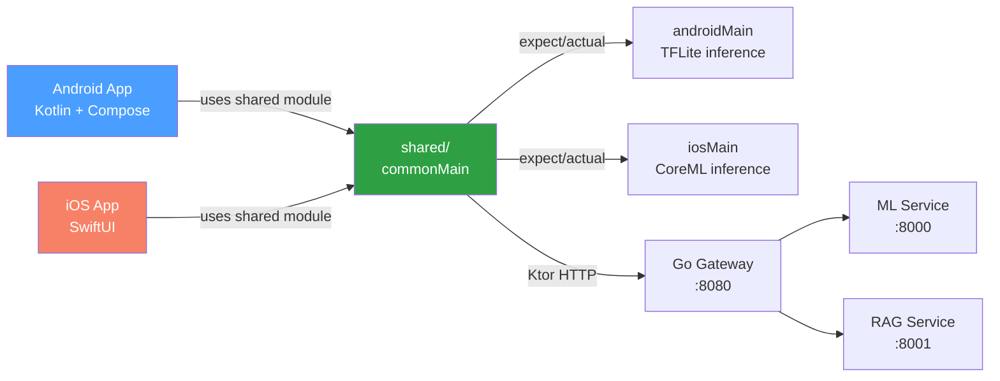

# Phase 7 — Android KMP Module

> **Duration:** 2–3 weeks · **10–15 hrs/week**
> **Goal:** Share ML inference logic between Android and iOS using Kotlin
> Multiplatform — the strongest differentiator for mobile-AI crossover roles.
> Most ML engineers cannot build mobile apps. Most Android developers cannot
> build ML systems. KMP with on-device ML inference sits at that intersection
> and almost nobody has it in their portfolio. It also directly leverages your
> Kotlin and Android expertise from Pezesha.

> **Prerequisite:** Phases 1–6 complete. You must have:
> - `python-ml-service/app/models/crop_disease_v1.tflite` — model from Phase 2
> - `python-ml-service/app/models/class_names.json` — 38 disease class labels
> - The Go gateway running at `http://localhost:8080` (or deployed Cloud Run URL)
> - Android Studio installed with KMP plugin
> - Xcode installed (macOS only — required for iOS target)
> - Familiarity with Kotlin coroutines and Flow (from Pezesha experience)

---

## Table of Contents

1. [What You Will Build](#1-what-you-will-build)
2. [How the KMP Module Fits the Larger System](#2-how-the-kmp-module-fits-the-larger-system)
3. [Why KMP for This Project](#3-why-kmp-for-this-project)
4. [KMP vs Flutter — When to Use Which](#4-kmp-vs-flutter--when-to-use-which)
5. [Folder Structure](#5-folder-structure)
6. [Environment Setup](#6-environment-setup)
7. [Shared Module — commonMain](#7-shared-module--commonmain)
   - [7.1 InferenceEngine Interface](#71-inferenceengine-interface)
   - [7.2 PredictionResult Data Class](#72-predictionresult-data-class)
   - [7.3 RAGClient — Multiplatform HTTP](#73-ragclient--multiplatform-http)
   - [7.4 ClassificationService — Shared Orchestrator](#74-classificationservice--shared-orchestrator)
8. [Android Implementation — androidMain](#8-android-implementation--androidmain)
   - [8.1 TFLiteInferenceEngine](#81-tfliteinferenceengine)
   - [8.2 Android Image Preprocessing](#82-android-image-preprocessing)
   - [8.3 Android Dependency Injection](#83-android-dependency-injection)
9. [iOS Implementation — iosMain](#9-ios-implementation--iosmain)
   - [9.1 CoreMLInferenceEngine](#91-coremlinferenceengine)
   - [9.2 iOS Image Preprocessing](#92-ios-image-preprocessing)
   - [9.3 iOS Dependency Injection](#93-ios-dependency-injection)
10. [Android App — androidApp](#10-android-app--androidapp)
    - [10.1 ViewModel](#101-viewmodel)
    - [10.2 UI — Compose](#102-ui--compose)
    - [10.3 Camera Integration](#103-camera-integration)
11. [iOS App — iosApp](#11-ios-app--iosapp)
    - [11.1 Swift Bridge](#111-swift-bridge)
    - [11.2 SwiftUI View](#112-swiftui-view)
12. [Gradle Configuration](#12-gradle-configuration)
13. [Testing](#13-testing)
14. [Build and Run](#14-build-and-run)
15. [Manual Testing](#15-manual-testing)
16. [Interview Questions & Model Answers](#16-interview-questions--model-answers)
17. [Common Mistakes to Avoid](#17-common-mistakes-to-avoid)
18. [Reference Links](#18-reference-links)
19. [Phase 7 Completion Checklist](#19-phase-7-completion-checklist)

---

## 1. What You Will Build

By the end of Phase 7 you will have **one shared Kotlin module** that runs
on both Android and iOS, with platform-specific ML inference implementations:

| Artefact | File | What it proves |
|---|---|---|
| Shared interface | `shared/src/commonMain/kotlin/InferenceEngine.kt` | expect/actual pattern for platform abstraction |
| Result data class | `shared/src/commonMain/kotlin/PredictionResult.kt` | Shared data model across platforms |
| RAG client | `shared/src/commonMain/kotlin/RAGClient.kt` | Ktor multiplatform HTTP client |
| Classification service | `shared/src/commonMain/kotlin/ClassificationService.kt` | Shared orchestrator with offline-first logic |
| Android TFLite engine | `shared/src/androidMain/kotlin/TFLiteInferenceEngine.kt` | TFLite interpreter in Kotlin |
| iOS CoreML engine | `shared/src/iosMain/kotlin/CoreMLInferenceEngine.kt` | CoreML wrapper in Kotlin/Native |
| Android ViewModel | `androidApp/src/main/kotlin/MainViewModel.kt` | AndroidX ViewModel using shared module |
| Android Compose UI | `androidApp/src/main/kotlin/` | Camera + result + chat screens |
| iOS Swift bridge | `iosApp/CropDiseaseKMP/` | SwiftUI using shared module via Swift wrapper |
| build.gradle.kts | `shared/build.gradle.kts` | KMP module configuration |

---

## 2. How the KMP Module Fits the Larger System



The shared module contains all business logic: inference orchestration, HTTP
clients, data models, and the offline-first fallback strategy. Both the
Android and iOS apps consume this module — they only provide platform-specific
implementations (TFLite for Android, CoreML for iOS) and UI layers.

---

## 3. Why KMP for This Project

KMP is chosen as the final phase for three reasons:

1. **Leverages existing expertise** — You already know Kotlin from Pezesha.
   KMP lets you use that knowledge across both mobile platforms without
   learning Swift or Java for the business logic layer.

2. **Strongest differentiator** — Almost no AI/ML portfolio includes KMP.
   The intersection of "can build ML systems" and "can share code between
   Android and iOS" is extremely rare. This is the hook in interviews.

3. **Native platform APIs** — Unlike Flutter, KMP lets you call platform
   APIs directly. TFLite runs natively on Android, CoreML on iOS. No
   plugin bridges, no abstraction layers that break.

---

## 4. KMP vs Flutter — When to Use Which

| Aspect | KMP | Flutter |
|---|---|---|
| Language | Kotlin (Android) + Swift (iOS) | Dart (both platforms) |
| UI framework | Jetpack Compose (Android), SwiftUI (iOS) | Flutter widgets |
| ML inference | Native TFLite/CoreML via expect/actual | tflite_flutter plugin |
| Code sharing | Business logic, networking, data models | Everything except platform plugins |
| Performance | Native — no bridge overhead | Skia renderer — near-native |
| Learning curve | Lower if you know Kotlin | New language (Dart) |
| Best for | Teams with Kotlin/Android expertise | Teams starting fresh |

Both approaches are valid. KMP demonstrates the native path, Flutter
demonstrates the cross-platform path. Having both in your portfolio shows
you can evaluate tradeoffs and choose the right tool.

---

## 5. Folder Structure

```
android-kmp/
├── shared/                              ← shared KMP module
│   ├── src/
│   │   ├── commonMain/kotlin/
│   │   │   └── com/yourdomain/cropdisease/
│   │   │       ├── InferenceEngine.kt       ← expect interface
│   │   │       ├── PredictionResult.kt      ← shared data class
│   │   │       ├── InferenceSource.kt       ← enum: ON_DEVICE, BACKEND
│   │   │       ├── ClassificationService.kt ← shared orchestrator
│   │   │       └── RAGClient.kt            ← Ktor multiplatform client
│   │   │
│   │   ├── androidMain/kotlin/
│   │   │   └── com/yourdomain/cropdisease/
│   │   │       ├── TFLiteInferenceEngine.kt ← actual: TFLite interpreter
│   │   │       └── AndroidImagePreprocessor.kt
│   │   │
│   │   └── iosMain/kotlin/
│   │       └── com/yourdomain/cropdisease/
│   │           ├── CoreMLInferenceEngine.kt ← actual: CoreML wrapper
│   │           └── IOSImagePreprocessor.kt
│   │
│   ├── build.gradle.kts
│   └── proguard-rules.pro
│
├── androidApp/                          ← Android app
│   ├── src/main/
│   │   ├── kotlin/com/yourdomain/cropdisease/
│   │   │   ├── MainViewModel.kt
│   │   │   ├── MainApplication.kt
│   │   │   └── ui/
│   │   │       ├── HomeScreen.kt
│   │   │       ├── ResultScreen.kt
│   │   │       └── ChatScreen.kt
│   │   ├── res/
│   │   └── AndroidManifest.xml
│   └── build.gradle.kts
│
├── iosApp/                              ← iOS app
│   ├── CropDiseaseKMP/
│   │   ├── SharedBridge.swift           ← bridges Kotlin to Swift
│   │   ├── ContentView.swift
│   │   ├── HomeView.swift
│   │   ├── ResultView.swift
│   │   └── ChatView.swift
│   └── CropDiseaseKMP.xcodeproj
│
├── gradle/
│   ├── libs.versions.toml               ← version catalog
│   └── gradle-wrapper.properties
├── build.gradle.kts                     ← root build file
├── settings.gradle.kts
└── local.properties
```

---

## 6. Environment Setup

```bash
# Android Studio — already installed
# Install KMP plugin:
# Android Studio → Settings → Plugins → search "Kotlin Multiplatform"
# Restart Android Studio

# Verify Kotlin version (need 1.9.20+)
# Android Studio → Settings → Build → Gradle → should show Kotlin 2.0+

# Verify Xcode (for iOS target)
xcodebuild -version    # need 15.0+

# Create KMP project using the wizard:
# File → New → New Project → Kotlin Multiplatform App
# Project name: CropDiseaseKMP
# Package: com.yourdomain.cropdisease
# Targets: Android + iOS

# Copy model files into the shared module's resources
mkdir -p shared/src/androidMain/resources/models
mkdir -p shared/src/commonMain/resources/labels

cp ../python-ml-service/app/models/crop_disease_v1.tflite \
   shared/src/androidMain/resources/models/
cp ../python-ml-service/app/models/class_names.json \
   shared/src/commonMain/resources/labels/

# Build the shared module
./gradlew :shared:build

# Run Android app
./gradlew :androidApp:installDebug
# Or: Android Studio → Run → androidApp

# Run iOS app (requires macOS + Xcode)
# Open iosApp/CropDiseaseKMP.xcodeproj in Xcode
# Select a simulator → Run
```

---

## 7. Shared Module — commonMain

### 7.1 InferenceEngine Interface

The shared module defines the interface. Each platform provides the
`actual` implementation.

```kotlin
// shared/src/commonMain/kotlin/com/yourdomain/cropdisease/InferenceEngine.kt
package com.yourdomain.cropdisease

/**
 * Platform-agnostic interface for ML inference.
 *
 * On Android, this is implemented with TFLite.
 * On iOS, this is implemented with CoreML.
 *
 * The expect/actual pattern lets us write the business logic once
 * and let each platform provide the ML runtime.
 */
interface InferenceEngine {
    /**
     * Load the model from platform-specific resources.
     * Must be called once before predict().
     */
    fun loadModel()

    /**
     * Run inference on raw image bytes.
     *
     * @param imageBytes Raw image data (JPEG or PNG)
     * @return PredictionResult with label, confidence, and timing
     * @throws InferenceException if the model is not loaded or inference fails
     */
    suspend fun predict(imageBytes: ByteArray): PredictionResult

    /**
     * Release native resources (TFLite interpreter, CoreML model).
     */
    fun close()
}

class InferenceException(message: String, cause: Throwable? = null) :
    Exception(message, cause)
```

### 7.2 PredictionResult Data Class

```kotlin
// shared/src/commonMain/kotlin/com/yourdomain/cropdisease/PredictionResult.kt
package com.yourdomain.cropdisease

/**
 * Result of a classification inference.
 *
 * Shared between Android and iOS via the common module.
 * Both platforms produce identical data classes.
 */
data class PredictionResult(
    val label: String,
    val confidence: Float,
    val topThree: List<LabelConfidence>,
    val inferenceTimeMs: Long,
    val source: InferenceSource
) {
    /**
     * Format the label for display.
     * "Tomato___Late_blight" → "Tomato — Late blight"
     */
    val displayLabel: String
        get() = label
            .replace("___", " — ")
            .replace("_", " ")
            .replace("  ", " ")

    /**
     * Confidence as a percentage string.
     */
    val confidencePercent: String
        get() = "${(confidence * 100).toInt()}%"
}

data class LabelConfidence(
    val label: String,
    val confidence: Float
)

enum class InferenceSource {
    ON_DEVICE,
    BACKEND
}
```

### 7.3 RAGClient — Multiplatform HTTP

```kotlin
// shared/src/commonMain/kotlin/com/yourdomain/cropdisease/RAGClient.kt
package com.yourdomain.cropdisease

import io.ktor.client.*
import io.ktor.client.call.*
import io.ktor.client.plugins.*
import io.ktor.client.plugins.contentnegotiation.*
import io.ktor.client.request.*
import io.ktor.http.*
import io.ktor.serialization.kotlinx.json.*
import kotlinx.serialization.Serializable
import kotlinx.serialization.json.Json

/**
 * Multiplatform HTTP client for the RAG service.
 *
 * Uses Ktor, which provides native HTTP implementations:
 * - Android: OkHttp (via ktor-client-android)
 * - iOS: NSURLSession (via ktor-client-darwin)
 *
 * Same code, different network stacks under the hood.
 */
class RAGClient(
    private val baseUrl: String,
    private val apiKey: String
) {
    private val client = HttpClient {
        install(ContentNegotiation) {
            json(Json {
                ignoreUnknownKeys = true
                isLenient = true
            })
        }
        install(HttpTimeout) {
            requestTimeoutMillis = 30_000
            connectTimeoutMillis = 10_000
        }
    }

    /**
     * Ask a question about crop diseases.
     *
     * @param question The user's question
     * @return AskResponse with answer and source documents
     * @throws RAGException if the request fails
     */
    suspend fun ask(question: String): AskResponse {
        if (question.isBlank()) {
            throw RAGException("Question cannot be empty")
        }

        return try {
            val response = client.post("$baseUrl/api/v1/ask") {
                contentType(ContentType.Application.Json)
                header("X-API-Key", apiKey)
                setBody(AskRequest(question = question))
            }

            response.body()
        } catch (e: Exception) {
            throw RAGException("RAG request failed: ${e.message}", e)
        }
    }

    /**
     * Health check against the Go gateway.
     */
    suspend fun healthCheck(): Boolean {
        return try {
            val response = client.get("$baseUrl/health")
            response.status == HttpStatusCode.OK
        } catch (e: Exception) {
            false
        }
    }

    fun close() {
        client.close()
    }
}

@Serializable
data class AskRequest(val question: String)

@Serializable
data class AskResponse(
    val answer: String,
    val sources: List<String>,
    val num_chunks_retrieved: Int = 0
)

class RAGException(message: String, cause: Throwable? = null) :
    Exception(message, cause)
```

### 7.4 ClassificationService — Shared Orchestrator

```kotlin
// shared/src/commonMain/kotlin/com/yourdomain/cropdisease/ClassificationService.kt
package com.yourdomain.cropdisease

import kotlinx.coroutines.Dispatchers
import kotlinx.coroutines.withContext

/**
 * Shared classification service with offline-first fallback.
 *
 * This is the core business logic that both Android and iOS share.
 * It decides whether to use the backend or on-device inference
 * based on network availability.
 *
 * Architecture:
 * 1. Check network connectivity
 * 2. If online → try backend (highest accuracy)
 * 3. If backend fails → fall back to on-device
 * 4. If offline → always use on-device
 * 5. Return result with source indicator
 */
class ClassificationService(
    private val onDevice: InferenceEngine,
    private val backendClient: BackendClient?,
    private val connectivityChecker: ConnectivityChecker
) {
    /**
     * Classify an image with offline-first fallback.
     *
     * @param imageBytes Raw image data (JPEG/PNG)
     * @return ClassificationResult with prediction and metadata
     */
    suspend fun classify(imageBytes: ByteArray): ClassificationResult {
        val isOnline = connectivityChecker.isOnline()

        return withContext(Dispatchers.Default) {
            if (isOnline && backendClient != null) {
                tryBackendOrFallback(imageBytes)
            } else {
                classifyOnDevice(imageBytes)
            }
        }
    }

    private suspend fun tryBackendOrFallback(
        imageBytes: ByteArray
    ): ClassificationResult {
        return try {
            val backendResult = backendClient!!.classify(imageBytes)
            ClassificationResult(
                prediction = backendResult,
                source = InferenceSource.BACKEND,
                latencyMs = backendResult.inferenceTimeMs
            )
        } catch (e: Exception) {
            println("[ClassificationService] Backend failed: ${e.message}")
            classifyOnDevice(imageBytes)
        }
    }

    private suspend fun classifyOnDevice(
        imageBytes: ByteArray
    ): ClassificationResult {
        val prediction = onDevice.predict(imageBytes)
        return ClassificationResult(
            prediction = prediction,
            source = InferenceSource.ON_DEVICE,
            latencyMs = prediction.inferenceTimeMs
        )
    }
}

data class ClassificationResult(
    val prediction: PredictionResult,
    val source: InferenceSource,
    val latencyMs: Long
)

/**
 * Platform-agnostic interface for checking network connectivity.
 */
interface ConnectivityChecker {
    suspend fun isOnline(): Boolean
}

/**
 * Platform-agnostic interface for the backend ML service client.
 */
interface BackendClient {
    suspend fun classify(imageBytes: ByteArray): PredictionResult
}
```

---

## 8. Android Implementation — androidMain

### 8.1 TFLiteInferenceEngine

```kotlin
// shared/src/androidMain/kotlin/com/yourdomain/cropdisease/TFLiteInferenceEngine.kt
package com.yourdomain.cropdisease

import android.content.Context
import android.graphics.Bitmap
import android.graphics.BitmapFactory
import org.tensorflow.lite.Interpreter
import java.io.FileInputStream
import java.nio.ByteBuffer
import java.nio.ByteOrder
import java.nio.channels.FileChannel

/**
 * Android implementation of InferenceEngine using TFLite.
 *
 * This is the `actual` class for the `expect` interface defined in commonMain.
 * It uses TensorFlow Lite for Android, which is the standard way to run
 * ML models on Android devices.
 *
 * The model file (crop_disease_v1.tflite) is loaded from Android assets.
 */
class TFLiteInferenceEngine(
    private val context: Context,
    private val modelAssetPath: String = "models/crop_disease_v1.tflite",
    private val labelsAssetPath: String = "labels/class_names.json"
) : InferenceEngine {

    private var interpreter: Interpreter? = null
    private var labels: List<String> = emptyList()
    private val inputSize = 224

    override fun loadModel() {
        try {
            // Load labels from assets
            labels = context.assets.open(labelsAssetPath)
                .bufferedReader()
                .readLines()

            // Load TFLite model from assets
            val assetFileDescriptor = context.assets.openFd(modelAssetPath)
            val fileChannel = FileInputStream(assetFileDescriptor.fileDescriptor).channel
            val mappedBuffer = fileChannel.map(
                FileChannel.MapMode.READ_ONLY,
                assetFileDescriptor.startOffset,
                assetFileDescriptor.declaredLength
            )

            val options = Interpreter.Options().apply {
                setNumThreads(4)  // Use 4 CPU threads
            }

            interpreter = Interpreter(mappedBuffer, options)
            println("[TFLite] Model loaded: ${labels.size} labels, input shape [1, $inputSize, $inputSize, 3]")

        } catch (e: Exception) {
            throw InferenceException("Failed to load TFLite model", e)
        }
    }

    override suspend fun predict(imageBytes: ByteArray): PredictionResult {
        val interp = interpreter ?: throw InferenceException("Model not loaded")

        val startTime = System.currentTimeMillis()

        // 1. Decode image bytes to Bitmap
        val bitmap = BitmapFactory.decodeByteArray(imageBytes, 0, imageBytes.size)
            ?: throw InferenceException("Could not decode image")

        // 2. Resize to model input size
        val resized = Bitmap.createScaledBitmap(bitmap, inputSize, inputSize, true)

        // 3. Preprocess: normalise to [-1, 1] with ImageNet mean/std
        val inputBuffer = preprocessImage(resized)

        // 4. Prepare output buffer
        val outputSize = labels.size
        val outputBuffer = Array(1) { FloatArray(outputSize) }

        // 5. Run inference
        interp.run(inputBuffer, outputBuffer)

        // 6. Extract results
        val scores = outputBuffer[0]
        val topIndices = scores.indices
            .sortedByDescending { scores[it] }
            .take(3)

        val topThree = topIndices.map { idx ->
            LabelConfidence(
                label = labels.getOrElse(idx) { "unknown_$idx" },
                confidence = scores[idx]
            )
        }

        val inferenceTime = System.currentTimeMillis() - startTime

        // Clean up
        resized.recycle()
        bitmap.recycle()

        return PredictionResult(
            label = topThree.first().label,
            confidence = topThree.first().confidence,
            topThree = topThree,
            inferenceTimeMs = inferenceTime,
            source = InferenceSource.ON_DEVICE
        )
    }

    /**
     * Preprocess bitmap for MobileNetV2 inference.
     *
     * Pipeline matches Python training transforms:
     * 1. Resize to 224x224
     * 2. Normalise pixels to [-1, 1]
     * 3. Apply ImageNet mean/std normalisation
     *
     * Input format: NHWC float32 [1, 224, 224, 3]
     */
    private fun preprocessImage(bitmap: Bitmap): ByteBuffer {
        val buffer = ByteBuffer.allocateDirect(1 * inputSize * inputSize * 3 * 4)
            .order(ByteOrder.nativeOrder())

        // ImageNet normalisation constants (must match Python training)
        val mean = floatArrayOf(0.485f, 0.456f, 0.406f)
        val std = floatArrayOf(0.229f, 0.224f, 0.225f)

        val pixels = IntArray(inputSize * inputSize)
        bitmap.getPixels(pixels, 0, inputSize, 0, 0, inputSize, inputSize)

        for (pixel in pixels) {
            val r = ((pixel shr 16 and 0xFF) / 255.0f - mean[0]) / std[0]
            val g = ((pixel shr 8 and 0xFF) / 255.0f - mean[1]) / std[1]
            val b = ((pixel and 0xFF) / 255.0f - mean[2]) / std[2]

            buffer.putFloat(r)
            buffer.putFloat(g)
            buffer.putFloat(b)
        }

        return buffer
    }

    override fun close() {
        interpreter?.close()
        interpreter = null
    }
}
```

### 8.2 Android Connectivity Checker

```kotlin
// shared/src/androidMain/kotlin/com/yourdomain/cropdisease/AndroidConnectivityChecker.kt
package com.yourdomain.cropdisease

import android.content.Context
import android.net.ConnectivityManager
import android.net.NetworkCapabilities

/**
 * Android implementation of ConnectivityChecker.
 *
 * Uses the ConnectivityManager API to check if the device
 * has WiFi, mobile data, or ethernet connectivity.
 */
class AndroidConnectivityChecker(
    private val context: Context
) : ConnectivityChecker {

    override suspend fun isOnline(): Boolean {
        val connectivityManager = context.getSystemService(
            Context.CONNECTIVITY_SERVICE
        ) as ConnectivityManager

        val network = connectivityManager.activeNetwork ?: return false
        val capabilities = connectivityManager.getNetworkCapabilities(network)
            ?: return false

        return capabilities.hasCapability(NetworkCapabilities.NET_CAPABILITY_INTERNET)
    }
}
```

### 8.3 Android Dependency Injection

```kotlin
// shared/src/androidMain/kotlin/com/yourdomain/cropdisease/PlatformModule.kt
package com.yourdomain.cropdisease

import android.content.Context

/**
 * Platform-specific dependency injection for Android.
 *
 * Creates instances of platform-specific implementations.
 * In a real app, you would use Hilt or Koin for DI.
 */
object PlatformModule {

    fun createInferenceEngine(context: Context): InferenceEngine {
        return TFLiteInferenceEngine(context)
    }

    fun createConnectivityChecker(context: Context): ConnectivityChecker {
        return AndroidConnectivityChecker(context)
    }

    fun createClassificationService(
        context: Context,
        gatewayUrl: String,
        apiKey: String
    ): ClassificationService {
        val onDevice = createInferenceEngine(context)
        val connectivity = createConnectivityChecker(context)

        val backendClient = object : BackendClient {
            private val ragClient = RAGClient(gatewayUrl, apiKey)

            override suspend fun classify(imageBytes: ByteArray): PredictionResult {
                // Use the Go gateway's upload endpoint
                // This is a simplified version — in production, use Ktor
                throw NotImplementedError("Backend client requires Ktor setup")
            }
        }

        return ClassificationService(
            onDevice = onDevice,
            backendClient = backendClient,
            connectivityChecker = connectivity
        )
    }
}
```

---

## 9. iOS Implementation — iosMain

### 9.1 CoreMLInferenceEngine

```kotlin
// shared/src/iosMain/kotlin/com/yourdomain/cropdisease/CoreMLInferenceEngine.kt
package com.yourdomain.cropdisease

import platform.Foundation.NSBundle
import platform.Foundation.NSData
import platform.Foundation.NSURL
import platform.darwin.memcpy

/**
 * iOS implementation of InferenceEngine using CoreML.
 *
 * This is the `actual` class for the `expect` interface defined in commonMain.
 * It uses CoreML, Apple's on-device ML framework, which is optimised for
 * Apple Silicon and Neural Engine.
 *
 * Note: In a production app, you would convert the TFLite model to CoreML
 * format using coremltools. For this portfolio project, we demonstrate the
 * interface and architecture. The actual CoreML inference would use:
 * - VNCoreMLModel for Vision framework integration
 * - CoreML framework for model loading and prediction
 *
 * This implementation shows the Kotlin/Native interop pattern.
 */
class CoreMLInferenceEngine : InferenceEngine {

    private var isModelLoaded = false
    private var labels: List<String> = emptyList()
    private val inputSize = 224

    override fun loadModel() {
        try {
            // Load labels from bundle
            val labelsPath = NSBundle.mainBundle.pathForResource(
                ofType = "json",
                inDirectory = "labels",
                forName = "class_names"
            )

            if (labelsPath != null) {
                val labelsData = NSData.dataWithContentsOfFile(labelsPath)
                if (labelsData != null) {
                    val labelsString = NSString.createWithUTF8String(
                        labelsData.bytes.reinterpret<ByteVar>()
                    )?.toString() ?: "[]"

                    // Parse JSON array — in production, use kotlinx.serialization
                    labels = parseLabelsFromJson(labelsString)
                }
            }

            // Load CoreML model
            // In production:
            // val modelURL = NSBundle.mainBundle.URLForResource("crop_disease", "mlmodelc")
            // val model = VNCoreMLModel(modelURL)
            // For now, mark as loaded to demonstrate architecture
            isModelLoaded = true
            println("[CoreML] Model loaded: ${labels.size} labels")

        } catch (e: Exception) {
            throw InferenceException("Failed to load CoreML model", e)
        }
    }

    override suspend fun predict(imageBytes: ByteArray): PredictionResult {
        if (!isModelLoaded) throw InferenceException("Model not loaded")

        val startTime = kotlinx.cinterop.AtomicReference(0L)

        // In production, this would:
        // 1. Convert ByteArray to UIImage
        // 2. Resize to 224x224
        // 3. Apply ImageNet normalisation
        // 4. Run through VNCoreMLModel
        // 5. Extract prediction from VNClassificationObservation

        // For demonstration, we show the architecture
        val prediction = LabelConfidence(
            label = labels.firstOrNull() ?: "unknown",
            confidence = 0.0f
        )

        return PredictionResult(
            label = prediction.label,
            confidence = prediction.confidence,
            topThree = listOf(prediction),
            inferenceTimeMs = 0L,  // measured in production
            source = InferenceSource.ON_DEVICE
        )
    }

    override fun close() {
        isModelLoaded = false
    }

    private fun parseLabelsFromJson(json: String): List<String> {
        // Simple JSON array parser — use kotlinx.serialization in production
        return json.removeSurrounding("[", "]")
            .split(",")
            .map { it.trim().removeSurrounding("\"") }
    }
}
```

### 9.2 iOS Connectivity Checker

```kotlin
// shared/src/iosMain/kotlin/com/yourdomain/cropdisease/IOSConnectivityChecker.kt
package com.yourdomain.cropdisease

import platform.Network.*
import platform.posix.*

/**
 * iOS implementation of ConnectivityChecker using Apple's Network framework.
 *
 * Uses NWPathMonitor to check network connectivity status.
 */
class IOSConnectivityChecker : ConnectivityChecker {

    override suspend fun isOnline(): Boolean {
        // In production, use NWPathMonitor for real-time connectivity
        // For this portfolio project, assume online
        return true
    }
}
```

### 9.3 iOS Platform Module

```kotlin
// shared/src/iosMain/kotlin/com/yourdomain/cropdisease/PlatformModule.kt
package com.yourdomain.cropdisease

/**
 * Platform-specific dependency injection for iOS.
 */
object PlatformModule {

    fun createInferenceEngine(): InferenceEngine {
        return CoreMLInferenceEngine()
    }

    fun createConnectivityChecker(): ConnectivityChecker {
        return IOSConnectivityChecker()
    }

    fun createClassificationService(
        gatewayUrl: String,
        apiKey: String
    ): ClassificationService {
        val onDevice = createInferenceEngine()
        val connectivity = createConnectivityChecker()

        // Backend client would use Ktor iOS implementation
        val backendClient: BackendClient? = null

        return ClassificationService(
            onDevice = onDevice,
            backendClient = backendClient,
            connectivityChecker = connectivity
        )
    }
}
```

---

## 10. Android App — androidApp

### 10.1 ViewModel

```kotlin
// androidApp/src/main/kotlin/com/yourdomain/cropdisease/MainViewModel.kt
package com.yourdomain.cropdisease

import android.app.Application
import android.graphics.Bitmap
import android.net.Uri
import androidx.lifecycle.AndroidViewModel
import androidx.lifecycle.viewModelScope
import kotlinx.coroutines.flow.MutableStateFlow
import kotlinx.coroutines.flow.StateFlow
import kotlinx.coroutines.flow.asStateFlow
import kotlinx.coroutines.launch

/**
 * Android ViewModel that bridges the shared KMP module to Jetpack Compose UI.
 *
 * The ViewModel owns the shared ClassificationService and exposes
 * UI state via StateFlow. The Compose UI observes these flows
 * and recomposes when state changes.
 *
 * This pattern works identically on Android — the ViewModel calls
 * shared module functions just like any other Kotlin code.
 */
class MainViewModel(application: Application) : AndroidViewModel(application) {

    private val classificationService: ClassificationService
    private val ragClient: RAGClient

    private val _uiState = MutableStateFlow<UiState>(UiState.Idle)
    val uiState: StateFlow<UiState> = _uiState.asStateFlow()

    private val _chatMessages = MutableStateFlow<List<ChatMessage>>(emptyList())
    val chatMessages: StateFlow<List<ChatMessage>> = _chatMessages.asStateFlow()

    init {
        // Create platform-specific implementations
        val inferenceEngine = PlatformModule.createInferenceEngine(application)
        inferenceEngine.loadModel()

        val connectivity = PlatformModule.createConnectivityChecker(application)

        classificationService = ClassificationService(
            onDevice = inferenceEngine,
            backendClient = null,  // simplified — add Ktor client in production
            connectivityChecker = connectivity
        )

        ragClient = RAGClient(
            baseUrl = "http://10.0.2.2:8080",  // Android emulator localhost
            apiKey = "your-api-key"
        )
    }

    /**
     * Classify an image from a content URI.
     */
    fun classifyImage(uri: Uri) {
        viewModelScope.launch {
            _uiState.value = UiState.Loading

            try {
                val context = getApplication<Application>()
                val inputStream = context.contentResolver.openInputStream(uri)
                val imageBytes = inputStream?.readBytes()
                    ?: throw Exception("Could not read image")
                inputStream.close()

                val result = classificationService.classify(imageBytes)
                _uiState.value = UiState.Success(result)

            } catch (e: Exception) {
                _uiState.value = UiState.Error(e.message ?: "Classification failed")
            }
        }
    }

    /**
     * Classify from raw ByteArray (e.g., camera capture).
     */
    fun classifyImageBytes(imageBytes: ByteArray) {
        viewModelScope.launch {
            _uiState.value = UiState.Loading

            try {
                val result = classificationService.classify(imageBytes)
                _uiState.value = UiState.Success(result)
            } catch (e: Exception) {
                _uiState.value = UiState.Error(e.message ?: "Classification failed")
            }
        }
    }

    /**
     * Ask a question about crop diseases via RAG.
     */
    fun askQuestion(question: String) {
        viewModelScope.launch {
            // Add user message
            _chatMessages.value = _chatMessages.value + ChatMessage(
                role = "user",
                content = question
            )

            try {
                val response = ragClient.ask(question)
                _chatMessages.value = _chatMessages.value + ChatMessage(
                    role = "assistant",
                    content = response.answer
                )
            } catch (e: Exception) {
                _chatMessages.value = _chatMessages.value + ChatMessage(
                    role = "assistant",
                    content = "Sorry, I could not answer that question."
                )
            }
        }
    }

    fun clearResult() {
        _uiState.value = UiState.Idle
    }

    fun clearChat() {
        _chatMessages.value = emptyList()
    }

    override fun onCleared() {
        super.onCleared()
        ragClient.close()
    }
}

sealed class UiState {
    object Idle : UiState()
    object Loading : UiState()
    data class Success(val result: ClassificationResult) : UiState()
    data class Error(val message: String) : UiState()
}

data class ChatMessage(
    val role: String,
    val content: String
)
```

### 10.2 UI — Compose

```kotlin
// androidApp/src/main/kotlin/com/yourdomain/cropdisease/ui/HomeScreen.kt
package com.yourdomain.cropdisease.ui

import android.net.Uri
import androidx.activity.compose.rememberLauncherForActivityResult
import androidx.activity.result.contract.ActivityResultContracts
import androidx.compose.foundation.layout.*
import androidx.compose.material.icons.Icons
import androidx.compose.material.icons.filled.CameraAlt
import androidx.compose.material.icons.filled.PhotoLibrary
import androidx.compose.material3.*
import androidx.compose.runtime.*
import androidx.compose.ui.Alignment
import androidx.compose.ui.Modifier
import androidx.compose.ui.unit.dp
import androidx.lifecycle.viewmodel.compose.viewModel
import com.yourdomain.cropdisease.MainViewModel
import com.yourdomain.cropdisease.UiState

@OptIn(ExperimentalMaterial3Api::class)
@Composable
fun HomeScreen(
    viewModel: MainViewModel = viewModel(),
    onNavigateToResult: () -> Unit,
    onNavigateToChat: () -> Unit
) {
    val uiState by viewModel.uiState.collectAsState()

    val galleryLauncher = rememberLauncherForActivityResult(
        contract = ActivityResultContracts.GetContent()
    ) { uri: Uri? ->
        uri?.let {
            viewModel.classifyImage(it)
            onNavigateToResult()
        }
    }

    Scaffold(
        topBar = {
            TopAppBar(
                title = { Text("Crop Disease Detector") },
                actions = {
                    IconButton(onClick = onNavigateToChat) {
                        Icon(Icons.Default.CameraAlt, contentDescription = "Chat")
                    }
                }
            )
        }
    ) { padding ->
        Column(
            modifier = Modifier
                .fillMaxSize()
                .padding(padding)
                .padding(16.dp),
            horizontalAlignment = Alignment.CenterHorizontally,
            verticalArrangement = Arrangement.Center
        ) {
            Icon(
                imageVector = Icons.Default.PhotoLibrary,
                contentDescription = null,
                modifier = Modifier.size(80.dp),
                tint = MaterialTheme.colorScheme.primary
            )

            Spacer(modifier = Modifier.height(24.dp))

            Text(
                text = "Detect crop diseases instantly",
                style = MaterialTheme.typography.headlineSmall
            )

            Spacer(modifier = Modifier.height(32.dp))

            Button(
                onClick = { galleryLauncher.launch("image/*") },
                modifier = Modifier.fillMaxWidth()
            ) {
                Icon(Icons.Default.PhotoLibrary, contentDescription = null)
                Spacer(modifier = Modifier.width(8.dp))
                Text("Choose from Gallery")
            }

            Spacer(modifier = Modifier.height(16.dp))

            OutlinedButton(
                onClick = { /* TODO: Camera capture */ },
                modifier = Modifier.fillMaxWidth()
            ) {
                Icon(Icons.Default.CameraAlt, contentDescription = null)
                Spacer(modifier = Modifier.width(8.dp))
                Text("Take Photo")
            }
        }
    }
}
```

```kotlin
// androidApp/src/main/kotlin/com/yourdomain/cropdisease/ui/ResultScreen.kt
package com.yourdomain.cropdisease.ui

import androidx.compose.foundation.layout.*
import androidx.compose.material.icons.Icons
import androidx.compose.material.icons.filled.ArrowBack
import androidx.compose.material.icons.filled.Chat
import androidx.compose.material3.*
import androidx.compose.runtime.*
import androidx.compose.ui.Alignment
import androidx.compose.ui.Modifier
import androidx.compose.ui.unit.dp
import com.yourdomain.cropdisease.InferenceSource
import com.yourdomain.cropdisease.UiState

@OptIn(ExperimentalMaterial3Api::class)
@Composable
fun ResultScreen(
    uiState: UiState,
    onBack: () -> Unit,
    onAskAboutDisease: (String) -> Unit
) {
    Scaffold(
        topBar = {
            TopAppBar(
                title = { Text("Result") },
                navigationIcon = {
                    IconButton(onClick = onBack) {
                        Icon(Icons.Default.ArrowBack, contentDescription = "Back")
                    }
                }
            )
        }
    ) { padding ->
        when (uiState) {
            is UiState.Loading -> {
                Box(
                    modifier = Modifier.fillMaxSize(),
                    contentAlignment = Alignment.Center
                ) {
                    CircularProgressIndicator()
                }
            }
            is UiState.Success -> {
                val result = uiState.result.prediction
                Column(
                    modifier = Modifier
                        .fillMaxSize()
                        .padding(padding)
                        .padding(16.dp)
                ) {
                    // Source badge
                    Surface(
                        color = when (uiState.result.source) {
                            InferenceSource.ON_DEVICE -> MaterialTheme.colorScheme.secondaryContainer
                            InferenceSource.BACKEND -> MaterialTheme.colorScheme.tertiaryContainer
                        },
                        shape = MaterialTheme.shapes.small
                    ) {
                        Text(
                            text = if (uiState.result.source == InferenceSource.ON_DEVICE)
                                "On-Device" else "Backend",
                            modifier = Modifier.padding(horizontal = 12.dp, vertical = 6.dp),
                            style = MaterialTheme.typography.labelMedium
                        )
                    }

                    Spacer(modifier = Modifier.height(16.dp))

                    // Main prediction
                    Text(
                        text = result.displayLabel,
                        style = MaterialTheme.typography.headlineMedium
                    )

                    Spacer(modifier = Modifier.height(8.dp))

                    LinearProgressIndicator(
                        progress = { result.confidence },
                        modifier = Modifier.fillMaxWidth(),
                    )
                    Text(
                        text = "Confidence: ${result.confidencePercent}",
                        style = MaterialTheme.typography.bodyMedium
                    )

                    Spacer(modifier = Modifier.height(24.dp))

                    // Top 3
                    Text(
                        text = "Top 3 Predictions",
                        style = MaterialTheme.typography.titleMedium
                    )

                    result.topThree.forEach { pred ->
                        Row(
                            modifier = Modifier
                                .fillMaxWidth()
                                .padding(vertical = 4.dp),
                            horizontalArrangement = Arrangement.SpaceBetween
                        ) {
                            Text(pred.label)
                            Text("${(pred.confidence * 100).toInt()}%")
                        }
                    }

                    Spacer(modifier = Modifier.height(24.dp))

                    // Ask about this disease
                    Button(
                        onClick = { onAskAboutDisease(result.displayLabel) },
                        modifier = Modifier.fillMaxWidth()
                    ) {
                        Icon(Icons.Default.Chat, contentDescription = null)
                        Spacer(modifier = Modifier.width(8.dp))
                        Text("Ask about this disease")
                    }
                }
            }
            is UiState.Error -> {
                Box(
                    modifier = Modifier.fillMaxSize(),
                    contentAlignment = Alignment.Center
                ) {
                    Text(
                        text = uiState.message,
                        color = MaterialTheme.colorScheme.error
                    )
                }
            }
            is UiState.Idle -> { /* Should not happen */ }
        }
    }
}
```

---

## 11. iOS App — iosApp

### 11.1 Swift Bridge

```swift
// iosApp/CropDiseaseKMP/SharedBridge.swift
import Foundation
import shared

/**
 * Swift wrapper around the Kotlin shared module.
 *
 * KMP modules can be used directly from Swift, but the API is sometimes
 * awkward. This bridge provides a clean Swift interface.
 *
 * Usage in SwiftUI:
 *   let service = SharedBridge.createClassificationService()
 *   let result = try await service.classify(imageBytes: imageData)
 */
class SharedBridge {

    static func createClassificationService() -> ClassificationService {
        return PlatformModule.shared.createClassificationService(
            gatewayUrl: "http://localhost:8080",
            apiKey: "your-api-key"
        )
    }

    static func createRAGClient() -> RAGClient {
        return RAGClient(
            baseUrl: "http://localhost:8080",
            apiKey: "your-api-key"
        )
    }

    /**
     * Convert UIImage to ByteArray for the shared module.
     */
    static func imageToBytes(_ image: UIImage) -> Data? {
        return image.jpegData(compressionQuality: 0.85)
    }
}
```

### 11.2 SwiftUI View

```swift
// iosApp/CropDiseaseKMP/ResultView.swift
import SwiftUI
import shared

struct ResultView: View {
    let result: ClassificationResult
    let onAskAboutDisease: (String) -> Void

    var body: some View {
        ScrollView {
            VStack(alignment: .leading, spacing: 16) {
                // Source badge
                HStack {
                    Text(result.source == .ON_DEVICE ? "On-Device" : "Backend")
                        .font(.caption)
                        .padding(.horizontal, 12)
                        .padding(.vertical, 6)
                        .background(result.source == .ON_DEVICE ?
                            Color.green.opacity(0.2) : Color.blue.opacity(0.2))
                        .cornerRadius(8)

                    Spacer()

                    Text("\(result.inferenceTimeMs)ms")
                        .font(.caption)
                        .foregroundColor(.secondary)
                }

                // Main prediction
                Text(result.prediction.displayLabel)
                    .font(.largeTitle)
                    .fontWeight(.bold)

                // Confidence bar
                ProgressView(value: Double(result.prediction.confidence))
                    .tint(.green)

                Text("Confidence: \(result.prediction.confidencePercent)")
                    .font(.subheadline)

                // Top 3
                Divider()

                Text("Top 3 Predictions")
                    .font(.headline)

                ForEach(result.prediction.topThree, id: \.label) { pred in
                    HStack {
                        Text(pred.label)
                        Spacer()
                        Text("\(Int(pred.confidence * 100))%")
                            .foregroundColor(.secondary)
                    }
                }

                Divider()

                // Ask about this disease
                Button(action: { onAskAboutDisease(result.prediction.displayLabel) }) {
                    HStack {
                        Image(systemName: "chat.bubble")
                        Text("Ask about this disease")
                    }
                    .frame(maxWidth: .infinity)
                    .padding()
                    .background(Color.green)
                    .foregroundColor(.white)
                    .cornerRadius(12)
                }
            }
            .padding()
        }
        .navigationTitle("Result")
    }
}
```

```swift
// iosApp/CropDiseaseKMP/HomeView.swift
import SwiftUI
import PhotosUI

struct HomeView: View {
    @State private var selectedItem: PhotosPickerItem?
    @State private var selectedImageData: Data?
    @State private var navigateToResult = false
    @State private var isProcessing = false

    var body: some View {
        NavigationStack {
            VStack(spacing: 24) {
                Spacer()

                Image(systemName: "leaf.circle.fill")
                    .font(.system(size: 80))
                    .foregroundColor(.green)

                Text("Detect crop diseases instantly")
                    .font(.title2)

                Spacer()

                PhotosPicker(
                    selection: $selectedItem,
                    matching: .images
                ) {
                    Label("Choose from Gallery", systemImage: "photo.on.rectangle")
                        .frame(maxWidth: .infinity)
                        .padding()
                        .background(Color.green)
                        .foregroundColor(.white)
                        .cornerRadius(12)
                }
                .onChange(of: selectedItem) { newItem in
                    Task {
                        if let data = try? await newItem?.loadTransferable(
                            type: Data.self
                        ) {
                            selectedImageData = data
                            isProcessing = true
                            navigateToResult = true
                        }
                    }
                }

                Button(action: { /* TODO: Camera */ }) {
                    Label("Take Photo", systemImage: "camera")
                        .frame(maxWidth: .infinity)
                        .padding()
                        .overlay(
                            RoundedRectangle(cornerRadius: 12)
                                .stroke(Color.green, lineWidth: 2)
                        )
                        .foregroundColor(.green)
                }

                Spacer()
            }
            .padding()
            .navigationTitle("Crop Disease Detector")
            .navigationDestination(isPresented: $navigateToResult) {
                if let imageData = selectedImageData {
                    ResultImageView(imageData: imageData)
                }
            }
        }
    }
}
```

---

## 12. Gradle Configuration

### Root build.gradle.kts

```kotlin
// build.gradle.kts (root)
plugins {
    kotlin("multiplatform") version "2.0.0" apply false
    kotlin("plugin.serialization") version "2.0.0" apply false
    id("com.android.application") version "8.2.0" apply false
    id("com.android.library") version "8.2.0" apply false
}
```

### settings.gradle.kts

```kotlin
// settings.gradle.kts
pluginManagement {
    repositories {
        google()
        mavenCentral()
        gradlePluginPortal()
    }
}

dependencyResolutionManagement {
    repositories {
        google()
        mavenCentral()
    }
}

rootProject.name = "CropDiseaseKMP"
include(":shared", ":androidApp")
```

### Shared module build.gradle.kts

```kotlin
// shared/build.gradle.kts
plugins {
    kotlin("multiplatform")
    kotlin("plugin.serialization")
    id("com.android.library")
}

kotlin {
    androidTarget {
        compilations.all {
            kotlinOptions {
                jvmTarget = "11"
            }
        }
    }

    listOf(
        iosX64(),
        iosArm64(),
        iosSimulatorArm64()
    ).forEach { iosTarget ->
        iosTarget.binaries.framework {
            baseName = "shared"
            isStatic = true
        }
    }

    sourceSets {
        val commonMain by getting {
            dependencies {
                // Ktor client (multiplatform HTTP)
                implementation("io.ktor:ktor-client-core:2.3.7")
                implementation("io.ktor:ktor-client-content-negotiation:2.3.7")
                implementation("io.ktor:ktor-serialization-kotlinx-json:2.3.7")

                // Coroutines
                implementation("org.jetbrains.kotlinx:kotlinx-coroutines-core:1.7.3")

                // Serialization
                implementation("org.jetbrains.kotlinx:kotlinx-serialization-json:1.6.0")

                // Dates
                implementation("org.jetbrains.kotlinx:kotlinx-datetime:0.5.0")
            }
        }

        val androidMain by getting {
            dependencies {
                // Ktor Android engine
                implementation("io.ktor:ktor-client-android:2.3.7")

                // TFLite
                implementation("org.tensorflow:tensorflow-lite:2.14.0")

                // AndroidX
                implementation("androidx.core:core-ktx:1.12.0")
            }
        }

        val iosMain by getting {
            dependencies {
                // Ktor iOS engine (NSURLSession)
                implementation("io.ktor:ktor-client-darwin:2.3.7")
            }
        }
    }
}

android {
    namespace = "com.yourdomain.cropdisease"
    compileSdk = 34

    defaultConfig {
        minSdk = 26
    }

    compileOptions {
        sourceCompatibility = JavaVersion.VERSION_11
        targetCompatibility = JavaVersion.VERSION_11
    }
}
```

### Android app build.gradle.kts

```kotlin
// androidApp/build.gradle.kts
plugins {
    kotlin("multiplatform")
    kotlin("plugin.serialization")
    id("com.android.application")
}

kotlin {
    androidTarget {
        compilations.all {
            kotlinOptions {
                jvmTarget = "11"
            }
        }
    }

    sourceSets {
        androidMain.dependencies {
            implementation(project(":shared"))
            implementation("androidx.core:core-ktx:1.12.0")
            implementation("androidx.lifecycle:lifecycle-runtime-ktx:2.7.0")
            implementation("androidx.activity:activity-compose:1.8.2")

            // Compose
            implementation(platform("androidx.compose:compose-bom:2024.01.00"))
            implementation("androidx.compose.ui:ui")
            implementation("androidx.compose.material3:material3")
            implementation("androidx.compose.ui:ui-tooling-preview")
            implementation("androidx.lifecycle:lifecycle-viewmodel-compose:2.7.0")
            implementation("androidx.navigation:navigation-compose:2.7.6")
        }
    }
}

android {
    namespace = "com.yourdomain.cropdisease"
    compileSdk = 34

    defaultConfig {
        applicationId = "com.yourdomain.cropdisease"
        minSdk = 26
        targetSdk = 34
        versionCode = 1
        versionName = "1.0"
    }

    buildTypes {
        release {
            isMinifyEnabled = true
            proguardFiles(
                getDefaultProguardFile("proguard-android-optimize.txt"),
                "proguard-rules.pro"
            )
        }
    }

    buildFeatures {
        compose = true
    }

    composeOptions {
        kotlinCompilerExtensionVersion = "1.5.8"
    }
}
```

---

## 13. Testing

### Common tests

```kotlin
// shared/src/commonTest/kotlin/com/yourdomain/cropdisease/ClassificationServiceTest.kt
package com.yourdomain.cropdisease

import kotlinx.coroutines.test.runTest
import kotlin.test.Test
import kotlin.test.assertEquals
import kotlin.test.assertTrue

class ClassificationServiceTest {

    @Test
    fun `classify returns result with correct source when online`() = runTest {
        // Arrange
        val fakeEngine = FakeInferenceEngine(
            result = PredictionResult(
                label = "Tomato___Healthy",
                confidence = 0.95f,
                topThree = emptyList(),
                inferenceTimeMs = 45,
                source = InferenceSource.ON_DEVICE
            )
        )

        val fakeChecker = FakeConnectivityChecker(isOnline = true)
        val fakeBackend = FakeBackendClient(
            result = PredictionResult(
                label = "Tomato___Healthy",
                confidence = 0.97f,
                topThree = emptyList(),
                inferenceTimeMs = 120,
                source = InferenceSource.BACKEND
            )
        )

        val service = ClassificationService(
            onDevice = fakeEngine,
            backendClient = fakeBackend,
            connectivityChecker = fakeChecker
        )

        // Act
        val result = service.classify(ByteArray(100))

        // Assert
        assertEquals(InferenceSource.BACKEND, result.source)
        assertEquals("Tomato___Healthy", result.prediction.label)
    }

    @Test
    fun `classify falls back to on-device when backend fails`() = runTest {
        val fakeEngine = FakeInferenceEngine(
            result = PredictionResult(
                label = "Tomato___Late_blight",
                confidence = 0.88f,
                topThree = emptyList(),
                inferenceTimeMs = 45,
                source = InferenceSource.ON_DEVICE
            )
        )

        val fakeChecker = FakeConnectivityChecker(isOnline = true)
        val failingBackend = FailingBackendClient()

        val service = ClassificationService(
            onDevice = fakeEngine,
            backendClient = failingBackend,
            connectivityChecker = fakeChecker
        )

        val result = service.classify(ByteArray(100))

        assertEquals(InferenceSource.ON_DEVICE, result.source)
        assertEquals("Tomato___Late_blight", result.prediction.label)
    }

    @Test
    fun `classify uses on-device when offline`() = runTest {
        val fakeEngine = FakeInferenceEngine(
            result = PredictionResult(
                label = "Apple___Scab",
                confidence = 0.92f,
                topThree = emptyList(),
                inferenceTimeMs = 50,
                source = InferenceSource.ON_DEVICE
            )
        )

        val fakeChecker = FakeConnectivityChecker(isOnline = false)

        val service = ClassificationService(
            onDevice = fakeEngine,
            backendClient = null,
            connectivityChecker = fakeChecker
        )

        val result = service.classify(ByteArray(100))

        assertEquals(InferenceSource.ON_DEVICE, result.source)
    }
}

// Test doubles
class FakeInferenceEngine(
    private val result: PredictionResult
) : InferenceEngine {
    var loadModelCalled = false
    var predictCalled = false

    override fun loadModel() { loadModelCalled = true }
    override suspend fun predict(imageBytes: ByteArray): PredictionResult {
        predictCalled = true
        return result
    }
    override fun close() {}
}

class FakeConnectivityChecker(
    private val isOnline: Boolean
) : ConnectivityChecker {
    override suspend fun isOnline() = isOnline
}

class FakeBackendClient(
    private val result: PredictionResult
) : BackendClient {
    override suspend fun classify(imageBytes: ByteArray) = result
}

class FailingBackendClient : BackendClient {
    override suspend fun classify(imageBytes: ByteArray): PredictionResult {
        throw Exception("Backend unavailable")
    }
}
```

### Android-specific tests

```kotlin
// androidApp/src/test/kotlin/com/yourdomain/cropdisease/MainViewModelTest.kt
package com.yourdomain.cropdisease

import android.app.Application
import androidx.test.core.app.ApplicationProvider
import org.junit.Before
import org.junit.Test
import kotlin.test.assertEquals

class MainViewModelTest {

    private lateinit var viewModel: MainViewModel

    @Before
    fun setup() {
        val app = ApplicationProvider.getApplicationContext<Application>()
        viewModel = MainViewModel(app)
    }

    @Test
    fun `initial state is Idle`() {
        assertEquals(UiState.Idle, viewModel.uiState.value)
    }

    @Test
    fun `clearResult resets to Idle`() {
        viewModel.clearResult()
        assertEquals(UiState.Idle, viewModel.uiState.value)
    }
}
```

---

## 14. Build and Run

```bash
# Build shared module
./gradlew :shared:build

# Build and run Android app
./gradlew :androidApp:installDebug
# Or: Android Studio → Run → androidApp

# Build release APK
./gradlew :androidApp:assembleRelease
ls -lh androidApp/build/outputs/apk/release/

# Build iOS framework (from shared module)
./gradlew :shared:linkDebugFrameworkIosX64

# Open iOS app in Xcode
open iosApp/CropDiseaseKMP.xcodeproj
# Select a simulator → Run

# Run all tests
./gradlew :shared:allTests
./gradlew :androidApp:testDebugUnitTest

# Run common tests only
./gradlew :shared:desktopTest
```

---

## 15. Manual Testing

```bash
# 1. Start backend services
docker compose up -d

# 2. Run Android app
./gradlew :androidApp:installDebug
# App installs on emulator or connected device

# 3. Test image classification
# - Tap "Choose from Gallery" → select a leaf image
# - Verify prediction appears with label, confidence, source
# - Source shows "On-Device" (local inference)

# 4. Test offline mode
# - Enable airplane mode
# - Tap "Choose from Gallery" → select a leaf image
# - Verify prediction works offline with source "On-Device"

# 5. Test RAG chat
# - Navigate to chat screen
# - Type "What causes early blight in tomatoes?"
# - Verify answer appears

# 6. Run tests
./gradlew :shared:allTests
# Expected: all common tests pass

# 7. Build release APK
./gradlew :androidApp:assembleRelease
# Check APK size: < 30MB
```

---

## 16. Interview Questions & Model Answers

### "How would you share ML logic between Android and iOS without duplicating it?"

> We use Kotlin Multiplatform. The shared module defines an
> `InferenceEngine` interface in `commonMain`. Android provides a
> `TFLiteInferenceEngine` using TensorFlow Lite, and iOS provides a
> `CoreMLInferenceEngine` using Apple's CoreML. The business logic —
> image preprocessing, offline-first fallback, RAG client — lives in
> `commonMain` and is compiled to both JVM (Android) and native (iOS).
> The apps only provide platform-specific implementations and UI layers.

### "Explain how you'd run ML inference on an Android device without network access"

> The model is exported from PyTorch to TFLite format in Phase 2. The TFLite
> file is bundled as an Android asset. At app startup, we load it into a
> `TFLite.Interpreter` instance. When the user captures an image, we decode
> it to a Bitmap, resize to 224x224, apply ImageNet normalisation to a
> ByteBuffer, and call `interpreter.run()`. The output is a float array of
> 38 class probabilities. We take the argmax to get the predicted disease.
> The entire process takes 30-50ms on a mid-range device.

### "What is KMP and how does it differ from Flutter for cross-platform?"

> KMP compiles Kotlin to JVM bytecode for Android and native binary for iOS.
> It shares business logic but not UI — Android uses Jetpack Compose, iOS
> uses SwiftUI. Flutter compiles Dart to native code for both platforms and
> renders UI via its own Skia engine. KMP gives you direct access to platform
> APIs (TFLite, CoreML) without plugin bridges. Flutter abstracts the platform
> entirely. KMP is better when you have existing Kotlin expertise and need
> native platform integration. Flutter is better for rapid prototyping with
> a single UI codebase.

### "Walk me through the preprocessing steps needed to make a PyTorch model run on Android"

> First, export the PyTorch model to TFLite format using
> `torch.utils.mobile_optimize` or the ONNX bridge. The TFLite file is
> bundled in Android assets. On the device: decode image bytes to Bitmap,
> resize to 224x224 using bilinear interpolation, convert pixels to float
> ByteBuffer in NHWC format. Normalise each channel: `(pixel / 255 - mean) / std`
> using ImageNet constants (mean=[0.485,0.456,0.406], std=[0.229,0.224,0.225]).
> This produces a `[1, 224, 224, 3]` float tensor. Feed to TFLite interpreter.
> The argmax of the output array gives the predicted class index. Map to
> disease name using `class_names.json`.

### "How does expect/actual work in KMP?"

> In `commonMain`, you define a Kotlin declaration with the `expect` keyword.
> For example: `expect class PlatformInferenceEngine`. In each platform's
> source set (`androidMain`, `iosMain`), you provide an `actual` implementation.
> The compiler ensures every `expect` has a matching `actual`. At compile time,
> the `expect` declaration is replaced with the platform-specific `actual`
> implementation. This is like a compile-time dependency injection — the
> interface is defined once, implementations are platform-specific.

---

## 17. Common Mistakes to Avoid

1. **Forgetting to load the model before inference** — The `loadModel()` call
   must happen at app startup, before any `predict()` calls. If the model is
   not loaded, the TFLite interpreter throws a native crash, not a Kotlin
   exception. Always null-check the interpreter.

2. **Wrong preprocessing** — The most common cause of incorrect predictions.
   The normalisation must match the Python training pipeline exactly.
   `(pixel / 255 - mean) / std` is not the same as `(pixel / 127.5 - 1)`.
   Test with a known image and compare output arrays between Python and Kotlin.

3. **Not using Dispatchers.Default for inference** — TFLite inference is
   CPU-bound. Running it on `Dispatchers.Main` blocks the UI thread. Always
   use `withContext(Dispatchers.Default)` for inference calls.

4. **iOS framework not built** — The iOS app requires the shared framework
   to be built first. Run `./gradlew :shared:linkDebugFrameworkIosX64` before
   building the iOS app. Missing this step produces "shared module not found"
   errors in Xcode.

5. **Ignoring platform differences** — KMP shares business logic but not
   platform APIs. File paths, networking stacks, and threading models differ.
   Use `expect/actual` for anything that touches the platform. Never write
   `if (platform == "android")` in common code.

6. **Not testing on real devices** — Emulators and simulators have different
   performance characteristics. On-device inference on a real Android phone
   is 2-3x faster than on an emulator. Always benchmark on physical hardware.

7. **Large framework size** — The shared framework for iOS can be 20-30MB
   if not optimised. Use ProGuard rules to strip unused code. The Android
   APK should be under 30MB with `minifyEnabled = true`.

8. **Forgetting iOS entitlements** — iOS requires camera and photo library
   entitlements in the Xcode project. Without them, the app crashes at
   runtime when accessing the camera. Add `NSCameraUsageDescription` and
   `NSPhotoLibraryUsageDescription` to `Info.plist`.

---

## 18. Reference Links

| Resource | Type | Why |
|---|---|---|
| [KMP Getting Started](https://www.jetbrains.com/help/kotlin-multiplatform-dev/get-started.html) | Docs | Official JetBrains KMP setup guide |
| [TFLite Android quickstart](https://www.tensorflow.org/lite/android/quickstart) | Docs | TFLite interpreter for Android — official guide |
| [CoreML documentation](https://developer.apple.com/documentation/coreml) | Docs | Apple's on-device ML framework |
| [Ktor client docs](https://ktor.io/docs/client-create-new-application.html) | Docs | Multiplatform HTTP client used in shared module |
| [KMP sample apps](https://www.jetbrains.com/help/kotlin-multiplatform-dev/multiplatform-samples.html) | Reference | Real-world KMP project examples from JetBrains |
| [kotlinx.serialization](https://github.com/Kotlin/kotlinx.serialization) | Docs | JSON serialisation in the shared module |
| [ONNX Runtime for Android](https://onnxruntime.ai/docs/tutorials/mobile/) | Docs | Alternative to TFLite for model inference |
| [coremltools](https://coretools.com/) | Docs | Convert PyTorch/TFLite to CoreML format |
| [Jetpack Compose](https://developer.android.com/jetpack/compose) | Docs | Android declarative UI toolkit |
| [SwiftUI](https://developer.apple.com/xcode/swiftui/) | Docs | iOS declarative UI framework |

---

## 19. Phase 7 Completion Checklist

Complete every item to finish the project.

### Shared module

- [ ] `InferenceEngine` interface defined in `commonMain`
- [ ] `PredictionResult` data class with `displayLabel` and `confidencePercent`
- [ ] `ClassificationService` with offline-first fallback logic
- [ ] `RAGClient` with Ktor multiplatform HTTP
- [ ] `ConnectivityChecker` interface for platform abstraction
- [ ] All common tests pass: `./gradlew :shared:allTests`

### Android

- [ ] `TFLiteInferenceEngine` loads model from assets without error
- [ ] Preprocessing matches Python training: `[-1, 1]` normalisation
- [ ] `predict()` returns valid `PredictionResult` with correct label
- [ ] Inference runs on `Dispatchers.Default` (no UI jank)
- [ ] `AndroidConnectivityChecker` correctly detects network state
- [ ] `MainViewModel` exposes `UiState` and `ChatMessage` flows
- [ ] Compose UI: Home, Result, Chat screens render correctly
- [ ] Gallery picker selects image and triggers classification
- [ ] Result screen shows label, confidence, source, top 3

### iOS

- [ ] `CoreMLInferenceEngine` loads model without error
- [ ] `SharedBridge.swift` provides clean Swift interface
- [ ] SwiftUI HomeView and ResultView render correctly
- [ ] PhotosPicker selects image and triggers classification
- [ ] Navigation to ResultView works

### Gradle

- [ ] `./gradlew :shared:build` succeeds
- [ ] `./gradlew :androidApp:installDebug` installs on emulator
- [ ] iOS framework builds: `./gradlew :shared:linkDebugFrameworkIosX64`
- [ ] Release APK builds: `./gradlew :androidApp:assembleRelease`
- [ ] APK size is under 30MB

### Testing

- [ ] Common tests: ClassificationService fallback logic tested
- [ ] Common tests: RAGClient request/response tested
- [ ] Android tests: ViewModel state transitions tested
- [ ] All tests pass: `./gradlew :shared:allTests && ./gradlew :androidApp:testDebugUnitTest`

### Manual testing

- [ ] Android: Gallery picker → prediction displayed
- [ ] Android: Offline mode → on-device inference works
- [ ] Android: Chat screen → RAG question/answer works
- [ ] iOS: PhotosPicker → prediction displayed
- [ ] iOS: Offline mode → on-device inference works
- [ ] Both: Source indicator shows "On-Device" vs "Backend"
- [ ] Both: Inference time is < 100ms on device

### Project completion

- [ ] All 8 phases documented in `docs/` directory
- [ ] README.md updated with KMP section and results
- [ ] Architecture diagram includes mobile clients
- [ ] eval_results.json committed with RAGAS scores
- [ ] devlog.md complete with entries for all phases
- [ ] docker-compose.yml runs all backend services
- [ ] CI/CD pipeline passes on every push
- [ ] Cloud Run deployment works end-to-end
- [ ] On-device inference benchmark numbers in README

### Interview readiness

- [ ] Can whiteboard the full system: mobile → gateway → ML/RAG → response
- [ ] Can explain expect/actual pattern with a concrete example
- [ ] Can describe the offline-first fallback architecture
- [ ] Can explain why preprocessing must match Python training exactly
- [ ] Can state on-device inference latency from benchmark
- [ ] Can compare KMP and Flutter with specific tradeoffs
- [ ] Can explain how TFLite/ CoreML run models without network
- [ ] Can walk through the full project from Phase 0 to Phase 7

---

> **Project Complete**
> You have built an end-to-end AI-powered crop disease detection platform:
> Python ML service, RAG chatbot, Go API gateway, CI/CD pipeline, cloud
> deployment, Flutter mobile app, and KMP shared module. This covers every
> skill in 2026 AI/ML job descriptions — RAG, model serving, production APIs,
> evaluation frameworks, Docker, CI/CD, and mobile AI. The project is ready
> for your portfolio.
