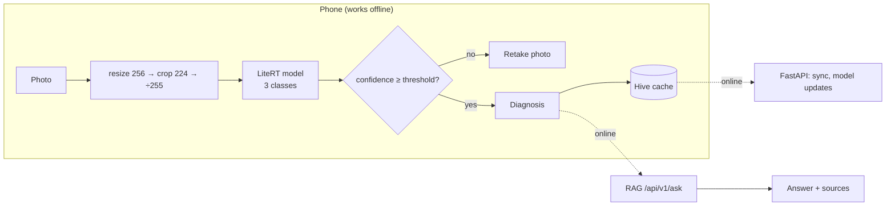

# Presentation Plan: "Beyond the API Call: On-Device AI in Flutter with LiteRT and Offline-First Architecture"

## Goal
A small, testable system that backs every claim in the talk with a measured number:
- a 3-class **potato** classifier that runs on the phone
- a FastAPI backend for chat and sync
- a RAG service that answers "what do I do about this?" with cited sources

The model is a prop; the architecture is the product.

## Scope

| In | Out (one "what's next" slide) |
|---|---|
| Potato: early blight, late blight, healthy | Other crops, field-photo validation (PlantDoc) |
| One baseline model (frozen backbone) | Full fine-tuning, hyperparameter search, quantisation |
| Confidence threshold ("retake photo") | Out-of-distribution detection, calibration |
| `/predict`, `/ready`, `/ask` contracts; Go gateway (go-backend M0–M3) | auth beyond API keys, CI/CD, full RAGAS |
| Python-side benchmarks; Flutter app UI on mock data (LeafCheck) | Phone benchmarks (after F1: real LiteRT) |

## Architecture rule
**Diagnosis always runs on the phone. The network only adds advice (RAG), history sync and model updates.**

## Stage A: Data and model (`ml-training/`)

| # | Step | Command / change | Done when |
|---|---|---|---|
| A1 | Download | `uv run kaggle datasets download -d emmarex/plantdisease -p data/ --unzip` | 15 class folders present |
| A2 | Potato subset | Symlink the 3 `Potato___*` folders into `data/potato/` | EDA reports 3 classes |
| A3 | Explore | `python -m crop_ml.eda --data-dir data/potato` | Real image counts and imbalance ratio |
| A4 | Train | `python -m crop_ml.train --data-dir data/potato` | Best checkpoint saved |
| A5 | Evaluate | `python -m crop_ml.evaluate` | Test accuracy, macro F1, 3×3 confusion matrix |
| A6 | Confidence threshold | Lowest threshold with validation precision ≥ 95%, saved in the checkpoint | Unit test |
| A7 | Mismatch experiment | `crop_ml/mismatch.py`: correct vs stretched vs no ÷255 vs swapped colour channels | 4-row accuracy table |

## Stage B: Export and backend (`python-ml-service/`)

| # | Step | Done when |
|---|---|---|
| B1 | Copy the checkpoint and class names into `models/` | `/ready` → 200 |
| B2 | Export to LiteRT; threshold written to `crop_disease_v1.json` | `OK`, output shape `[1, 3]` |
| B3 | `/predict` returns `status: ok \| uncertain` using the same threshold | New test |
| B4 | `docs/API_CONTRACT.md`: `/predict`, `/ready`, `/ask`, error format | Examples match real responses |

## Stage C: RAG trimmed to potato (`rag-service/`)

| # | Step | Done when |
|---|---|---|
| C1 | Keep only the 3 potato notes (others moved to `knowledge/_other/`) | `/classes` lists 3 labels |
| C2 | Live `/ask` (scoped to one class, plus an off-topic question) | Cited answer; off-topic question refused |
| C3 | RAGAS on 5 potato questions | Saved scores, labelled "8B local judge" |

## Stage D: Benchmarks (`benchmarks/`)

| # | Measure |
|---|---|
| D1 | Model size: `.pt` vs `.tflite` |
| D2 | LiteRT inference latency on the laptop (p50/p95); phone numbers come from the app later |
| D3 | `/predict` latency (p50/p95) normally and with simulated 3G/2G |
| D4 | `/ask` latency, cold vs warm |
| D5 | Upload cost: full photo vs 224×224 JPEG |

Output: `benchmarks/results.md`.

## Stage E: Flutter app (later)
One screen, a `PredictionService` interface (on-device and backend implementations), Hive history, `connectivity_plus` plus a `/ready` check, a chat sheet calling `/ask`, and phone latency benchmarks.

## Test gate
After each stage, all three projects pass `uv run ruff check . && uv run pytest`.

## From work to slides

**The full slide-by-slide outline, template and screenshots are in [`PRESENTATION_SLIDES.md`](PRESENTATION_SLIDES.md).** The table below is the original mapping.

| Slide | Source |
|---|---|
| Why offline-first | D3, D5 |
| Know your data | A3 |
| Model results | A5 |
| Export to LiteRT | B2 |
| Silent preprocessing failure | A7 |
| Don't guess: abstain | A6, B3 |
| The contract | B4 |
| RAG seam | C2, C3 |
| Limitations and what's next | Scope table |

## Risks
- **Lab photos:** accuracy will look high but won't hold in the field. Say so on the limitations slide.
- **Few "healthy" images:** the balancing sampler is in place; A3 shows the real count.
- **Local-model latency:** pre-warm Ollama before the demo, or show a recording.

## Progress (2026-10-29)

| Stage | Status | Result |
|---|---|---|
| A1–A3 Data | ✅ | 2,152 potato images: early blight 1,000, late blight 1,000, healthy 152 (6.6× imbalance) |
| A4–A5 Model | ✅ | Trained in ~40 s (M-series GPU). Test accuracy **95.8%**, macro F1 **0.945** |
| A6 Threshold | ✅ | 0.50. Test: answers 96.3% of photos, 97.1% of those correct |
| A7 Mismatch | ✅ | Correct 95.8% · forgot ÷255 **9.3%** (calls 210/216 leaves "healthy") · red/blue swapped **55.6%** · stretch 97.7% (square photos) |
| B1–B3 Export + API | ✅ | `.tflite` 9.0 MB, `[1,224,224,3]` → `[1,3]`, matches PyTorch to 8e-7; `/predict` returns `status` |
| B4 Contract | ✅ | `docs/API_CONTRACT.md` (real responses) |
| C1–C3 RAG | ✅ | 3 potato notes, 17 chunks. RAGAS (5 Qs, 8B judge): faithfulness 0.51 → **0.88** after two fixes |
| Field photos (PlantDoc) | ✅ | 221 potato field photos: accuracy **54.8%** (lab 95.8%); early blight recall 38.8%; threshold still answers 86% of them at 55% accuracy |
| D Benchmarks | ✅ | `benchmarks/results.md`: on-device **1.9 ms** vs backend 18 ms server time; modelled 3 MB photo upload ≈ 34 s on 3G, ≈ 4 min on 2G; RAG warm ≈ 3.5 s |
| E Flutter app | 🟡 | UI done on mock data (`mobile-app/`, 91 tests); LiteRT + Hive next (F1) |

### What moved the RAG scores (5 potato questions, local llama3.1:8b judge)

| Change | Faithfulness | Context recall | Answer accuracy |
|---|---|---|---|
| Original prompt | 0.51 | 0.81 | 0.70 |
| Prompt: answer only what was asked, no outside facts | 0.77 | 0.81 | 0.50 |
| Knowledge notes: self-contained "Cause" sentences | **0.88** | **0.88** | **0.75** |

Lessons for the talk: padding rules in prompts invite invented advice, and tiny chunks that don't
name their subject ("Phytophthora infestans.") are hard for a small embedding model to retrieve.

### Caveats to state on stage
- **Lab vs field:** 95.8% on PlantVillage lab photos, **54.8% on PlantDoc field photos**. The model
  knows "diseased" but confuses the two blights, and the confidence threshold does not catch it.
  Say this on the limitations slide; it is also the strongest argument for collecting field data.
- Network times in D3 are modelled from stated profiles; phone measurements come with Stage E.
- RAGAS on 5 questions with an 8B judge is directional, not a benchmark.
