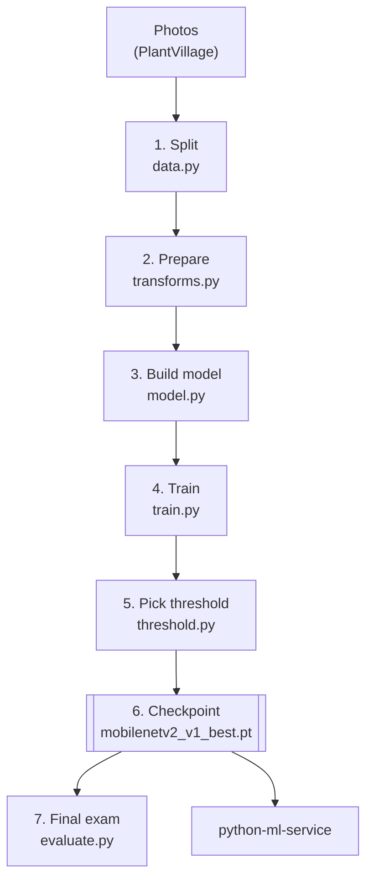
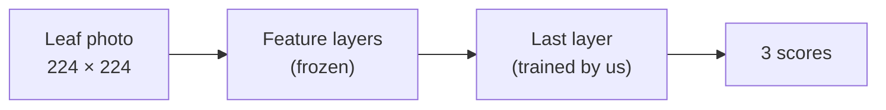
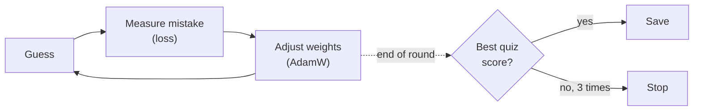
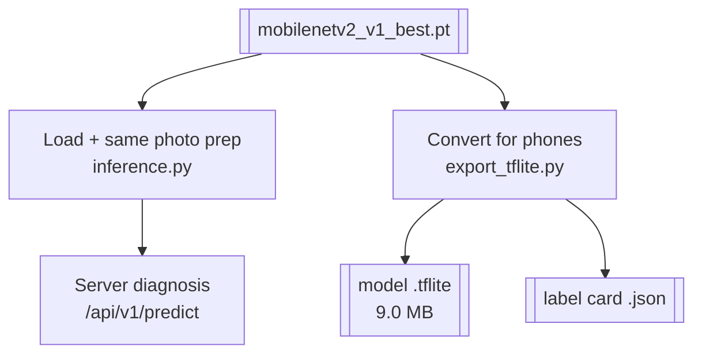

# ML training explained (for beginners)

ML training is like **teaching a student to recognise three potato-leaf conditions from flashcards**. It happens
once, on the laptop, in the `ml-training/` folder, and produces one file that the python-ml-service then picks up.

More context: [`HOW_IT_WORKS.md`](../HOW_IT_WORKS.md) · [`ARCHITECTURE_FLOW.md`](../ARCHITECTURE_FLOW.md)



---

## Step 0: The flashcards (the data)
**Where:** `ml-training/data/PlantVillage/`

There's a folder per class, and **the folder name is the answer**:
```
PlantVillage/
├── Potato___Early_blight/   (photos of early blight)
├── Potato___Late_blight/    (photos of late blight)
└── Potato___healthy/        (only 152 photos!)
```
That's 2,152 photos in total, each with a known correct answer. This is called **labelled data**.

**Look before you learn:** `eda.py` counts the photos and draws a chart. It shows **healthy has about 6.6× fewer photos**
than each disease. Remember that; it matters in step 1.

---

## Step 1: Split the cards into three piles (`data.py`)
You never test a student on the same cards they studied, or you can't tell whether they actually learned.
So the photos are split:

| Pile | Roughly | Used for |
|---|---|---|
| **Train** | 80% | The student studies these |
| **Validation** | 10% | A practice quiz after each round, to pick the best version |
| **Test** | 10% (216 photos) | The final exam, used only once at the end |

- **Stratified** means each pile keeps the same mix of classes, so healthy leaves appear in every pile.
- The exact split is saved to `outputs/splits.json`, so the experiment can be repeated exactly (seed 42).
- **Fixing the imbalance:** a `WeightedRandomSampler` shows the rare healthy photos **more often** during study.
  Otherwise the student would mostly see diseased leaves and learn to just say "diseased".

---

## Step 2: Prepare every photo the same way (`transforms.py`)
A model doesn't see a "photo". It sees a grid of numbers, and it needs every photo in the same format:

1. **Resize** so the short side is 256 pixels.
2. **Crop** the centre to 224 × 224 (the size the model expects).
3. **Turn colours into numbers** between 0 and 1 (divide by 255), then **normalise** them the way the model saw
   images originally.

**For study photos only:** random crops and flips, so the student learns "a leaf is a leaf even if it's turned
around". This is called **augmentation**.

> ⚠️ **The phone must later prepare photos exactly like this** (the val/test version), or answers go wrong. That's
> the "silent bug": forgetting the ÷255 step dropped accuracy to 9.3%.

---

## Step 3: Pick a student who can already see (`model.py`)
We don't start from a blank brain. We use **MobileNetV2**, a small model (about 3.4 M parameters) that Google
already trained on over a million everyday photos. It already recognises **edges, spots, textures and shapes**.

```python
model = mobilenet_v2(weights=IMAGENET1K_V2)       # the experienced student
for p in model.features.parameters():
    p.requires_grad = False                        # freeze: keep how it sees
model.classifier[1] = nn.Linear(model.last_channel, 3)   # new last step: 3 answers
```

- **Freeze** the "seeing" part, so it doesn't change.
- **Replace** only the last layer with one that has **3 outputs**: early blight, late blight, healthy.

This is **transfer learning**: like hiring someone who can already read and teaching them only three new words.
It's why training takes about **40 seconds**, not days.



---

## Step 4: Study in rounds (`train.py`)
Training repeats **rounds** called **epochs** (up to 10). In each round:

1. **Study:** show the training photos in small batches. For each photo the model guesses, e.g. "70% late blight".
2. **Measure the mistake (loss):** compare the guess with the correct answer. Cross-entropy loss is a number
   that's big when the model is confidently wrong and small when it's right.
3. **Adjust:** the optimiser (AdamW) nudges the last layer's numbers slightly, so the next guess is a bit better.
   That's "learning".
4. **Practice quiz:** check the validation pile, which the model doesn't learn from. If this is the best quiz
   score so far, **save this version**.

```
round 1 ─ study ─ quiz loss 0.40  ✔ best so far → save
round 2 ─ study ─ quiz loss 0.25  ✔ save
round 3 ─ study ─ quiz loss 0.27  ✗ worse (1)
round 4 ─ study ─ quiz loss 0.28  ✗ worse (2)
round 5 ─ study ─ quiz loss 0.29  ✗ worse (3) → stop early, keep round 2
```
(Illustrative numbers.)

**Early stopping** (after 3 rounds with no improvement) prevents **overfitting**: memorising the study cards instead
of really learning.



---

## Step 5: Decide when to say "I'm not sure" (`threshold.py`)
The model always gives three percentages that add up to 100%. We pick a rule on the **validation** pile: if the
top score is below **50%**, say **"Not sure, retake the photo"** instead of guessing.

With 50%, it answers 96.3% of photos and is right 97.1% of the time when it does.

---

## Step 6: Save everything in one file (the checkpoint)
The output is **`outputs/checkpoints/mobilenetv2_v1_best.pt`**. Think of it as the student's diploma plus
instructions:

| Inside the checkpoint | Why |
|---|---|
| The learned numbers (weights) | The actual "knowledge" |
| Class names | So output 1 = "Early blight", etc. |
| Image size (224), mean/std | How to prepare a photo |
| Threshold (0.5) | When to say "not sure" |
| Model version (v1) | So everyone knows which model gave an answer |

`class_names.json` is saved beside it.

---

## Step 7: The final exam (`evaluate.py`)
Now, and only now, the **test pile** (216 photos it has never seen) is used:
- **95.8%** correct, F1 0.945, saved in `outputs/eval_summary.json`
- a confusion matrix showing which classes get mixed up

Two extra experiments:
- `mismatch.py`: what happens when photos are prepared wrongly (the 9.3% "silent bug").
- `field_eval.py`: real field photos (PlantDoc) score only **54.8%**, because lab photos are easier than real fields.

---

## Where python-ml-service picks up
**The hand-off is one copy:**
```bash
cp ml-training/outputs/checkpoints/{mobilenetv2_v1_best.pt,class_names.json} python-ml-service/models/
```

From there, python-ml-service uses the checkpoint in **two ways**:



1. **Serve it:** `app/services/inference.py` loads the checkpoint and reads the image size, mean/std and threshold
   **from it**, so the server prepares photos exactly like training. `POST /api/v1/predict` then answers with a
   diagnosis, or "uncertain" below 50%. This is the app's "second opinion".
2. **Convert it:** `scripts/export_tflite.py` turns it into a **`.tflite`** file small enough for phones, and checks
   it gives the same answers (difference ≤ 0.0000008). It also writes a **`.json` label card** (labels, threshold,
   input size), which the phone reads so nothing is hardcoded.

---

## Glossary

| Word | Meaning |
|---|---|
| Labelled data | Photos with a known correct answer (the folder name) |
| Train / validation / test | Study pile / practice quiz / final exam |
| Stratified | Every pile keeps the same mix of classes |
| Augmentation | Random crops and flips so the model sees variety |
| Transfer learning | Reuse a model that can already see; teach only the last step |
| Epoch | One full round through the study pile |
| Loss | A number for "how wrong"; training makes it smaller |
| Optimiser (AdamW) | The rule that nudges the weights after each mistake |
| Overfitting | Memorising the study cards instead of learning |
| Early stopping | Stop when the quiz score stops improving |
| Threshold | The minimum confidence (50%) to give an answer |
| Checkpoint | The saved model file plus everything needed to use it |

---

### In one breath
> We take 2,152 labelled leaf photos, split them into study, quiz and exam piles, prepare each one the same way,
> start from a model that can already see, teach it only the last step in about 40 seconds of rounds, keep the
> version with the best quiz score, choose a 50% "not sure" rule, and save it all in one checkpoint file.
> python-ml-service picks up that file, serves it for second opinions, and converts it into the small `.tflite`
> file the phone runs.
