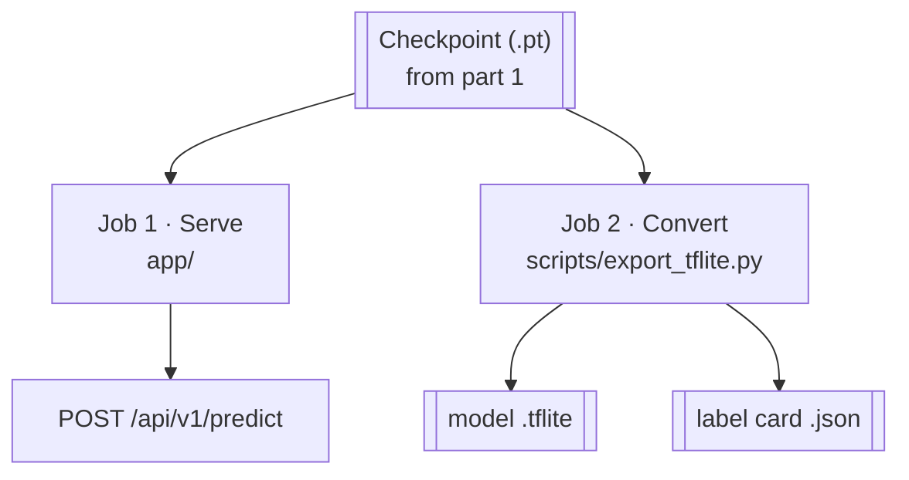
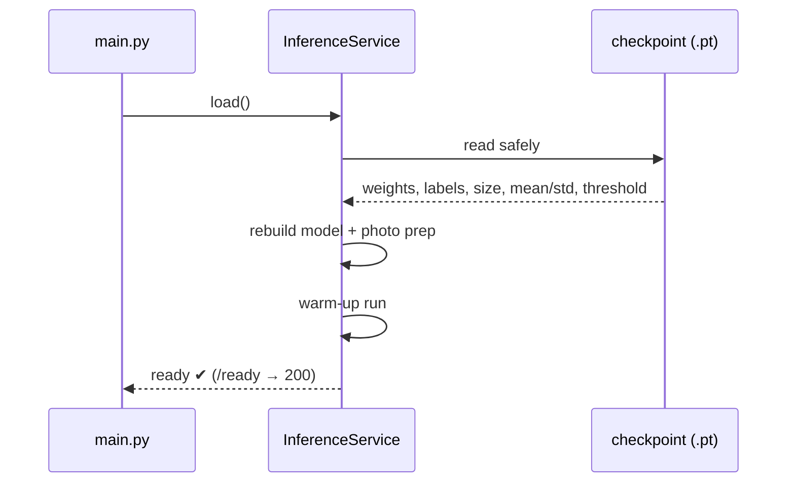
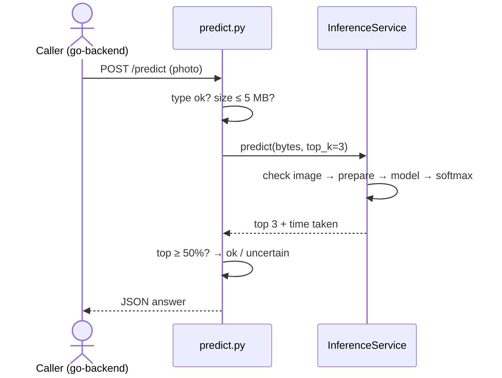
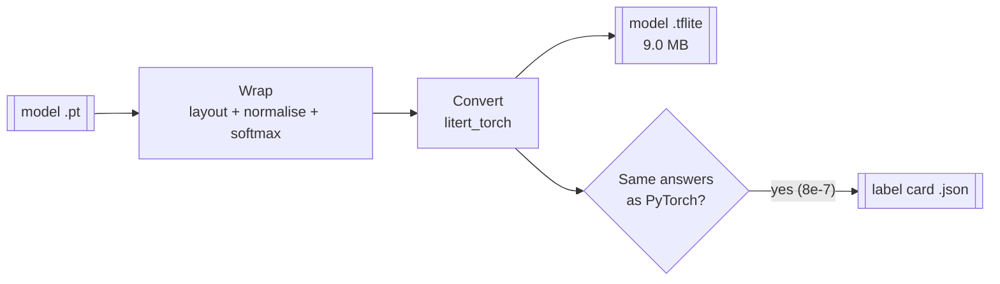
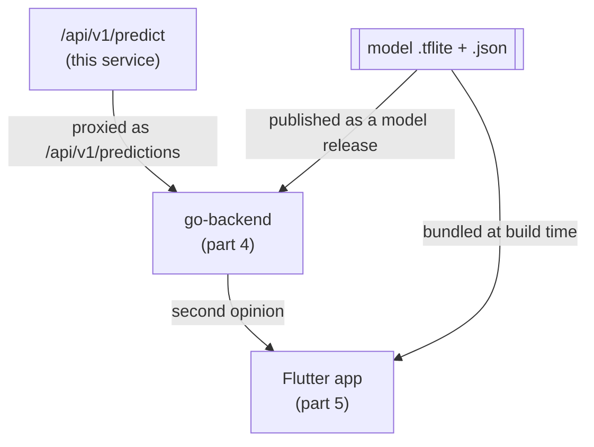

# Part 2 · python-ml-service explained (for beginners)

Part 1 ended with one file: the **checkpoint** (`mobilenetv2_v1_best.pt`), the trained "student" plus its instructions.
python-ml-service picks it up and does **two jobs**:

1. **The clinic 🏥:** it runs the model on a server, so anyone can send a leaf photo over HTTP and get a diagnosis.
   The app uses this as a **"second opinion"**.
2. **The translator 🔄:** it converts the model into a small **LiteRT (`.tflite`)** file that a phone can run
   offline, plus a **label card (`.json`)**.

Previous: [Part 1 · ML training](01_ML_TRAINING.md) · Index: [learn/](README.md)



---

## Step 0: Where we pick up
The hand-off from part 1 is one copy:
```bash
cp ml-training/outputs/checkpoints/{mobilenetv2_v1_best.pt,class_names.json} python-ml-service/models/
```

Remember what's inside the checkpoint. The service reads **all of it**, so it never has to guess:

| Inside | Used for |
|---|---|
| `model_state_dict` (the weights) | Rebuilding the trained model |
| `num_classes`, `class_names` | 3 outputs → "Early blight", "Late blight", "Healthy" |
| `image_size`, `mean`, `std` | Preparing photos exactly like training |
| `confidence_threshold` (0.5) | Deciding "ok" vs "uncertain" |
| `model_version` (v1) | Tagging every answer |

---

## Job 1 · The clinic: serving the model

### Step 1: Opening the clinic (start-up)
**Files:** `app/main.py`, `app/config.py`, `app/services/inference.py`

When the service starts, it **loads the model once**, not on every request:

```python
# app/main.py (lifespan): runs once at start-up
real = InferenceService(settings.checkpoint_path, settings.device)
real.load()          # a missing model fails fast here, not on the first user
```

`InferenceService.load()` does four things:
1. **Reads the checkpoint safely** (`torch.load(..., weights_only=True)`, which refuses to run hidden code inside a file).
2. **Rebuilds the model:** an empty MobileNetV2, with the last layer set to 3 outputs, then fills in the learned weights.
3. **Rebuilds the photo preparation** from the checkpoint's numbers (`build_preprocess`).
4. **Warms up:** it runs one dummy photo, because the first run is slow and it's better to pay that cost before any user arrives.

**Is the clinic open?** `GET /ready` returns **200** only when the model is loaded, otherwise **503**.
go-backend uses this to know whether "second opinion" is available.



### Step 2: A patient arrives (one prediction)
**File:** `app/routers/predict.py`

```bash
curl -F "file=@leaf.jpg" "http://localhost:8000/api/v1/predict?top_k=3"
```

What happens, in order:

| # | Step | Why |
|---|---|---|
| 1 | **Check the file type** (JPEG, PNG or WebP only) | Anything else → 415 |
| 2 | **Check the size** (at most 5 MB; reads only 5 MB + 1 byte) | A huge upload is refused without loading it all → 413 |
| 3 | **Check it's a real image** (`img.verify()`) | A broken file → 400 `invalid_image` |
| 4 | **Prepare the photo**: resize 256 → crop 224 → numbers 0–1 → normalise | **Exactly** like training (step 2 of part 1) |
| 5 | **Run the model** in a worker thread | The heavy maths doesn't block other requests |
| 6 | **Softmax** turns the 3 raw scores into percentages that add up to 100% | Easier to read |
| 7 | **Top-k**: sort, keep the best 3 | The answer list |
| 8 | **Threshold**: top ≥ 50% → `"ok"`, else `"uncertain"` | Same rule as the phone |

```python
# the photo preparation, rebuilt from the checkpoint (inference.py)
T.Resize(int(image_size * 256 / 224)),   # short side → 256
T.CenterCrop(image_size),                # → 224 × 224
T.ToDtype(torch.float32, scale=True),    # colours → 0..1
T.Normalize(mean, std),                  # same numbers as training
```

```python
# the "not sure" rule (predict.py)
status = "ok" if top[0].confidence >= service.confidence_threshold else "uncertain"
```



**The answer** (a real response, shortened):
```json
{
  "status": "ok",
  "prediction": {"class_name": "Potato___Late_blight", "condition": "Late blight", "confidence": 0.8429},
  "top_k": [ {"class_name": "Potato___Late_blight", "confidence": 0.8429}, … ],
  "is_healthy": false,
  "confidence_threshold": 0.5,
  "model_version": "v1",
  "inference_ms": 31.85
}
```
`class_name` is the exact label. The app passes it on when asking for advice (part 3).

### Step 3: When something goes wrong (one error shape)
**File:** `app/core/errors.py`

Every failure, whatever the cause, comes back in **the same shape**, so callers need only one way to read errors:
```json
{"error": "unsupported_media_type", "detail": "Got 'text/plain'…", "request_id": "0255dd1d…"}
```

| Status | `error` | When |
|---|---|---|
| 400 | `invalid_image`, `bad_request` | Unreadable or empty file |
| 413 | `payload_too_large` | Over 5 MB |
| 415 | `unsupported_media_type` | Not JPEG / PNG / WebP |
| 422 | `validation_error` | Missing or invalid field (e.g. `top_k=50`) |
| 503 | `model_not_loaded` | Model not ready |

The `request_id` lets you trace one request through go-backend and this service's logs.

---

## Job 2 · The translator: converting for phones
**File:** `scripts/export_tflite.py`. It's a standalone script with its own pinned dependencies, so it never clashes with the service.

A phone can't run PyTorch. It runs **LiteRT** (formerly TensorFlow Lite). The script converts the model **and makes it easier for the phone to use**.

### Step 4: Wrap the model so the phone's job is simple
```python
class MobileWrapper(nn.Module):
    def forward(self, x):
        x = x.permute(0, 3, 1, 2)          # phone layout (NHWC) → PyTorch layout (NCHW)
        x = (x - self.mean) / self.std     # normalisation INSIDE the model
        return torch.softmax(self.model(x), dim=1)   # percentages INSIDE the model
```
Three things move **inside** the model:

| Moved inside | So the phone… |
|---|---|
| Layout change (NHWC → NCHW) | can pass pixels in the order phone image libraries give them |
| Normalisation (mean/std) | only has to **divide by 255**: nothing else to get wrong |
| Softmax | gets percentages directly |

That's why the phone's preparation is just resize → crop → ÷255. Fewer steps on the phone means fewer chances for the "silent bug" from part 1.

### Step 5: Convert, then prove it's the same
```python
edge_model = litert_torch.convert(wrapped, (sample,))   # PyTorch → LiteRT
edge_model.export("crop_disease_v1.tflite")
```
Then it **checks its own work**: it runs the same random input through PyTorch and through the new `.tflite` and compares. The biggest difference is **0.0000008 (8e-7)**: effectively identical.

### Step 6: Write the label card
Next to the model it writes `crop_disease_v1.json`. The phone reads this card instead of hardcoding anything:
```json
{ "model_version": "v1",
  "input_shape": [1, 224, 224, 3], "input_layout": "NHWC", "input_range": [0, 1],
  "output": "probabilities",
  "class_names": ["Potato___Early_blight", "Potato___Late_blight", "Potato___healthy"],
  "confidence_threshold": 0.5 }
```



---

## Where it all goes next



- **Second opinion:** the app → go-backend `/api/v1/predictions` → this service's `/api/v1/predict`.
  The app never calls this service directly.
- **The phone model:** the `.tflite` + `.json` are copied into `mobile-app/assets/models/` (bundled with the app),
  and go-backend publishes them as model releases for updates.

---

## Try it yourself
```bash
cd python-ml-service
uv run uvicorn app.main:app --reload --port 8000          # or: docker compose up ml-service
curl -s localhost:8000/ready
curl -s -F file=@../mobile-app/assets/images/leaf_late_blight.jpg \
  "localhost:8000/api/v1/predict?top_k=3" | jq .
uv run pytest                                              # 25 tests, no real model needed
uv run scripts/export_tflite.py                            # rebuild the .tflite + .json
```
Interactive API docs: http://localhost:8000/docs

---

## Files at a glance

| File | Job |
|---|---|
| `app/main.py` | Creates the app; loads the model once at start-up |
| `app/config.py` | Settings: model path, device (cpu), 5 MB limit, allowed image types |
| `app/services/inference.py` | `InferenceService`: load, prepare, predict |
| `app/routers/predict.py` | `POST /api/v1/predict`, with checks and the ok/uncertain rule |
| `app/routers/health.py` | `/health` (alive) and `/ready` (model loaded) |
| `app/routers/models.py` | Info about the loaded model |
| `app/schemas/prediction.py` | Shapes of answers and errors |
| `app/core/errors.py` | One error format for everything |
| `scripts/export_tflite.py` | `.pt` → `.tflite` + `.json`, verified |
| `tests/` | 25 tests with a fake model |

---

## Glossary

| Word | Meaning |
|---|---|
| API / endpoint | A web address that does one job, e.g. `POST /api/v1/predict` |
| FastAPI | The Python framework the service is built with |
| Inference | Using the trained model to answer one photo |
| Softmax | Turns raw scores into percentages that add up to 100% |
| Top-k | The k best answers, sorted |
| Warm-up | One dummy run at start-up so the first real request is fast |
| Readiness (`/ready`) | "Am I able to answer right now?" (model loaded) |
| LiteRT / `.tflite` | Google's runtime and file format for models on phones |
| NHWC vs NCHW | Two orders for pixel data (phones use NHWC, PyTorch NCHW) |
| Label card (`.json`) | Labels, threshold and input size that travel with the model |
| `request_id` | A tag that follows one request through every service's logs |

---

### In one breath
> python-ml-service takes the checkpoint from training and does two things. As a **clinic**, it loads the model once,
> checks and prepares each uploaded photo exactly like training, and answers with the top diagnoses, saying
> "uncertain" below 50%. That's the app's second opinion, reached through go-backend. As a **translator**, it wraps the
> model so the phone only has to divide pixels by 255, converts it to a 9 MB `.tflite`, proves it gives the same
> answers, and writes a label card. Those two files are what the phone runs offline.

Next: **Part 3 · rag-service + Ollama**: advice from trusted notes.
