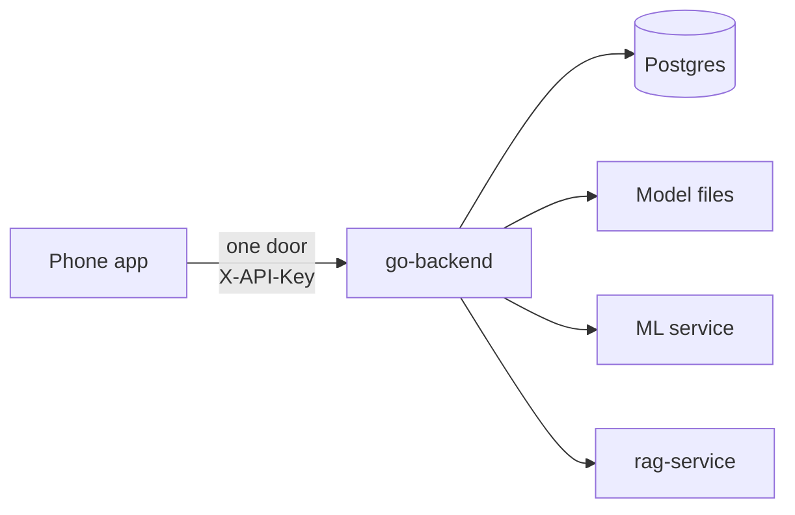
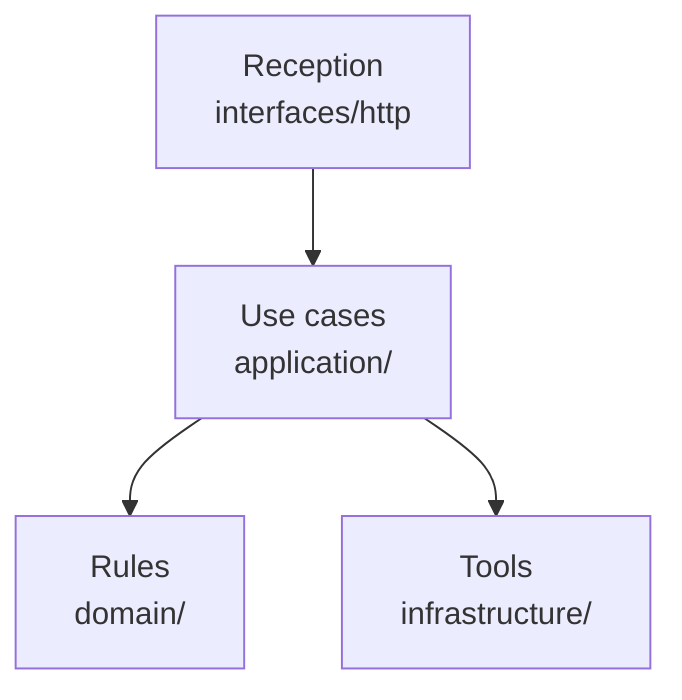
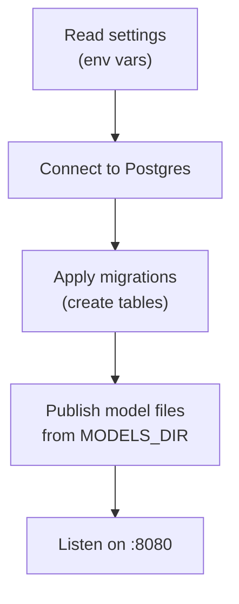
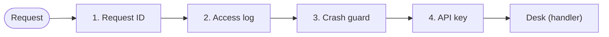
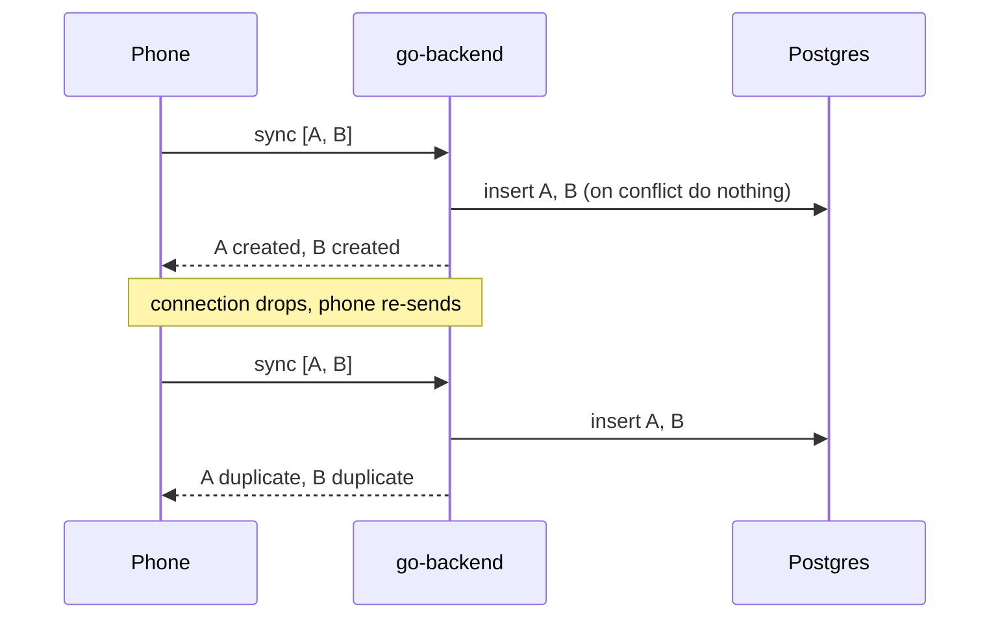
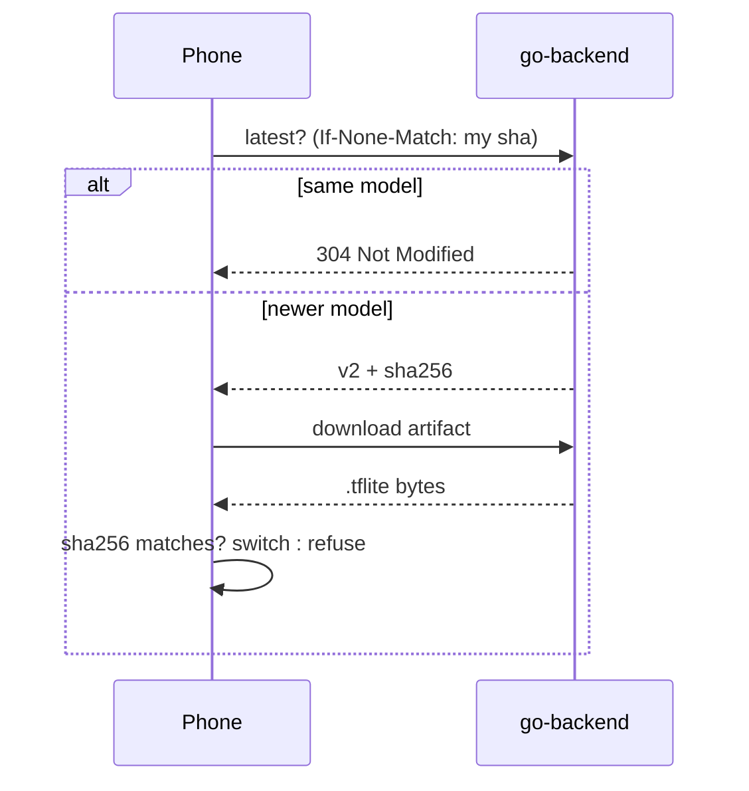
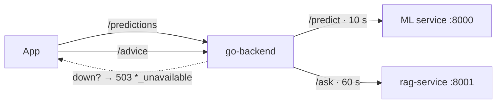

# Part 4 · go-backend explained (for beginners)

Parts 2 and 3 built two Python services: one diagnoses photos, one writes advice. But the phone **never talks to them
directly**. It talks to exactly one service: **go-backend**, the **front desk** 🏢 of the whole platform.

Previous: [Part 3 · rag-service + Ollama](03_RAG_SERVICE.md) · Index: [learn/](README.md)



---

## Step 0: Why one door?
Imagine a clinic where patients wander into any room they like. A **reception desk** fixes that. go-backend is that desk:

| Without a front desk | With go-backend |
|---|---|
| The app needs 2–3 addresses | One address (`:8080`) |
| Every service checks keys differently | One key check (`X-API-Key`) |
| Different error formats | One error shape everywhere |
| Python services exposed to the internet | Python services stay private |
| No single place to see what happened | One log per request (`X-Request-ID`) |

It's written in **Go**: small, fast, one binary, good at handling many requests at once.

---

## Step 1: The building's floors (clean layers)
The code is organised like the Flutter app: each floor has one job and only talks to the floor below.



| Floor | Folder | Job | Example |
|---|---|---|---|
| Reception | `internal/interfaces/http/` | Takes requests, checks keys, sends answers | `handlers/sync.go` |
| Use cases | `internal/application/` | The steps of one job | "sync a batch of diagnoses" |
| Rules | `internal/domain/` | What is valid, with no database or HTTP | "confidence must be 0–1" |
| Tools | `internal/infrastructure/` | Postgres, model files, calls to Python, settings, logs | `postgres/diagnosis_repository.go` |

**Why bother?** The rules can be tested without a database, and the database or a Python service can change without touching the rules. The repo has **34 Go tests**.

---

## Step 2: Opening up (start-up)
**Files:** `cmd/api/main.go`, `internal/infrastructure/config/config.go`, `internal/infrastructure/postgres/postgres.go`



1. **Read the settings** from environment variables. Two are required, so start-up fails fast without them:

   | Setting | Default | Meaning |
   |---|---|---|
   | `DATABASE_URL` | *(required)* | Where Postgres is |
   | `API_KEYS` | *(required)* | Accepted app keys, e.g. `dev-key` |
   | `ADMIN_API_KEYS` | empty | Keys allowed to publish/withdraw models |
   | `ML_SERVICE_URL` / `RAG_SERVICE_URL` | `:8000` / `:8001` | The two Python services |
   | `PREDICT_TIMEOUT` / `ADVICE_TIMEOUT` | 10 s / 60 s | How long to wait for them |
   | `MODELS_DIR` | `models` | Where `.tflite` + `.json` files are |

2. **Connect to Postgres** and **apply migrations**: SQL files in `migrations/` that create the tables. They're built into the binary and run automatically (goose).
3. **Publish model files:** every `crop_disease_<version>.tflite` + `.json` pair in `MODELS_DIR` becomes a model release, unless it's already published.
4. **Start listening** on port 8080. On shutdown, requests already in progress get time to finish.

**Is the desk open?**

| | Answers |
|---|---|
| `GET /health` | "The process is alive" |
| `GET /ready` | `{"database": true, "ml_service": true, "rag_service": true, "status": "ready"}`. **Ready needs only the database**; ML and RAG are reported so the app can grey out "second opinion" or "advice" when they're down |

---

## Step 3: Every request passes the door (middleware)
**File:** `internal/interfaces/http/middleware/middleware.go`

Before any desk sees a request, it passes four checks, in order:



| Check | What it does |
|---|---|
| **Request ID** | Uses the app's `X-Request-ID` or makes one, and echoes it back. The same ID appears in Python's logs |
| **Access log** | One log line per request: path, status, time taken |
| **Crash guard** | If code panics, return a clean 500 instead of killing the server |
| **API key** | `X-API-Key` must be one of `API_KEYS` (compared in constant time); otherwise **401** |

**One error shape** (`handlers/respond.go`), the same as the Python services:
```json
{"error": "unauthorized", "detail": "missing or invalid X-API-Key", "request_id": "0dd9d08c…"}
```

---

## Step 4: Desk 1, saving diagnoses (sync)
**Endpoint:** `POST /api/v1/diagnoses:sync`, with up to **500** diagnoses per call
**Files:** `handlers/sync.go`, `application/diagnosis/service.go`, `domain/diagnosis/diagnosis.go`, `infrastructure/postgres/diagnosis_repository.go`

The phone sends everything in its outbox:
```json
{"items": [{
  "id": "ea92ff1a-080d-4f2c-a4dc-bd0f33f02e7c",
  "device_id": "efab8227-89f5-4765-b4ca-2ad0ec29fa8d",
  "class_label": "Potato___Late_blight",
  "confidence": 0.878, "confidence_threshold": 0.5,
  "model_version": "v1", "captured_at": "2026-11-04T18:16:53Z"
}]}
```

**Rule check** (`domain/diagnosis/diagnosis.go`): each item must have:
- an `id` that's a **UUID made by the phone**
- a `device_id` and a `class_label`
- `confidence` and `confidence_threshold` between 0 and 1
- a `model_version`
- a `captured_at` that's **not more than 24 h in the future** (farmers' phones often have the wrong time, so small errors are tolerated)

**Saving** (the one line that makes it safe to repeat):
```sql
INSERT INTO diagnoses (id, device_id, class_label, …) VALUES ($1, $2, $3, …)
ON CONFLICT (id) DO NOTHING      -- same id again → nothing inserted
```

**The answer** reports each item separately, in the same order. One bad item doesn't fail the batch:
```json
{"created": 1, "duplicate": 0, "invalid": 0,
 "items": [{"id": "ea92ff1a-…", "outcome": "created"}]}
```

| Outcome | Meaning | The phone then… |
|---|---|---|
| `created` | New, saved | marks it **Synced** |
| `duplicate` | Already had it (e.g. a re-send after a dropped connection) | marks it **Synced** |
| `invalid` | Broke a rule; comes with `error.detail` | marks it **Rejected** and shows the reason |



**Why sending twice is safe:** the phone makes the ID, and the database refuses a second row with the same ID. This is called **idempotent**: doing it twice has the same effect as doing it once.

---

## Step 5: Desk 2, history
**Endpoint:** `GET /api/v1/devices/{device_id}/diagnoses?limit=50&cursor=…`

It returns one device's diagnoses, **newest first**, one page at a time. Each page includes a `next_cursor`, a bookmark for the next page, or `null` on the last page. An index on `(device_id, captured_at)` keeps this fast.

---

## Step 6: Desk 3, model releases (updates)
**Files:** `handlers/model_release.go`, `application/modelrelease/service.go`, `domain/modelrelease/modelrelease.go`, `infrastructure/filestore/filestore.go`

A **model release** is a version (`v1`, `v2`…) plus its file's **sha256 fingerprint**, size, labels and threshold.

| Endpoint | Job |
|---|---|
| `GET /api/v1/model-releases/latest` | The newest release. Its **ETag** is the sha256; if the phone sends it back (`If-None-Match`) and nothing changed → **304 Not Modified**, with no body |
| `GET /api/v1/model-releases/{version}/artifact` | Downloads the `.tflite`. Supports **Range** (resume a broken download) and sends `X-Checksum-Sha256` |
| `POST /api/v1/model-releases` | Publish a version (admin key only) |
| `DELETE /api/v1/model-releases/{version}` | Withdraw it; "latest" falls back to the previous one (admin key only) |

**Safety check:** the server re-checks the file's fingerprint before serving it. If someone replaced the file after publishing, it refuses with **409 `artifact_checksum_mismatch`**. The rule is: publish a new version, never edit an old one.



---

## Step 7: Desk 4, forwarding to the Python services
**Files:** `handlers/proxy.go`, `application/prediction/service.go`, `application/advice/service.go`, `infrastructure/upstream/upstream.go`

| App calls | go-backend forwards to | Waits at most |
|---|---|---|
| `POST /api/v1/predictions` (photo ≤ 5 MB) | ML service `POST /api/v1/predict` | 10 s |
| `POST /api/v1/advice` (`{question, class_name}`) | rag-service `POST /api/v1/ask` | 60 s |

The Python answer is passed back **unchanged**, so parts 2 and 3 describe exactly what the app receives.

If a Python service is down, slow or broken, the app gets a clear **503**: `prediction_unavailable` or `advice_unavailable`. The app then keeps its on-phone result and shows "advice unavailable"; it never blocks.



---

## Step 8: The database
**Postgres**, running in Docker; port **5433** on your laptop (to avoid clashing with a local Postgres).
The tables come from `migrations/`:

| Table | Holds |
|---|---|
| `diagnoses` | id (UUID, primary key), device_id, class_label, confidence, threshold, model_version, captured_at (phone time), recorded_at (server time, the trusted one) |
| `model_releases` | version, sha256, size, labels, threshold, published/withdrawn |

Note what's **not** stored: **photos**. Sync sends only the result.

---

## Try it yourself
```bash
# from the repo root: everything (Postgres, ML, RAG, go-backend)
docker compose up -d --build --wait
# or only Postgres in Docker + Go on your machine:
cd go-backend && make db-up && make run

K='X-API-Key: dev-key'
curl -s localhost:8080/ready
U=$(uuidgen | tr A-Z a-z)
BODY='{"items":[{"id":"'$U'","device_id":"try-me","class_label":"Potato___Late_blight","confidence":0.9,"confidence_threshold":0.5,"model_version":"v1","captured_at":"2026-11-04T09:00:00Z"}]}'
curl -s -H "$K" -H 'Content-Type: application/json' localhost:8080/api/v1/diagnoses:sync -d "$BODY"   # created
curl -s -H "$K" -H 'Content-Type: application/json' localhost:8080/api/v1/diagnoses:sync -d "$BODY"   # duplicate
curl -si -H "$K" localhost:8080/api/v1/model-releases/latest | grep -i etag
make test               # unit tests, no database needed
```

---

## Files at a glance

| File | Job |
|---|---|
| `cmd/api/main.go` | Start-up: settings, database, migrations, publish models, server |
| `internal/infrastructure/config/config.go` | Reads and checks env vars |
| `internal/interfaces/http/router.go` | Which URL goes to which handler; where keys are required |
| `internal/interfaces/http/middleware/middleware.go` | Request ID, access log, crash guard, API key |
| `internal/interfaces/http/handlers/` | `sync.go`, `diagnosis.go`, `model_release.go`, `proxy.go`, `health.go`, `respond.go` |
| `internal/application/*/service.go` | Use cases: diagnosis, modelrelease, prediction, advice |
| `internal/domain/diagnosis`, `modelrelease` | The rules |
| `internal/infrastructure/postgres/` | SQL: saving and reading |
| `internal/infrastructure/filestore/` | Model files + checksum |
| `internal/infrastructure/upstream/` | HTTP calls to the Python services |
| `migrations/` | Table definitions |
| `Makefile` | `run`, `test`, `db-up`, `test-integration`, `docker` |

---

## Glossary

| Word | Meaning |
|---|---|
| Gateway / front desk | The single entry point that routes requests to the right place |
| Middleware | Checks every request passes through before reaching a handler |
| Handler | The code for one endpoint |
| Use case | The steps of one job ("sync a batch") |
| Domain | The business rules, independent of databases and HTTP |
| Migration | A versioned SQL file that creates or changes tables |
| UUID | A random, globally unique ID, made on the phone |
| Idempotent | Safe to repeat: twice has the same effect as once |
| ETag / 304 | A fingerprint of a resource; "304 Not Modified" means "you already have it" |
| Range request | Download part of a file, to resume after a drop |
| sha256 | A file's fingerprint; one changed byte changes it |
| Proxy | Forward a request to another service and pass the answer back |
| 503 | "The service behind me is unavailable right now" |

---

### In one breath
> go-backend is the platform's front desk: the only door the phone uses. Every request gets an ID, a log line, a
> crash guard and a key check. It saves diagnoses safely: the phone makes each ID, the rules are checked, and
> `ON CONFLICT DO NOTHING` turns re-sends into "duplicate", never a second row. It serves history page by page. It
> hands out model updates cheaply (304 when unchanged), resumably (Range) and safely (sha256). And it forwards
> second-opinion photos and advice questions to the Python services, answering a clear 503 when they're down so the
> phone never waits.

Next: **Part 5 · the Flutter app**: how the phone ties everything together.
