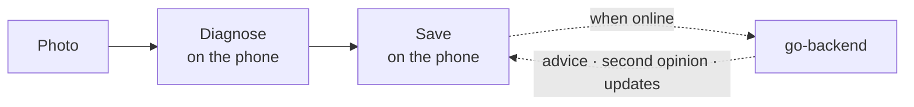
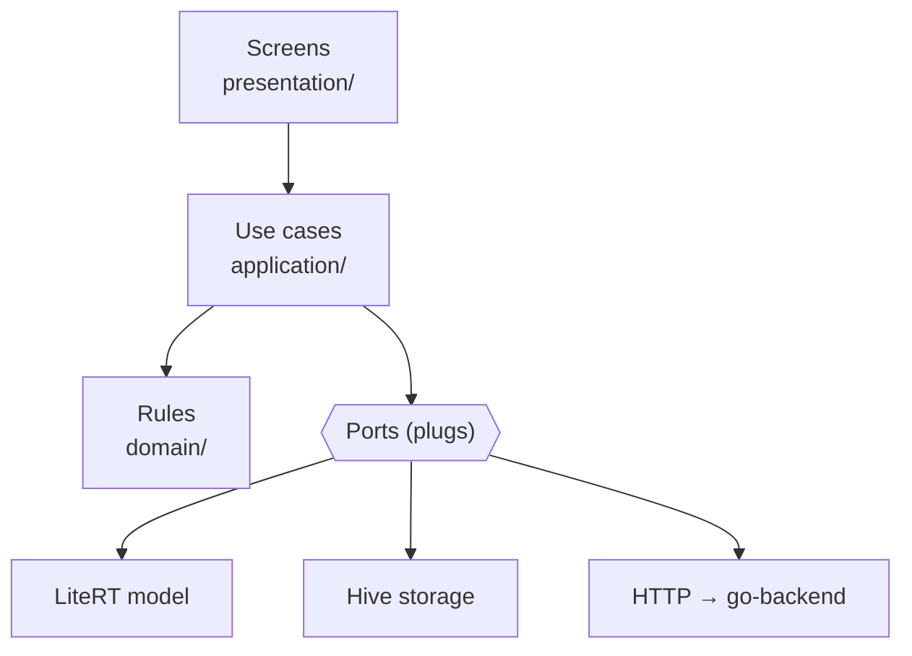
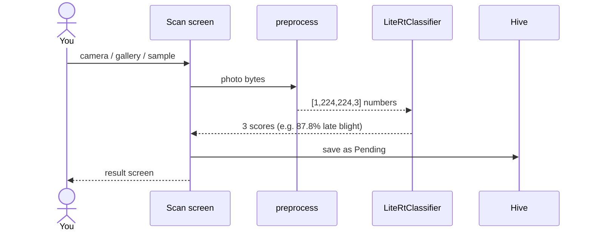
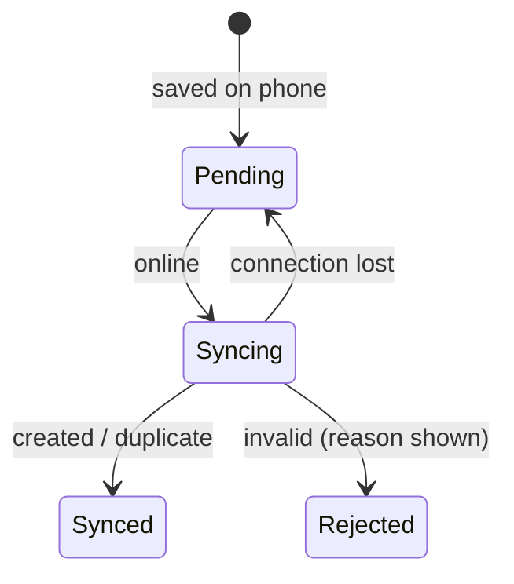
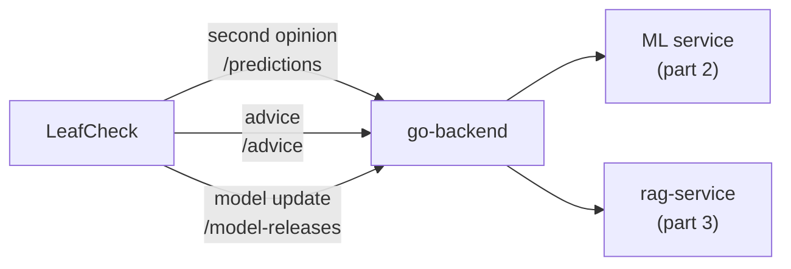

# Part 5 · The Flutter app explained (for beginners)

This is the last stop. Parts 1–4 built the model, the two Python services and the front desk. **LeafCheck**, the
Flutter app, is the **pocket doctor** 📱 that ties it all together. It diagnoses a leaf **on the phone, with no
internet**, saves the result first, and uses the backend only for extras when a connection exists.

Previous: [Part 4 · go-backend](04_GO_BACKEND.md) · Index: [learn/](README.md)



---

## Step 0: The phone is the doctor
| Works with **no internet** | Needs the backend (extras) |
|---|---|
| Take/pick a photo, diagnose it (~10–50 ms) | Sync results to the server |
| "Not sure" when below 50% | Second opinion from the server model |
| History, disease library, settings | Advice with sources |
| | Model updates |

If the backend is off, the app still does its main job. That's **offline-first**.

---

## Step 1: The app's floors (clean layers)
Like go-backend, the code is split into floors. Screens never touch the model, the database or the network directly.



| Floor | Folder | Example |
|---|---|---|
| Screens | `features/*/presentation/` | the Result page, History page |
| Use cases | `features/*/application/` | `DiagnoseLeaf`, `SyncDiagnoses`, `AskAdvice` |
| Rules | `features/*/domain/` | `Prediction`: top score ≥ threshold → confident, else "not sure" |
| Plugs (ports) | `features/*/domain/repositories/ports.dart` | `Classifier`, `DiagnosisRepository`, `SyncService` |
| Real parts (adapters) | `features/*/infrastructure/` | `LiteRtClassifier`, `HiveDiagnosisRepository`, `HttpSyncService` |

**Ports are like wall sockets.** A use case says "I need a `Classifier`", and something gets plugged in:
- **Real build:** `app/di/real_overrides.dart` plugs in LiteRT, Hive and HTTP.
- **Mock build** (tests, design states): `app/di/mock_overrides.dart` plugs in fake ones.

The wiring is done with **Riverpod** providers in `app/di/providers.dart`. A test (`test/architecture_test.dart`) fails the build if a screen imports a database or network library directly.

---

## Step 2: Starting the app
**Files:** `lib/main.dart`, `lib/app/di/real_overrides.dart`

```dart
// main.dart: real parts by default; --dart-define=SCENARIO=offline uses mock data
overrides: scenario.isEmpty
    ? await realOverrides()
    : mockOverrides(MockScenario.fromName(scenario)),
```

`realOverrides()` prepares, in order:
1. **Hive** (a small database on the phone): opens a `settings` box and a `diagnoses` box.
2. **ModelStore:** loads the **bundled model** `assets/models/crop_disease_v1.tflite` + `.json` (from part 2), computes its sha256, and remembers which model is active. That could later be a downloaded v2.
3. **ApiClient:** the one HTTP client, pointed at `SERVER_URL` (default `http://10.0.2.2:8080`) with `API_KEY` (default `dev-key`).
4. **Settings:** a device ID (a UUID made once), the theme, and whether onboarding was done.

---

## Step 3: One scan, step by step



**1. Pick a photo** (`scan/widgets/photo_source_sheet.dart`): camera or gallery (`image_picker`, capped at 1600 px), or one of the bundled **sample leaves**, which are handy on an emulator.

**2. Prepare it** (`litert/preprocess.dart`), in a background isolate (`compute`) so the screen never freezes:
```dart
// short side → 256, centre crop 224 × 224, RGB 0..1, NHWC
final scale = 256 / min(image.width, image.height);
final resized = img.copyResize(image, width: …, height: …);
out[i++] = p.rNormalized;   // red / 255
out[i++] = p.gNormalized;   // green / 255
out[i++] = p.bNormalized;   // blue / 255
```
**Why only ÷255?** Part 2's wrapper put the normalisation **inside** the model, so the phone has fewer steps to get wrong. That's the "silent bug" guard from part 1.

**3. Run the model** (`litert/litert_classifier.dart`, using `flutter_litert`):
```dart
_interpreter = Interpreter.fromBuffer(await store.bytesOf(active));   // load once
final out = Float32List(labels.length);                              // [1, 3]
interpreter.run(input, out);                                         // 3 percentages
```
The labels, threshold and version come from the **label card** (`.json`), never hardcoded. The interpreter is reused and reloaded only if the active model changes.

**4. Apply the rule** (domain, `entities/prediction.dart`): top score ≥ threshold (0.5) → a diagnosis; otherwise **"Not sure, retake"**.

**5. Save before showing** (`application/use_cases.dart` → `DiagnoseLeaf`): the diagnosis gets a **UUID made on the phone**, is saved in Hive as **Pending** (the photo is copied into the app's folder), and only then appears on screen. If the app crashes, nothing is lost.

**Real numbers from the emulator:** late-blight sample **87.8%** (55 ms for the first run), early-blight sample **67.2%**; the speed test gives **11 ms** typical.

---

## Step 4: Offline first, sync later

**What "online" means** (`settings/infrastructure/http_backend_status_source.dart`): **go-backend answered `GET /ready` within 2 seconds**, checked every 10 s. Having Wi-Fi isn't enough.

> 🔎 **Real story:** on a real phone the app said "offline" while Wi-Fi worked. The default address `10.0.2.2` means
> "this laptop" only inside the Android emulator. The fix was to run the app with the laptop's IP:
> `--dart-define=SERVER_URL=http://192.168.1.3:8080`.

**Automatic sync** (`app/app.dart` → `diagnosis/infrastructure/http/http_sync_service.dart`): whenever `/ready` says online, the app uploads everything Pending to go-backend's `diagnoses:sync` (part 4).



Re-sending is always safe: go-backend answers "duplicate" for IDs it already has (part 4, `ON CONFLICT DO NOTHING`).

---

## Step 5: Extras when online



| Extra | Adapter | What happens |
|---|---|---|
| **Second opinion** | `http/http_server_classifier.dart` | Uploads the photo only when the user taps; the server model answers (e.g. 84.3% vs the phone's 87.8%, "Both agree") |
| **Advice** | `advice/infrastructure/http/http_advice_repository.dart` | Sends `{question, class_name}`; shows the answer and **only the sources it cites**; waits up to 90 s for a cold LLM |
| **Model update** | `model_update/infrastructure/http/http_model_update_repository.dart` | "Check for updates": ETag → 304 if unchanged; otherwise download → **check sha256** → switch, keeping the previous model as backup |

---

## Step 6: When things go wrong
**File:** `shared/http/api_client.dart`

Every network problem becomes one of a few **failures**, and the screens show one clear message for each:

| Problem | Failure | The user sees |
|---|---|---|
| No connection / timeout | `Offline` | "Advice needs internet" (diagnosis still works) |
| 401 | `Unauthorized` | Access key problem |
| 503 `*_unavailable` | `ServerUnavailable` | "Advice is unavailable right now" + reference |
| 4xx with a reason | `Invalid` | The reason (e.g. the phone's clock is ahead) |
| Anything else | `Unexpected` | A short message + reference ID |

---

## Step 7: How it's tested
- **97 tests** (`flutter test`), no device needed.
- **Golden tests:** a screenshot of every screen state in light and dark, compared pixel by pixel. They can also render at 3× for slides.
- **Adapter tests** (`test/infrastructure/real_adapters_test.dart`): sync, errors and advice parsing against a **fake HTTP server**, plus Hive round-trips and the preprocessing shape.
- **Accessibility checks:** contrast, tap-target size, labels and reduce motion. They found 4 real bugs.
- **Architecture test:** layers can't import what they shouldn't.

---

## Try it yourself
```bash
# 1. backend (repo root) + Ollama running
docker compose up -d --build --wait
# 2. app on the Android emulator (real model, real backend)
cd mobile-app && flutter run -d emulator-5554
#    or VS Code → Run and Debug → "LeafCheck: real backend (emulator)"
# 3. on a real phone (same Wi-Fi/hotspot as the laptop)
flutter run --dart-define=SERVER_URL=http://$(ipconfig getifaddr en0):8080
# 4. no backend at all (design states)
flutter run --dart-define=SCENARIO=offline
# 5. tests
flutter test
```
Then: Scan → **Use a sample photo** → result → airplane mode on → scan again (Pending) → airplane mode off (Synced) → **Get advice**.

---

## Files at a glance (`mobile-app/`)

| File | Job |
|---|---|
| `lib/main.dart` | Picks real or mock parts |
| `lib/app/app.dart` | App shell, theme, auto-sync |
| `lib/app/di/providers.dart`, `real_overrides.dart`, `mock_overrides.dart` | Wiring (Riverpod) |
| `lib/shared/http/api_client.dart` | One HTTP client, key, error mapping |
| `lib/features/diagnosis/infrastructure/litert/` | `preprocess.dart`, `litert_classifier.dart` |
| `lib/features/diagnosis/infrastructure/local/` | `hive_diagnosis_repository.dart` |
| `lib/features/diagnosis/infrastructure/http/` | sync + second opinion |
| `lib/features/advice/infrastructure/http/` | advice |
| `lib/features/model_update/infrastructure/` | `model_store.dart` + update over HTTP |
| `lib/features/settings/infrastructure/` | `/ready` check, settings in Hive |
| `lib/features/*/domain`, `application`, `presentation` | Rules, use cases, screens |
| `assets/models/` | The bundled `.tflite` + `.json` (from part 2) |
| `assets/knowledge/` | The disease notes (same as part 3), for offline reading |
| `test/` | 97 tests and goldens |
| `../.vscode/launch.json` | One-click run configurations |

---

## Glossary

| Word | Meaning |
|---|---|
| Widget | A piece of Flutter UI (a button, a screen) |
| Riverpod / provider | How parts are created and shared (the wiring) |
| Port / adapter | A plug (interface) and the real thing plugged into it |
| Isolate / `compute` | Running work in the background so the screen stays smooth |
| LiteRT / `flutter_litert` | Runs the `.tflite` model on the phone |
| Hive | A small, fast database stored on the phone |
| Outbox | Results waiting to be uploaded (Pending) |
| `--dart-define` | A setting passed when starting the app (`SERVER_URL`, `SCENARIO`) |
| `10.0.2.2` | "The laptop", as seen from inside the Android emulator |
| Golden test | A screenshot test: fails if the screen changes unexpectedly |

---

## The whole series in one breath
> **Part 1:** 2,152 labelled leaf photos teach MobileNetV2, which can already see, to tell three potato conditions
> apart, saved as one checkpoint. **Part 2:** python-ml-service serves that checkpoint for second opinions and
> converts it into a 9 MB `.tflite` plus a label card. **Part 3:** rag-service answers "what should I do?" from our
> own notes, with Ollama writing and citing. **Part 4:** go-backend is the single front desk: it saves results
> safely, hands out model updates, and forwards to Python. **Part 5:** the Flutter app runs the model on the phone
> with no internet, saves first, syncs later, and calls on the backend only for extras.

Big-picture diagrams: [`../ARCHITECTURE_FLOW.md`](../ARCHITECTURE_FLOW.md) · Plain-language overview: [`../HOW_IT_WORKS.md`](../HOW_IT_WORKS.md)
