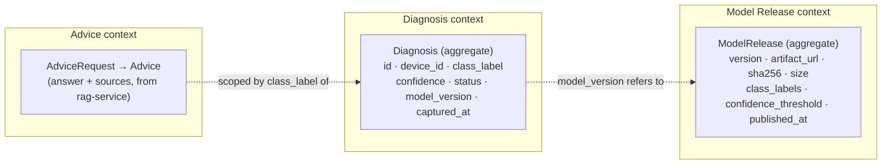

# PRD: go-backend (Crop Disease Platform)

| | |
|---|---|
| Status | Draft v1 · 2026-10-30 |
| Owner | Paul Mburu |
| Code | `go-backend/` (Go, chi, PostgreSQL) |
| Related | `docs/API_CONTRACT.md`, `docs/PRESENTATION_PLAN.md`, `python-ml-service/`, `rag-service/` |

## 1. Problem

Smallholder farmers photograph a leaf and need a diagnosis **in the field**, often on 2G or with no
signal. The platform therefore diagnoses **on the phone** (LiteRT model). The network is only used
to add value when it is available:

- keep a **history** of diagnoses beyond one phone (so they are not lost, and can be analysed);
- deliver **newer models** to phones;
- give **advice** ("what do I do about this?") from the RAG service.

Today the phone would have to talk to two Python services directly, with no place for history,
model versions, authentication or rate limiting. `go-backend` is that single, stable backend.

**Design rule:** the backend is **never on the diagnosis path**. If it is down, the app still
diagnoses; sync and advice simply wait.

## 2. Users

| User | Needs |
|---|---|
| Farmer app (Flutter / KMP) | Upload cached diagnoses when online; ask for advice; check for a newer model |
| Platform admin | Publish a new model release; see aggregate diagnosis data |
| Developers | Clear contracts, one error format, fast tests |

## 3. Goals and non-goals

**Goals (v1)**
1. Idempotent **diagnosis sync**: re-sending the same diagnosis never duplicates it.
2. **Model release** discovery: the app asks "latest model?" and gets version, URL, checksum, labels, threshold.
3. **Advice proxy** to `rag-service`, with timeouts and graceful failure.
4. Same conventions as the Python services: `X-Request-ID`, error shape `{"error","detail","request_id"}`.
5. Observable (structured logs, metrics, health/readiness) and secured (API key, rate limit, size limits).

**Non-goals (v1)**
- User accounts / login (devices are identified by an app-generated `device_id`; API key per app build).
- Storing photos (only the diagnosis result is synced).
- Running ML inference in Go (the Python service and the phone do that).
- Multi-region, sharding, event streaming.

## 4. Domain model (DDD)

### Ubiquitous language

| Term | Meaning |
|---|---|
| **Diagnosis** | One on-device classification result: which disease, how confident, when, by which model. |
| **Class label** | The classifier's exact label, e.g. `Potato___Late_blight`. Shared with the ML and RAG services. |
| **Confidence** | Top-1 probability, 0–1. |
| **Status** | `ok` if confidence ≥ the model's threshold, else `uncertain` (same rule as the API and the phone). |
| **Device** | One installation of the app, identified by a UUID it generates. |
| **Sync** | Uploading diagnoses that were cached on the device while offline. |
| **Model release** | A published `.tflite` model version the app may download. |
| **Advice** | A grounded, source-cited answer about a disease, produced by the RAG service. |

### Invariants
- Diagnosis: confidence ∈ [0, 1]; class label and device id non-empty; `captured_at` not in the future
  (small clock-skew allowance); `status` is derived, never sent by the client; the id is a
  client-generated UUID and is the idempotency key.
- Model release: version unique; sha256 is 64 hex chars; threshold ∈ [0, 1]; at least one class label;
  exactly one release is "latest" (most recently published, not withdrawn).

## 5. Functional requirements

### Diagnosis context
| ID | Requirement | Milestone |
|---|---|---|
| D1 | `POST /api/v1/diagnoses` records one diagnosis; same id again → 200 with the stored record, no duplicate | M0 |
| D2 | `GET /api/v1/diagnoses/{id}` | M0 |
| D3 | `POST /api/v1/diagnoses:sync` accepts up to 500 diagnoses; returns per-item result (created / duplicate / invalid) | M1 |
| D4 | `GET /api/v1/devices/{device_id}/diagnoses` with cursor pagination, newest first | M1 |

### Model Release context
| ID | Requirement | Milestone |
|---|---|---|
| R1 | `POST /api/v1/model-releases` (admin key) publishes a release | M2 |
| R2 | `GET /api/v1/model-releases/latest` returns version, URL, sha256, size, labels, threshold; supports `ETag` / `If-None-Match` so phones can check cheaply | M2 |
| R3 | Withdraw a release; "latest" falls back to the previous one | M2 |

### Advice context
| ID | Requirement | Milestone |
|---|---|---|
| A1 | `POST /api/v1/advice` → forwards to `rag-service` `/api/v1/ask` with `class_name`; returns answer + sources | M3 |
| A2 | Timeout (default 30 s), one retry on connection error only, 503 `advice_unavailable` when the RAG service is down | M3 |
| A3 | Optional: `POST /api/v1/predictions` proxy to `python-ml-service` | M3 |

## 6. Non-functional requirements

| Area | Requirement |
|---|---|
| Latency | p95 < 50 ms for diagnosis/model-release endpoints (excluding network); advice bounded by RAG timeout |
| Availability | Startup fails fast if the DB is unreachable; `/ready` = DB reachable; `/health` = process alive |
| Resilience | Upstream timeouts on every outbound call; no unbounded retries |
| Security | API key on `/api/v1/*` (constant-time compare); admin key for publishing; per-key rate limit (M4); request body ≤ 1 MB; input validation in the domain |
| Observability | JSON logs (`log/slog`) with `request_id`; Prometheus metrics at `/metrics` (M4) |
| Contract | OpenAPI document (M4); error shape and `X-Request-ID` identical to the Python services |
| Quality | Domain and application layers 100% unit-testable without a DB; repositories covered by integration tests |

## 7. Success metrics
- Zero duplicate diagnoses after repeated sync of the same batch.
- An offline phone that reconnects syncs a 100-item backlog in one request.
- App detects a new model with a single conditional GET (304 when unchanged).

## 8. Open questions
1. Where are `.tflite` files hosted (object storage, GitHub release, CDN)? v1 stores only the URL.
2. Retention: how long are diagnoses kept, and are they anonymised for analysis?
3. Is per-device auth needed later (signed device tokens) instead of a shared app key?
4. Should the gateway later front all traffic (phone → Go → Python), or stay beside the Python services?
