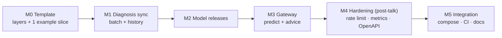

# Roadmap: go-backend

Each milestone is a vertical slice that ends with passing tests and an updated `PROGRESS.md`.
Requirement IDs refer to `PRD.md`.

## M0: Template (DDD layers + example slice)
**Delivers:** module, folder layout, config, slog logging, chi router, middleware (request id,
access log, recover, timeout, API key), `/health`, `/ready`, PostgreSQL pool + embedded migrations,
the Diagnosis aggregate with `POST/GET /api/v1/diagnoses` (D1, D2), Dockerfile, compose entries,
Makefile, these docs.

**Done when**
- `go vet`, `staticcheck`, `go test ./...` pass; unit tests need no DB.
- `go test -tags integration ./...` passes against compose PostgreSQL.
- An architecture test proves `internal/domain` imports nothing from other layers.
- `docker compose up postgres go-backend` → `/ready` 200; same diagnosis posted twice → one row.

## M1: Diagnosis sync (D3, D4) ✅
- `POST /api/v1/diagnoses:sync` (≤ 500 items, per-item outcome, one transaction per batch).
- `GET /api/v1/devices/{device_id}/diagnoses` (cursor = `captured_at,id`, limit ≤ 100).
- **Done when:** syncing the same batch twice yields `duplicate` for every item and no new rows;
  pagination test walks 250 records without gaps or repeats.

## M2: Model releases (R1–R3) ✅
- New aggregate `ModelRelease` + repository + migration.
- Admin key for publish/withdraw; `GET /latest` with `ETag`.
- **Done when:** publish v1, v2 → latest is v2; withdraw v2 → latest is v1; unchanged ETag → 304.

## M3: Prediction + advice gateway (A1–A3) ✅
- Port `AdviceProvider` in the application layer; HTTP adapter to `rag-service` in infrastructure.
- Timeouts, single retry on connection errors, error mapping to `advice_unavailable` (503).
- Predictions proxy to `python-ml-service` (multipart pass-through, 5 MB limit).
- **Done when:** adapter tests with `httptest` fake upstream cover success, timeout, 503, malformed JSON;
  live test against the running `rag-service` returns a cited answer.

## M4: Hardening (after the talk; not needed on stage)
- Per-API-key rate limiting (token bucket, `golang.org/x/time/rate`), 429 with `Retry-After`.
- Prometheus `/metrics`: request count/latency by route and status, upstream latency.
- OpenAPI 3.1 document served at `/openapi.yaml`, checked against handlers in a test.

## M5: Integration and docs
- Root `docker-compose.yml`: go-backend + postgres alongside ml/rag services, healthy together.
- CI workflow (GitHub Actions): vet, staticcheck, unit + integration tests (Postgres service container).
- Rewrite `docs/PHASE_4_GO_BACKEND_GATEWAY.md` from the real code (`docs/sync_code_blocks.py`).
- Update `docs/API_CONTRACT.md` with the go-backend endpoints.

## Later (not scheduled)
Signed device tokens · photo upload for field-data collection (feeds retraining) · admin dashboard ·
analytics on diagnoses per region/season.
