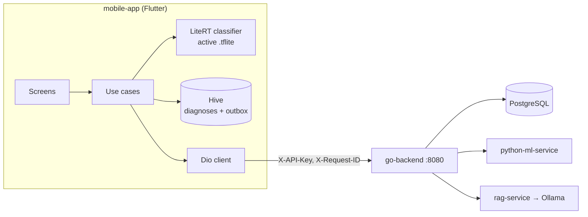
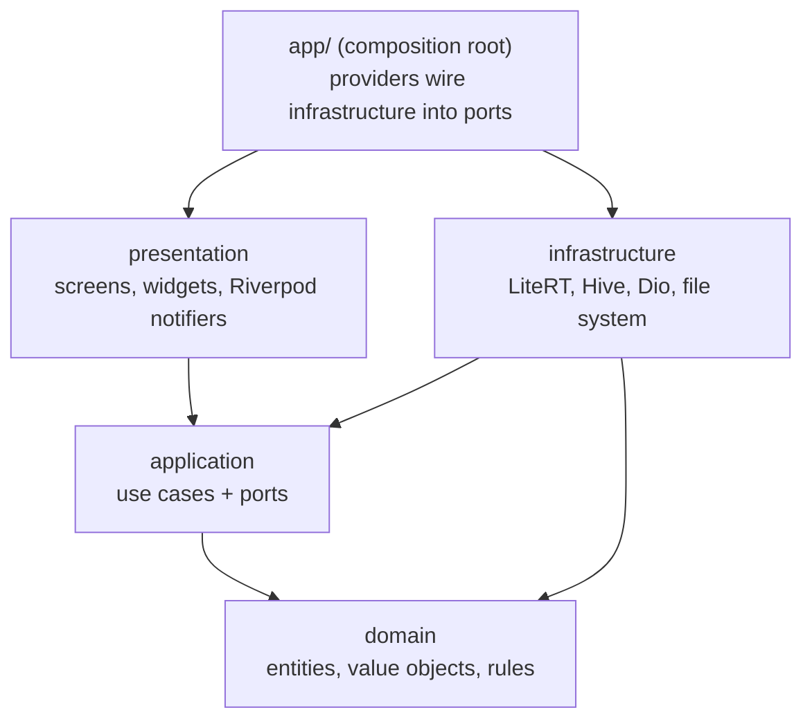
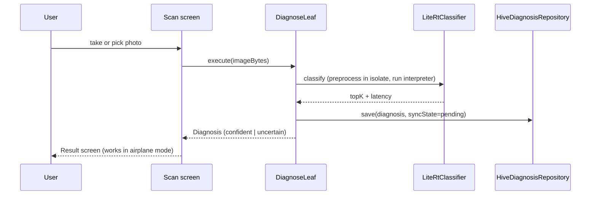
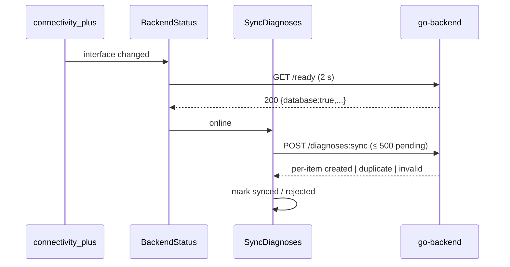
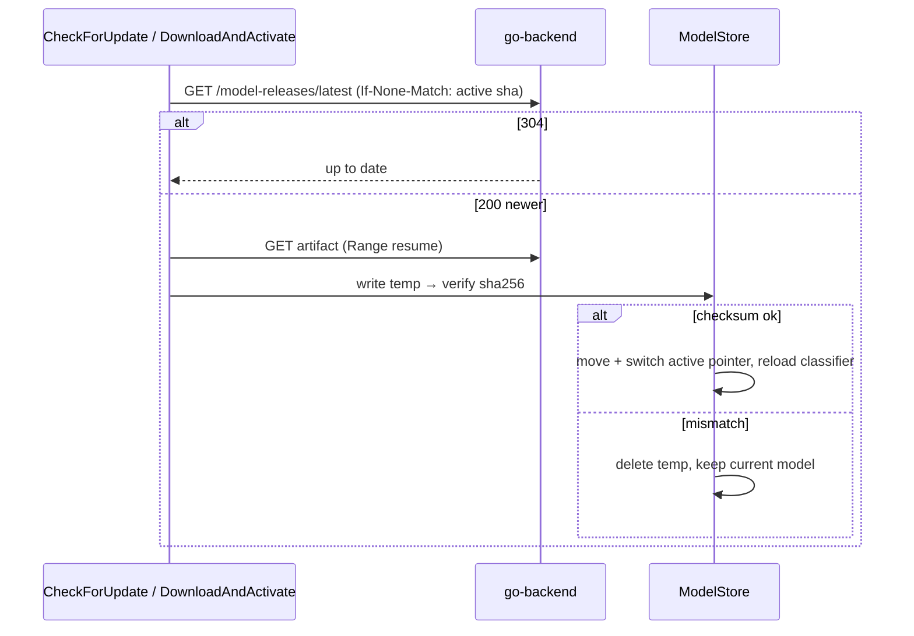
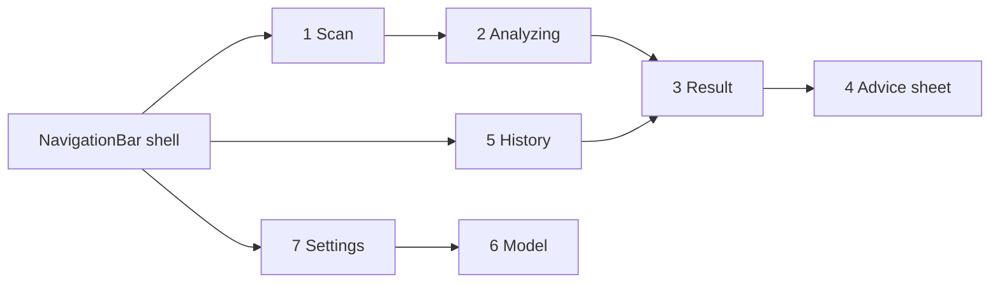

# mobile-app: Architecture

The Flutter app for the crop disease platform and for the talk **"Beyond the API Call: On-Device AI
in Flutter with LiteRT and Offline-First Architecture"**.

The phone diagnoses a potato leaf **on the device** with a LiteRT model, so it works fully offline.
The network is only an add-on:

- syncing diagnoses
- model updates
- a server-side second opinion
- cited treatment advice

Status: **design only**. No code yet. Decisions: Riverpod 3; build the talk MVP first.

## Contents
1. [Principles](#1-principles)
2. [System context](#2-system-context)
3. [Layers and the dependency rule](#3-layers-and-the-dependency-rule)
4. [Folder structure](#4-folder-structure)
5. [Bounded contexts (features)](#5-bounded-contexts-features)
6. [Key flows](#6-key-flows)
7. [State management and dependency injection](#7-state-management-and-dependency-injection)
8. [Error model](#8-error-model)
9. [Local data](#9-local-data)
10. [Screens and navigation](#10-screens-and-navigation)
11. [Theme and motion](#11-theme-and-motion)
12. [Dependencies](#12-dependencies)
13. [Testing strategy](#13-testing-strategy)
14. [Milestones](#14-milestones)
15. [Open questions and risks](#15-open-questions-and-risks)

---

## 1. Principles

| Principle | What it means here |
|---|---|
| **Offline first** | Diagnosis, history and the active model never need the network. Every write is local first and synced later. |
| **The model is the contract** | Labels, confidence threshold and input shape come from `crop_disease_<v>.json`, the same file the ML service and go-backend use. Nothing about classes is hardcoded. |
| **Preprocessing parity** | The Dart preprocessing must match the Python training transform. A golden test proves it, because a silent mismatch drops accuracy without any error. |
| **Honest uncertainty** | Below the threshold the app says "uncertain, retake the photo" instead of guessing. |
| **One backend** | The app talks only to go-backend (`X-API-Key`). It never calls the Python services directly. |
| **Clean layers** | Domain is pure Dart; frameworks live at the edges. Same dependency rule as `go-backend/`. |
| **Small and boring** | No code generation, no extra packages where Dart 3 or Flutter already does the job. |

## 2. System context



Endpoints used, all on go-backend (details in [`docs/API_CONTRACT.md`](../docs/API_CONTRACT.md)):

| Need | Endpoint |
|---|---|
| Is the backend usable, and which parts? | `GET /ready` → `database`, `ml_service`, `rag_service` |
| Upload cached diagnoses | `POST /api/v1/diagnoses:sync` (≤ 500 per batch, idempotent) |
| Restore or show server history | `GET /api/v1/devices/{device_id}/diagnoses?cursor=` |
| Newer model? | `GET /api/v1/model-releases/latest` with `If-None-Match` (304 = up to date) |
| Download model | `GET /api/v1/model-releases/{v}/artifact` (Range resume, `X-Checksum-Sha256`) |
| Second opinion | `POST /api/v1/predictions` (multipart `file`) |
| Advice | `POST /api/v1/advice` `{question, class_name}` |

## 3. Layers and the dependency rule



| Layer | May import | Must not import | Contains |
|---|---|---|---|
| `domain` | Dart core, `meta`, `core/` | Flutter, any package, other layers | Entities, value objects, invariants, repository/port interfaces |
| `application` | `domain`, `core/` | Flutter, infrastructure, presentation | Use cases that orchestrate ports; no I/O of their own |
| `infrastructure` | `domain`, `application`, packages | presentation | Adapters: LiteRT, Hive, Dio, path_provider, crypto |
| `presentation` | `application`, `domain` (read-only types), Flutter, Riverpod | infrastructure | Screens, widgets, notifiers |
| `app/` | everything | – | Providers, router, theme, `main` bootstrap |

A test enforces the rule: `test/architecture_test.dart` reads each file's imports and fails on a
forbidden one. It mirrors `go-backend/internal/architecture_test.go`.

## 4. Folder structure

```
mobile-app/
  assets/
    models/crop_disease_v1.tflite      # bundled fallback model (copied from python-ml-service/models)
    models/crop_disease_v1.json        # labels, threshold, input shape
    fonts/Inter-Variable.ttf
  lib/
    main.dart                          # init Hive, open boxes, ProviderScope
    app/
      app.dart                         # MaterialApp.router
      router.dart                      # go_router, StatefulShellRoute (Scan · History · Settings)
      providers.dart                   # composition root
      theme/ app_theme.dart, tokens.dart, motion.dart, diagnosis_colors.dart
    core/
      failure.dart                     # sealed Failure
      result.dart                      # sealed Result<T> (Ok / Err)
      clock.dart, ids.dart
    shared/http/
      api_client.dart                  # Dio: base URL, interceptors, error shape → Failure
    features/
      diagnosis/     {domain, application, infrastructure, presentation}/
      sync/          {domain, application, infrastructure}/
      model_update/  {domain, application, infrastructure, presentation}/
      advice/        {domain, application, infrastructure, presentation}/
      connectivity/  {domain, application, infrastructure}/
      settings/      {domain, application, infrastructure, presentation}/
  test/                                # mirrors lib/; + architecture_test.dart, fixtures/
  integration_test/                    # end-to-end on an emulator against docker compose
  ARCHITECTURE.md  README.md  AGENTS.md  PROGRESS.md
```

The layout is feature-first: each bounded context owns its layers, so a feature can be read, tested or
deleted as one folder.

## 5. Bounded contexts (features)

### diagnosis (core domain)
| Type | Name | Notes |
|---|---|---|
| Entity | `Diagnosis` | `id` (UUID made on the phone), `deviceId`, `classLabel`, `confidence`, `threshold`, `modelVersion`, `capturedAt`, `source` (onDevice / server), `imagePath`, `syncState` |
| Value objects | `Confidence` (0–1), `ClassLabel` (`Potato___Late_blight` → plant "Potato", condition "Late blight") | Invariants are checked in constructors |
| Rule | `status` = `confident` if confidence ≥ threshold, else `uncertain` | Same rule as the server |
| Ports | `Classifier.classify(imageBytes) → Prediction(topK, latency)`, `DiagnosisRepository` | |
| Use cases | `DiagnoseLeaf`, `GetHistory`, `GetDiagnosis`, `DeleteDiagnosis`, `SecondOpinion` | `DiagnoseLeaf` = classify → build entity → save locally → enqueue sync |
| Adapters | `LiteRtClassifier`, `RemoteClassifier` (`/predictions`), `HiveDiagnosisRepository` | |

### sync
- **Outbox pattern.** Saving a diagnosis also enqueues its id with `syncState = pending`.
- `SyncDiagnoses`:
  - reads pending items
  - posts them in batches of ≤ 500
  - marks `created` and `duplicate` items as `synced`
  - marks `invalid` items as `rejected`, keeping the server error to show
- **Triggers:** connectivity regained (after `/ready` passes), app resume, pull to refresh. There is no background worker in the MVP.
- **Safe to repeat:** the server is idempotent on the client UUID, so a crash mid-sync just resends.

### model_update
| Type | Name | Notes |
|---|---|---|
| Entity | `ModelRelease` | version, sha256, sizeBytes, classLabels, threshold, inputShape |
| Ports | `ReleaseSource` (backend), `ModelStore` (files + active pointer) | |
| Use cases | `CheckForUpdate` (ETag → 304 means none), `DownloadAndActivate`, `Rollback` | |
| Safety | Download to a temp file → verify sha256 → move to `models/<v>.tflite` → switch the active pointer → reload the classifier | Keep the previous model and the bundled v1 |

### advice
- `AskAdvice(question, classLabel)` returns `AdviceAnswer(text, citations[], grounded)`.
- When offline it fails with `Offline`. The UI shows "available when online" and can queue the question.

### connectivity
- `BackendStatus` is a stream of `{online, ml, rag}`.
- A `connectivity_plus` event only says an interface exists, so every change triggers `GET /ready` with a 2 s timeout before the app trusts the network.

### settings
- **Backend:** base URL with presets (Android emulator `10.0.2.2:8080`, iOS simulator `localhost:8080`, LAN IP) and the API key (secure storage).
- **Device:** `deviceId`, a UUID created on first run.
- **Display:** theme mode and the reduce-motion override.
- Settings are stored in a Hive box.

## 6. Key flows

### Diagnose a leaf (offline)


### Sync when the network returns


### Model update


### Preprocessing (must match Python)
1. Decode the image and apply the EXIF orientation.
2. Resize so the shorter side is 256 (bilinear).
3. Centre crop to 224 × 224.
4. Convert RGB to float32 and divide by 255, as an NHWC tensor `[1, 224, 224, 3]`. ImageNet normalisation is inside the model.

This runs in a background isolate (`compute`) so the UI never stutters. A golden test compares the
output to a fixture tensor exported from Python for the same image.

## 7. State management and dependency injection

Riverpod 3 (`flutter_riverpod`), without code generation.

| Provider kind | Used for |
|---|---|
| `Provider` | Adapters and use cases (the composition root in `app/providers.dart`) |
| `AsyncNotifierProvider` | Screen state that loads: history, model status, advice |
| `NotifierProvider` | Synchronous UI state: settings, scan flow |
| `StreamProvider` | `BackendStatus` |

- Notifiers depend only on use cases, never on Dio, Hive or LiteRT.
- Tests replace adapters with `ProviderScope(overrides: [...])` and fakes.
- `ref.onDispose` closes the interpreter and boxes.

## 8. Error model

```dart
sealed class Failure {
  const Failure();
}
final class Offline extends Failure {}
final class ServerUnavailable extends Failure { final String code; final String? requestId; } // 503 *_unavailable
final class Invalid extends Failure { final String code; final String detail; }               // 422
final class Unauthorized extends Failure {}                                                   // 401
final class ChecksumMismatch extends Failure {}
final class ModelLoadFailed extends Failure { final String detail; }
final class Unexpected extends Failure { final Object error; final String? requestId; }
```

- Use cases return `Result<T>` (`Ok` / `Err(Failure)`) instead of throwing across layers.
- `api_client.dart` maps the shared server error shape `{error, detail, request_id}` to a `Failure`.
- The UI maps each `Failure` to one message and one action, using an exhaustive `switch`.

## 9. Local data

| Hive box | Content | Notes |
|---|---|---|
| `diagnoses` | `Map` per diagnosis (JSON-like), keyed by id | Sorted by `capturedAt` when read |
| `outbox` | pending ids | Removed when the server answers created or duplicate |
| `settings` | base URL, deviceId, theme mode | The API key lives in `flutter_secure_storage`, not Hive |
| `model` | active version, sha, path, previous version | |

- Values are plain maps, so there are no type adapters and no code generation.
- Photos are copied to `appDocumentsDir/photos/<id>.jpg`.
- Models live in `appSupportDir/models/`.
- Migrations: a `schemaVersion` key in each box, with upgrades run at start-up.

## 10. Screens and navigation



| # | Screen | Purpose | Motion | MVP |
|---|---|---|---|---|
| 1 | **Scan (Home)** | Large "Scan a leaf" button (camera or gallery), chips for model version and online/offline, last 3 diagnoses | Gentle "breathing" glow on the button; offline banner slides in and out | ✅ |
| 2 | **Analyzing** | Photo with a scan line while inference runs (held ≥ 600 ms so it reads on stage) | Scan line sweep; Hero of the photo into Result | ✅ |
| 3 | **Result** | Condition, plant, confidence bar, `uncertain` state with "retake" tips, on-device latency, model version; "Get advice" and "Second opinion" buttons | Confidence counts up; status colour cross-fades | ✅ |
| 4 | **Advice** (bottom sheet) | Answer with `[n]` citation chips that open the sources; offline state "available when online" | Shimmer skeleton while waiting (3–20 s), then text and citations stagger in | ✅ |
| 5 | **History** | Local diagnoses grouped by day, sync badge (pending / synced / rejected), pull to sync, tap to open Result | Staggered list entrance; badge morph on sync | ✅ |
| 6 | **Model** | Active version, size, sha; check for update; download progress; rollback | Progress ring → check mark | ✅ |
| 7 | **Settings / Diagnostics** | Backend URL presets, API key, device id, theme, `/ready` per service, last sync, on-device benchmark (N runs → p50/p95 for the talk) | Fade-through between sections | ✅ |
| 8 | Onboarding | 3 pages: works offline, how to photograph a leaf, privacy | Shared axis (horizontal) | later |
| 9 | Disease library | Early blight, late blight, healthy: symptoms and actions, bundled from rag-service knowledge notes | Container transform from card | later |
| 10 | Splash | Native splash while the interpreter warms up | – | later |

Routing uses `go_router` with a `StatefulShellRoute.indexedStack`, which keeps each tab's state. Result
is a pushed route (`/diagnosis/:id`), and Advice is a modal bottom sheet.

## 11. Theme and motion

The app is used **outdoors, in bright sun, often one-handed**, so contrast and large targets come before decoration.

### Colour (Material 3)
- `ColorScheme.fromSeed(seedColor: Color(0xFF2E7D32), dynamicSchemeVariant: DynamicSchemeVariant.fidelity)`. The seed is leaf green. Light and dark schemes; dark helps at night and saves battery on OLED.
- Diagnosis colours live in a `ThemeExtension<DiagnosisColors>`, and each also has an **icon and a label**, so colour is never the only signal:

| Status | Colour | Icon |
|---|---|---|
| Healthy | green (from scheme) | `check_circle` |
| Early blight | amber `#F9A825` | `warning_amber` |
| Late blight | red-brown `#B23B1E` | `coronavirus` / `dangerous` |
| Uncertain | slate (scheme `outline`) | `help` |

- All text meets WCAG AA contrast; a widget test checks it with `meetsGuideline(textContrastGuideline)`.

### Typography and shape
- **Inter** variable font bundled as an asset; it has clear numerals for confidence and latency. No `google_fonts`, because it downloads at runtime, which breaks offline.
- Body 16 sp; the result title uses `displaySmall`.
- Cards have 16 dp corners. Primary buttons are 56 dp tall, and every touch target is at least 48 dp.

### Motion
| Token | Value |
|---|---|
| short / medium / long | 150 / 300 / 500 ms |
| enter | `Easing.emphasizedDecelerate` |
| exit | `Easing.emphasizedAccelerate` |
| standard | `Easing.standard` |

- **Page transitions** come from the `animations` package (Material motion):
  - fade through between tabs
  - container transform from a history card to Result
  - shared axis for onboarding
- **In-widget effects** come from `flutter_animate`: scan line, count-up, stagger, shimmer.
- **Reduce motion:** every effect checks `MediaQuery.disableAnimationsOf(context)` and the settings override, and shows the end state immediately when either is set.
- **Purposeful motion only.** Animation explains state (analyzing, syncing, downloading). Nothing loops while idle except the subtle scan-button glow, which also stops under reduce motion.

## 12. Dependencies

Latest versions checked on pub.dev on 2026-10-30.

**Toolchain decision (2026-10-30):** stay on the installed **Flutter 3.41.6 / Dart 3.11.4**. Current stable is 3.47.9, but
we don't upgrade. Use the newest package versions whose SDK constraint allows 3.41.6. The UI-phase
versions are pinned in [`docs/UI_IMPLEMENTATION.md`](docs/UI_IMPLEMENTATION.md) §2:
- `flutter_riverpod` ^3.3.2
- `go_router` ^17.5.0
- `animations` ^2.2.0
- `very_good_analysis` ^10.2.0

The versions in the table below are the latest; re-check each data package against 3.41.6 when it is added in F1/F2.

| Package | Version | Purpose |
|---|---|---|
| `flutter_riverpod` | ^3.3.2 (on 3.41.6) | State management + DI |
| `go_router` | ^17.5.0 (on 3.41.6) | Routing, tab shell |
| `flutter_litert` | ^3.9.4 | LiteRT interpreter (community, released 2026-10, bundles native libraries; the package the talk names). Fallback: `tflite_flutter` ^0.12.1 (official, last released 2025-10) |
| `image` | ^4.12.0 | Decode, EXIF orientation, resize, crop |
| `image_picker` | ^1.2.4 | Camera + gallery |
| `hive_ce` / `hive_ce_flutter` | ^2.22.0 / ^2.5.0 | Local storage (maintained fork of Hive) |
| `dio` | ^5.11.1 | HTTP, interceptors, download progress, Range |
| `connectivity_plus` | ^7.3.2 | Network interface events |
| `uuid` | ^4.6.0 | Client-generated ids for idempotent sync |
| `crypto` | ^3.0.8 | sha256 of downloaded models |
| `path_provider` | ^2.1.6 | App directories |
| `flutter_secure_storage` | ^11.2.0 | Access key in Keychain / Android Keystore (never in Hive) |
| `animations` | ^3.0.0 | Material motion transitions |
| `flutter_animate` | ^4.5.2 | In-widget effects (last release 2024-11; fall back to implicit animations if it breaks) |
| dev: `very_good_analysis` | ^11.0.0 | Strict lints |
| dev: `mocktail` | ^1.0.5 | Test doubles |
| dev: `flutter_native_splash`, `flutter_launcher_icons` | ^2.4.8, ^0.14.4 | Splash and icon (later) |
| SDK: `flutter_test`, `integration_test` | – | Unit, widget, end-to-end tests |

**Deliberately not used:**

| Package | Why not |
|---|---|
| `freezed`, `json_serializable` | Dart 3 sealed classes and records cover it, with no code generation |
| `camera` | `image_picker` is enough for the MVP |
| `drift`, `sqflite` | One list plus an outbox doesn't need SQL |
| `workmanager` | Sync on resume and on reconnect is enough for the MVP |
| `google_fonts` | Fetches fonts at runtime, which breaks offline |

## 13. Testing strategy

| Level | What | Tool |
|---|---|---|
| Domain | Invariants, status rule, label parsing | `test` (pure Dart, fast) |
| Application | Use cases with fake ports: diagnose → saved + queued; sync outcomes; update → checksum mismatch keeps the old model | `mocktail` / hand-written fakes |
| Infrastructure | Preprocessing **golden test** against a Python fixture; Hive repository on a temp dir; api_client error mapping with a mock adapter | `flutter_test` |
| Architecture | Forbidden imports per layer | `test/architecture_test.dart` |
| Widget | Result confident and uncertain, contrast guideline, reduce motion, offline advice state | `flutter_test` |
| End to end | On the Android emulator against `docker compose up` (`http://10.0.2.2:8080`): offline diagnosis of a late-blight leaf → `Potato___Late_blight`; sync, then resend → duplicate; advice with citations; model check → 304 | `integration_test` |
| Manual | Real phone over the LAN: airplane-mode diagnosis; RAG stopped → "available later"; record p50 inference time for the slides | – |

## 14. Milestones

Each milestone is one commit on `feature/flutter-app`.

| | Milestone | Done when |
|---|---|---|
| F0 | Scaffold: `flutter create`, lints, folder layout, theme + motion tokens, router shell, architecture test, README/AGENTS/PROGRESS | `flutter analyze` clean; empty tabs navigate |
| F1 | On-device diagnosis: bundled v1 model, LiteRtClassifier, preprocessing golden test, Scan → Analyzing → Result, Hive history | Late-blight leaf diagnosed in airplane mode |
| F2 | Offline-first sync: BackendStatus, outbox, `SyncDiagnoses`, history badges, backend settings | Sync after reconnect; resend → all duplicate |
| F3 | Advice + second opinion | Cited answer; offline state shown |
| F4 | Model update: check, download, verify, swap, rollback | 304 when current; checksum mismatch keeps the old model |
| F5 | Talk polish: diagnostics + benchmark, motion pass, icon/splash, rewrite `docs/PHASE_6_FLUTTER_MOBILE.md` from code | Demo script runs end to end |

## 15. Open questions and risks

| Item | Risk | Mitigation |
|---|---|---|
| `flutter_litert` is community-maintained | Releases could stop | Check 16 KB alignment in F1; `tflite_flutter` can replace it behind the same `Classifier` port |
| Preprocessing drift | Silent accuracy loss | Golden test against a Python fixture |
| Field photos | 54.8% on PlantDoc vs 95.8% lab | Uncertain state + retake tips; say it on the limitations slide |
| Cleartext HTTP in the demo | Android/iOS block it by default | Debug-only network config (Android `usesCleartextTraffic` in the debug manifest, iOS `NSAllowsLocalNetworking`) |
| Slow advice (3–20 s) | Looks frozen on stage | Shimmer + streamed reveal; pre-warm Ollama |
| `docs/PHASE_6_FLUTTER_MOBILE.md` is outdated (online-first, old `/upload` and `/ask` endpoints, flat `lib/services`) | Confuses readers | Rewrite from the code in F5 |
