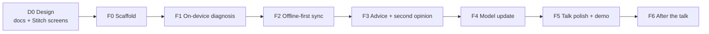

# Roadmap: mobile-app

Each milestone is one commit or PR on `feature/flutter-app`, and is done only when its acceptance
criteria pass. Requirement IDs refer to [`PRD.md`](PRD.md).

## D0: Design
- Docs: README, PRD, ARCHITECTURE, ROADMAP, PROGRESS, AGENTS, STITCH_PROMPTS.
- Stitch: all screens from `design/STITCH_PROMPTS.md` §4 generated and reviewed (§7 checklist);
  export to `designs/`.
- **Done when:** the exports exist, and every PRD requirement has a screen state or is marked "no UI".

## F0: Scaffold
- Toolchain: the installed Flutter 3.41.6, `flutter doctor` clean. UI with mock data first, per [`UI_IMPLEMENTATION.md`](UI_IMPLEMENTATION.md).
- `flutter create --org com.paulmburu --platforms android,ios mobile-app`.
- Android: minSdk 26, targetSdk 36. iOS: 15.0.
- `analysis_options.yaml` with very_good_analysis; the folder layout from ARCHITECTURE §4.
- `core/` (`Result`, `Failure`, `Clock`); theme, motion and diagnosis colours from `designs/field_diagnostic_tool/DESIGN.md`; bundled Inter.
- go_router shell with 3 empty tabs; `test/architecture_test.dart`.
- Platform config:
  - Android: camera/media permissions, debug-only `network_security_config.xml` allowing cleartext to `10.0.2.2` and LAN ranges.
  - iOS: `NSCameraUsageDescription`, `NSPhotoLibraryUsageDescription`, `NSAllowsLocalNetworking`.
- **Done when:** `flutter analyze` is clean; `flutter test` passes (architecture + theme contrast test); the app runs on the Android emulator and the iOS simulator and switches tabs.

## F1: On-device diagnosis (D1–D7, ST2)
- Bundle `crop_disease_v1.{tflite,json}`; `ModelMetadata` parsed from the json.
- Preprocessing in an isolate, plus a **golden test**:
  - add `python-ml-service/scripts/export_preprocess_fixture.py`, which writes the tensor for one test image to `mobile-app/test/fixtures/`
  - the Dart output must match within 1e-4 (max abs diff)
- `LiteRtClassifier` (`flutter_litert`). If it fails to build or isn't 16 KB aligned, swap in `tflite_flutter` behind the same port.
- `tool/check_16kb.dart` checks the alignment of the `.so` files in the release APK. Also run on a 16 KB emulator.
- Hive boxes with `schemaVersion`; `HiveDiagnosisRepository`; photo copy and delete.
- Screens S1-A/C, S1a, S2, S3-A/B/C/D, S5-A/C.
- **Done when:**
  - a PlantVillage late-blight leaf gives `Potato___Late_blight` in airplane mode on the emulator
  - the golden test passes
  - an uncertain photo shows S3-D
  - the record survives an app restart
  - the APK passes the 16 KB check

## F2: Offline-first sync (S1–S5, C1–C3, ST1)
- `ApiClient` (Dio):
  - base URL from settings
  - `X-API-Key` from `flutter_secure_storage`
  - an `X-Request-ID` per call
  - the error shape mapped to `Failure` (PRD §5)
- `BackendStatus` (connectivity_plus + `/ready`, 2 s).
- Outbox and `SyncDiagnoses`; triggers on reconnect, resume and pull.
- Screens S1-B, S5-B/D, S7-A (server section).
- **Done when:** the integration test passes against `docker compose up`:
  - 3 offline diagnoses → network on → synced
  - the server history (`GET /devices/{id}/diagnoses`) lists them
  - forcing a resend → all `duplicate`
  - the wrong key → the 401 message

## F3: Advice + second opinion (A1–A5, D8)
- `AskAdvice` and `RemoteClassifier`; advice sheet S4-A…E; S3-E.
- **Done when:**
  - a cited answer is shown for late blight
  - with rag-service stopped → S4-E with a reference
  - in airplane mode → S4-D
  - second opinion matches the server's prediction

## F4: Model update (M1–M6)
- `CheckForUpdate`, `DownloadAndActivate`, `Rollback`; `ModelStore` with an active pointer.
- Screens S6-A…E.
- **Done when:**
  - check → 304 when current
  - after publishing a v2 (README "Connecting to the backend"): download, verify, activate, then go back to v1
  - a corrupted file (test fake) → S6-E with v1 still active

## F5: Talk polish + demo
- Diagnostics S7-B and speed test S7-C (record the phone's p50/p95 in `benchmarks/results.md`).
- Motion pass: all motion specs from STITCH_PROMPTS, with reduce motion honoured. Dark theme. Icon and native splash.
- Accessibility pass: TalkBack walk-through and 200% text.
- Rewrite `docs/PHASE_6_FLUTTER_MOBILE.md` from the code (`docs/sync_code_blocks.py`). Update `docs/API_CONTRACT.md` client rules and `docs/PRESENTATION_PLAN.md` stage E.
- **Demo runbook** (in PRESENTATION_PLAN): pre-warm Ollama, compose healthy, emulator snapshot, airplane-mode script, backup screen recording.
- Release: `flutter build apk --release --split-per-abi`, debug-signed, version `1.0.0+1`.
- **Done when:** 5 full rehearsals in a row pass without a crash, and the APK is ≤ 30 MB per ABI.

## F6: After the talk
- Onboarding S8, disease library S9, splash S10 polish.
- Background sync (workmanager), queued advice questions after restart.
- CI (GitHub Actions): `flutter analyze` + `flutter test` on every PR; integration tests on demand with the compose stack.
- Field-photo collection with consent (feeds retraining); Swahili; iOS on-stage polish; Play Store signing.
