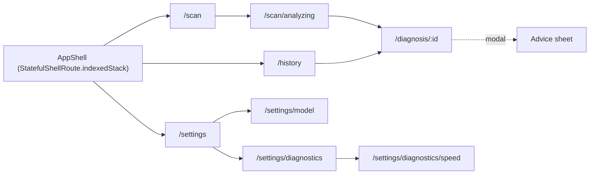

# UI implementation spec (mock data phase)

How every design in [`../designs/`](../designs/) becomes Flutter code, before any real data source
exists. It follows [`../ARCHITECTURE.md`](../ARCHITECTURE.md) (DDD clean layers) and
[`../AGENTS.md`](../AGENTS.md). When this doc and the code disagree, fix one of them in the same change.

| | |
|---|---|
| Toolchain | **Flutter 3.41.6 / Dart 3.11.4** (installed; no upgrade, decided 2026-10-30) |
| Data | **Mock implementations of the real ports.** Presentation cannot tell mock from real |
| Sources of truth | `designs/<id>/screen.png` (layout), `designs/<id>/code.html` (spacing, sizes, exact text), `designs/field_diagnostic_tool/DESIGN.md` (tokens), [`../design/STITCH_PROMPTS.md`](../design/STITCH_PROMPTS.md) (motion specs, missing states) |

## Contents
1. [Scope and rules](#1-scope-and-rules)
2. [Packages](#2-packages-for-flutter-3416)
3. [Folder structure and placement rules](#3-folder-structure-and-placement-rules)
4. [Domain types, ports and mock data](#4-domain-types-ports-and-mock-data)
5. [Shared design-system widgets](#5-shared-design-system-widgets-ui)
6. [Screen-by-screen mapping](#6-screen-by-screen-mapping)
7. [Theme mapping](#7-theme-mapping-designmd--flutter)
8. [Navigation](#8-navigation)
9. [Tests](#9-tests-for-the-ui-phase)
10. [Build order](#10-build-order)
11. [Swap mocks for real adapters](#11-swap-mocks-for-real-adapters)

---

## 1. Scope and rules

**In scope:** every talk-MVP screen and state (S1–S7) running on the emulator with mock data,
light and dark theme, motion, and tests. F6 screens (S8–S10) are mapped here and built last.

**Design overrides.** The export differs from the spec in a few places. These decisions win:

| Export says | We use | Why |
|---|---|---|
| YAML `primary: #0d631b` | `#2E7D32` | It's what the screens render and what the DESIGN.md prose table says |
| S3 filled button `rounded-full` (pill) | 16 dp radius everywhere | DESIGN.md component rule; S1 uses 16 |
| Inter from Google Fonts | Inter **bundled** in `assets/fonts/` | Offline-first; no runtime downloads |
| Prose type table (title-large 500) | YAML type scale (size, weight, line height, letter-spacing) | The YAML is what the HTML renders |
| Text buttons/links in `#2E7D32` | Text in `primaryText` `#1B5E20` (filled buttons keep `#2E7D32`) | `#2E7D32` text is only 4.2:1 on surface-container-high (WCAG AA needs 4.5); found by the contrast test |
| Exported DESIGN.md has no dark colour table (Stitch shortened the prose) | Dark tokens from STITCH_PROMPTS §1 + standard M3 values for the missing roles; dark diagnosis mains lightened for AA | The export is incomplete |
| S1-A recent shows Late/Healthy/Early, but S5-A has "Not sure" at 09:10 today | One mock history for both; Recent = newest 3 (Late, Not sure, Healthy) | Stitch screens contradict each other; consistent data wins |
| S1-B shows Healthy as Pending | Same sync states as S1-A; only the banner and chip change | Offline doesn't change sync state |
| Design thumbnails are illustrations | Real leaf photos | DESIGN.md asks for realistic photos |
| S3-B shows 76.5% for Healthy; S3-D shows 76.5% and no "Not sure" header; S5-D repeats the error banner 3×; S3-E wraps names mid-word | Built from the prompt data: 98.1% / 38.9%, one banner, stacked values | Stitch generation errors |
| S3-A photo is a broken image | Layout from the PNG, `LeafPhoto` with the late-blight asset | The broken image is an export artefact |

**Duplicate designs.** One of each pair is used; swap by changing the folder in §6.

| Pair | Used | Reason |
|---|---|---|
| `s3_d_result_not_sure_1` / `s3_d_result_not_sure_2` | `_1` | Same content; `_1` is the first generation (check visually) |
| `s5_a_history_1` / `s5_a_history_2` | `_1` | Only `_1` has the sync summary "2 waiting to sync · …" from the prompt |
| `s5_d_result_sync_rejected_1` / `s5_d_result_sync_rejected_2` | `_1` | `_2` adds an extra "Rejected" chip not in the prompt |
| `s7_b_diagnostics_1` / `s7_b_diagnostics_2` | `_2` | `_1` renders unstyled (raw HTML); `_2` is the themed card layout (corrected after visual check in U12) |

**States with no design:**
- S5-B History syncing: S5-A layout + prompt S5-B.
- Dark theme for all screens: DESIGN.md dark tokens + the "Dark mode variants" prompt.

**Hard rules for this phase:**
- No raw `Color`, `TextStyle`, `EdgeInsets` numbers, `Duration` or user-visible string literals in
  widget files. They come from `ui/theme/`, `core/constants/` and the strings classes (§3).
- Each design state is a **state of one page widget**, driven by its controller, never a separate copy of the page.
- Mocks implement the same ports the real adapters will; only `app/di/providers.dart` chooses which.

## 2. Packages (for Flutter 3.41.6)

These are the newest releases whose SDK constraint allows Dart 3.11 / Flutter 3.41, checked on pub.dev
on 2026-10-30.

| Package | Version | Why | Newer version needs |
|---|---|---|---|
| `flutter_riverpod` | ^3.3.2 | State + DI | 3.4 → Dart 3.12 |
| `go_router` | ^17.5.0 | Routes, tab shell | 18 → Flutter 3.44 |
| `animations` | ^2.2.0 | Fade-through, container transform, shared axis | 3.0 → Flutter 3.44 |
| `url_launcher` | ^6.3.3 | Open advice sources (added in U10) | – |
| `flutter_animate` | ^4.5.2 | Scan line, count-up, stagger, pulse | – |
| dev `very_good_analysis` | ^10.2.0 | Lints | 11 → Dart 3.13 |
| SDK `flutter_test` | – | Widget + golden tests | – |

Not needed for the UI phase: `hive_ce`, `dio`, `flutter_litert`, `image_picker`, `connectivity_plus`,
`flutter_secure_storage`. They are added in F1/F2 with versions re-checked against 3.41.6. The photo
picker is mocked: it returns bundled asset images.

**Assets** (copied from `designs/`):
- `assets/fonts/Inter-{Regular,Medium,SemiBold,Italic}.ttf` (Inter v4.1 static TTFs; Flutter handles these more reliably than the variable font) + `Inter-OFL.txt`
| Design folder | Asset |
|---|---|
| `close_up_authentic_smartphone_photo_of_a_green_potato_leaf_infected_with_late` | `assets/images/leaf_late_blight.jpg` |
| `close_up_authentic_smartphone_photo_of_a_green_potato_leaf_infected_with_early` | `assets/images/leaf_early_blight.jpg` |
| `close_up_authentic_smartphone_photo_of_a_vibrant_clean_evenly_green_healthy` | `assets/images/leaf_healthy.jpg` |
| `close_up_authentic_smartphone_photo_of_messy_blurry_shadowed_green_potato` | `assets/images/leaf_blurry.jpg` |
| `authentic_natural_daylight_photograph_looking_down_rows_of_an_agricultural` | `assets/images/field_rows.jpg` (S8-A) |

## 3. Folder structure and placement rules

```
mobile-app/lib/
  main.dart                          # ProviderScope(overrides: mockOverrides) + App
  app/                               # composition root: may import everything
    app.dart                         # MaterialApp.router, theme, darkTheme, themeMode
    router/
      app_router.dart                # GoRouter, shell, transitions
      routes.dart                    # Routes.scan = '/scan', … (path + name constants)
    di/
      providers.dart                 # port providers: mock today, real later
      mock_overrides.dart            # ProviderScope overrides for MockScenario
  core/                              # shared kernel, pure Dart (no Flutter widgets)
    result/        result.dart, failure.dart
    constants/     app_constants.dart        # minAnalyzingHold 600 ms, historyPageSize 50, maxQuestionLength 500 …
    enums/         sync_state.dart, connectivity_status.dart   # used by 2+ features
    utils/         formatters.dart (percent, relative day/time, bytes, ms), clock.dart
    mock/          mock_scenario.dart        # enum MockScenario (debug only)
  ui/                                # design system: reusable by ALL features
    theme/         tokens.dart, typography.dart, app_theme.dart, diagnosis_colors.dart, motion.dart
    widgets/       (see §5)
    strings/       common_strings.dart       # "Retry", "Online", "Offline", "Synced", "Pending" …
    assets/        app_assets.dart           # AppAssets.leafLateBlight, AppAssets.inter …
  features/
    diagnosis/     (scan, analyzing, result, history pages)
    advice/        (advice sheet)
    model_update/  (model page)
    settings/      (settings, diagnostics, speed test pages)
    onboarding/    (F6)
    library/       (F6)
```

One feature, expanded (every feature follows this shape):

```
features/diagnosis/
  domain/
    entities/        diagnosis.dart, prediction.dart
    value_objects/   confidence.dart, class_label.dart
    enums/           diagnosis_condition.dart, diagnosis_status.dart, prediction_source.dart
    repositories/    diagnosis_repository.dart, classifier.dart        # ports (abstract)
  application/
    use_cases/       diagnose_leaf.dart, get_history.dart, get_diagnosis.dart, delete_diagnosis.dart
  infrastructure/
    mock/            mock_diagnosis_repository.dart, mock_classifier.dart, diagnosis_mock_data.dart
  presentation/
    strings/         diagnosis_strings.dart                            # copy used in 2+ pages of this feature
    widgets/         diagnosis_tile.dart                               # used by 2+ pages of this feature (scan + history)
    scan/
      scan_page.dart, scan_controller.dart, scan_state.dart
      widgets/       scan_hero_card.dart, status_row.dart, recent_section.dart, photo_tips_card.dart, photo_source_sheet.dart
    analyzing/
      analyzing_page.dart, analyzing_controller.dart
      widgets/       scan_line_overlay.dart, analyzing_caption.dart
    result/
      result_page.dart, result_controller.dart, result_state.dart
      widgets/       …(see §6 S3)
    history/
      history_page.dart, history_controller.dart, history_state.dart
      widgets/       sync_summary_row.dart, day_section.dart
```

**Placement rules:**

| What | Used by | Goes in |
|---|---|---|
| Widget | 2+ features | `lib/ui/widgets/<group>/` |
| Widget | 2+ pages of one feature | `features/<f>/presentation/widgets/` |
| Widget | one page | `features/<f>/presentation/<page>/widgets/` |
| User-visible string | 2+ features | `ui/strings/common_strings.dart` |
| User-visible string | one feature | `features/<f>/presentation/strings/<f>_strings.dart` |
| Enum with domain meaning | one feature | `features/<f>/domain/enums/` |
| Enum with domain meaning | 2+ features | `core/enums/` |
| Enum only for display (e.g. `ThemeChoice`) | one page | next to that page's state file |
| Numbers that are rules (threshold display, min hold, limits) | anywhere | `core/constants/app_constants.dart` |
| Colours, spacing, radius, type, durations, curves | anywhere | `ui/theme/` only |
| Route paths and names | anywhere | `app/router/routes.dart` |
| Asset paths | anywhere | `ui/assets/app_assets.dart` |
| Mock data | one feature | `features/<f>/infrastructure/mock/<f>_mock_data.dart` |

**Strings style:** `abstract final class DiagnosisStrings { static const scanCta = 'Scan a leaf'; … }`.
Functions are used for interpolation, e.g. `static String recentSubtitle(String when, String pct) => '$when · $pct';`.
This makes the l10n move in F6 a mechanical change.

**Imports:**
- presentation → application, domain, `ui/`, `core/`
- infrastructure → domain, application, `core/`
- domain → `core/` only

`test/architecture_test.dart` enforces this.

## 4. Domain types, ports and mock data

### Enums
| Enum | Values | Location |
|---|---|---|
| `DiagnosisCondition` | `earlyBlight`, `lateBlight`, `healthy` (+ `fromLabel('Potato___Late_blight')`) | diagnosis/domain/enums |
| `DiagnosisStatus` | `confident`, `uncertain` | diagnosis/domain/enums |
| `PredictionSource` | `onDevice`, `server` | diagnosis/domain/enums |
| `SyncState` | `pending`, `syncing`, `synced`, `rejected` | core/enums |
| `ConnectivityStatus` | `online`, `offline` | core/enums |
| `ServiceName` / `ServiceHealth` | `server`, `database`, `diagnosis`, `advice` / `ok`, `down` | settings/domain/enums |
| `ModelUpdatePhase` | `upToDate`, `available`, `downloading`, `installed`, `checkFailed` | model_update/domain/enums |
| `AdvicePhase` | `questions`, `loading`, `answer`, `offline`, `unavailable` | advice/presentation (UI state) |
| `ThemeChoice` | `light`, `dark`, `system` | settings/presentation/settings |
| `MockScenario` | see below | core/mock |

### Entities and ports (pure Dart)
| Feature | Entities / value objects | Ports (abstract) |
|---|---|---|
| diagnosis | `Diagnosis` (id, deviceId, condition, confidence, threshold, topK, modelVersion, capturedAt, source, imageAsset/Path, syncState, rejectReason), `Prediction` (topK, latency), `Confidence` | `DiagnosisRepository` (watchAll, get, save, delete), `Classifier` (classify) |
| sync | – | `SyncService` (pendingCount, lastSyncAt, syncNow → stream of SyncState changes) |
| connectivity | `BackendStatus` (connectivity, services) | `BackendStatusSource` (watch, refresh) |
| model_update | `ModelRelease` (version, sizeBytes, sha256, labels, threshold, installedAt), `DownloadProgress` | `ModelUpdateRepository` (active, check, download → stream, activate, rollback) |
| advice | `AdviceAnswer` (text, citations, grounded), `Citation` (n, title, source, url) | `AdviceRepository` (ask) |
| settings | `AppSettings` (serverUrl, deviceId, theme, reduceMotion), `BenchmarkResult` (p50, p95, runs) | `SettingsRepository`, `Benchmark` |

### Mock data (exact values from the designs)
| Data | Values |
|---|---|
| Recent / history | Late blight 76.5% "Today, 09:12" pending · Not sure 38.9% "09:10" pending · Healthy 98.1% "Yesterday, 16:40" synced · Early blight 88.4% "27 Oct, 11:05" synced · Late blight 91.7% server "10:58" synced · Healthy 95.0% "10:51" rejected ("The phone's clock was ahead by more than a day…") |
| Result top-K | Late 76.5 / Early 18.9 / Healthy 4.6 · Healthy 98.1 / 1.2 / 0.7 · Early 88.4 / 9.3 / 2.3 · Uncertain 38.9 / 31.4 / 29.7 |
| Meta | "On-device · 1.9 ms · Model v1"; threshold 50% |
| Second opinion | phone 76.5% 1.9 ms · server 81.2% "312 ms over Wi-Fi" |
| Model | v1 9.0 MB sha `83bb8785…c969b7b` installed 29 Oct 2026 · v2 9.1 MB published 30 Oct 2026 · downloading 42% "3.8 of 9.1 MB · about 20 s left" |
| Advice | answer + citations [1][2] + sources "Potato late blight" / "Potato late blight: Management" (UC IPM) |
| Diagnostics | Server OK 24 ms · Database OK · Diagnosis OK · Advice Down · waiting 2 · last sync "Today 08:55" · synced 148 · Pixel 7a · Android 16 |
| Speed test | p50 1.9 ms · p95 1.9 ms · Wi-Fi ≈ 1.3 s · 3G ≈ 34 s |
| Settings | `http://10.0.2.2:8080`, device `a3f1c2d4-…-9b7e`, version 1.0.0 (1) |

**Mock behaviour:**
- `MockClassifier` waits 900 ms and returns the result for the chosen asset: late blight, healthy, early blight, or blurry → uncertain.
- `MockAdviceRepository` waits 3 s.
- `MockModelUpdateRepository.download` emits progress 0 → 100% over 6 s.
- `MockSyncService` flips pending → syncing → synced in 1.5 s.

### Mock scenarios (reach every design state on the emulator)
`MockScenario` is chosen with `--dart-define=SCENARIO=offline` or from a debug-only "Scenario" row in
Settings. It's tree-shaken in release.

| Scenario | States it produces |
|---|---|
| `online` (default) | S1-A, S3-A…C/E, S4-A…C, S5-A/B, S6-A, S7-A…C |
| `offline` | S1-B, S4-D |
| `firstRun` | S1-C, S5-C |
| `uncertainPhoto` | S3-D |
| `adviceDown` | S4-E, S7-B (Advice down) |
| `updateAvailable` | S6-B → S6-C → S6-D |
| `checksumFail` | S6-E |
| `syncRejected` | S5-D |

## 5. Shared design-system widgets (`ui/`)

Implementation notes:
- **Grouped files:** related widgets share a file: `buttons/buttons.dart`, `feedback/banners.dart`, `layout/layout.dart`.
- **Icons:** all of them come from `ui/theme/app_icons.dart`.
- **Diagnosis colours:** shared widgets take a `DiagnosisTone` (`ui/theme/diagnosis_tone.dart`). Features map their domain condition to a tone, so `ui/` never imports feature code.

Built first, from `designs/c0_component_reference`. Each has a widget test.

| Widget | File | Used by (designs) |
|---|---|---|
| `PrimaryButton` (56 dp, r16, optional icon) | `ui/widgets/buttons/primary_button.dart` | S1, S3, S6-B, S7-C, S8 |
| `TonalButton` (48 dp) | `ui/widgets/buttons/tonal_button.dart` | S4-D/E, S5-C, S6-A/E, S7-B |
| `AppTextButton` | `ui/widgets/buttons/app_text_button.dart` | S1 "See all", S3 second opinion, S6 restore |
| `StatusChip` (neutral/positive/warning/error/progress) | `ui/widgets/chips/status_chip.dart` | S1 status row, S5 sync chips, S6 Active, S3-E "Both agree" |
| `DiagnosisIcon` / `DiagnosisChip` | `ui/widgets/diagnosis/` | S1, S3, S4, S5, S9 |
| `ConfidenceBar` (threshold tick, count-up) | `ui/widgets/diagnosis/confidence_bar.dart` | S3 |
| `LeafPhoto` (Hero by id, r16) | `ui/widgets/diagnosis/leaf_photo.dart` | S1, S2, S3, S5, S9 |
| `OfflineBanner` | `ui/widgets/feedback/offline_banner.dart` | S1-B |
| `ErrorBanner` (error-container) | `ui/widgets/feedback/error_banner.dart` | S5-D, S6-E |
| `EmptyState` | `ui/widgets/feedback/empty_state.dart` | S4-D/E, S5-C |
| `SkeletonLines` (opacity pulse) | `ui/widgets/feedback/skeleton_lines.dart` | S4-B |
| `AppSnackbar.show` | `ui/widgets/feedback/app_snackbar.dart` | S5-B, S6-D |
| `SectionCard` (surface-container-low, r16) | `ui/widgets/layout/section_card.dart` | S1, S3, S6, S7 |
| `InfoRow` (label left, value right, tabular) | `ui/widgets/layout/info_row.dart` | S6-A, S7-B/C |
| `SectionHeader` (title + optional action) | `ui/widgets/layout/section_header.dart` | S1 "Recent", S3 "Sources", S7 sections |
| `IconTextRow` (24 dp icon + body) | `ui/widgets/layout/icon_text_row.dart` | S1-C tips, S3-D tips, S8-C |
| `AppBottomSheet` (r28, handle, scrim) | `ui/widgets/layout/app_bottom_sheet.dart` | S1a, S4 |
| `CircularDownloadProgress` (ring → check) | `ui/widgets/progress/download_progress.dart` | S6-C/D |
| `AppShell` (NavigationBar, 3 tabs) | `ui/widgets/navigation/app_shell.dart` | S1, S5, S7 |
| `ReduceMotion.of(context)` helper | `ui/theme/motion.dart` | all animations |

## 6. Screen-by-screen mapping

The format is: design → route → page → controller state → widgets (top to bottom, matching the PNG) → scenario → motion.
Shared widgets are written in **bold**.

### Diagnosis feature

**S1-A / S1-B / S1-C: Scan** (`s1_a_scan_online`, `s1_b_scan_offline`, `s1_c_scan_first_run`)
- **Route:** `/scan` (shell tab 1).
- **Page:** `diagnosis/presentation/scan/scan_page.dart`.
- **State:** `ScanState { ConnectivityStatus connectivity; String modelVersion; List<Diagnosis> recent }`. `recent.isEmpty` gives S1-C; `offline` gives S1-B.
- **Widgets, top to bottom:**
  1. AppBar title `DiagnosisStrings.appName` + help icon
  2. **OfflineBanner** (S1-B only)
  3. `scan/widgets/status_row.dart` (2 × **StatusChip**)
  4. `scan/widgets/scan_hero_card.dart` (**SectionCard**, camera circle with pulse, title, body, **PrimaryButton**)
  5. S1-A/B: `scan/widgets/recent_section.dart` (**SectionHeader** "Recent"/"See all" + 3 × `presentation/widgets/diagnosis_tile.dart`). S1-C: `scan/widgets/photo_tips_card.dart` (**SectionCard** + 3 × **IconTextRow**)
  6. **AppShell** nav
- **Scenarios:** `online` / `offline` / `firstRun`.
- **Motion:** camera circle pulse 2400 ms (off with reduce motion); recent tiles stagger 40 ms; banner slides 300 ms.

**S1a-A: Photo source** (`s1a_a_photo_source`)
- **Host:** modal from Scan, via `scan/widgets/photo_source_sheet.dart` (**AppBottomSheet**).
- **Content:** title + 2 list rows (camera, gallery).
- **Mock:** both rows open a small debug picker of the 4 bundled leaf photos (the real `image_picker` comes in F1).
- **Motion:** sheet 300 ms emphasized-decelerate.

**S2-A / S2-B: Analyzing** (`s2_a_analyzing_start`, `s2_b_analyzing_end`)
- **Route:** `/scan/analyzing` (pushed, no nav bar).
- **Page:** `analyzing/analyzing_page.dart`.
- **State:** `AsyncValue<Diagnosis>` from the `DiagnoseLeaf` use case. Navigates to `/diagnosis/:id` when done, after at least `AppConstants.minAnalyzingHold`.
- **Widgets:**
  1. AppBar with close
  2. **LeafPhoto** 380² + `analyzing/widgets/scan_line_overlay.dart`. S2-A and S2-B are the start and end frames of one animation.
  3. `analyzing/widgets/analyzing_caption.dart` (two lines + indeterminate linear progress)
- **Motion:** line top → bottom 900 ms, repeating; Hero into Result 500 ms.

**S3-A…E, S5-D: Result** (`s3_a_result_late_blight`, `s3_b_result_healthy`, `s3_c_result_early_blight`, `s3_d_result_not_sure_1`, `s3_e_result_second_opinion`, `s5_d_result_sync_rejected_1`)
- **Route:** `/diagnosis/:id` (pushed).
- **Page:** `result/result_page.dart`.
- **State:** `ResultState { Diagnosis d; SecondOpinionState secondOpinion (idle|loading|shown(Prediction)|unavailable); bool adviceAvailable }`.
- **Widgets, top to bottom:**
  1. AppBar "Result" + delete
  2. `result/widgets/sync_rejected_banner.dart` (wraps **ErrorBanner**; only when `syncState == rejected`, S5-D)
  3. **LeafPhoto**
  4. `result/widgets/diagnosis_header.dart` (**DiagnosisChip**, title, subtitle: plant · pathogen; for uncertain: "Not sure" + explanation)
  5. `result/widgets/confidence_card.dart` (**SectionCard**, **ConfidenceBar**, caption above/below threshold, `result/widgets/top_k_rows.dart`)
  6. `result/widgets/second_opinion_card.dart` (S3-E only)
  7. `result/widgets/retake_tips_card.dart` (S3-D only; **IconTextRow** ×3)
  8. `result/widgets/meta_row.dart`
  9. `result/widgets/meaning_card.dart` (not in S3-D)
  10. `result/widgets/result_actions.dart`: **PrimaryButton** "Get advice" (or "Retake photo" when uncertain) + **AppTextButton** second opinion (hidden after S3-E)
- **Copy:** per condition in `diagnosis_strings.dart` (`meaningText(condition)`, `pathogen(condition)`).
- **Motion:** bar + number count-up 500 ms; header fade + 8 dp rise, 60 ms stagger; second-opinion card container transform 300 ms.

**S5-A / S5-B / S5-C: History** (`s5_a_history_1`, *(no design: S5-B)*, `s5_c_history_empty`)
- **Route:** `/history` (shell tab 2).
- **Page:** `history/history_page.dart`.
- **State:** `HistoryState { List<DaySection> days; int pending; DateTime? lastSync; bool syncing }`.
- **Widgets:**
  1. AppBar "History" + sync icon
  2. `history/widgets/sync_summary_row.dart`
  3. `RefreshIndicator`
  4. `history/widgets/day_section.dart` (day label + `presentation/widgets/diagnosis_tile.dart` with **StatusChip** sync badge)
  5. **AppShell**
- **Empty state:** **EmptyState** (S5-C).
- **Syncing (S5-B):** chips show the progress variant, then morph to "Synced"; **AppSnackbar** "Synced 2 diagnoses".
- **Motion:** stagger 30 ms; tile → Result container transform 500 ms (`OpenContainer`); chip cross-fade 300 ms.

### Advice feature

**S4-A…E: Advice sheet** (`s4_a_advice_questions`, `s4_b_advice_loading`, `s4_c_advice_answer`, `s4_d_advice_offline`, `s4_e_advice_unavailable`)
- **Host:** modal sheet from Result (`advice/presentation/advice_sheet/advice_sheet.dart`, **AppBottomSheet**).
- **State:** `AdviceState { AdvicePhase phase; DiagnosisCondition condition; String? question; AdviceAnswer? answer; String? reference }`.
- **Widgets, all in `advice_sheet/widgets/`:**
  - `sheet_header.dart` (**DiagnosisChip** + close)
  - `suggested_questions.dart` (S4-A)
  - `question_bubble.dart` (S4-B/C)
  - **SkeletonLines** + wait caption (S4-B)
  - `answer_text.dart` (`RichText` with citation markers; tapping one scrolls to and highlights the source)
  - `source_list.dart`
  - `advice_disclaimer.dart`
  - `advice_input.dart` (disabled in S4-B; hidden in S4-D/E)
  - **EmptyState** with an offline or unavailable config (S4-D/E), plus the reference caption
- **Strings:** `advice/presentation/strings/advice_strings.dart` (suggested questions per condition).
- **Scenarios:** `online` (A→B→C), `offline` (D), `adviceDown` (E).
- **Motion:** sheet 300 ms; questions stagger 40 ms; skeleton opacity pulse 1200 ms; answer sentences fade 60 ms apart; sources rise 300 ms.

### Model update feature

**S6-A…E: Diagnosis model** (`s6_a_model_up_to_date`, `s6_b_model_update_available`, `s6_c_model_downloading`, `s6_d_model_installed`, `s6_e_model_check_failed`)
- **Route:** `/settings/model` (pushed).
- **Page:** `model_update/presentation/model/model_page.dart`.
- **State:** `ModelState { ModelRelease active; ModelUpdatePhase phase; ModelRelease? candidate; DownloadProgress? progress; DateTime checkedAt }`.
- **Widgets:**
  1. AppBar "Diagnosis model"
  2. `model/widgets/model_info_card.dart` (**SectionCard**, **StatusChip** Active, **InfoRow** ×5)
  3. One of:
     - `model/widgets/update_available_card.dart` (S6-B)
     - `model/widgets/downloading_card.dart` (S6-C, **CircularDownloadProgress**)
     - `model/widgets/check_failed_card.dart` (S6-E, **ErrorBanner** style card)
  4. `model/widgets/model_status_line.dart`
  5. **TonalButton** check / **AppTextButton** restore or "Go back to v1"
  6. S6-D: **AppSnackbar** "Model v2 is ready" / Undo
- **Scenarios:** `online` (A), `updateAvailable` (B→C→D), `checksumFail` (E).
- **Motion:** card expand 300 ms; ring → check morph 300 ms; status line cross-fade 300 ms.

### Settings feature

**S7-A: Settings** (`s7_a_settings`)
- **Route:** `/settings` (shell tab 3).
- **Page:** `settings/presentation/settings/settings_page.dart`.
- **Widgets:**
  - `settings/widgets/settings_section.dart` (label + rows)
  - `settings/widgets/settings_row.dart` (icon, title, subtitle, trailing chevron/switch/segmented)
  - `settings/widgets/theme_segmented.dart` (`ThemeChoice`)
  - **AppShell**
  - Debug only: a "Mock scenario" row
- **Motion:** shared axis X 300 ms into sub-pages.

**S7-B: Diagnostics** (`s7_b_diagnostics_2`)
- **Route:** `/settings/diagnostics`.
- **Page:** `settings/presentation/diagnostics/diagnostics_page.dart`.
- **Widgets:**
  - `diagnostics/widgets/services_card.dart` (service rows with status dot)
  - `diagnostics/widgets/sync_stats_card.dart` (**InfoRow**)
  - `diagnostics/widgets/phone_info_card.dart` (**InfoRow**)
  - **TonalButton** "Run speed test"
- **Motion:** refresh icon rotates 500 ms; values cross-fade 150 ms.

**S7-C: Speed test** (`s7_c_speed_test`)
- **Route:** `/settings/diagnostics/speed`.
- **Page:** `settings/presentation/speed_test/speed_test_page.dart`.
- **Widgets:**
  - `speed_test/widgets/stat_block.dart` ×2
  - `speed_test/widgets/comparison_card.dart`
  - **PrimaryButton** "Run again"
  - a linear progress "Run 37 of 100" while running
- **Motion:** count-up 500 ms.

### F6 (mapped now, built last)
| Design | Route | Page / widgets |
|---|---|---|
| `s8_a_onboarding_1`, `s8_b_onboarding_2`, `s8_c_onboarding_3` | `/onboarding` | `onboarding/presentation/onboarding/onboarding_page.dart` (PageView, shared axis X); widgets `onboarding_step.dart`, `page_dots.dart`, `photo_compare.dart` (S8-B), `privacy_points.dart` (S8-C) |
| `s9_a_disease_library` | `/library` | `library/presentation/library/library_page.dart`; widget `disease_card.dart` |
| `s9_b_late_blight` | `/library/:condition` | `library/presentation/disease_detail/disease_detail_page.dart`; widgets `detail_section.dart`, `source_row.dart`; content from `rag-service/knowledge/*.md` bundled as assets |
| `s10_a_splash`, `s10_a_splash_dark` | native | `flutter_native_splash` config in `pubspec.yaml` (icon on `#F7FBF2` / `#101510`) |
| `c0_component_reference` | – | The shared widget catalogue: `test/ui/widgets/` + a debug `/dev/components` page |
| `field_diagnostic_tool/DESIGN.md` | – | §7 token source |
| 5 photo folders | – | `assets/images/` (§2) |

All 45 folders in `designs/` are accounted for:
- 35 used screen designs (including C0 and the dark splash)
- 4 unused duplicates (§1)
- the DESIGN.md folder
- 5 photos (§2)

## 7. Theme mapping (DESIGN.md → Flutter)

| DESIGN.md | Flutter |
|---|---|
| `primary` … `outline-variant`, `inverse-*`, `error*`, `surface-container-*` | `ColorScheme(…)` fields with the same names (`surfaceContainerLow`, …), light and dark (`tokens.dart` → `app_theme.dart`) |
| `diag-*` (healthy, early-blight, early-blight-bar, late-blight, uncertain + container/text) | `DiagnosisColors extends ThemeExtension` (`main`, `bar`, `container`, `onContainer`, `icon` per `DiagnosisCondition`/uncertain) |
| `headline-lg/md/sm`, `title-lg/md/sm`, `body-lg/md/sm`, `label-lg/md/sm` | `TextTheme.headlineLarge` … `labelSmall` (YAML size, weight, height = lineHeight/size, letterSpacing); `display-small` 36/44 600 for the result title; tabular figures via `FontFeature.tabularFigures()` in a `numeric` helper |
| `rounded` sm/DEFAULT/md/lg/xl/full | `AppRadius.xs 4, sm 8, md 12, lg 16, xl 24, sheet 28, full 999` |
| `spacing` | `AppSpace.xs 4, sm 8, md 12, lg 16, xl 24, xxl 32`; screen padding 16 |
| Components (buttons, chips, cards, nav, sheet, snackbar, inputs) | `filledButtonTheme`, `chipTheme`, `cardTheme`, `navigationBarTheme`, `bottomSheetTheme`, `snackBarTheme`, `inputDecorationTheme` in `app_theme.dart` |
| Motion tokens | `AppMotion.short 150 ms, medium 300 ms, long 500 ms`; curves `Easing.emphasizedDecelerate/Accelerate`, `Easing.standard` |

`test/ui/theme/design_tokens_test.dart` parses the YAML front matter of
`designs/field_diagnostic_tool/DESIGN.md` with a small line parser (no extra package). It asserts every
colour and type token matches, except the documented overrides in §1.

## 8. Navigation



| Transition | Implementation |
|---|---|
| Between tabs | `FadeThroughTransition` (animations) 300 ms |
| Tile → Result | `OpenContainer` (container transform) 500 ms |
| Analyzing → Result | `Hero` on `LeafPhoto` (tag = diagnosis id) |
| Settings → sub-pages | `SharedAxisTransition` horizontal 300 ms |
| Sheets | `showModalBottomSheet` with the theme's sheet shape |
| Reduce motion | All of the above become an instant change or a 150 ms fade |

Route constants live in `app/router/routes.dart`. Pages never hardcode paths.

## 9. Tests for the UI phase

| Test | Where | Checks |
|---|---|---|
| Design tokens | `test/ui/theme/design_tokens_test.dart` | Tokens = DESIGN.md (minus overrides) |
| Shared widgets | `test/ui/widgets/**` | Each variant renders; 48 dp targets; semantics labels |
| Page states | `test/features/**/presentation/**` | Each design state renders from its mock scenario (exact strings from §6) |
| Goldens | `test/goldens/<design_id>_test.dart` | 412 × 915 PNG per state, light (+ dark for S1-A, S3-A, S3-D, S4-C, S5-A, S6-C, S7-A); reviewed side by side with `designs/<id>/screen.png` |
| Accessibility | in page tests | `meetsGuideline(textContrastGuideline)`, `androidTapTargetGuideline`, `labeledTapTargetGuideline` |
| Reduce motion | in page tests | With `disableAnimations: true` the final state shows immediately |
| Architecture | `test/architecture_test.dart` | Layer imports (AGENTS.md table); no `infrastructure/` import from presentation |

Goldens use the bundled Inter (loaded in `flutter_test_config.dart`) so text renders like the app.

## 10. Build order

| Step | Builds | Done when |
|---|---|---|
| 1 | `flutter create`, lints, assets, `ui/theme`, token test | Token test green; theme previewed on the emulator |
| 2 | §5 shared widgets + `/dev/components` | Matches `c0_component_reference` |
| 3 | Router + `AppShell` + mock providers + `MockScenario` | Tabs switch with fade-through |
| 4 | S1 Scan (A/B/C) + S1a | Matches the 3 PNGs per scenario |
| 5 | S2 Analyzing | Scan line + Hero into Result |
| 6 | S3 Result (A–E) + S5-D | All 6 states match |
| 7 | S5 History (A/B/C) | Matches; sync animation |
| 8 | S4 Advice (A–E) | All 5 states via scenarios |
| 9 | S6 Model (A–E) | Full update flow in mock |
| 10 | S7 Settings, Diagnostics, Speed | Match |
| 11 | Dark theme pass + goldens | Review complete; differences fixed or recorded here |
| 12 | (F6) S8, S9, S10 | Match |

## 11. Swap mocks for real adapters

Only `app/di/providers.dart` changes. Pages, controllers and use cases stay the same.

| Port | Mock (now) | Real adapter | Milestone |
|---|---|---|---|
| `Classifier` | `MockClassifier` | `LiteRtClassifier` (flutter_litert + preprocessing) | F1 |
| `DiagnosisRepository` | `MockDiagnosisRepository` (in memory) | `HiveDiagnosisRepository` | F1 |
| photo picking | debug asset picker | `image_picker` | F1 |
| `BackendStatusSource` | scenario-driven | connectivity_plus + `GET /ready` | F2 |
| `SyncService` | timed state flip | `POST /api/v1/diagnoses:sync` + outbox | F2 |
| `SettingsRepository` | in memory | Hive + `flutter_secure_storage` | F2 |
| `AdviceRepository` | 3 s canned answer | `POST /api/v1/advice` | F3 |
| `Classifier` (server) | canned 81.2% | `POST /api/v1/predictions` | F3 |
| `ModelUpdateRepository` | progress stream | `/model-releases/latest` + artifact + sha256 | F4 |
| `Benchmark` | canned 1.9 ms | N = 100 real inferences | F5 |
